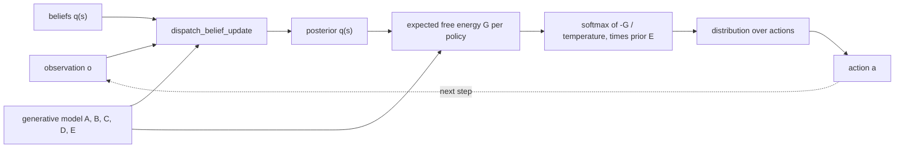
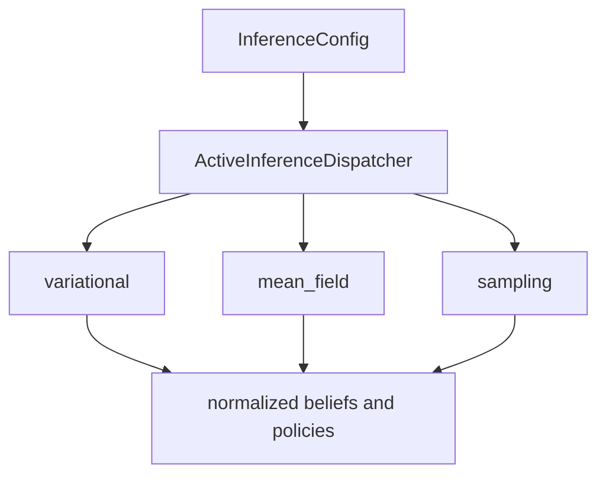
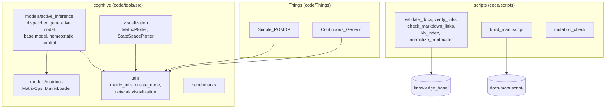
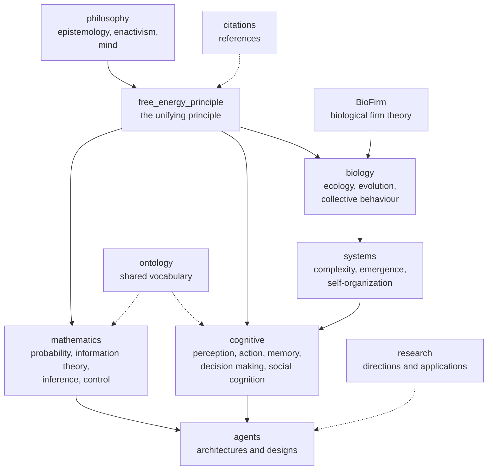
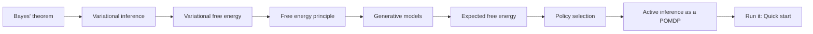
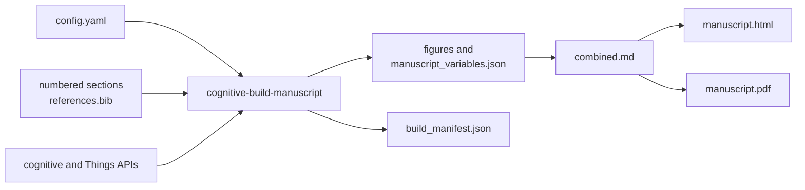
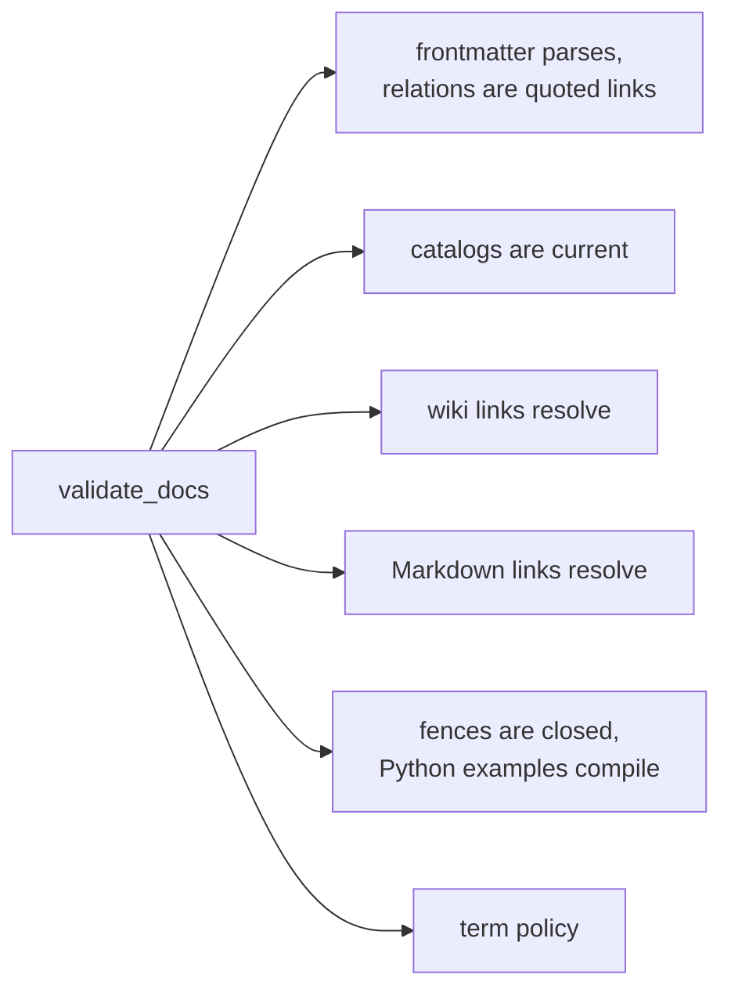
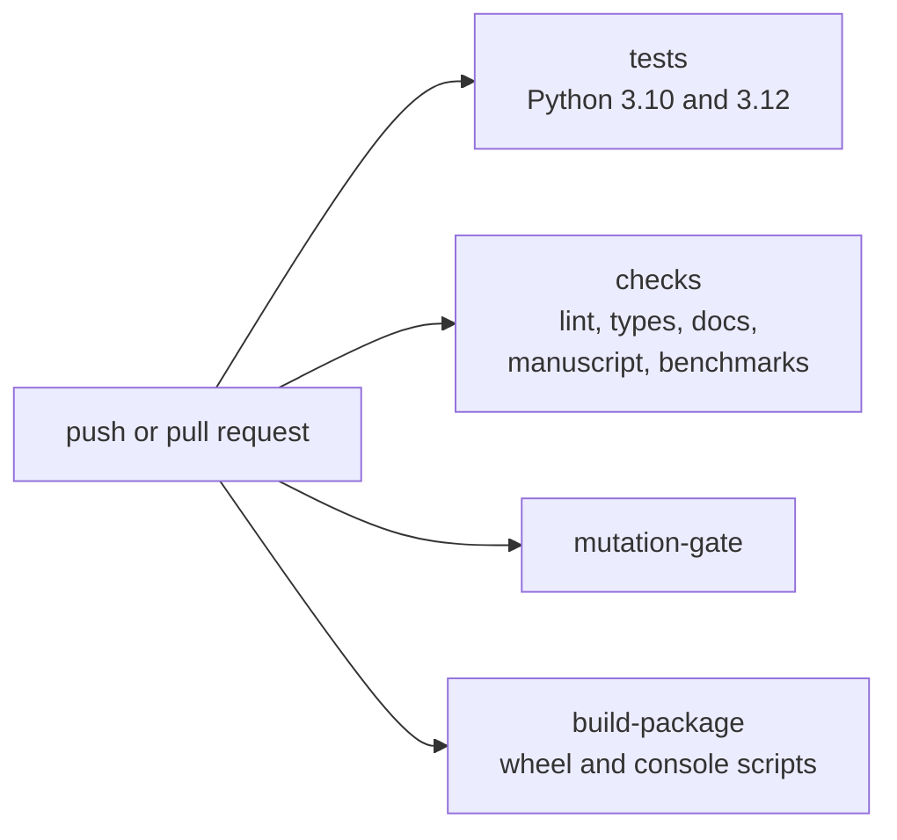

# Cognitive Active Inference

[](https://github.com/ActiveInferenceInstitute/cognitive/actions/workflows/quality.yml)

A tested Python package for **Active Inference** agents, and an Obsidian vault of
more than 1,000 linked pages that explain the mathematics, biology, cognitive
science and philosophy behind it. The package is the executable reference; the
vault is the explanation. Each side points at the other.

| I want to | Go to |
|---|---|
| Run an agent in five minutes | [Quick start](#quick-start) |
| Understand how an agent decides | [How one step works](#how-one-step-works) |
| Learn the theory in order | [Reading path](#reading-path-through-the-theory) |
| Find a concept page | [`knowledge_base/catalog.md`](knowledge_base/catalog.md) |
| See what code exists | [Package map](#package-map) and [Agents](#agents) |
| Reproduce the paper | [Manuscript](#manuscript) |
| Contribute | [Contributing](#contributing) |

## Quick start

Python 3.10 or newer:

```bash
python -m pip install -e ".[dev]"
```

Build a two-state model, infer beliefs after an observation, and infer a
distribution over actions:

```python
import numpy as np

from cognitive import ActiveInferenceDispatcher, DiscreteGenerativeModel, InferenceConfig, ModelState

model = DiscreteGenerativeModel(
    A=np.array([[0.9, 0.1], [0.1, 0.9]]),                      # P(o | s)
    B=np.stack([np.eye(2), np.array([[0.1, 0.9], [0.9, 0.1]])], axis=2),  # P(s' | s, a)
    C=np.array([0.0, 1.0]),                                    # log-preference over o
    D=np.array([0.5, 0.5]),                                    # prior over s
    E=np.array([0.5, 0.5]),                                    # prior over a
)
dispatcher = ActiveInferenceDispatcher(
    InferenceConfig(
        method="variational",
        policy_type="discrete",
        temporal_horizon=2,
        learning_rate=0.5,
        precision_init=1.0,
        seed=7,
    ),
    model,
)
state = ModelState(model.D.copy(), model.E.copy(), 1.0, 0.0, 0.0)
beliefs = dispatcher.dispatch_belief_update(1, state)   # q(s) after observing o = 1
policies = dispatcher.dispatch_policy_inference(state)  # distribution over actions
assert np.isclose(beliefs.sum(), 1.0)
assert np.isclose(policies.sum(), 1.0)
```

The editable install also provides these commands:

| Command | Purpose |
|---|---|
| `cognitive-benchmark` | Time the runtime components |
| `cognitive-build-manuscript` | Build the executable [manuscript](#manuscript) |
| `cognitive-validate-docs` | Run the documentation gate |
| `cognitive-verify-links` | Check `[[wiki links]]` |
| `cognitive-kb-index` | Check or regenerate the knowledge-base catalogs |
| `cognitive-normalize-frontmatter` | Check or fix `semantic_relations` frontmatter |
| `cognitive-create-node` | Create a knowledge-base page from a template |

## How one step works

An agent holds beliefs `q(s)` about hidden states. Each step it updates them from
what it observed, scores every candidate policy by expected free energy `G`, and
turns those scores into a distribution over actions.



The generative model is five arrays, validated on construction:

| Array | Meaning | Theory page |
|---|---|---|
| `A[o, s]` | likelihood `P(o \| s)` | [generative models](knowledge_base/mathematics/generative_models.md) |
| `B[s', s, a]` | transitions `P(s' \| s, a)` | [POMDP structure](knowledge_base/mathematics/pomdp_structure.md) |
| `C[o]` | log-preferences over observations | [expected free energy](knowledge_base/mathematics/expected_free_energy.md) |
| `D[s]` | prior over initial states | [belief updating](knowledge_base/mathematics/belief_updating.md) |
| `E[a]` | prior over actions | [policy selection](knowledge_base/mathematics/policy_selection.md) |

The dispatcher offers three inference methods and discrete policy sequences with
explicit horizons, temperatures and seeds. All of its methods return finite,
normalized distributions.



Method background: [variational inference](knowledge_base/mathematics/variational_inference.md),
[variational free energy](knowledge_base/mathematics/variational_free_energy.md),
[message passing](knowledge_base/mathematics/message_passing.md),
[precision](knowledge_base/mathematics/precision_parameter.md).

### Expected free energy

`expected_free_energy` returns the canonical objective and its parts:

```text
G = D_KL(q(o) || p*(o))  +  E_q(s)[H(P(o | s))]
    \_____ risk _____/     \____ ambiguity ____/
```

Ambiguity equals `H[q(o)] - I(s; o)`, so the expected information gain is already
inside it. The package returns the gain as a fourth value for inspection and does
not subtract it from the total a second time. `InferenceConfig.exploration_weight`
adds an explicit information-seeking bias; it defaults to `0.0`, and `1.0`
reproduces the objective used before 1.1.0 (see [`CHANGELOG.md`](CHANGELOG.md)).
Derivation and intuition:
[expected free energy](knowledge_base/mathematics/expected_free_energy.md),
[in the free energy principle](knowledge_base/free_energy_principle/mathematics/expected_free_energy.md),
[information gain](knowledge_base/mathematics/information_gain.md),
[KL divergence](knowledge_base/mathematics/kl_divergence.md).

## Package map



| Component | Read |
|---|---|
| `cognitive` package | [`code/tools/src/README.md`](code/tools/src/README.md), [`docs/api/README.md`](docs/api/README.md) |
| Dispatcher and models | [`code/tools/src/models/active_inference/README.md`](code/tools/src/models/active_inference/README.md) |
| Tests | [`code/tests/README.md`](code/tests/README.md), [`docs/tools/mutation_testing.md`](docs/tools/mutation_testing.md) |
| Configuration | [`config.yaml`](config.yaml), [`docs/config/README.md`](docs/config/README.md) |
| Every folder | [`project_structure.md`](project_structure.md) |

## Agents

[`code/Things/`](code/Things/README.md) is installed as the `Things` package. Two
of its folders contain code; the others are design notes with no importable
Python.

| Agent | Kind | What it is |
|---|---|---|
| [`Simple_POMDP`](code/Things/Simple_POMDP/README.md) | code | Discrete POMDP agent configured from a YAML path or dict; seeded, validated, with persistence, histories and expected-free-energy components |
| [`Continuous_Generic`](code/Things/Continuous_Generic/README.md) | code | Precision-weighted generalized-coordinate updates; multi-frame GIF animation through `ContinuousVisualizer` |
| [`Generic_POMDP`](code/Things/Generic_POMDP/README.md) | design notes | Matrix-configured discrete agent design |
| [`Generic_Thing`](code/Things/Generic_Thing/README.md) | design notes | The abstract definition of an agent |
| [`Ant_Colony`](code/Things/Ant_Colony/README.md) | design notes | Stigmergic foraging concept |
| [`BioFirm`](code/Things/BioFirm/README.md), [`KG_Multi_Agent`](code/Things/KG_Multi_Agent/README.md), [`Path_Network`](code/Things/Path_Network/README.md) | design notes | A firm as an agent; agents on a knowledge graph; agents on a dynamic network |

Theory behind them:
[POMDP framework](knowledge_base/mathematics/pomdp_framework.md),
[generalized coordinates](knowledge_base/mathematics/generalized_coordinates.md),
[continuous-time models](knowledge_base/mathematics/continuous_time_models.md),
[Markov blankets](knowledge_base/mathematics/markov_blanket.md),
[swarm intelligence](knowledge_base/cognitive/swarm_intelligence.md),
[ant colony organization](knowledge_base/biology/ant_colony_organization.md).

## The knowledge base

Start at [`knowledge_base/catalog.md`](knowledge_base/catalog.md). It lists every
domain, and each domain's `catalog.md` lists every page with its opening line.
The catalogs are generated by `kb_index.py`; do not edit them. The
[glossary](knowledge_base/glossary.md) defines the vocabulary, and
[linking standards](knowledge_base/linking_standards.md) say how pages connect.



| Domain | Scope | Enter at |
|---|---|---|
| `free_energy_principle` | The principle, its mathematics, applications across biology, cognition and systems | [README](knowledge_base/free_energy_principle/README.md), [catalog](knowledge_base/free_energy_principle/catalog.md) |
| `mathematics` | Probability, information theory, variational inference, POMDPs, control | [README](knowledge_base/mathematics/README.md), [catalog](knowledge_base/mathematics/catalog.md) |
| `cognitive` | Perception, attention, memory, decision making, social and collective cognition | [README](knowledge_base/cognitive/README.md), [catalog](knowledge_base/cognitive/catalog.md) |
| `biology` | Ecology, evolution, colony organization, communication | [README](knowledge_base/biology/README.md), [catalog](knowledge_base/biology/catalog.md) |
| `systems` | Complexity, emergence, self-organization, networks | [README](knowledge_base/systems/README.md), [catalog](knowledge_base/systems/catalog.md) |
| `philosophy` | Epistemology, enactivism, philosophy of mind and science | [README](knowledge_base/philosophy/README.md), [catalog](knowledge_base/philosophy/catalog.md) |
| `agents` | Agent architectures and the POMDP framework | [README](knowledge_base/agents/README.md), [catalog](knowledge_base/agents/catalog.md) |
| `ontology` | Cross-domain vocabulary | [README](knowledge_base/ontology/README.md), [catalog](knowledge_base/ontology/catalog.md) |
| `research` | Research directions and implementation notes | [README](knowledge_base/research/README.md), [catalog](knowledge_base/research/catalog.md) |
| `citations` | Reference lists and sources | [README](knowledge_base/citations/README.md), [catalog](knowledge_base/citations/catalog.md) |
| `BioFirm` | Biological firm theory in Active Inference terms | [README](knowledge_base/BioFirm/README.md), [catalog](knowledge_base/BioFirm/catalog.md) |

The vault explains concepts; **executable behavior is defined by the package and
its tests**. Pages may use pseudocode to illustrate an idea, and that code is not
package API.

### Reading path through the theory



1. [Bayes' theorem](knowledge_base/mathematics/bayes_theorem.md)
2. [Variational inference](knowledge_base/mathematics/variational_inference.md)
3. [Variational free energy](knowledge_base/mathematics/variational_free_energy.md)
4. [Free energy principle](knowledge_base/mathematics/free_energy_principle.md)
5. [Generative models](knowledge_base/mathematics/generative_models.md)
6. [Expected free energy](knowledge_base/mathematics/expected_free_energy.md)
7. [Policy selection](knowledge_base/mathematics/policy_selection.md)
8. [Active inference as a POMDP](knowledge_base/mathematics/active_inference_pomdp.md)

Longer routes by background: [learning roadmap](knowledge_base/learning_roadmap.md),
[guides and learning paths](docs/guides/README.md). From the cognitive side:
[active inference](knowledge_base/cognitive/active_inference.md),
[predictive coding](knowledge_base/cognitive/predictive_coding.md),
[the Bayesian brain](knowledge_base/cognitive/bayesian_brain.md),
[hierarchical models](knowledge_base/cognitive/hierarchical_models.md).

## Documentation

[`docs/README.md`](docs/README.md) is the spine. It covers the implemented package
and the process around it.

| Folder | Contents |
|---|---|
| [`docs/api/`](docs/api/README.md) | Exports, signatures, executed examples, version policy |
| [`docs/guides/`](docs/guides/README.md) | Application notes and learning paths |
| [`docs/examples/`](docs/examples/README.md) | Example entry points |
| [`docs/tools/`](docs/tools/README.md) | One page per shipped tool or gate |
| [`docs/development/`](docs/development/contribution_guide.md) | Development loop and contribution rules |
| [`docs/repo_docs/`](docs/repo_docs/getting_started.md) | Setup, documentation standards, linking, naming, testing |
| [`docs/implementation/rxinfer/`](docs/implementation/rxinfer/README.md) | Notes on RxInfer.jl, an external project |
| [`docs/policy/`](docs/policy/README.md) | The term policy the documentation gate enforces |

## Manuscript

[`docs/manuscript/`](docs/manuscript/README.md) is a complete executable paper.
Every number and figure is generated from the package, so the text cannot drift
from the code.



```bash
cognitive-build-manuscript --output build/manuscript              # HTML and PDF
cognitive-build-manuscript --no-render --output build/manuscript  # no Pandoc or XeLaTeX needed
```

## Quality gates

```bash
python -m pytest -q --cov                           # tests; branch coverage against the floor
ruff check . && ruff format --check code            # lint and format
mypy code/tools/src code/Things code/scripts        # types
python code/scripts/validate_docs.py --json         # documentation gate
python -m scripts.mutation_check                    # would the tests notice a wrong line?
```

`--cov` measures every module in the configured source tree, so the number is the
package's, not a chosen subset's ([why](docs/tools/coverage_tools.md)). The
documentation gate runs the whole checklist in one pass:



CI ([`quality.yml`](.github/workflows/quality.yml), described in
[`docs/tools/ci_tools.md`](docs/tools/ci_tools.md)) runs four jobs in parallel.



Tests write artifacts only to temporary directories, and generated output is
excluded from version control. The term policy is in
[`docs/policy/documentation_terms.yaml`](docs/policy/documentation_terms.yaml).

## Contributing

- Read [`AGENTS.md`](AGENTS.md) and [`docs/development/contribution_guide.md`](docs/development/contribution_guide.md).
- New pages follow [`knowledge_base/linking_standards.md`](knowledge_base/linking_standards.md):
  YAML frontmatter with quoted `semantic_relations` links, and `[[wiki links]]` only
  to pages that exist.
- After adding or renaming a page, run `python code/scripts/kb_index.py --write`
  and then the documentation gate.
- Release notes are in [`CHANGELOG.md`](CHANGELOG.md); open work is tracked in the
  backlog file at the repository root.

## License

Code is MIT ([`LICENSE`](LICENSE)). Documentation and the knowledge base are
CC BY-NC-SA 4.0.
