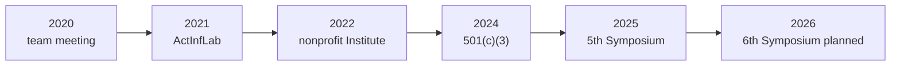
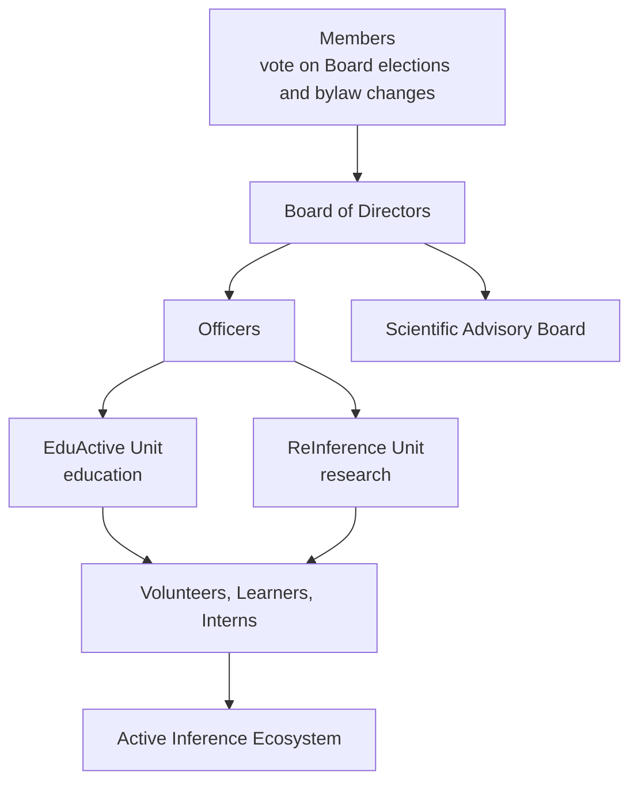

# Active Inference Institute

The Active Inference Institute is a volunteer-led 501(c)(3) nonprofit, incorporated in
Delaware, USA, dedicated to improving the accessibility, rigor and applicability of
Active Inference. People of any background, time zone and familiarity level are welcome.
Its motto is **Act. Infer. Serve.**

This page summarises the Institute's public website,
[activeinference.institute](https://activeinference.institute/), as it stood in October
2026 (website repository
[institute_website](https://github.com/ActiveInferenceInstitute/institute_website),
content through August 2026). The website is the authority: names, dates, programs and
schedules change, so follow the links before relying on a detail. This repository is one
of the Institute's public code repositories.

## Vision, mission and strategy

- **Vision.** A world where Active Inference, a framework of adaptive behavior grounded
  in first principles, is known, taught and applied across science, engineering and
  everyday life.
- **Mission.** To translate the science of how natural systems adapt and self-organize
  into practical tools, resources and educational experiences that empower people,
  communities and technology to improve decision making and reduce uncertainty.
- **Strategy.** Four areas, each pursued at three scales (the participant, the Institute
  and the wider ecosystem): Education, Research, Outreach and Engagement, and Methods.
  See the [strategy page](https://activeinference.institute/strategy/).

## History

| Year | Milestone |
|---|---|
| 2020 | A co-founder team meeting around a shared interest in Active Inference produced the publication "Active Inference & Behavior Engineering for Teams" (September 2020). The group's first livestream aired on 28 July 2020. |
| 2021 | The Active Inference Lab (ActInfLab) began operations. Dozens of people took part in educational production, open-source publishing, collaborative arts, learning groups, the Active Inference Journal and the early Active Inference Ontology. Quarterly Roundtable livestreams began and continue. |
| 2022 | A cohort-based Scientific Advisory Board was established. The first Active Inference textbook appeared (Parr, Pezzulo and Friston, 2022) and the Institute began hosting a Textbook Group. The Internship program began. In mid-2022 ActInfLab became the Active Inference Institute, a Delaware nonprofit. The Board of Directors held its first meeting at the end of the year and meets quarterly. |
| 2023 | The first two full courses ran, in physics and in social science. Livestream production continued, the Active Inference Insights podcast was hosted, and the Institute began applying for grants. |
| 2024 | Recognition as a 501(c)(3) nonprofit, with pro bono legal support. The Fellows program began, as did the Mentorship program. A "Prepare and Measure" system for projects was introduced. The 4th Applied Active Inference Symposium was held on 13 November 2024. |
| 2025 | The 5th Applied Active Inference Symposium (12 to 14 November), the Theoretical Neurobiology Group joining the Institute, a partnership around the RxInfer.jl Learning Group, completion of the project measurement system, and AICACP as the Institute's first funded grant. |
| 2026 | Institute Structure clarified with a new Board and Scientific Advisory Board; Quarterly Roundtables on 27 March and 26 June; a call for presenters for the 6th Applied Active Inference Symposium, online on 12 to 14 November 2026. |

Fuller accounts: [History](https://activeinference.institute/history/), the
[2025](https://activeinference.institute/years/2025/) and
[2026](https://activeinference.institute/years/2026/) annual overviews.

## Structure and governance

- **Members.** As a Delaware nonprofit corporation, the Institute has formal Members who
  hold the voting rights the bylaws reserve to them, including approving Board elections
  and bylaw amendments.
- **Board of Directors.** The primary governing body: strategic direction, fiduciary
  oversight and accountability. It is made up of ten directors of equal standing and meets
  regularly; core governing documents such as the bylaws are public.
- **Officers.** Day-to-day operations. The current officers are Daniel Friedman (President
  and Treasurer) and Alexandra Mikhailova (Vice-President and Secretary).
- **Scientific Advisory Board.** Experts in Active Inference, computational neuroscience,
  cognitive science and related fields who advise on research directions, educational
  content, project selection and scientific quality.
- **Organizational units.** The EduActive Unit supports learning groups, courses, textbook
  cohorts, seasonal schools and audio-visual production. The ReInference Unit supports
  research projects, the Active Inference Journal, the Active Inference Ontology,
  knowledge engineering and the Applied Active Inference Symposium. Facilitators lead
  both.
- **Participants.** Volunteers, Learners and Interns carry out the day-to-day work and
  connect outward to the wider Ecosystem.

Names and roles are listed on the [structure page](https://activeinference.institute/structure/).

## Programs

The Institute's programs are structured pathways into participation.

| Program | What it offers |
|---|---|
| [Volunteer](https://activeinference.institute/get-involved/) | The broadest on-ramp: learning groups, project support, operations, writing, analysis, media. No prior expertise required. |
| [Internship](https://activeinference.institute/programs/internship/) | Defined deliverables on projects or functions, with skills built through practice. |
| [Mentorship](https://activeinference.institute/programs/mentorship/) | Experienced participants guide people earlier in their engagement. |
| [Fellowship](https://activeinference.institute/programs/fellowship/) | Sustained commitments with regular progress reports and public outputs. |
| [Partnership](https://activeinference.institute/programs/partnership/) | Organizations and collaborators aligned around concrete shared work. |
| [Philanthropy](https://activeinference.institute/programs/philanthropy/) | Tax-deductible donations that fund public education, research infrastructure and events. |
| Grants | Institute support for grant preparation, affiliation and collaborative proposals. |
| Open source | Publishing reusable work and maintaining shared technical resources. |

All programs are listed on the [programs page](https://activeinference.institute/programs/).

## Activities

Recurring and public activities include textbook groups, sessions on RxInfer.jl,
Fundamentals of Active Inference, seasonal schools, model streams, guest streams, project
meetings, the Quarterly Roundtables and the annual Applied Active Inference Symposium. The
public archive holds livestreams, podcasts and symposium material. The
[activities page](https://activeinference.institute/activities/) and the
[calendar](https://activeinference.institute/calendar/) are the most reliable view of
what is on.

## Open source and licensing

The Institute hosts public repositories in the
[ActiveInferenceInstitute](https://github.com/ActiveInferenceInstitute) GitHub
organization, including this repository, the Active Inference Ontology, ActiveInferAnts,
Biofirm, Active Blockference, GeneralizedNotationNotation and materials for the
Parr et al. 2022 textbook group. The Institute's default license for public materials is
Creative Commons Attribution-NonCommercial-ShareAlike 4.0 (CC BY-NC-SA 4.0), and
individual repositories may use other terms. This repository releases its code under the
MIT license and its documentation under CC BY-NC-SA 4.0; see
[`LICENSE`](../../../LICENSE) and the [open-source page](https://activeinference.institute/open-source/).

## Getting involved

Discord is the main public chat surface; the Institute also publishes on YouTube and
other channels. Start from the [Get involved](https://activeinference.institute/get-involved/)
page, attend a learning group or project meeting, or write to the public contact address,
blanket@activeinference.institute.

## Related in this repository

- [[knowledge_base/cognitive/active_inference|Active inference]]
- [[docs/guides/learning_paths/README|Learning paths]]
- [[knowledge_base/learning_roadmap|Learning roadmap]]
- Free Energy Principle overview:
  [Wikipedia](https://en.wikipedia.org/wiki/Free_energy_principle)
