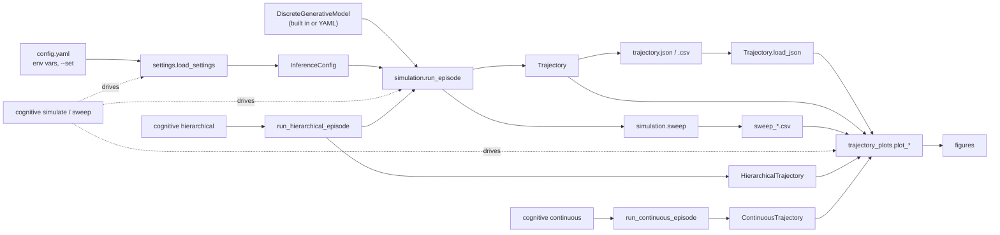

# Architecture

The inference engine (`ActiveInferenceDispatcher`, `DiscreteGenerativeModel`)
computes beliefs and expected free energy for one step. Modules around it
turn that into a runnable, reproducible experiment:

| Module | Path | Responsibility |
|---|---|---|
| `cognitive.settings` | `code/tools/src/settings.py` | Layered, validated settings; builds an `InferenceConfig`. |
| `cognitive.simulation` | `code/tools/src/simulation.py` | The perception-action loop, the `Trajectory` it records, sweeps, and two example models. |
| `cognitive.episodes` | `code/tools/src/episodes.py` | Continuous episodes and two-level discrete control; see [episode API](episodes.md). |
| `cognitive.visualization.trajectory_plots` | `code/tools/src/visualization/trajectory_plots.py` | Figures from recorded data. |
| `cognitive.cli` | `code/tools/src/cli.py` | The `cognitive` command (also `python -m cognitive`). |

The knowledge-base report, `scripts/kb_report.py`, is separate: it works on the
Markdown vault through the RDF export, not on a simulation.

## Data flow

Each arrow carries plain data (a settings object, a config, a trajectory, a list
of rows). The continuous runner explicitly advances the passed agent. The
plots accept any `Trajectory`, and a script can build an `InferenceConfig`
without the command line.

## One step of an episode

`run_episode` repeats, for each step:

1. the dispatcher turns the current beliefs into a distribution over actions by
   expected free energy;
2. an action is sampled from it;
3. the world transitions with the process matrices `process.B` and emits an
   observation from `process.A`;
4. the agent predicts its next states with its own `model.B` and updates its
   beliefs on the observation.

The world defaults to the agent's own model. Passing a different `process`
studies an agent whose model is wrong (see
[`examples/04_model_mismatch.py`](../../examples/README.md)).

## Reproducibility

- The world and the agent draw from separate random streams spawned from one
  seed. Changing how the agent samples never changes the world's noise, and an
  episode is exactly reproducible from `(model, config, steps, seed)`.
- A sweep runs seeds `simulation.seed`, `simulation.seed + 1`, ... at each value
  and reports the mean and spread.
- A `Trajectory` saves with a `schema_version`, its configuration and its
  labels. `from_dict` and `load_json` validate a saved record before plotting it.
- The examples ignore the environment (`load_settings(environ={})`) so that they
  give the same result on every machine.

## Settings design

Settings are layered (defaults, file, environment, overrides) and validated when
built, so a mistake fails before a run starts. Unknown keys are errors. Only the
`active_inference`, `simulation` and `output` sections of `config.yaml` are read
by `cognitive.settings`; other sections belong to other loaders. The full
rules are in the [settings reference](../config/settings.md).

## Where to extend

| To add | Change | Also update |
|---|---|---|
| A swept parameter | `SWEEPABLE` in `simulation.py` | the `--parameter` list in the [CLI reference](../cli/reference.md) |
| A setting | the dataclass in `settings.py` | [`settings.md`](../config/settings.md) and `config.yaml` |
| A figure | a `plot_*` function in `trajectory_plots.py` | the [gallery](../visualization/gallery.md) |
| A subcommand | `build_parser` and `main` in `cli.py` | the CLI reference and the CI help loop |

`uv run python -m scripts.regenerate_gallery --publish` regenerates all gallery
figures, data, captions and hash receipts from one set of parameters.

`code/tests/test_docs_sync.py` fails when a setting, a subcommand option, a public
plot or an example script is missing from its page.
