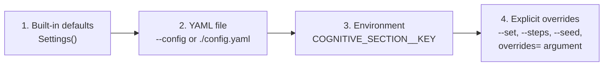

# Settings reference

`cognitive.settings` turns the `active_inference`, `simulation` and `output`
sections of [`config.yaml`](../../config.yaml) into a validated `Settings`
object. The `cognitive` command and the scripts in [`examples/`](../../examples/README.md)
use it, and you can use it directly to build an `InferenceConfig` without
repeating numbers in code.

```python
from cognitive.settings import load_settings

settings = load_settings("examples/configs/settings.yaml")
config = settings.inference_config()          # an InferenceConfig, already validated
steps, seed = settings.simulation.steps, settings.simulation.seed
```

Print what a command would use, after every layer is applied:

```bash
cognitive settings
cognitive settings --json
```

## Layers

Each key takes the value from the highest layer that sets it.



| Layer | Source | Notes |
|---|---|---|
| 1 | Built-in defaults | The dataclass defaults in the tables below. |
| 2 | YAML file | `load_settings(path)` or `--config path`. With no path, `config.yaml` in the working directory is used if it exists; a path that is given must exist. |
| 3 | Environment | `COGNITIVE_<SECTION>__<KEY>`, upper or lower case, two underscores between section and key. |
| 4 | Overrides | `--set section.key=value` (repeatable), `--steps`, `--seed`, or `load_settings(overrides={"simulation.steps": 50})`. |

`--steps` and `--seed` are shorthands for `--set simulation.steps=...` and
`--set simulation.seed=...`; when both are given, the shorthand wins.

### Worked example

[`examples/configs/settings.yaml`](../../examples/configs/settings.yaml) sets
`active_inference.temporal_horizon: 2`, `active_inference.learning_rate: 0.6`,
`simulation.steps: 40`, `simulation.seed: 7`, `output.figure_format: png` and
`output.dpi: 120`. Layer an environment variable and an override on top:

```bash
COGNITIVE_ACTIVE_INFERENCE__LEARNING_RATE=0.8 COGNITIVE_SIMULATION__STEPS=60 \
  cognitive settings --config examples/configs/settings.yaml --set simulation.steps=100
```

| Key | Default | File | Environment | Override | Result | Decided by |
|---|---|---|---|---|---|---|
| `active_inference.temporal_horizon` | `3` | `2` | | | `2` | file |
| `active_inference.learning_rate` | `0.5` | `0.6` | `0.8` | | `0.8` | environment |
| `simulation.steps` | `20` | `40` | `60` | `100` | `100` | override |
| `simulation.seed` | `0` | `7` | | | `7` | file |
| `output.dpi` | `150` | `120` | | | `120` | file |
| `simulation.temperature` | `1.0` | | | | `1.0` | default |

## Environment variables

The name is the prefix `COGNITIVE_`, the section, two underscores, and the key:

| Setting | Variable |
|---|---|
| `active_inference.learning_rate` | `COGNITIVE_ACTIVE_INFERENCE__LEARNING_RATE` |
| `simulation.steps` | `COGNITIVE_SIMULATION__STEPS` |
| `output.figure_format` | `COGNITIVE_OUTPUT__FIGURE_FORMAT` |

Values are strings in the environment and are converted to the type of the key.
A variable whose section is not one of the three, or whose name has no double
underscore, is ignored, so unrelated `COGNITIVE_*` variables do no harm. A
variable that names an unknown key of an owned section is an error. Pass
`environ={}` to `load_settings` to ignore the real environment (the examples
do, so that they behave the same on every machine).

## `active_inference`

Starting values for the inference engine. Each key sets one field of
`InferenceConfig` (`cognitive.models.active_inference.dispatcher`).

| Key | Type | Default | Meaning | Sets `InferenceConfig` field |
|---|---|---|---|---|
| `active_inference.default_precision` | float | `1.0` | Initial precision; with `learning_rate` it sets the step size of each variational belief update. Finite and positive. | `precision_init` |
| `active_inference.temporal_horizon` | int | `3` | Number of future steps a policy spans. At least 1. | `temporal_horizon` |
| `active_inference.learning_rate` | float | `0.5` | Weight of the new posterior in each belief update, in (0, 1]. | `learning_rate` |
| `active_inference.exploration_factor` | float | `0.0` | Extra weight on expected information gain, in [0, 1]. `0.0` is the canonical objective. | `exploration_weight` |
| `active_inference.discount_factor` | float | `0.95` | Discount applied to later steps of a policy, in (0, 1]. | `discount_factor` |

## `simulation`

How an episode runs. These keys also set `InferenceConfig` fields, plus the
episode length and seed.

| Key | Type | Default | Meaning | Sets |
|---|---|---|---|---|
| `simulation.method` | str | `variational` | Inference method: `variational`, `sampling` or `mean_field`. | `InferenceConfig.method` |
| `simulation.policy_aggregation` | str | `marginal` | How policies sharing a first action are combined: `marginal` (Bayesian model average) or `min` (best continuation). | `InferenceConfig.policy_aggregation` |
| `simulation.temperature` | float | `1.0` | Planning temperature; lower values make action choice greedier. Finite and positive. | `InferenceConfig.temperature` |
| `simulation.policy_limit` | int | `4096` | Maximum number of policies enumerated. At least 1; enumeration raises if the limit leaves an action without a policy. | `InferenceConfig.policy_limit` |
| `simulation.num_samples` | int | `256` | Posterior samples averaged by the `sampling` method. At least 2. | `InferenceConfig.num_samples` |
| `simulation.steps` | int | `20` | Perception-action cycles in one episode. At least 1. | episode length (not an `InferenceConfig` field) |
| `simulation.seed` | int | `0` | Seed of the episode; the world and the agent draw from separate streams spawned from it. | `InferenceConfig.seed` and the episode seed |

`InferenceConfig.policy_type` is always set to `discrete`; it is not a setting
because the dispatcher implements no other policy type.

## `output`

Where results go and how figures are written.

| Key | Type | Default | Meaning |
|---|---|---|---|
| `output.directory` | str | `output` | Directory the `cognitive` command writes into, unless `--output` is given. Must not be blank. The root `.gitignore` excludes `output/`. |
| `output.figure_format` | str | `png` | Figure file type: `png`, `svg` or `pdf`. |
| `output.dpi` | int | `150` | Resolution of raster figures. At least 1. |

## From settings to `InferenceConfig`

`Settings.inference_config(**overrides)` builds the engine configuration.
Keyword arguments replace individual fields after the settings are applied, so
a sweep can vary one field without rewriting the file:

```python
from cognitive.settings import load_settings

settings = load_settings(environ={})
base = settings.inference_config()
cautious = settings.inference_config(temperature=0.25, temporal_horizon=2)
print(base.temperature, cautious.temperature)
```

Other useful members: `Settings.to_dict()` (a plain nested mapping, what
`cognitive settings --json` prints), `Settings.with_overrides({"section.key":
value})` (a validated copy), and `section_keys(section)` (the keys a section
accepts).

## Strictness

Settings are checked when they are built, so a mistake fails at the start of a
run rather than half way through it.

- **Unknown keys are errors.** `simulation.stepz` raises `ValueError: Unknown
  simulation setting(s) ['stepz']; valid keys are [...]`. This applies to the
  YAML file, environment variables and overrides alike.
- **Override names must be `section.key`** with a section in `active_inference`,
  `simulation` or `output`.
- **No lossy conversion.** An integer key accepts `7`, `"7"` and `7.0` but not
  `7.5` or `true`; a float key accepts any number or numeric string but not a
  boolean; a string key accepts only strings. `simulation.seed` must be an
  integer.
- **Ranges are checked** (see the tables). `output.figure_format` must be one of
  `png`, `svg`, `pdf`; `simulation.method` and `simulation.policy_aggregation`
  must name a real option; the `InferenceConfig` range checks run during
  construction of `Settings`.
- **A section must be a mapping** in the YAML file, and the file must parse as
  YAML with a mapping at the top level.

On the command line these errors print `error: ...` to stderr and exit with
status 2. See the [CLI reference](../cli/reference.md).

## Other sections of `config.yaml`

Only `active_inference`, `simulation` and `output` are read by
`cognitive.settings`; every other top-level section is ignored by it, so they
can sit in the same file. Their status is unchanged: `paths` and
`visualization.seed` are read by the node creator and the network visualizer,
and `knowledge_base`, `templates`, `analysis`, `obsidian`, `logging` and
`development` are descriptive. See [Configuration reference](README.md).
