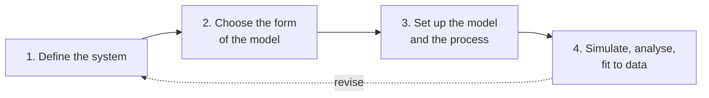

# Designing an Active Inference model: a study guide

A short guide to the design workflow in Chapter 6 of Parr, Pezzulo, and Friston
(2022), *Active Inference: The Free Energy Principle in Mind, Brain, and
Behavior* (MIT Press). It restates the chapter's four-step structure in our own
words and points to the pages in this repository that explain each step. Read the
chapter itself for the argument, the worked examples and the full set of
design choices. For the implementation in this package, see
[[docs/guides/application/guide_for_cognitive_modeling|Guide for cognitive modelling]].

## 1. Define the system

Decide what is being modelled and what the agent can and cannot observe. Separate
the **agent** (the generative model it carries) from its **world** (the process that
actually produces observations), and say what counts as an action. This is where
a [Markov blanket](../../../knowledge_base/mathematics/markov_blanket.md) is drawn: the
observations and actions are the only coupling.

## 2. Choose the form of the model

| Choice | Options | Read |
|---|---|---|
| State space | Discrete, continuous, or a mixture | [continuous and discrete inference](../../../knowledge_base/mathematics/continuous_discrete_inference.md), [continuous-time models](../../../knowledge_base/mathematics/continuous_time_models.md) |
| Depth in structure | One level, or levels running at different timescales | [hierarchical models](../../../knowledge_base/cognitive/hierarchical_models.md) |
| Depth in time | How far ahead policies look | [policy selection](../../../knowledge_base/mathematics/policy_selection.md), [expected free energy](../../../knowledge_base/mathematics/expected_free_energy.md) |

The simplest form that can express the behaviour of interest is usually the best
starting point.

## 3. Set up the model and the process

- **Variables.** Name the hidden states, observations and actions, and give each its
  dimension. In the discrete case these fix the shapes of the five arrays in
  [POMDP structure](../../../knowledge_base/mathematics/pomdp_structure.md):
  `A`, `B`, `C`, `D` and `E`.
- **Fixed or learned.** Decide which parameters are given and which the agent
  learns from experience. See [parameter learning](../../../knowledge_base/mathematics/parameter_learning.md).
- **Generative process.** Specify how the world produces observations. It may
  differ from the agent's model; that difference is often the point of the study.
- **Precision.** Choose how confident the agent is in its likelihoods and its
  policies: [precision](../../../knowledge_base/mathematics/precision_parameter.md).

## 4. Simulate, analyse, fit

Run the agent, plot beliefs and action choices, and compare behaviour with data
by fitting the free parameters. In this package, `Things.Simple_POMDP` records a
history of beliefs, actions and expected-free-energy components and can plot them;
see [`code/Things/Simple_POMDP`](../../../code/Things/Simple_POMDP/README.md).

## Related

- [Active inference as a POMDP](../../../knowledge_base/mathematics/active_inference_pomdp.md)
- [Generative models](../../../knowledge_base/mathematics/generative_models.md)
- [Belief updating](../../../knowledge_base/mathematics/belief_updating.md)
