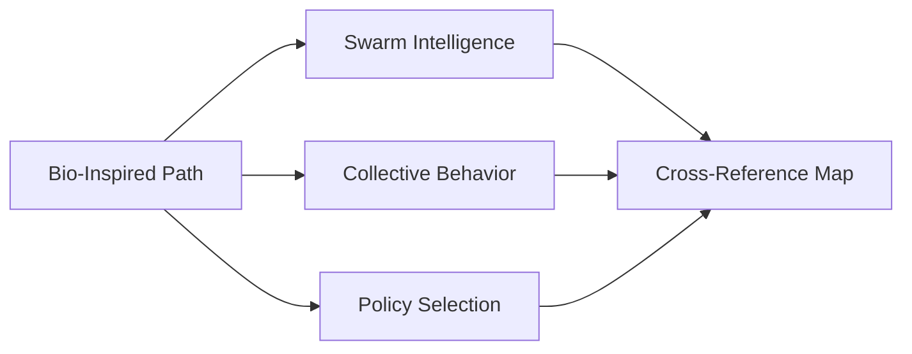

---

title: Bio-Inspired Cognitive Systems Learning Path

type: learning_path

status: stable
updated: 2026-10-10

created: 2024-03-15


complexity: advanced


difficulty_level: advanced

estimated_hours: 480

completion_time: "20 weeks"

certification_track: true

tags:

  - biological systems

  - cognitive science

  - interdisciplinary

  - bio-inspired computing

  - neural networks

  - evolutionary algorithms

  - embodied cognition

semantic_relations:
  - type: prerequisite
    links:
      - "[[active_inference_biological_learning_path]]"
      - "[[active_inference_cognitive_learning_path]]"
  - type: specializes
    links:
      - "[[active_inference_learning_path]]"
  - type: related
    links:
      - "[[active_inference_computational_learning_path]]"
      - "[[active_inference_biological_learning_path]]"
  - type: integrates_with
    links:
      - "[[active_inference_robotics_learning_path]]"
      - "[[active_inference_agi_learning_path]]"
---

# Bio-Inspired Cognitive Systems Learning Path

## Quick Start

- Read the ant colony material ([[docs/guides/ant_colony_guide|Ant colony guide]]); the folder is documentation only, so a simulation is your own code

- Build a cell-level inference sketch with the `cognitive` package; verify belief update trends

- Prototype a simple GA vs. swarm policy selection; assert convergence stability

## External Web Resources

- [[index#centralized-external-web-resources|Centralized resources hub]]

- Ant Colony Optimization background (book reference at MIT Press); myrmecology journals (see hub pointers)

## Quick Reference

- **Difficulty**: Advanced

- **Time Commitment**: 20-25 hours/week for 20 weeks

- **Prerequisites Score**: 8/10 (biology, computer science, and mathematics background)

- **Industry Relevance**: High (Research, Robotics, AI Systems)

- **Hands-on Component**: 55%

- **Theory Component**: 45%

## Executive Summary

### Purpose and Scope

This learning path explores the intersection of biological systems and cognitive architectures, focusing on bio-inspired approaches to cognitive system design. It integrates principles from neuroscience, evolutionary biology, and cognitive science to develop more natural and adaptive computational systems using Active Inference principles.

### Target Audience

- **Primary**: Researchers in bio-inspired computing and cognitive systems

- **Secondary**: Engineers developing adaptive AI systems

- **Career Stage**: Advanced practitioners and researchers (3+ years experience)

### Learning Outcomes

By completing this path, learners will be able to:

1. Design bio-inspired cognitive architectures using Active Inference principles

1. Implement natural computation algorithms based on biological mechanisms

1. Develop adaptive systems that learn and evolve like biological organisms

1. Apply bio-inspired solutions to real-world engineering challenges

### Industry Applications

- Research: Bio-inspired computing, cognitive systems research

- Robotics: Adaptive robotic systems, swarm robotics

- AI Systems: Natural language processing, computer vision

- Biotechnology: Computational biology, synthetic biology

### Repository labs

Runnable material in this repository is the `cognitive` package, `Things.Simple_POMDP`, and `Things.Continuous_Generic`. The `Generic_POMDP`, `BioFirm`, `Ant_Colony`, and `Generic_Thing` folders contain documentation only, so there are no scripts to launch for them.

- Executed starting points: [[docs/examples/index|Examples index]] and [[docs/api/api_examples|API examples]].

- Continuous-agent checks: `python -m pytest code/tests/visualization/test_continuous_generic.py -q`.

- Exercise: encode a small signalling task as a `DiscreteGenerativeModel` and compare belief updates under the `variational` and `mean_field` methods.

### Foundations

- [[knowledge_base/mathematics/expected_free_energy]] · [[knowledge_base/mathematics/policy_selection]] · [[knowledge_base/mathematics/precision_parameter]] · [[knowledge_base/mathematics/softmax_function]] · [[knowledge_base/mathematics/numerical_stability]] · [[knowledge_base/mathematics/message_passing]] · [[knowledge_base/mathematics/bethe_free_energy]]

## Knowledge Base Anchors

- Bio-inspired: [[knowledge_base/cognitive/collective_behavior]] · [[knowledge_base/cognitive/swarm_intelligence]] · [[knowledge_base/cognitive/stigmergic_coordination]]

- Math: [[knowledge_base/mathematics/policy_selection]] · [[knowledge_base/mathematics/dynamical_systems]]

- Cross-map: [[knowledge_base/mathematics/cross_reference_map]]



## Learner Assessment and Entry Guidance

### Pre-Learning Assessment

```yaml

assessment_dimensions:

  biological_knowledge:

    - neuroscience_basics: [none, basic, intermediate, advanced]

    - evolutionary_biology: [none, basic, intermediate, advanced]

    - systems_biology: [none, basic, intermediate, advanced]

    - cellular_biology: [none, basic, intermediate, advanced]

  technical_background:

    - programming_experience: [none, basic, intermediate, advanced, expert]

    - mathematics_level: [basic, intermediate, advanced, expert]

    - ai_ml_knowledge: [none, basic, intermediate, advanced, expert]

    - systems_design: [none, basic, intermediate, advanced]

  interdisciplinary_experience:

    - cross_domain_projects: [none, limited, moderate, extensive]

    - research_experience: [none, undergraduate, graduate, professional]

    - collaboration_skills: [developing, proficient, advanced, expert]

```

### Recommended Entry Points

**Foundation Track** (Prerequisites: 6/10)

- For learners with strong biology OR computer science background

- 4-week interdisciplinary bridge module

- Focus on building missing domain knowledge

- **Start Here If**: Strong in one domain, need the other

**Integration Track** (Prerequisites: 7-8/10)

- For learners with moderate background in both domains

- 2-week synthesis and methodology module

- Focus on integration principles

- **Start Here If**: Good foundation in both biology and CS

**Advanced Track** (Prerequisites: 8-9/10)

- Direct entry to core bio-inspired systems

- **Start Here If**: Strong interdisciplinary background

**Research Track** (Prerequisites: 9-10/10)

- Focus on novel research and current applications

- **Start Here If**: Extensive research experience in related fields

## Core Learning Path

### Foundation Track Bridge (4 weeks)

#### Week 3-4: Computational Foundations for Biologists

- **Computational Thinking and Algorithms**

  - Concepts: Algorithm design principles; Data structures and complexity; Machine learning fundamentals; Optimization and search

  - Practice: basic algorithms; data structure practice; ml model implementation

  - Assessments: algorithm design; implementation project

- **Systems Design and Architecture**

  - Concepts: System architecture principles; Modular design and interfaces; Distributed systems basics; Performance and scalability

  - Practice: modular system design; interface specification; performance analysis

  - Assessments: system design project; architecture review

