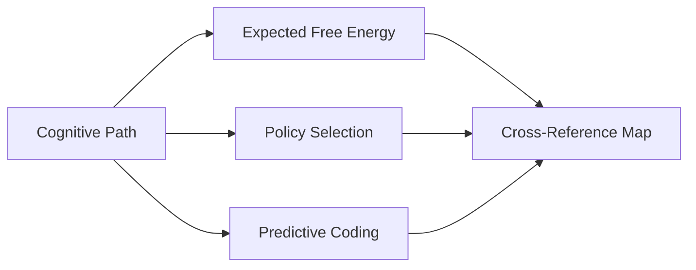
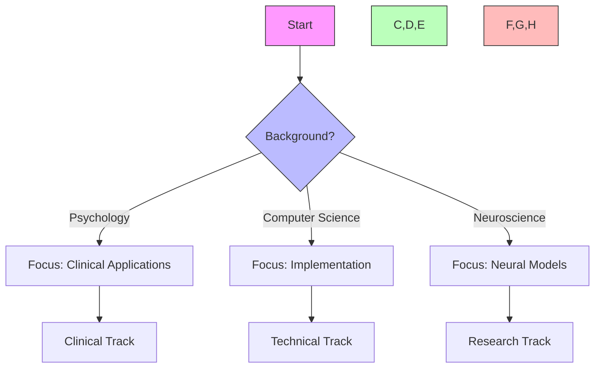
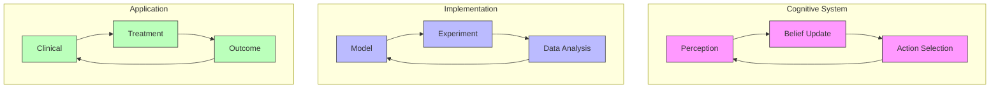
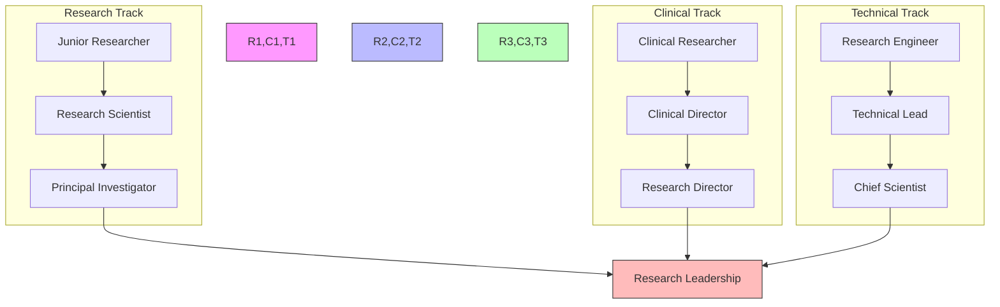

---

title: Active Inference in Cognitive Science Learning Path

type: learning_path

status: stable
updated: 2026-10-10

created: 2024-03-15


complexity: advanced


difficulty_level: advanced

estimated_hours: 400

completion_time: "18 weeks"

certification_track: true

tags:

  - active-inference

  - cognitive-science

  - psychology

  - behavior

  - computational-modeling

  - neuroscience

semantic_relations:
  - type: specializes
    links:
      - "[[active_inference_learning_path]]"
  - type: relates
    links:
      - "[[active_inference_neuroscience_learning_path]]"
---

# Active Inference in Cognitive Science Learning Path

## Quick Start

- Foundations: Friston (2010), Parr et al. (2022), and Smith et al. (2022) tutorial (see index hub)

- Implement a 2AFC task with a minimal Active Inference agent; validate expected patterns

- Add a simple social 2-agent extension and test reciprocity metrics

## External Web Resources

- [[index#centralized-external-web-resources|Centralized resources hub]]

- [Active Inference Institute resources](https://www.activeinference.org/research/resources)

- [Tutorial (Smith et al., 2022)](https://pmc.ncbi.nlm.nih.gov/articles/PMC8956124/)

## Quick Reference

- **Difficulty**: Advanced

- **Time Commitment**: 20-25 hours/week for 18 weeks

- **Prerequisites Score**: 8/10 (cognitive science and programming foundation)

- **Industry Relevance**: High (Research, Clinical, Technology)

- **Hands-on Component**: 50%

- **Theory Component**: 50%

## Executive Summary

### Purpose and Scope

This specialized learning path integrates Active Inference principles with cognitive science, providing a framework for understanding and modeling mental processes. It bridges theoretical cognitive science with computational implementation, focusing on both fundamental research and practical applications in clinical and technological domains.

### Target Audience

- **Primary**: Cognitive scientists and computational psychologists

- **Secondary**: AI researchers and clinical practitioners

- **Career Stage**: Advanced researchers and practitioners (3+ years experience)

### Learning Outcomes

By completing this path, learners will be able to:

1. Develop sophisticated cognitive models using Active Inference principles

1. Implement computational models of mental processes and behavior

1. Design and conduct cognitive experiments with Active Inference frameworks

1. Apply models to clinical and research applications

### Industry Applications

- Research: Cognitive science labs, neuroscience research

- Clinical: Computational psychiatry, behavioral therapy

- Technology: Cognitive systems, human-AI interaction

- Education: Cognitive training, educational technology

### Repository labs

Runnable material in this repository is the `cognitive` package, `Things.Simple_POMDP`, and `Things.Continuous_Generic`. The `Generic_POMDP`, `BioFirm`, `Ant_Colony`, and `Generic_Thing` folders contain documentation only, so there are no scripts to launch for them.

- Executed starting points: [[docs/examples/index|Examples index]] and [[docs/api/api_examples|API examples]].

- Continuous-agent checks: `python -m pytest code/tests/visualization/test_continuous_generic.py -q`.

- Exercise: encode a two-alternative forced-choice task as the `A`, `B`, `C`, `D`, `E` arrays of a `DiscreteGenerativeModel` and check that beliefs stay normalized across repeated stimuli.

## Knowledge Base Anchors

- Core math: [[knowledge_base/mathematics/expected_free_energy]] · [[knowledge_base/mathematics/policy_selection]] · [[knowledge_base/mathematics/precision_parameter]] · [[knowledge_base/mathematics/message_passing]]

- Cognitive core: [[knowledge_base/cognitive/predictive_coding]] · [[knowledge_base/cognitive/active_inference]] · [[knowledge_base/cognitive/attention_mechanisms]]

- Cross-map: [[knowledge_base/mathematics/cross_reference_map]]

### Foundations

- [[knowledge_base/mathematics/softmax_function]] · [[knowledge_base/mathematics/numerical_stability]] · [[knowledge_base/mathematics/bethe_free_energy]]



## Path Selection Guide



## Overview

This specialized path focuses on applying Active Inference to understand cognitive processes, behavior, and mental phenomena. It integrates psychological theory with computational modeling.

## Prerequisites

### 1. Cognitive Science Foundations (4 weeks)

- Cognitive Psychology

  - Perception

  - Attention

  - Memory

  - Decision making

- Behavioral Science

  - Learning theory

  - Motivation

  - Emotion

  - Social cognition

- Experimental Methods

  - Research design

  - Data collection

  - Statistical analysis

  - Behavioral measures

- Computational Theory

  - Information processing

  - Mental representations

  - Cognitive architectures

  - Neural computation

### 2. Technical Skills (2 weeks)

- Research Tools

  - Python/R

  - Statistical packages

  - Experimental software

  - Data visualization

## Core Learning Path

### 2. Cognitive Domains (6 weeks)

#### Week 1-2: Perceptual Processing

- Sensory Integration

- Feature Extraction

- Pattern Recognition

- Attention Allocation

#### Week 3-4: Decision Making

- Value Computation

- Risk Assessment

- Temporal Planning

- Social Decision Making

#### Week 5-6: Learning and Memory

- Skill Acquisition

- Knowledge Formation

- Memory Consolidation

- Habit Learning

### 3. Applications (4 weeks)

#### Week 3-4: Clinical Applications

- Psychiatric Disorders

- Behavioral Therapy

- Cognitive Training

- Intervention Design

### 4. Advanced Topics (4 weeks)

#### Week 3-4: Metacognition

- Self-monitoring

- Confidence Estimation

- Strategy Selection

- Learning to Learn

## Projects

### Cognitive Projects

1. **Perceptual Tasks**

   - Visual Search

   - Pattern Recognition

   - Category Learning

   - Attention Tasks

1. **Decision Tasks**

   - Value-based Choice

   - Risk Assessment

   - Social Dilemmas

   - Sequential Planning

### Clinical Projects

1. **Disorder Modeling**

   - Anxiety

   - Depression

   - OCD

   - ADHD

1. **Intervention Design**

   - Cognitive Training

   - Behavioral Therapy

   - Treatment Planning

   - Outcome Prediction

## Assessment

### Knowledge Assessment

1. **Theoretical Understanding**

   - Cognitive Processes

   - Behavioral Principles

   - Clinical Applications

   - Research Methods

1. **Practical Skills**

   - Experimental Design

   - Data Analysis

   - Model Implementation

   - Result Interpretation

### Final Projects

1. **Research Project**

   - Theory Development

   - Experimental Design

   - Data Collection

   - Analysis

1. **Clinical Application**

   - Disorder Modeling

   - Treatment Design

   - Validation Study (include unit tests + reproducible notebook or script)

   - Outcome Assessment

## Resources

### Academic Resources

1. **Research Papers**

   - Theoretical Papers

   - Empirical Studies

   - Review Articles

   - Clinical Studies

1. **Books**

   - Cognitive Science

   - Computational Modeling

   - Clinical Psychology

   - Research Methods

### Technical Resources

1. **Software Tools**

   - Experimental Software

   - Analysis Packages

   - Modeling Tools

   - Visualization Libraries

1. **Data Resources**

   - Behavioral Datasets

   - Clinical Data

   - Model Benchmarks

   - Analysis Scripts

## Next Steps

### Advanced Topics

1. Computational Psychiatry

1. Social Cognition

1. Metacognition

### Research Directions

1. [[knowledge_base/cognitive/cognitive_science|Cognitive Science Research]]

1. [[knowledge_base/cognitive/clinical_psychology|Clinical Psychology Research]]

1. [[knowledge_base/research/computational_modeling|Computational Modeling Research]]

## Integration Strategies

### Development Approaches

- Theory-Practice Integration

  - Cognitive theory implementation

  - Experimental validation

  - Clinical application

- Cross-Domain Development

  - Psychological models

  - Computational frameworks

  - Clinical tools

- Research Integration

  - Literature review

  - Model development

  - Empirical validation

### System Architecture



### Research Framework

```mermaid

mindmap

    root((Cognitive

    Research))

        Theory

            Active Inference

                Free Energy

                Belief Update

            Cognitive Science

                Mental Processes

                Behavior

        Methods

            Experimental

                Design

                Analysis

            Computational

                Modeling

                Simulation

        Applications

            Clinical

                Disorders

                Treatment

            Research

                Discovery

                Validation

```

## Assessment Framework

### Portfolio-Based Assessment

```yaml

portfolio_requirements:

  theoretical_component:

    weight: 0.35

    artifacts:

      - literature_review: "Critical analysis of 10+ papers"

      - concept_synthesis: "Integration of multiple theoretical frameworks"

      - theoretical_extension: "Novel theoretical contribution"

    evaluation_criteria:

      - depth_of_understanding

      - critical_thinking

      - theoretical_innovation

  implementation_component:

    weight: 0.35

    artifacts:

      - model_implementation: "Working cognitive model"

      - optimization_project: "Performance improvement initiative"

      - tool_development: "Reusable implementation tool"

    evaluation_criteria:

      - code_quality

      - model_accuracy

      - practical_utility

  research_component:

    weight: 0.30

    artifacts:

      - experimental_study: "Original research project"

      - validation_analysis: "Model validation study"

      - publication_draft: "Submission-ready paper"

    evaluation_criteria:

      - research_rigor

      - methodological_soundness

      - contribution_significance

```

## Career Development

### Industry Alignment

#### Research Roles

- Cognitive Scientist

  - Research design

  - Theory development

  - Publication track

- Clinical Researcher

  - Treatment modeling

  - Intervention design

  - Clinical trials

- Research Engineer

  - Model implementation

  - System development

  - Technical validation

### Professional Network

#### Research Community

- Academic Connections:

  - Research labs

  - Universities

  - Clinical centers

- Industry Partners:

  - Tech companies

  - Clinical practices

  - Research institutes

- Professional Organizations:

  - Cognitive Science Society

  - Clinical Psychology Association

  - AI Research Groups

#### Career Progression



### Competency Framework

```mermaid

mindmap

    root((Cognitive

    Science Expert))

        Research Skills

            Experimental Design

                Methods

                Analysis

            Theory Development

                Models

                Validation

        Clinical Skills

            Disorder Modeling

                Assessment

                Treatment

            Intervention Design

                Planning

                Evaluation

        Technical Skills

            Implementation

                Modeling

                Testing

            System Design

                Architecture

                Integration

```

## Final Notes

### Additional Resources

- Extended Reading

  - Advanced theory

  - Clinical papers

  - Technical guides

- Research Directions

  - Open problems

  - Future applications

  - Integration opportunities

- Community Resources

  - Research groups

  - Clinical networks

  - Technical forums
