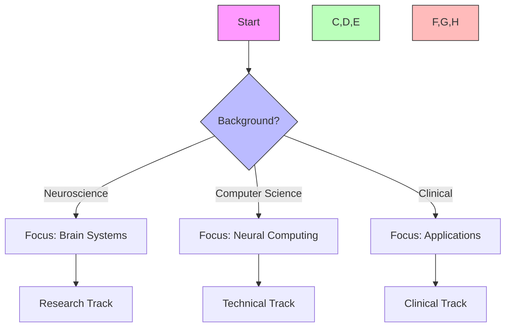
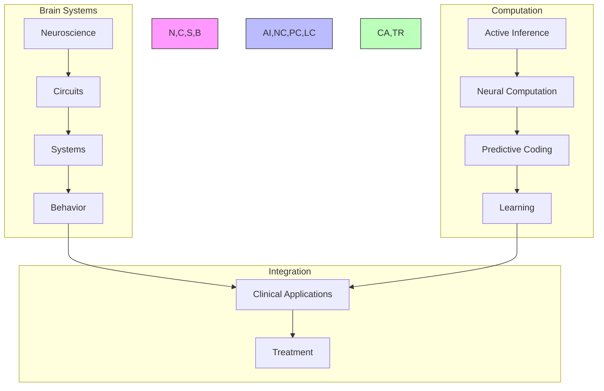
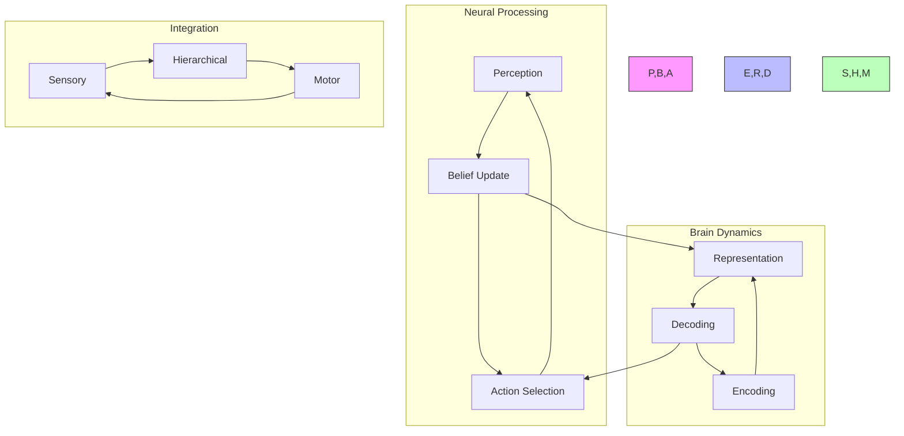
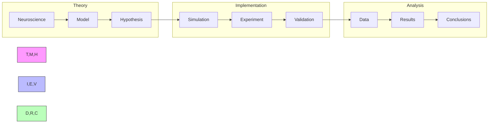
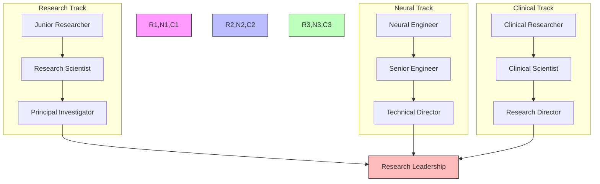
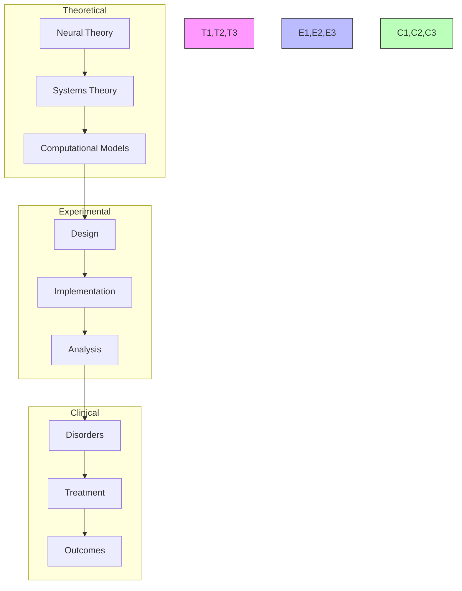
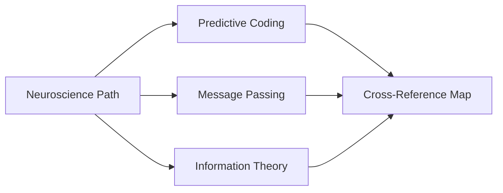

---

title: Active Inference in Neuroscience Learning Path

type: learning_path

status: stable
updated: 2026-10-10

created: 2024-03-15


complexity: advanced


difficulty_level: advanced

estimated_hours: 500

completion_time: "20 weeks"

certification_track: true

tags:

  - active-inference

  - neuroscience

  - brain-modeling

  - neural-computation

  - cognitive-neuroscience

  - neuroimaging

  - neural-dynamics

semantic_relations:
  - type: specializes
    links:
      - "[[active_inference_learning_path]]"
  - type: relates
    links: []
---

# Active Inference in Neuroscience Learning Path

## Quick Start

- Select a neural domain (perception/action/learning) and outline an inference model at circuit level

- Validate a small predictive coding example; compare to a classical baseline

- Draft an experimental mapping plan (signals, measures, expected effects)

## External Web Resources

- [[index#centralized-external-web-resources|Centralized resources hub]]

- Active Inference Institute resources and neuroimaging best practices (see hub)

### Foundations

- [[knowledge_base/mathematics/expected_free_energy]] · [[knowledge_base/mathematics/policy_selection]] · [[knowledge_base/mathematics/precision_parameter]] · [[knowledge_base/mathematics/softmax_function]] · [[knowledge_base/mathematics/numerical_stability]] · [[knowledge_base/mathematics/message_passing]] · [[knowledge_base/mathematics/bethe_free_energy]]

## Quick Reference

- **Difficulty**: Advanced

- **Time Commitment**: 25-30 hours/week for 20 weeks

- **Prerequisites Score**: 8/10 (neuroscience and computational expertise)

- **Industry Relevance**: High (Research, Healthcare, Neurotechnology)

- **Hands-on Component**: 45%

- **Theory Component**: 55%

## Executive Summary

### Purpose and Scope

This specialized learning path integrates Active Inference principles with neuroscience research, providing a framework for understanding brain function and neural computation. It bridges theoretical neuroscience with computational modeling, focusing on neural dynamics and cognitive processes.

### Target Audience

- **Primary**: Neuroscientists and computational neuroscientists

- **Secondary**: AI researchers and cognitive scientists

- **Career Stage**: Advanced researchers (3+ years experience)

### Learning Outcomes

By completing this path, learners will be able to:

1. Develop sophisticated models of neural systems using Active Inference

1. Implement brain-inspired computational architectures

1. Design and conduct neuroscience experiments with Active Inference frameworks

1. Apply models to understand brain function and dysfunction

### Industry Applications

- Research: Neuroscience labs, brain research centers

- Healthcare: Neurological disorders, brain-machine interfaces

- Technology: Neural computing, brain-inspired AI

- Clinical: Diagnostic tools, treatment planning

## Path Selection Guide



## Path Interconnections



### System Architecture



## Prerequisites

### 1. Neuroscience Foundations (4 weeks)

- Neural Systems

  - Neuroanatomy

  - Neurophysiology

  - Neural circuits

  - Brain networks

- Computational Neuroscience

  - Neural coding

  - Network dynamics

  - Information processing

  - Brain computation

- Cognitive Neuroscience

  - Perception

  - Action

  - Learning

  - Memory

- Research Methods

  - Neuroimaging

  - Electrophysiology

  - Data analysis

  - Modeling approaches

### 2. Technical Skills (2 weeks)

- Neuroscience Tools

  - Neural simulators

  - Analysis packages

  - Visualization tools

  - Statistical methods

## Core Learning Path

### 2. Neural Applications (6 weeks)

#### Week 1-2: Perception

- Sensory processing

- Predictive coding

- Feature extraction

- Multimodal integration

#### Week 3-4: Action

- Motor control

- Action selection

- Movement planning

- Behavioral adaptation

#### Week 5-6: Learning

- Synaptic plasticity

- Neural adaptation

- Memory formation

- Skill acquisition

### 3. Brain Intelligence (4 weeks)

#### Week 3-4: Neural Systems

- Network dynamics

- Information flow

- Neural coding

- System integration

### 4. Advanced Topics (4 weeks)

#### Week 3-4: Advanced Neuroscience

- Neural computation

- Brain networks

- Cognitive architectures

- Consciousness studies

## Projects

### Neuroscience Projects

1. **Neural Systems**

   - Circuit analysis

   - Network modeling

   - Information processing

   - Neural dynamics

1. **Cognitive Systems**

   - Perception studies

   - Action modeling

   - Learning mechanisms

   - Memory formation

### Advanced Projects

1. **Brain Research**

   - Neural recording

   - Data analysis

   - Model development

   - Theory testing

1. **Clinical Applications**

   - Disorder modeling

   - Treatment simulation

   - Intervention design

   - Outcome prediction

## Resources

### Academic Resources

1. **Research Papers**

   - Neural Computation

   - Active Inference

   - Brain Theory

   - Clinical Neuroscience

1. **Books**

   - Neural Systems

   - Brain Function

   - Cognitive Theory

   - Clinical Applications

### Technical Resources

1. **Software Tools**

   - Neural Simulators

   - Analysis Packages

   - Visualization Tools

   - Statistical Methods

1. **Research Resources**

   - Brain Databases

   - Neural Data

   - Analysis Tools

   - Modeling Frameworks

## Next Steps

### Advanced Topics

1. Neuroscience

1. Computational Neuroscience

1. Cognitive Neuroscience

### Research Directions

1. [[knowledge_base/cognitive/neural_computation|Neural Computation Research]]

1. [[knowledge_base/research/brain_theory|Brain Theory Research]]

1. [[knowledge_base/research/clinical_neuroscience|Clinical Neuroscience Research]]

## Integration Strategies

### Development Approaches

- Theory-Practice Integration

  - Neuroscience principles

  - Computational models

  - Experimental validation

- Cross-Domain Development

  - Neural systems

  - Cognitive processes

  - Clinical applications

- Research Integration

  - Literature synthesis

  - Model development

  - Empirical testing

### Research Framework

```mermaid

mindmap

    root((Neural

    Research))

        Theory

            Active Inference

                Free Energy

                Prediction

            Neuroscience

                Systems

                Computation

        Methods

            Experimental

                Design

                Analysis

            Computational

                Modeling

                Simulation

        Applications

            Clinical

                Disorders

                Treatment

            Research

                Discovery

                Validation

```

### Development Lifecycle



## Assessment Framework

### Continuous Assessment

#### Weekly Checkpoints

- Theoretical Understanding (85% required)

  - Neuroscience principles

  - Active inference mathematics

  - Neural computation

- Implementation Skills (80% required)

  - Model development

  - Neural simulation

  - Data analysis

- Research Progress (85% required)

  - Literature review

  - Experimental design

  - Results analysis

#### Progress Tracking

- Daily Research Log

- Weekly Model Review

- Monthly Project Assessment

- Quarterly Publication Progress

### Knowledge Checkpoints

#### Foundation Checkpoint (Week 6)

- Format: Written + Implementation

- Duration: 4 hours

- Topics:

  - Neural systems

  - Active inference basics

  - Computational modeling

- Requirements:

  - Theory: 85% correct

  - Implementation: Working neural model

#### Advanced Integration (Week 12)

- Format: Research Project

- Duration: 2 weeks

- Focus:

  - Complex neural systems

  - Multi-scale integration

  - Experimental validation

- Deliverables:

  - Research paper draft

  - Working implementation

  - Experimental results

#### Final Assessment (Week 20)

- Format: Research Publication

- Duration: 3 weeks

- Components:

  - Original research

  - Novel implementation

  - Neural validation

- Requirements:

  - Publication-ready paper

  - Validated model

  - Experimental data

### Project Portfolio

#### Research Projects

1. Neural Model Development

   - Scope: Brain system modeling

   - Deliverables:

     - Model implementation

     - Validation results

     - Documentation

   - Evaluation:

     - Code quality: 30%

     - Results: 40%

     - Documentation: 30%

1. Experimental Application

   - Scope: Neural validation

   - Deliverables:

     - Experimental design

     - Data analysis

     - Results interpretation

   - Evaluation:

     - Design: 35%

     - Analysis: 35%

     - Documentation: 30%

#### Final Project

- Description: Novel Neural Application

- Requirements:

  - Technical:

    - Original model

    - Experimental validation

    - Data analysis

  - Documentation:

    - Research paper

    - Technical docs

    - Experimental protocol

  - Presentation:

    - Research talk

    - Code review

    - Experimental demo

### Success Criteria

#### Technical Competency

- Theory: Advanced understanding (9/10)

- Implementation: Expert level (8/10)

- Research: Publication quality

- Experimental: Lab ready

#### Project Delivery

- Quality Standards:

  - Code coverage > 90%

  - Experimental validation

  - Documentation complete

- Performance Metrics:

  - Model accuracy

  - Neural relevance

  - Research impact

#### Professional Development

- Research publications

- Experimental validations

- Conference presentations

- Community contributions

## Career Development

### Industry Alignment

#### Research Roles

- Computational Neuroscientist

  - Model development

  - System analysis

  - Research design

- Neural Engineer

  - Brain-machine interfaces

  - Neural technology

  - System integration

- Research Scientist

  - Experimental design

  - Data analysis

  - Theory development

### Professional Network

#### Research Community

- Academic Connections:

  - Research labs

  - Universities

  - Brain centers

- Industry Partners:

  - Neurotechnology companies

  - Research institutes

  - Healthcare organizations

- Professional Organizations:

  - Society for Neuroscience

  - Computational Neuroscience Society

  - Neural Engineering Groups

#### Career Progression



### Competency Framework

```mermaid

mindmap

    root((Neural

    Expert))

        Research Skills

            Experimental Design

                Methods

                Analysis

            Theory Development

                Models

                Validation

        Technical Skills

            Computation

                Modeling

                Simulation

            Data Analysis

                Statistics

                Visualization

        Neural Skills

            Brain Systems

                Circuits

                Networks

            Experimental

                Methods

                Protocols

```

### Research Focus Areas



## Final Notes

### Additional Resources

- Extended Reading

  - Advanced theory

  - Neural methods

  - Clinical studies

- Research Directions

  - Open problems

  - Future applications

  - Integration opportunities

- Community Resources

  - Research groups

  - Clinical networks

  - Professional forums

## Knowledge Base Anchors

- Neuroscience: [[knowledge_base/cognitive/predictive_coding]] · [[knowledge_base/cognitive/neural_plasticity]]

- Math: [[knowledge_base/mathematics/message_passing]] · [[knowledge_base/mathematics/information_theory]]

- Cross-map: [[knowledge_base/mathematics/cross_reference_map]]


