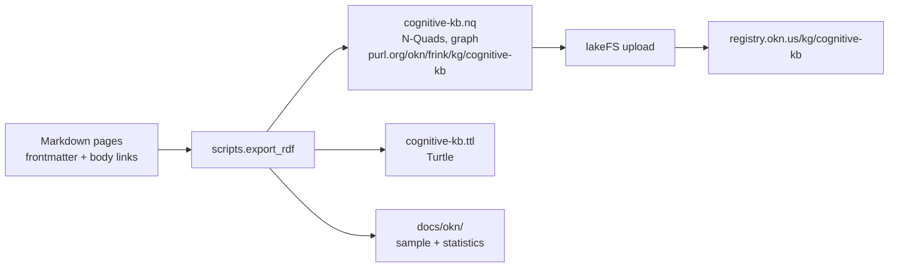

# Open Knowledge Network export

The knowledge base in [`knowledge_base/`](../../knowledge_base/README.md) is also published as an
RDF graph, `cognitive-kb`, for the [Open Knowledge Network](https://www.okn.us/) (OKN) registry
run by RENCI's FRINK project. The exporter is [`code/scripts/export_rdf.py`](../../code/scripts/export_rdf.py)
and lives in this repository, so anyone can regenerate the graph from the pages.



## Contents

| Page | What it holds |
|---|---|
| [`graph_description.md`](graph_description.md) | The graph in prose: the kinds of nodes and edges, provenance, licence, funding, limits. |
| [`vocabulary.md`](vocabulary.md) | Which standard vocabulary term each part of a page becomes, and the few terms the graph defines itself. |
| [`cognitive-kb.sample.ttl`](cognitive-kb.sample.ttl) | A Turtle sample: the dataset description and three pages described in full. Generated. |
| [`statistics.md`](statistics.md) | Counts of pages, edges, triples and what was left out. Generated. |
| [`registry_entry.md`](registry_entry.md) | The registry entry file to submit, and the upload steps. |

## Generate the graph

```bash
python -m scripts.export_rdf                  # writes output/okn/cognitive-kb.nq and .ttl
python -m scripts.export_rdf --write-docs     # refreshes the sample and statistics here
python -m scripts.export_rdf --check          # fails if those two files are stale
```

The export is deterministic: the same pages always give the same bytes. The sample and the
statistics are derived data, like the knowledge-base catalogs; `validate_docs.py` runs the
same check, so a change to the pages that moves them has to regenerate them.

## IRIs

Entity IRIs sit under `https://purl.org/okn/frink/kg/cognitive-kb/`, the prefix the FRINK
registry reserves for this graph, and are slash IRIs throughout:

| Kind | IRI |
|---|---|
| Page | `…/page/<path under knowledge_base, no .md>`, for example `…/page/mathematics/markov_blanket` |
| Domain (top-level folder) | `…/domain/<folder>` |
| Relation defined by this graph | `…/relation/<name>` |
| Property defined by this graph | `…/vocab/<name>` |
| Dataset, concept scheme, export activity | `…/dataset`, `…/scheme`, `…/activity/export` |
| Named graph | `https://purl.org/okn/frink/kg/cognitive-kb` |
