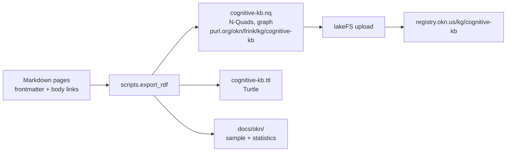

# Open Knowledge Network export

The knowledge base in [`knowledge_base/`](../../knowledge_base/README.md) can be exported as an
RDF graph, `cognitive-kb`, for the [Open Knowledge Network](https://www.okn.us/) (OKN) registry
run by RENCI's FRINK project. The exporter is [`code/scripts/export_rdf.py`](../../code/scripts/export_rdf.py)
and lives in this repository, so anyone can regenerate the graph from the pages.



## Contents

| Page | What it holds |
|---|---|
| [`graph_description.md`](graph_description.md) | The graph in prose: the kinds of nodes and edges, provenance, licence, funding, limits. |
| [`vocabulary.md`](vocabulary.md) | Which standard vocabulary term each part of a page becomes, and the few terms the graph defines itself. |
| [`cognitive-kb.sample.ttl`](cognitive-kb.sample.ttl) | A generated Turtle sample including the cortisol chemical concept, mapping evidence and concept keywords. |
| [`statistics.md`](statistics.md) | Counts of pages, edges, triples and what was left out. Generated. |
| [`alignment-review.md`](alignment-review.md) | Generated reviewed correspondences and a queue ranked by incoming references. |
| [`registry_entry.md`](registry_entry.md) | The registry entry file to submit, and the upload steps. |
| [`submission_criteria.md`](submission_criteria.md) | Jim Balhoff's supplied requirements, evidence, and acceptance boundaries. |
| [`interoperability.md`](interoperability.md) | Existing identifier mappings, local query examples, and mapping review rules. |
| [`evidence/2026-10-20/join-results.md`](evidence/2026-10-20/join-results.md) | Fresh join/replay evidence for the reviewed export; October 13 evidence is preserved separately. |
| [`landing_zone.md`](landing_zone.md) | Review package, access-request draft, and upload/processing acceptance steps. |

## Generate the graph

```bash
uv run --extra dev python -m scripts.export_rdf
uv run --extra dev python -m scripts.export_rdf --write-docs
uv run --extra dev python -m scripts.export_rdf --check
uv run --extra dev python -m scripts.export_rdf --check-submission
```

The export is deterministic: the same pages always give the same bytes. The sample and the
statistics are derived data, like the knowledge-base catalogs; `validate_docs.py` runs the
same check, so a change to the pages that moves them has to regenerate them.

Exports are CC BY 4.0. The exporter writes N-Quads, Turtle and `manifest.json`
under `output/okn/`. The manifest records SHA-256 hashes of the serialized files,
source pages, exporter and license notice. `--check-submission` exits 1 for an
incompatible or missing dataset/scheme license, incompatible explicit page licenses,
empty graph, dangling page objects, absent external concept mappings or absent
dataset source provenance. It prints JSON including unresolved link counts.
`--check` checks generated documentation freshness separately. Neither check
establishes ownership, validates the meaning of mappings, or certifies RENCI acceptance.

## IRIs

This repository owns the graph. Reusable capture/replay, submission packaging and
upload methods belong to [daf-okn](https://github.com/docxology/daf-okn).
The cross-graph query and its captured graph evidence stay here; see
[interoperability](interoperability.md) for execution and interpretation.

Entity IRIs sit under `https://purl.org/okn/frink/kg/cognitive-kb/`, the prefix the FRINK
registry reserves for this graph, and are slash IRIs throughout:

| Kind | IRI |
|---|---|
| Page | `…/page/<path under knowledge_base, no .md>`, for example `…/page/mathematics/markov_blanket` |
| Domain (top-level folder) | `…/domain/<folder>` |
| Relation defined by this graph | `…/relation/<name>` |
| Property defined by this graph | `…/vocab/<name>` |
| Dataset, concept scheme, export activity | `…/dataset`, `…/scheme`, `…/activity/export` |
| Named graph | `https://purl.org/okn/frink/kg/cognitive-kb` |
