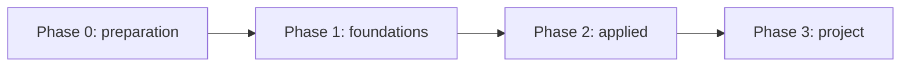

# [Learning Path Name]

Copy this file into `docs/guides/learning_paths/`, replace every `[Bracketed text]`,
delete sections that do not apply, and run `python code/scripts/validate_docs.py`.
Link only to pages that exist, and describe only what the repository contains.

## Quick reference

| | |
|---|---|
| Difficulty | [Beginner, intermediate, advanced] |
| Time | [Hours per week for how many weeks] |
| You will be able to | [One sentence: the capability at the end] |
| Prerequisites | [Pages or skills below] |

## Purpose and audience

[Two or three sentences: what the path covers, who it is for, and what it leaves out.]

### Outcomes

By the end you can:

1. [A specific, checkable outcome, for example "derive expected free energy for a two-state model"]
2. [Another outcome]
3. [Another outcome]

## Prerequisites

| Needed | Where to get it |
|---|---|
| [Concept or skill] | [[knowledge_base/index]] |
| [Concept or skill] | [Link to an existing page] |

## Progression

Repeat the block below for each phase.

### Phase [N]: [Name] ([weeks])

- **Goal**: [What you can do after this phase.]
- **Read**: [[knowledge_base/glossary|Glossary]] and [Existing page], [Existing page]
- **Run**: [A command or script from this repository, with the expected result]
- **Exercise**: [One task with a way to check the answer]
- **Checkpoint**: [Two or three questions you should be able to answer]

## Assessment

| Checkpoint | Evidence that you are ready to continue |
|---|---|
| End of phase 1 | [A test passes, a derivation matches a page, a plot reproduces] |
| End of phase 2 | [Evidence] |
| Final project | [Deliverable, scope, and how it is judged] |

## Resources

| Type | Resource | Why it is here |
|---|---|---|
| Theory | [Existing knowledge-base page] | [One line] |
| Code | [Existing module or example] | [One line] |
| Reading | [Paper or book with full citation] | [One line] |

## Next steps

- Continue with [Existing learning path].
- Go deeper in [Existing knowledge-base domain].

## Maintenance

Record the date reviewed in `updated:` above. Report problems by opening an issue
or a pull request that links the page.
