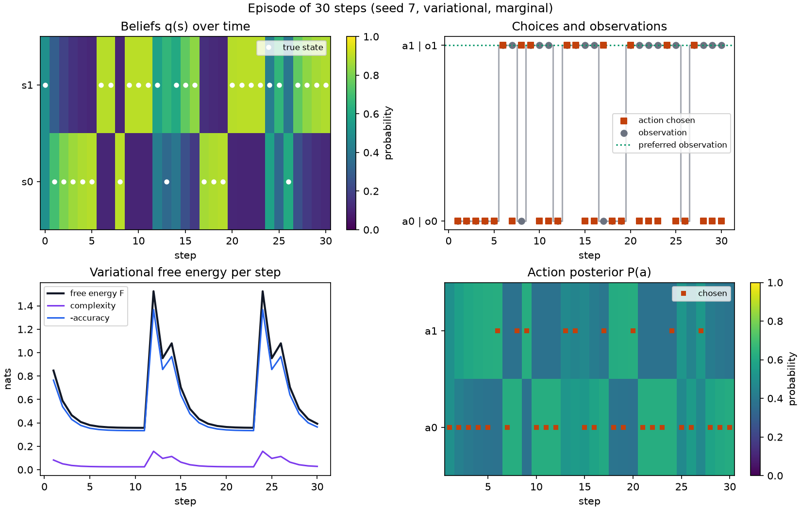
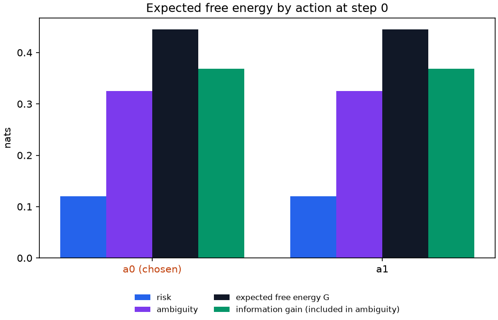
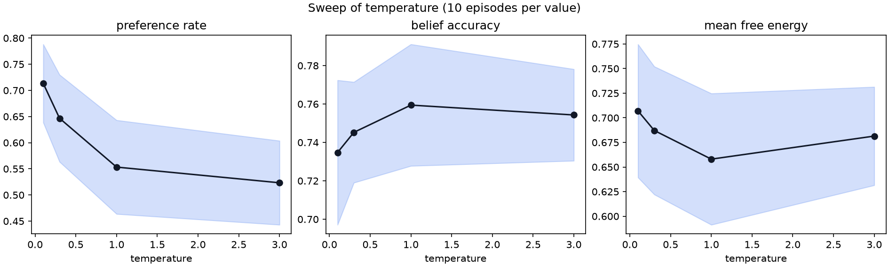
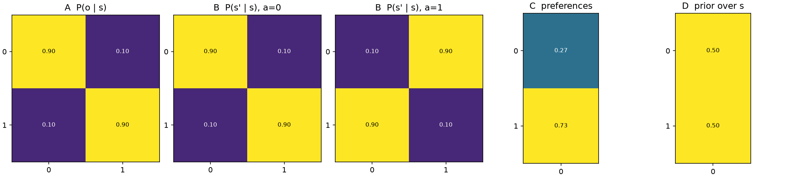
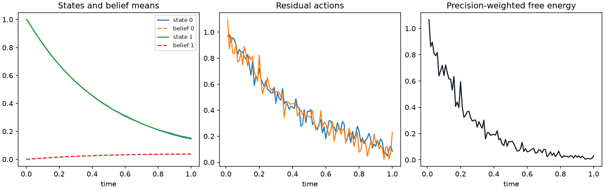
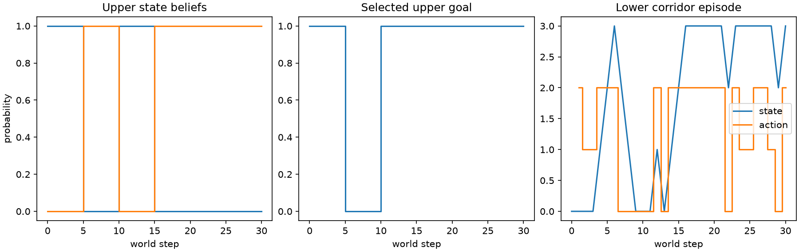
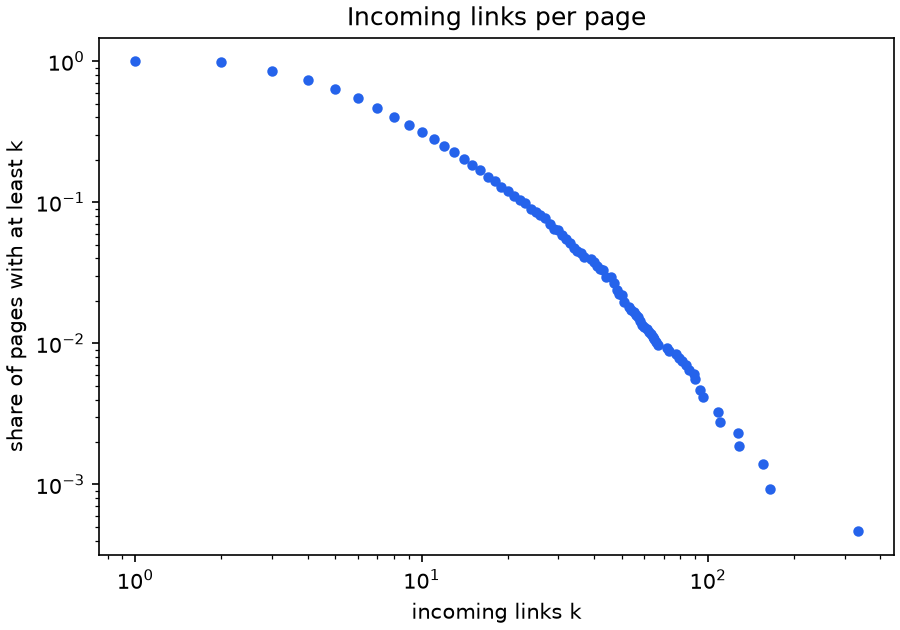
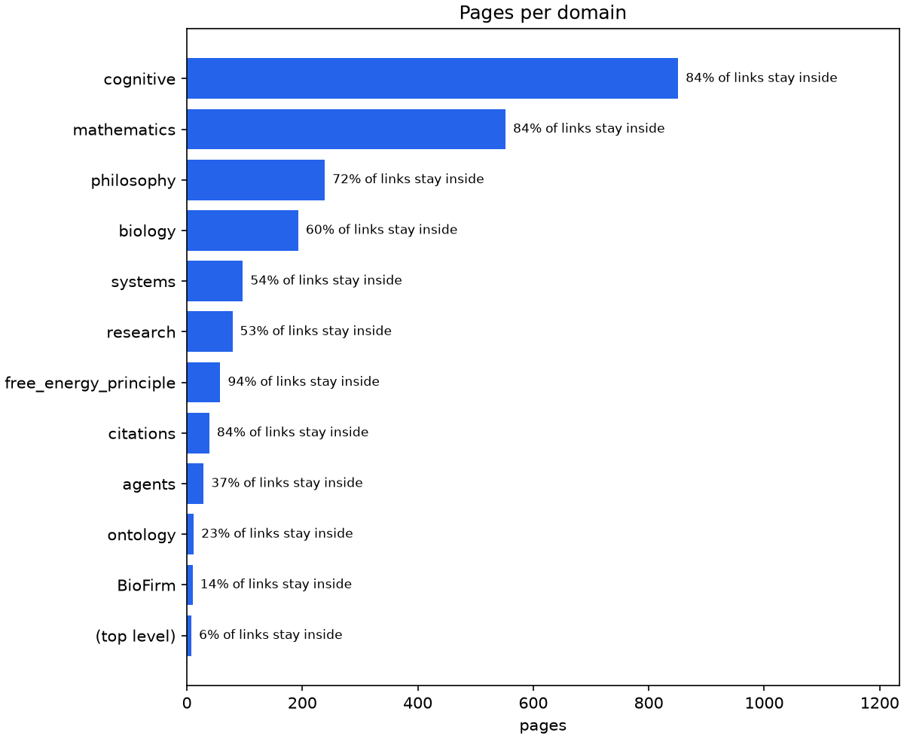
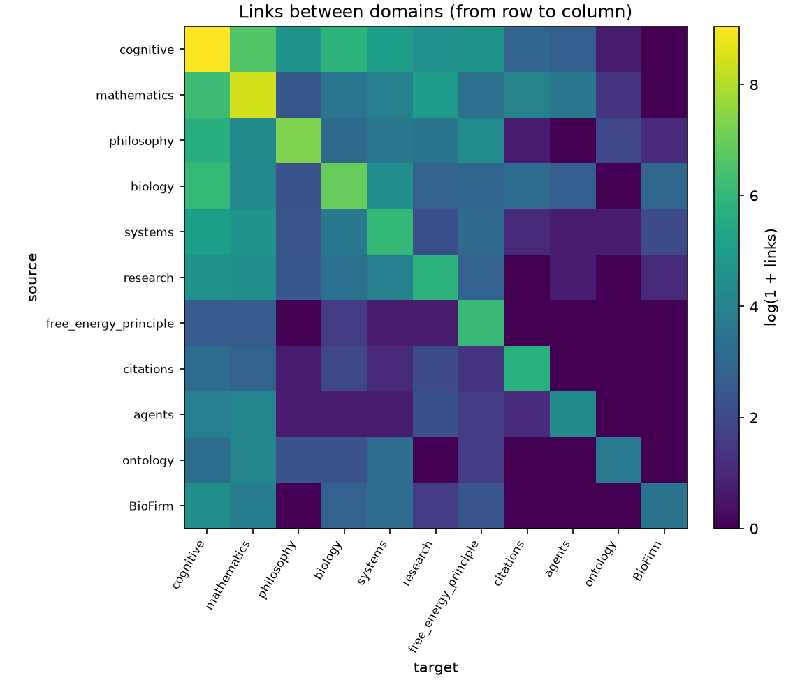
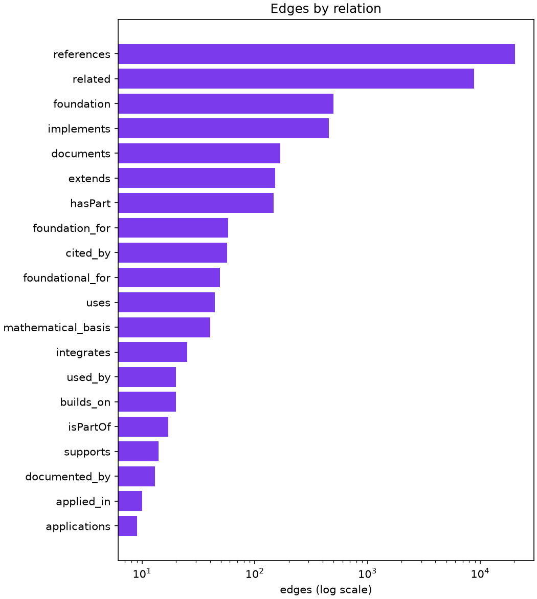

# Figure gallery

Every `plot_*` function returns a Matplotlib figure and leaves the backend alone. `save_figure` writes and closes a figure. Captions and figures are regenerated together.

```bash
uv run python -m scripts.regenerate_gallery --publish
```

The command writes recorded data and a hash receipt under `output/gallery`, then copies the figures and this page into the documentation with `--publish`. Without that option, it writes only under the chosen `--output` directory.

## Reproduction parameters

```json
{
  "steps": 30,
  "seed": 7,
  "temperatures": [
    0.1,
    0.3,
    1.0,
    3.0
  ],
  "seeds": 10,
  "continuous_steps": 100,
  "continuous_sensor_noise": 0.05,
  "decision_interval": 5
}
```

The graph contains 2167 pages, 22347 links, 1 weak component(s) and 0 isolated page(s).

The graph measurements describe documentation connectivity. They do not measure scientific validity or inferential performance.

## `plot_trajectory`



Beliefs, true states, actions and free energy.

Two-state episode: 30 steps, seed 7.

## `plot_efe_components`



Expected free energy parts at step 0.

Two-state episode: 30 steps, seed 7.

## `plot_sweep`



Means and population standard deviations across seeds.

Temperatures [0.1, 0.3, 1.0, 3.0]; 10 seeds per value, 30 steps per episode. The band is seed spread, not a confidence interval.

## `plot_model`



Likelihood, transition, preference and prior matrices.

Two-state episode: 30 steps, seed 7.

## `plot_continuous_trajectory`



Continuous states, belief means and residual actions.

The generalized-coordinate agent uses residual control in an Euler world; it does not optimize expected free energy over continuous actions.

## `plot_hierarchical_trajectory`



Upper beliefs and goals against lower states and actions.

The upper controller selects lower preferences every five world steps. Lower beliefs and physical state persist between decisions.

## `in_degree_distribution`



Share of pages with at least k incoming links.

## `domain_sizes`



Pages per domain and the share of links staying inside.

## `domain_links`



Links from row domain to column domain, colored by log(1 + links).

## `relations`



The twenty most frequent edge relation names, on a log scale.

## Saved-data plots

`cognitive plot trajectory.json --step 0` redraws a validated discrete data without rerunning inference. `plot_model` requires the original model.

`cognitive-kb-report` writes the four knowledge-base figures separately.
