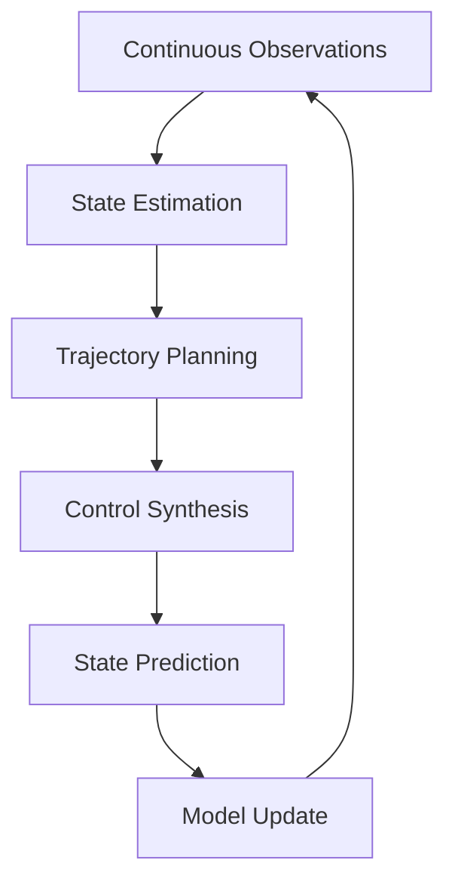

# Continuous-Time Active Inference Implementation Guide

This directory contains implementations of continuous-time Active Inference agents using stochastic differential equations and path integral formulations. Continuous-time approaches provide more biologically plausible and temporally precise models of cognitive processing compared to discrete-time formulations.

## 🌊 Mathematical Foundations

### Continuous-Time Free Energy

The continuous-time formulation of the Free Energy Principle uses path integrals over temporal trajectories:

```math
F = ∫_0^T F(x(t), μ(t), a(t)) dt
```

where:
- `x(t)`: True hidden states over time
- `μ(t)`: Internal model expectations
- `a(t)`: Actions as control signals

### Stochastic Differential Equations

The generative model is formulated as coupled stochastic differential equations:

```math
dx = f(x,v,θ)dt + σ_x dW_x
dy = g(x,v,θ)dt + σ_y dW_y
```

where:
- `f, g`: Deterministic dynamics functions
- `σ_x, σ_y`: Noise amplitudes
- `dW`: Wiener process increments

## 🏗️ Architecture Overview

### Core Components

#### Generative Model
- **State Dynamics**: Continuous-time evolution of hidden states
- **Observation Model**: Mapping from states to observations
- **Policy Representation**: Time-continuous action trajectories
- **Precision Control**: Time-varying uncertainty modulation

#### Inference Mechanisms
- **Path Integral Inference**: Trajectory-based probabilistic inference
- **Kalman Filtering**: Linear-Gaussian state estimation
- **Particle Methods**: Non-linear state estimation
- **Variational Methods**: Approximate continuous-time inference

#### Control Systems
- **Optimal Control**: Trajectory optimization under uncertainty
- **Stochastic Control**: Decision-making in continuous time
- **Adaptive Control**: Online parameter adaptation

### Processing Pipeline



## 📁 Directory Structure

### Core Documentation
- `[[continuous_time_agent]]` - Main implementation guide with mathematical formulations
- `README.md` - This overview and implementation guide

## 🚀 Implementation Examples

### Basic Continuous-Time Agent

```python
import numpy as np
rng = np.random.default_rng(0)

# True process: dx = (-x + a) dt + sigma dW, observed as y = x + noise.
# The agent holds belief mu and a prior that it will sit at the target.
dt, sigma, target = 0.01, 0.05, 1.0       # illustrative
pi_y, pi_prior, k_a = 8.0, 1.0, 4.0       # precisions and action gain
x, mu, a = 0.0, 0.0, 0.0

for _ in range(2000):
    y = x + 0.05 * rng.standard_normal()
    eps_y, eps_prior = y - mu, mu - target
    mu += dt * (pi_y * eps_y - pi_prior * eps_prior)        # perception: gradient flow on F
    a += dt * (-k_a * pi_y * eps_y)                         # action: change y to match mu
    x += dt * (-x + a) + np.sqrt(dt) * sigma * rng.standard_normal()
print(round(x, 2), round(mu, 2))
```

## 🔧 Advanced Implementation Patterns

### Stochastic Differential Equation Agent

```python
import numpy as np
rng = np.random.default_rng(1)

# Ornstein-Uhlenbeck process dx = -theta x dt + sigma dW by Euler-Maruyama
theta, sigma, dt, n_paths, n_steps = 2.0, 0.5, 0.01, 5000, 1000   # illustrative
x = np.zeros(n_paths)
for _ in range(n_steps):
    x += -theta * x * dt + sigma * np.sqrt(dt) * rng.standard_normal(n_paths)
print(round(x.var(), 3), sigma**2 / (2 * theta))      # sample versus stationary variance
```

### Path Integral Control Agent

```python
import numpy as np
rng = np.random.default_rng(2)

# Path-integral control for dx = u dt + noise: sample perturbed controls,
# weight each rollout by exp(-cost / lambda), and average the perturbations.
T, dt, lam, K, goal = 50, 0.05, 0.5, 200, 1.0          # illustrative
def rollout_cost(u):
    x = np.cumsum(u * dt)
    return (x[-1] - goal) ** 2 * 10.0 + 0.01 * np.sum(u**2) * dt

u = np.zeros(T)
print(round(rollout_cost(u), 3))
for _ in range(50):
    noise = 0.5 * rng.standard_normal((K, T))
    costs = np.array([rollout_cost(u + n) for n in noise])
    w = np.exp(-(costs - costs.min()) / lam)
    u += (w[:, None] * noise).sum(axis=0) / w.sum()
print(round(rollout_cost(u), 3))                        # cost falls with the updated controls
```

## 📊 Performance Analysis

### Numerical Integration Methods

```python
import numpy as np

f = lambda x: -x                                        # dx/dt = -x, exact solution exp(-t)
def euler(x, dt):
    return x + dt * f(x)
def rk4(x, dt):
    k1 = f(x); k2 = f(x + 0.5 * dt * k1); k3 = f(x + 0.5 * dt * k2); k4 = f(x + dt * k3)
    return x + dt / 6 * (k1 + 2 * k2 + 2 * k3 + k4)

dt, T = 0.1, 2.0
xe = xr = 1.0
for _ in range(int(T / dt)):
    xe, xr = euler(xe, dt), rk4(xr, dt)
print(abs(xe - np.exp(-T)), abs(xr - np.exp(-T)))     # RK4 error is far smaller
```

### Accuracy and Stability Analysis

```python
import numpy as np

# Explicit Euler on dx/dt = -lam x is stable only if dt < 2 / lam
lam = 10.0
for dt in (0.05, 0.25):
    x = 1.0
    for _ in range(40):
        x = x + dt * (-lam * x)
    print(dt, abs(x) < 1.0)          # True for dt < 0.2, False beyond
```

## 🔬 Research Applications

### Neuroscience Modeling
- **Neural Oscillations**: Modeling brain rhythms and synchronization
- **Synaptic Plasticity**: Continuous-time learning rules
- **Neural Dynamics**: Complex neural network behavior

### Robotics and Control
- **Motor Control**: Continuous trajectory planning
- **Sensorimotor Integration**: Real-time sensory-motor coordination
- **Adaptive Robotics**: Online learning and adaptation

### Cognitive Science
- **Temporal Processing**: Modeling time perception and memory
- **Decision Making**: Continuous-time evidence accumulation
- **Attention Dynamics**: Temporal aspects of selective attention

## 📚 Mathematical Background

### Key Concepts
- **Stochastic Calculus**: Ito and Stratonovich integrals
- **Path Integrals**: Feynman path integral formulation
- **Optimal Control**: Pontryagin's minimum principle
- **Kalman Filtering**: Continuous-time state estimation

### Related Mathematics
- [[knowledge_base/mathematics/path_integral_theory]] - Path integral methods
- [[knowledge_base/mathematics/stochastic_processes]] - Stochastic process theory
- [[knowledge_base/mathematics/optimal_control]] - Optimal control theory

## 🔗 Integration and Extensions

### Hybrid Approaches
- **Discrete-Continuous Hybrids**: Combining discrete planning with continuous control
- **Multi-Scale Models**: Integrating different temporal scales
- **Hierarchical Control**: Nested control architectures

### Advanced Topics
- **Quantum Active Inference**: Quantum probability formulations
- **Field Theory**: Continuous field representations
- **Non-Markovian Dynamics**: Memory-dependent processes

---

> **Temporal Precision**: Continuous-time formulations provide more biologically realistic models of cognitive temporal dynamics.

---

> **Computational Challenges**: Require sophisticated numerical methods but offer rich behavioral repertoires.

---

> **Research Frontier**: Active area of development with applications in neuroscience, robotics, and complex systems.

