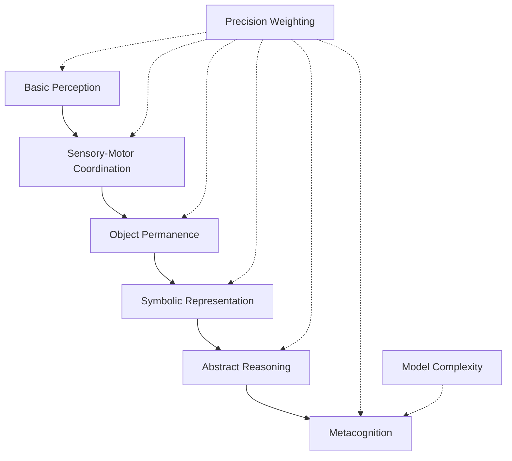

# Cognitive Development Through Active Inference

> **Code on this page.** The Python snippets illustrate the ideas. Unless a snippet imports the
> `cognitive` package, it is not part of the package and is not run by its tests, so treat it as a
> sketch. The tested implementations are listed in [[docs/api/api_reference|the API reference]].

This document explores cognitive development through the lens of Active Inference, examining how children acquire knowledge, skills, and cognitive capabilities through the minimization of variational free energy in increasingly complex environments.

## 🧠 Developmental Active Inference Framework

### Hierarchical Skill Acquisition

Cognitive development as progressive skill layering:



### Developmental Stages as Model Refinement

```python
import numpy as np

rng = np.random.default_rng(0)

def best_model_order(n, noise=0.3, max_degree=6):
    """Pick polynomial degree by a penalised-evidence score (BIC = n ln(RSS/n) + k ln n)."""
    x = np.linspace(-3, 3, n)
    y = np.sin(x) + noise * rng.standard_normal(n)
    scores = []
    for d in range(max_degree + 1):
        coef = np.polyfit(x, y, d)
        rss = np.sum((y - np.polyval(coef, x)) ** 2)
        scores.append(n * np.log(rss / n) + (d + 1) * np.log(n))
    return int(np.argmin(scores))

# Illustrative: averaged over repeats, more experience favours a richer model
for n in (20, 200, 2000):
    print(n, np.mean([best_model_order(n) for _ in range(20)]))
```

## 🔬 Neural Development and Active Inference

### Experience-Dependent Model Refinement

How experience shapes the developing brain:

```python
# Experience-dependent refinement: Dirichlet counts over the likelihood A[o, s]
true_A = np.array([[0.9, 0.2], [0.1, 0.8]])      # illustrative environment
a = np.ones_like(true_A)                         # flat prior counts
for t in range(500):
    s = rng.integers(2)                          # state (assumed known here)
    o = rng.choice(2, p=true_A[:, s])
    a[o, s] += 1                                 # a <- a + o (x) q(s)
learned_A = a / a.sum(axis=0)
print(np.round(learned_A, 2))
```

### Precision Development

How precision weighting matures over development:

```python
# Precision development: Gamma posterior over sensory precision from prediction errors
true_precision = 4.0
alpha, beta = 1.0, 1.0                           # Gamma prior (shape, rate)
for n in range(1, 201):
    eps = rng.normal(0, 1 / np.sqrt(true_precision))      # one prediction error
    alpha, beta = alpha + 0.5, beta + 0.5 * eps ** 2
    if n in (1, 10, 50, 200):
        print(n, "estimated precision:", alpha / beta)

def precision_weighted_update(mu, y, pi_y, pi_prior):
    """Posterior mean: the more precise source gets more weight."""
    return mu + pi_y / (pi_y + pi_prior) * (y - mu)

print(precision_weighted_update(0.0, 1.0, pi_y=alpha / beta, pi_prior=1.0))
```

## 🧪 Developmental Milestones as Phase Transitions

### Critical Transitions in Cognitive Development

```python
from math import lgamma, log

def log_marginal_binomial(k, n, theta):             # M1: fixed bias theta
    return k * log(theta) + (n - k) * log(1 - theta)

def log_marginal_beta(k, n):                        # M2: uniform prior on theta, B(k+1, n-k+1)
    return lgamma(k + 1) + lgamma(n - k + 1) - lgamma(n + 2)

data = rng.random(200) < 0.7                        # illustrative: true bias 0.7
for n in (5, 10, 20, 50, 100, 200):
    k = int(data[:n].sum())
    log_bf = log_marginal_beta(k, n) - log_marginal_binomial(k, n, 0.5)
    print(n, "P(richer model | data) =", round(1 / (1 + np.exp(-log_bf)), 3))
```

## 🧬 Language Development as Model Extension

### Linguistic Active Inference

How language acquisition extends cognitive models:

```python
# Cross-situational word learning: counts of word-object co-occurrence
objects, words = ["ball", "cup", "dog"], ["ball_w", "cup_w", "dog_w"]
counts = np.ones((3, 3))                            # counts[word, object], flat prior
for _ in range(300):
    scene = rng.choice(3, size=2, replace=False)    # two objects visible at once
    word = rng.choice(scene)                        # the utterance names one of them
    counts[word, scene] += 1
meaning = counts / counts.sum(axis=1, keepdims=True)  # p(object | word)
for w, row in zip(words, meaning):
    print(w, "->", objects[int(np.argmax(row))], np.round(row, 2))
```

## 🧪 Educational Applications

### Optimal Learning Trajectories

Designing education based on developmental Active Inference:

```python
def outcome_entropy(p):
    return -(p * np.log(p) + (1 - p) * np.log(1 - p))

difficulties = np.linspace(-3, 3, 13)
grid = np.linspace(-4, 4, 161)                      # candidate ability values
posterior = np.exp(-grid ** 2 / 2); posterior /= posterior.sum()
true_ability, chosen = 1.5, []
sigmoid = lambda z: 1 / (1 + np.exp(-z))
for trial in range(30):
    ability = grid @ posterior                      # current belief about ability
    d = difficulties[np.argmax(outcome_entropy(sigmoid(ability - difficulties)))]
    success = rng.random() < sigmoid(true_ability - d)
    like = sigmoid(grid - d) if success else 1 - sigmoid(grid - d)
    posterior = posterior * like; posterior /= posterior.sum()
    chosen.append(d)
print("difficulty chosen over trials:", np.round(chosen[::5], 2), "ability estimate:", round(grid @ posterior, 2))
```

## 🔬 Research Directions

### Computational Developmental Psychology

#### Large-Scale Developmental Simulations
- **Brain-scale development**: Simulating neural development over years
- **Cultural influences**: How culture shapes developmental trajectories
- **Individual differences**: Modeling developmental variability

#### Active Inference Developmental Models
- **Precision development**: How precision weighting matures
- **Model complexity growth**: Hierarchical model expansion
- **Critical period mechanisms**: Experience-dependent plasticity

### Educational Technology

#### AI Tutors Based on Developmental Active Inference
- **Adaptive difficulty**: Real-time difficulty adjustment
- **Optimal sequencing**: Concept presentation optimization
- **Feedback timing**: Precision-weighted feedback delivery

#### Developmental Assessment Tools
- **Readiness evaluation**: Predicting learning readiness
- **Progress monitoring**: Tracking developmental progress
- **Intervention design**: Optimizing educational interventions

## 📚 Related Concepts

### Core Development
- [[cognitive_development]] - General cognitive development
- [[learning_mechanisms]] - Learning processes
- [[neural_plasticity]] - Brain plasticity

### Active Inference Development
- [[active_inference]] - Core framework
- [[hierarchical_processing]] - Hierarchical development
- [[precision_weighting]] - Precision development

### Educational Applications
- [[skill_acquisition]] - Skill learning
- [[metacognition]] - Self-awareness in learning
- [[problem_solving]] - Problem-solving development

---

> **Developmental Active Inference**: Cognitive development emerges from the progressive refinement of generative models through experience, with precision weighting guiding attention and learning at each developmental stage.

---

> **Phase Transitions**: Developmental milestones represent phase transitions where cognitive models undergo qualitative changes in complexity and capability.

---

> **Experience-Dependent Refinement**: The developing brain optimizes its generative models through active engagement with the environment, guided by variational free energy minimization.

## References

- Piaget, J., & Inhelder, B. (1969). The Psychology of the Child. Basic Books.
- Gopnik, A., & Wellman, H. M. (2012). Reconstructing constructivism: causal models, Bayesian learning mechanisms, and the theory theory. Psychological Bulletin, 138(6), 1085-1108.
- Kidd, C., Piantadosi, S. T., & Aslin, R. N. (2012). The Goldilocks effect: human infants allocate attention to visual sequences that are neither too simple nor too complex. PLoS ONE, 7(5), e36399.
- Hensch, T. K. (2005). Critical period plasticity in local cortical circuits. Nature Reviews Neuroscience, 6(11), 877-888.
- van der Maas, H. L. J., & Molenaar, P. C. M. (1992). Stagewise cognitive development: an application of catastrophe theory. Psychological Review, 99(3), 395-417.
