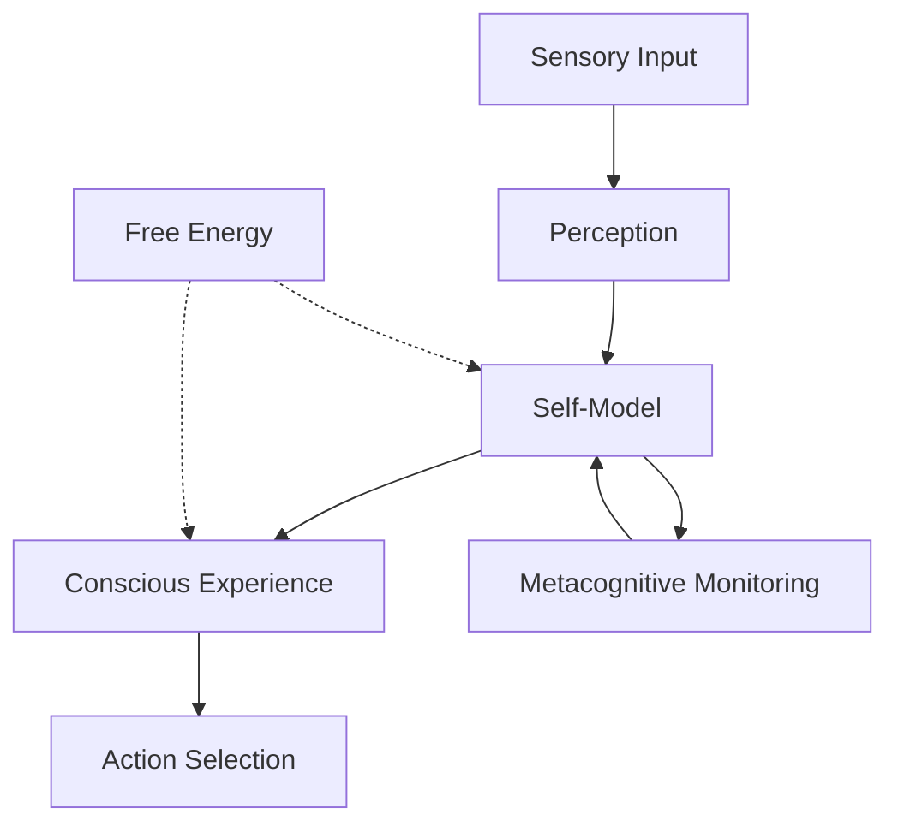

# Consciousness Theory and Active Inference

> **Code on this page.** The Python snippets illustrate the ideas. Unless a snippet imports the
> `cognitive` package, it is not part of the package and is not run by its tests, so treat it as a
> sketch. The tested implementations are listed in [[docs/api/api_reference|the API reference]].

This document explores consciousness through the lens of Active Inference, examining how self-aware experience can be modeled as arising from the minimization of variational free energy. It integrates phenomenological approaches with computational neuroscience to understand the nature of conscious experience.

## 🧠 Consciousness as Active Inference

### The Phenomenal Self-Model

On this account, consciousness is proposed to arise from the brain's generative model of itself and its environment:



### Core Principles

#### Self-Evidencing
- **Self-Model**: The brain maintains a generative model of itself
- **Self-Evidence**: Consciousness provides evidence for the self-model
- **Self-Consistency**: The self-model must be consistent with experience

#### Metacognitive Hierarchy
- **First-Order Cognition**: Direct perceptual and motor processes
- **Second-Order Cognition**: Monitoring of first-order processes
- **Higher-Order Cognition**: Recursive self-reflection and introspection

## 🔬 Phenomenological Active Inference

### The Structure of Conscious Experience

#### Intentionality
Conscious states are always about something - they have intentional content.

#### Temporal Flow
Consciousness has a characteristic temporal structure.

### The Unity of Consciousness

#### Binding Problem Solution
How disparate sensory inputs are bound into unified conscious experience:

```python
import numpy as np

# Binding as precision-weighted fusion: independent cues about one cause are
# combined into a single posterior, weighted by their precisions.
estimates = np.array([1.0, 1.4, 0.8])      # e.g. visual, auditory, tactile estimates (illustrative)
precisions = np.array([4.0, 1.0, 2.0])     # inverse variances
fused = np.sum(precisions * estimates) / np.sum(precisions)
fused_precision = np.sum(precisions)       # fused estimate is more precise than any single cue
print(round(fused, 3), fused_precision)
```

## 🧪 Levels of Consciousness

### Phenomenal Consciousness
The "what it's like" aspect of experience.

### Access Consciousness
The availability of information for cognitive processing.

### Self-Consciousness
Awareness of oneself as a conscious entity.

## 🧬 Consciousness and Free Energy

### Consciousness as Inference

#### Self-Evidencing Principle
```python
import numpy as np

def log_evidence(observations, A, prior):
    """ln p(o_1:T | model) for independent draws from a discrete model."""
    return sum(np.log(A[o] @ prior) for o in observations)

observations = [0, 0, 1, 0, 0, 0, 1, 0]                  # illustrative sensory samples
prior = np.array([0.5, 0.5])
good = np.array([[0.8, 0.7], [0.2, 0.3]])               # model that predicts these samples well
poor = np.array([[0.2, 0.3], [0.8, 0.7]])               # model that predicts them badly
print(log_evidence(observations, good, prior) > log_evidence(observations, poor, prior))
```

### Metacognitive Consciousness

#### Recursive Self-Monitoring
```python
import numpy as np

def confidence(q):
    """Second-order readout of a first-order posterior: 1 - H(q) / ln(n)."""
    q = np.asarray(q)
    return 1.0 - (-np.sum(q * np.log(q + 1e-16)) / np.log(len(q)))

print(round(confidence([0.9, 0.05, 0.05]), 2), round(confidence([1/3, 1/3, 1/3]), 2))
```

## 🧪 Empirical Evidence

### Consciousness Research

#### Neural Correlates of Consciousness (NCC)
- **Global Workspace Theory**: Consciousness as global information broadcast
- **Integrated Information Theory**: Consciousness as integrated information
- **Higher-Order Thought Theory**: Consciousness as meta-representation

#### Active Inference Evidence
- **Precision and Consciousness**: Correlation between precision weighting and conscious awareness
- **Prediction Errors**: Conscious experience of surprising events
- **Attentional Modulation**: Consciousness as attention-dependent process

### Clinical Insights

#### Disorders of Consciousness
- **Coma**: Minimal self-model maintenance
- **Vegetative State**: Sensory processing without self-awareness
- **Locked-in Syndrome**: Full consciousness with minimal output

#### Altered States
- **Meditation**: Enhanced metacognitive awareness
- **Psychedelic States**: Disrupted self-model predictions
- **Sleep**: Reduced consciousness precision

## 🔬 Research Directions

### Theoretical Developments

#### Unified Theory of Consciousness
- **Active Inference Framework**: Consciousness as self-evidencing inference
- **Free Energy Principle**: Consciousness minimizing surprise about self
- **Predictive Processing**: Consciousness as precise hierarchical prediction

#### Measurement Challenges
- **Subjective Experience**: Quantifying phenomenal consciousness
- **Neural Correlates**: Identifying necessary and sufficient NCC
- **Animal Consciousness**: Cross-species consciousness assessment

### Future Research

#### Computational Models
- **Large-Scale Simulations**: Brain-scale consciousness models
- **Virtual Consciousness**: Artificial consciousness in silico
- **Consciousness Metrics**: Quantitative measures of consciousness

#### Experimental Paradigms
- **Perturbational Approaches**: Causal manipulation of consciousness
- **Multimodal Integration**: Combined behavioral and neural measures
- **Developmental Studies**: Emergence of consciousness in development

## 📚 Related Concepts

### Core Active Inference
- [[active_inference]] - Framework for consciousness
- [[free_energy_principle]] - Mathematical basis
- [[metacognition]] - Higher-order consciousness

### Consciousness Research
- [[attention_mechanisms]] - Consciousness modulation
- [[working_memory]] - Conscious access
- [[self_organization]] - Spontaneous formation of ordered structure

### Related Domains
- [[consciousness]] - Philosophical approaches
- [[knowledge_base/biology/neuroscience]] - Neural basis
- [[knowledge_base/systems/complex_systems]] - Emergence of consciousness

---

> **Consciousness as Active Inference**: On this account, consciousness is proposed to arise from the brain's self-model, maintained through minimization of variational free energy about the self and its relationship to the world.

---

> **Self-Evidencing**: Consciousness provides evidence for its own existence through recursive self-modeling and metacognitive monitoring.

---

> **Phenomenal Experience**: The qualitative "what it's like" aspect of consciousness is hypothesized to arise from precision-weighted prediction errors in hierarchical generative models.

## References

- Hohwy, J. (2016). The self-evidencing brain. Noûs, 50(2), 259-285.
- Friston, K. (2018). Am I self-conscious? (Or does self-organization entail self-consciousness?). Frontiers in Psychology, 9, 579.
- Block, N. (1995). On a confusion about a function of consciousness. Behavioral and Brain Sciences, 18(2), 227-247.
- Dehaene, S., & Changeux, J.-P. (2011). Experimental and theoretical approaches to conscious processing. Neuron, 70(2), 200-227.
- Tononi, G. (2004). An information integration theory of consciousness. BMC Neuroscience, 5, 42.
