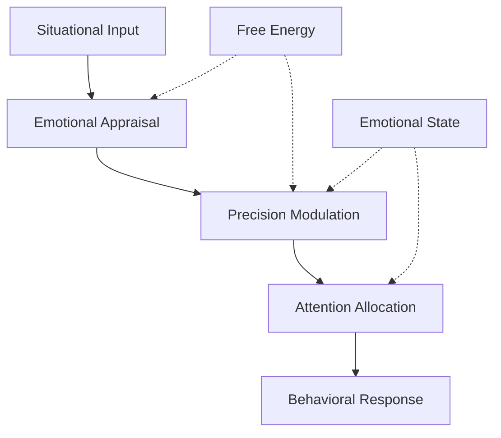

# Emotional Processing Through Active Inference

> **Code on this page.** The Python snippets illustrate the ideas. Unless a snippet imports the
> `cognitive` package, it is not part of the package and is not run by its tests, so treat it as a
> sketch. The tested implementations are listed in [[docs/api/api_reference|the API reference]].

This document explores emotional processing as an Active Inference mechanism, examining how emotions emerge from the minimization of variational free energy in affective prediction and regulation. It integrates computational neuroscience with affective science to understand the functional role of emotions in cognition.

## 🧠 Emotional Active Inference

### Emotions as Precision-Weighted Predictions

Emotions as affective states that modulate precision weighting:



### Core Emotional Processing Architecture

```python
import numpy as np

def appraise(obs, prediction, precision):
    """Precision-weighted prediction error and the free energy it implies (Gaussian, constants dropped)."""
    error = obs - prediction
    return error, 0.5 * precision * error ** 2

# Illustrative loop: arousal ~ |precision-weighted error|, valence ~ fall in free energy
prediction, precision, lr = 0.0, 2.0, 0.3
F_prev = None
for t, obs in enumerate([0.1, 0.0, 2.0, 1.8, 1.9, 2.0]):    # a surprising shift at t = 2
    error, F = appraise(obs, prediction, precision)
    arousal = abs(precision * error)
    valence = 0.0 if F_prev is None else F_prev - F          # positive when free energy falls
    prediction += lr * error                                 # perceptual update
    F_prev = F
    print(f"t={t} arousal={arousal:.2f} valence={valence:+.2f}")
```

## 🔬 Emotional Appraisal and Prediction

### Appraisal as Bayesian Inference

Emotional appraisal as probabilistic inference over emotional categories:

```python
# Appraisal as Bayesian inference over emotion categories
categories = ["calm", "fear", "joy"]
means = np.array([[0.1, 0.1], [0.9, 0.2], [0.7, 0.9]])        # illustrative (arousal, valence) features
sigma = 0.25
prior = np.array([0.6, 0.2, 0.2])

def appraisal_posterior(features):
    loglik = -0.5 * np.sum((features - means) ** 2, axis=1) / sigma ** 2
    post = prior * np.exp(loglik - loglik.max())
    return post / post.sum()

for features in ([0.15, 0.1], [0.85, 0.25], [0.7, 0.8]):
    print(features, {c: round(float(p), 3) for c, p in zip(categories, appraisal_posterior(np.array(features)))})
```

## 🧪 Emotional Precision Weighting

### Emotions as Attention Modulators

How emotions modulate attention through precision changes:

```python
# Emotion as an attention modulator: arousal scales sensory precision
def fuse(prior_mean, prior_precision, obs, sensory_precision, arousal, gain=1.0):
    """Posterior mean of a Gaussian model; arousal multiplies the sensory precision."""
    pi_s = sensory_precision * (1.0 + gain * arousal)
    return (prior_precision * prior_mean + pi_s * obs) / (prior_precision + pi_s)

for arousal in (0.0, 1.0, 4.0):
    print(arousal, fuse(prior_mean=0.0, prior_precision=1.0, obs=1.0, sensory_precision=1.0, arousal=arousal))
```

## 🧬 Affective Memory and Learning

### Emotional Consolidation

How emotions influence memory formation and consolidation:

```python
# Emotional consolidation: learning rate scaled by arousal (Rescorla-Wagner-style update)
def consolidate(value, outcome, arousal, base_rate=0.1, gain=2.0):
    return value + base_rate * (1.0 + gain * arousal) * (outcome - value)

calm, aroused = 0.0, 0.0
for _ in range(5):
    calm = consolidate(calm, 1.0, arousal=0.0)
    aroused = consolidate(aroused, 1.0, arousal=1.0)
print("calm:", round(calm, 3), "aroused:", round(aroused, 3))   # the aroused trace is learned faster
```

## 🧪 Social Emotional Processing

### Empathy and Emotional Contagion

How emotions spread through social Active Inference:

```python
# Empathy as coupling: each agent's affective state minimises
# F_i = 1/2 pi (x_i - o_i)^2 + 1/2 kappa (x_i - x_j)^2, where x_j is the other agent's state
def coupled_states(o, pi=1.0, kappa=0.5, lr=0.1, steps=200):
    x = o.copy()
    for _ in range(steps):
        grad = pi * (x - o) + kappa * (x - x[::-1])
        x = x - lr * grad
    return x

o = np.array([1.0, -1.0])                    # illustrative private evidence of two agents
print(coupled_states(o, kappa=0.0), coupled_states(o, kappa=1.0))   # coupling pulls states together
```

## 🧬 Motivational Systems

### Emotion-Driven Motivation

How emotions generate and sustain motivation:

```python
# Motivation as expected reduction of free energy: act while a large reduction is expected
def motivation_trace(goal=1.0, x=0.0, precision=2.0, step=0.2, threshold=0.05):
    trace = []
    for _ in range(40):
        F = 0.5 * precision * (goal - x) ** 2
        F_next = 0.5 * precision * (goal - (x + step * np.sign(goal - x))) ** 2
        drive = F - F_next                       # expected reduction in F from acting
        trace.append(round(drive, 3))
        if drive < threshold:
            break
        x += step * np.sign(goal - x)
    return trace

print(motivation_trace())                        # the drive declines as the goal is approached
```

Understanding emotional processing deficits:

## 📚 Related Concepts

### Core Emotional Processing
- [[emotional_processing]] - General emotional processing
- [[attention_mechanisms]] - Emotion-attention interactions
- [[decision_making]] - Emotion in decision making

### Active Inference Integration
- [[active_inference]] - Core framework
- [[precision_weighting]] - Precision modulation
- [[hierarchical_processing]] - Emotional hierarchies

### Applied Contexts
- [[working_memory]] - Emotional working memory
- [[social_cognition]] - Social emotional processing
- [[motivation]] - Emotional motivation

---

> **Emotional Active Inference**: Emotions are modeled as precision-weighted predictions that modulate attention, memory, and behavior to minimize variational free energy in affective domains.

---

> **Appraisal as Inference**: Emotional appraisal involves Bayesian inference over the causes and consequences of emotionally significant events.

---

> **Precision and Affect**: Emotional states modulate the precision of predictions across sensory, cognitive, and behavioral domains, shaping attention and learning.

## References

- Seth, A. K. (2013). Interoceptive inference, emotion, and the embodied self. Trends in Cognitive Sciences, 17(11), 565-573.
- Barrett, L. F. (2017). The theory of constructed emotion: an active inference account of interoception and categorization. Social Cognitive and Affective Neuroscience, 12(1), 1-23.
- Joffily, M., & Coricelli, G. (2013). Emotional valence and the free-energy principle. PLoS Computational Biology, 9(6), e1003094.
- Smith, R., Parr, T., & Friston, K. J. (2019). Simulating emotions: an active inference model of emotional state inference and emotion concept learning. Frontiers in Psychology, 10, 2844.
- Hesp, C., Smith, R., Parr, T., Allen, M., Friston, K. J., & Ramstead, M. J. D. (2021). Deeply felt affect: the emergence of valence in deep active inference. Neural Computation, 33(2), 398-446.
