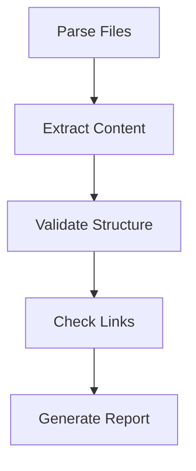
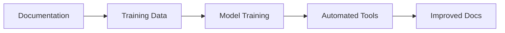

# Machine Readability and Automation


## Overview

Machine readability is a core benefit of plain text formats, enabling automated processing, validation, and intelligence augmentation. This document explores how our plain text ecosystem facilitates automation and machine learning integration.

## Text Processing Benefits

### 1. Structured Data Extraction

```python

# Example of extracting model parameters

def extract_parameters(markdown_file):

    """Extract model parameters from markdown documentation.

    See parameter_extraction for details."""

    parameters = {}

    # Parse YAML frontmatter

    # Extract code blocks

    # Parse parameter definitions

    return parameters

```

### 2. Knowledge Graph Construction

- **Automated Link Analysis**

  - link extraction

  - graph construction

  - relationship inference

### 3. Semantic Analysis

- **Natural Language Processing**

  - [[text_embedding]]

  - [[semantic_search]]

  - concept clustering

## Automation Capabilities

### 1. Documentation Processing

```python

# Automated documentation validation

def validate_docs():

    """

    Validates documentation structure and links.

    See documentation_validation for rules.

    """

    check_broken_links()

    validate_frontmatter()

    check_code_examples()

```

### 2. Code Generation

- **Template-Based Generation**

  - code templates

  - boilerplate generation

  - test generation

### 3. Quality Checks

- **Automated Validation**

  - style checking

  - link validation

  - consistency checking

## Machine Learning Integration

### 1. Training Data Preparation

```python

# Convert documentation to training data

def prepare_training_data():

    """

    Extracts training examples from documentation.

    See training_data_preparation.

    """

    examples = []

    # Parse markdown files

    # Extract code examples

    # Generate labels

    return examples

```

### 2. Model Training

- **Documentation-Based Training**

  - code completion

  - documentation generation

  - error prediction

### 3. Automated Improvement

- **Continuous Learning**

  - [[feedback_loops]]

  - model refinement

  - [[performance_optimization]]

## Tooling Integration

### 1. CI/CD Pipeline

```yaml

# Example GitHub Actions workflow

name: Documentation CI

on: [push]

jobs:

  validate:

    runs-on: ubuntu-latest

    steps:

      - uses: actions/checkout@v2

      - name: Check Links

        run: python tools/validate_links.py

      - name: Generate Docs

        run: python tools/generate_docs.py

```

### 2. Development Tools

- **Editor Integration**

  - ide plugins

  - [[linting_tools]]

  - autocomplete

### 3. Analysis Tools

- **Automated Analysis**

  - [[complexity_analysis]]

  - coverage reporting

  - dependency tracking

## Knowledge Extraction

### 1. Concept Mining

```python

# Extract concepts from documentation

def mine_concepts():

    """

    Identifies key concepts and relationships.

    See concept_mining.

    """

    concepts = {}

    # Parse documentation

    # Extract concepts

    # Build relationships

    return concepts

```

### 2. Pattern Recognition

- **Automated Pattern Detection**

  - code patterns

  - documentation patterns

  - usage patterns

### 3. Knowledge Base Construction

- **Automated Organization**

  - knowledge extraction

  - taxonomy building

  - ontology construction

## Automation Examples

### 1. Documentation Generation

```python

# Generate API documentation

def generate_api_docs():

    """

    Generates API documentation from source code.

    See api_documentation.

    """

    parse_source_code()

    extract_docstrings()

    generate_markdown()

```

### 2. Validation Workflows



### 3. Learning Systems



## Best Practices

### 1. Structure Guidelines

- **Machine-Friendly Format**

  - consistent formatting

  - clear structure

  - metadata standards

### 2. Automation Rules

- **Tool Configuration**

  - tool settings

  - automation rules

  - validation criteria

### 3. Integration Patterns

- **Tool Integration**

  - workflow integration

  - tool chaining

  - [[feedback_systems]]

## Related Tools

- documentation generators

- static analyzers

- validation tools

- automation frameworks

## References

- automation patterns

- machine learning integration

- tooling ecosystem

- ci cd practices

