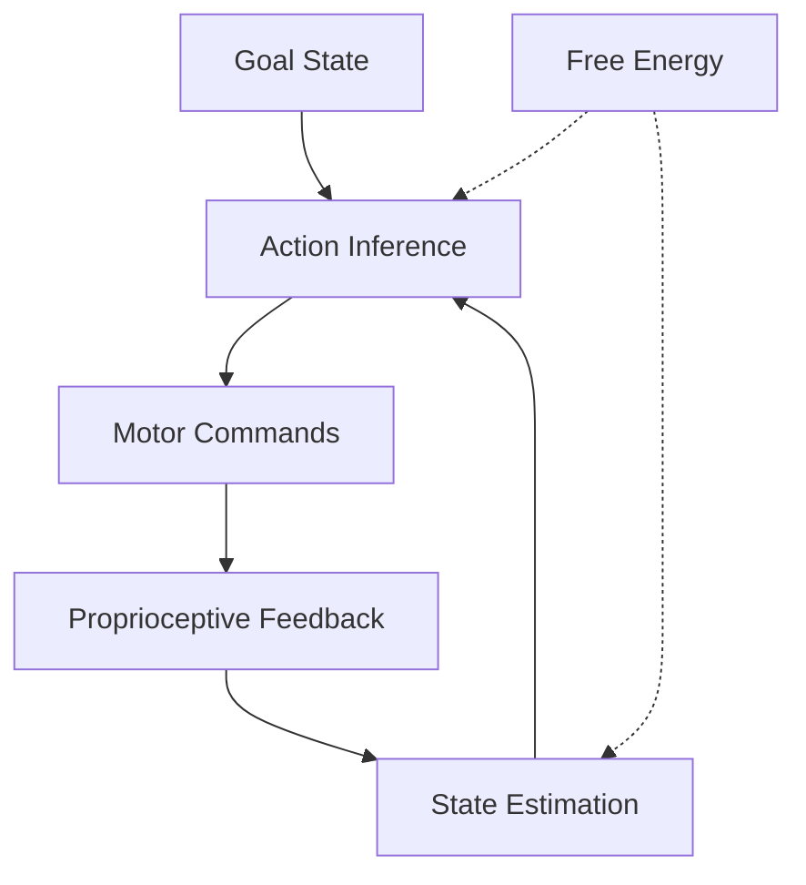

# Motor Control and Sensorimotor Integration Through Active Inference

> **Code on this page.** The Python snippets illustrate the ideas. Unless a snippet imports the
> `cognitive` package, it is not part of the package and is not run by its tests, so treat it as a
> sketch. The tested implementations are listed in [[docs/api/api_reference|the API reference]].

This document explores motor control and sensorimotor integration as Active Inference processes, examining how action emerges from the minimization of variational free energy. It integrates computational motor control with neuroscience to understand how the brain coordinates perception and action.

## 🧠 Sensorimotor Active Inference

### Action as Controlled Hallucination

Motor control as inference about optimal action sequences:



### Core Sensorimotor Architecture

```python
import numpy as np
rng = np.random.default_rng(0)

# One joint. Belief mu fuses a goal prior with proprioception y; action a
# descends the precision-weighted proprioceptive prediction error y - mu.
dt, goal = 0.05, 1.0                 # illustrative
pi_prior, pi_y = 1.0, 4.0            # precisions of the goal prior and of proprioception
x, mu = 0.0, 0.0                     # true joint angle, belief about it

for t in range(300):
    y = x + 0.02 * rng.standard_normal()                 # proprioceptive observation
    mu += dt * (pi_prior * (goal - mu) + pi_y * (y - mu))  # perception (gradient on free energy)
    a = -2.0 * pi_y * (y - mu)                           # action reduces prediction error
    x += dt * a                                          # joint moves under the motor command
print(round(x, 2), round(mu, 2))
```

## 🔬 Forward and Inverse Models

### Forward Model Learning

Predicting sensory consequences of actions:

```python
import numpy as np
rng = np.random.default_rng(1)

A_true, B_true = np.array([[0.9, 0.1], [0.0, 0.8]]), np.array([0.0, 0.5])   # unknown plant
W = np.zeros((2, 3))                                      # forward model: x' = W [x, u]
for _ in range(2000):
    x, u = rng.normal(size=2), rng.normal()
    x_next = A_true @ x + B_true * u                      # sensory consequence of the action
    z = np.append(x, u)
    W += 0.05 * np.outer(x_next - W @ z, z)               # delta rule on the prediction error
print(np.allclose(W[:, :2], A_true, atol=0.05), np.allclose(W[:, 2], B_true, atol=0.05))
```

### Inverse Model Optimization

Mapping desired consequences to actions:

```python
import numpy as np

A, B = np.array([[0.9, 0.1], [0.0, 0.8]]), np.array([[0.0], [0.5]])   # forward model x' = A x + B u
x, x_desired = np.array([0.2, 0.0]), np.array([0.3, 0.4])

# Inverse model: the command whose predicted consequence is closest to the goal
u = np.linalg.pinv(B) @ (x_desired - A @ x)
print(u, A @ x + B @ u)               # the second state component reaches its target
```

## 🧪 Motor Learning and Adaptation

### Error-Based Motor Learning

Learning through prediction error minimization:

```python
import numpy as np

# Single-state trial-by-trial adaptation to a constant perturbation
perturbation, eta = 1.0, 0.2          # illustrative
compensation = 0.0
errors = []
for trial in range(30):
    error = perturbation - compensation      # sensory prediction error on this trial
    compensation += eta * error              # update the motor plan to reduce it
    errors.append(error)
print(np.round(errors[:5], 2), round(errors[-1], 3))   # error shrinks geometrically
```

## 🧬 Hierarchical Motor Control

### Multi-Scale Motor Coordination

Coordinating motor control across time scales:

```python
import numpy as np

# Slow level: chooses a waypoint every 20 steps. Fast level: proportional control towards it.
waypoints, x, k, dt = [0.5, 1.0], 0.0, 4.0, 0.05      # illustrative
for step in range(40):
    target = waypoints[min(step // 20, len(waypoints) - 1)]    # slow, strategic timescale
    x += dt * k * (target - x)                                 # fast, moment-to-moment timescale
    if step % 20 == 19:
        print(step, round(x, 2))
```

## 🧪 Sensorimotor Coordination

### Proprioceptive State Estimation

Integrating proprioceptive feedback with motor control:

```python
import numpy as np
rng = np.random.default_rng(2)

# Scalar Kalman filter: efference-copy prediction combined with noisy proprioception
x, mu, var = 0.0, 0.0, 1.0
q, r = 0.01, 0.1                       # process and sensory noise variances (illustrative)
for t in range(50):
    u = 0.1                            # motor command (efference copy)
    x += u + np.sqrt(q) * rng.standard_normal()
    y = x + np.sqrt(r) * rng.standard_normal()
    mu, var = mu + u, var + q          # predict from the command
    gain = var / (var + r)             # precision-weighted correction
    mu, var = mu + gain * (y - mu), (1 - gain) * var
print(round(x, 2), round(mu, 2), round(var, 3))
```

## 📚 Related Concepts

### Core Motor Control
- [[motor_control]] - General motor control principles
- [[sensorimotor_coordination]] - Sensorimotor integration
- [[action_selection]] - Action planning and selection

### Active Inference Integration
- [[active_inference]] - Core framework
- [[predictive_coding]] - Predictive aspects
- [[hierarchical_processing]] - Multi-level control

### Learning and Adaptation
- [[learning_mechanisms]] - Motor learning
- [[skill_acquisition]] - Skill development
- [[adaptation_mechanisms]] - Motor adaptation

---

> **Motor Active Inference**: Motor control emerges from the minimization of variational free energy, with actions selected to make proprioceptive predictions match desired outcomes.

---

> **Forward-Inverse Model**: The forward model predicts sensory consequences of actions, while the inverse model maps goals to actions, enabling bidirectional sensorimotor inference.

---

> **Hierarchical Coordination**: Motor control operates across multiple time scales, from strategic planning to moment-to-moment execution, coordinated through hierarchical Active Inference.

## References

- Wolpert, D. M., & Kawato, M. (1998). Multiple paired forward and inverse models for motor control. Neural Networks, 11(7-8), 1317-1329.
- Adams, R. A., Shipp, S., & Friston, K. J. (2013). Predictions not commands: active inference in the motor system. Brain Structure and Function, 218(3), 611-643.
- Friston, K. J., Daunizeau, J., Kilner, J., & Kiebel, S. J. (2010). Action and behavior: a free-energy formulation. Biological Cybernetics, 102(3), 227-260.
- Shadmehr, R., Smith, M. A., & Krakauer, J. W. (2010). Error correction, sensory prediction, and adaptation in motor control. Annual Review of Neuroscience, 33, 89-108.
- Todorov, E., & Jordan, M. I. (2002). Optimal feedback control as a theory of motor coordination. Nature Neuroscience, 5(11), 1226-1235.
