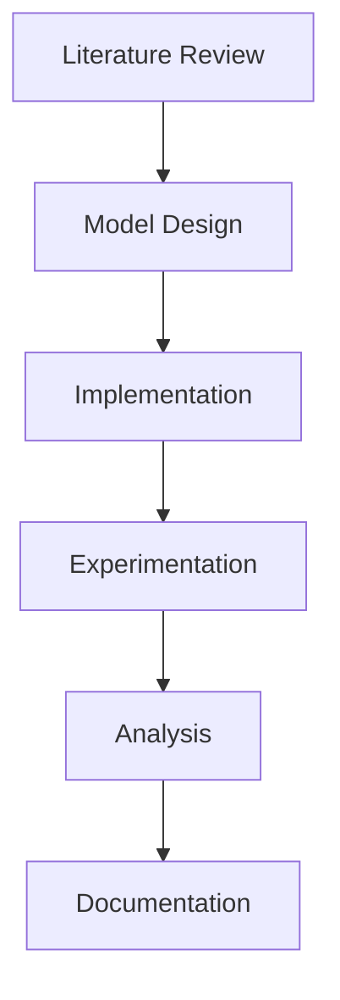
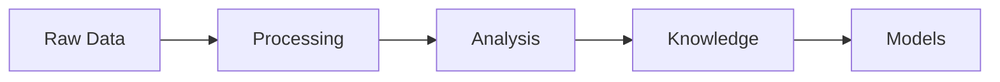

# Plain Text Benefits in Cognitive Modeling

## Overview

Plain text formats serve as the foundation for our cognitive modeling ecosystem, enabling seamless integration between version control, knowledge management, and model development. This document explores the comprehensive benefits of this approach.

## Core Benefits

### 1. Version Control Integration

- **Git-Friendly Format**

  - Line-by-line diff tracking

  - Meaningful change history

  - Conflict resolution

  - Branch-based development

  - See [[git_workflow]] for details

### 2. Knowledge Management

- **Obsidian Integration**

  - bidirectional linking

  - [[graph_visualization]]

  - Dynamic knowledge networks

  - Emergent relationships

  - See [[obsidian_linking]] for usage

### 3. Machine Readability

- **Automated Processing**

  - automated validation

  - documentation generation

  - model extraction

  - dependency analysis

### 4. Research Benefits

- **Reproducibility**

  - experiment tracking

  - version control

  - parameter logging

- **Collaboration**

  - code review

  - knowledge sharing

  - distributed development

## Applications

### 1. Model Development

```python

# Model specification in plain text

model = {

    "architecture": "active_inference",

    "components": ["perception", "action"],

    "parameters": {

        "learning_rate": 0.01

    }

}

```

See [[model_specification]] for details.

### 2. Knowledge Representation

```markdown

## Cognitive Architecture

- [[belief_updating]]

  - [[prediction_error]]

  - [[precision_weighting]]

```

See [[knowledge_representation]] for more.

### 3. Educational Resources

- Interactive tutorials

- Self-documenting code

- Linked learning paths

See educational resources for examples.

## Intelligence Augmentation

### 1. Machine Learning Integration

- **Training Data Generation**

  - Structured text for dataset creation

  - Annotated examples for model training

  - Version-controlled datasets

### 2. Knowledge Discovery

- **Pattern Recognition**

  - graph analysis

  - concept clustering

  - relationship mining

### 3. Model Generalization

- **Transfer Learning**

  - [[cross_domain_mapping]]

  - abstraction layers

  - parameter sharing

## Research Workflow

### 1. Literature Integration

- **Reference Management**

  - reference linking

  - [[knowledge_graphs]]

### 2. Experiment Documentation

```yaml

---

experiment:

  id: exp001

  hypothesis: "[[active_inference_hypothesis]]"

  methods: "[[experimental_design]]"

  results: "[[data_analysis]]"

---

```

### 3. Result Analysis

- **Data Processing**

  - [[statistical_analysis]]

  - [[visualization_tools]]

  - result interpretation

## Educational Applications

### 1. Learning Pathways

- **Structured Learning**

  - prerequisite chains

  - concept dependencies

  - learning objectives

### 2. Interactive Examples

```python

# Interactive code with documentation

def belief_update(observation):

    """See belief_update_theory for mathematical details"""

    pass

```

### 3. Knowledge Assessment

- **Progress Tracking**

  - concept mastery

  - [[skill_development]]

  - understanding gaps

## Model Generalization

### 1. Abstract Representations

- **Formal Specifications**

  - formal methods

  - model verification

  - property checking

### 2. Cross-Domain Transfer

- **Knowledge Transfer**

  - [[domain_adaptation]]

  - [[transfer_learning]]

  - [[meta_learning]]

### 3. Scalability

- **System Growth**

  - modular design

  - extensible architecture

  - scaling patterns

## Best Practices

### 1. File Organization

```text

project/

├── models/          # Implementation

├── docs/           # Documentation

├── tests/          # Validation

└── experiments/    # Research

```

See [[project_structure]] for details.

### 2. Documentation Standards

- **Consistent Formatting**

  - markdown style

  - docstring format

  - comment guidelines

### 3. Version Control

- **Meaningful History**

  - commit messages

  - branch strategy

  - release management

## Integration Examples

### 1. Research Pipeline



### 2. Knowledge Flow



## Related Concepts

- knowledge management

- version control

- documentation systems

- research methods

## References

- plain text manifesto

- git best practices

- obsidian methodology

- research workflow

