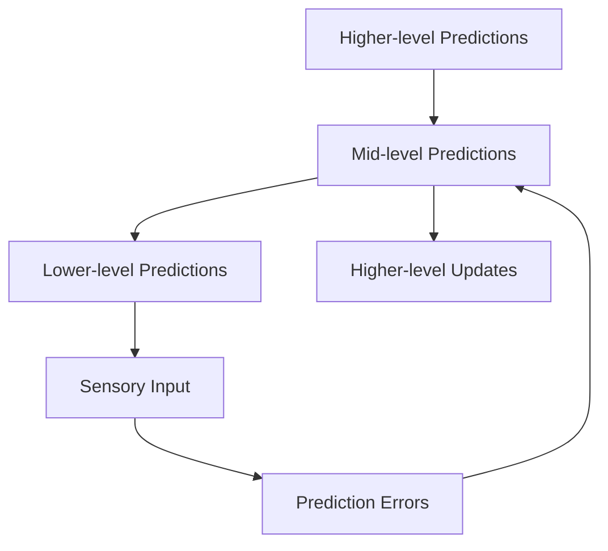

# Predictive Perception


## Overview

Predictive perception is a fundamental cognitive process where the brain actively generates predictions about sensory inputs and updates these predictions based on prediction errors. This framework is central to [[predictive_processing|Predictive Processing]] and [[active_inference|Active Inference]].

## Core Principles

### 1. Hierarchical Prediction

```python
import numpy as np

rng = np.random.default_rng(0)

# Two-level linear generative model (illustrative): v2 -> v1 -> input
W1 = rng.normal(size=(4, 3)) / 2             # level 1 prediction of the input
W2 = rng.normal(size=(3, 2)) / 2             # level 2 prediction of level 1
sensory = W1 @ (W2 @ np.array([1.0, -1.0]))  # input generated by known top causes

v1, v2 = np.zeros(3), np.zeros(2)
for _ in range(2000):
    e0 = sensory - W1 @ v1                   # sensory prediction error
    e1 = v1 - W2 @ v2                        # level-1 prediction error
    v1 += 0.05 * (W1.T @ e0 - e1)            # bottom-up error minus top-down pull
    v2 += 0.05 * (W2.T @ e1 - 0.01 * v2)     # weak prior on the top cause
print(np.linalg.norm(sensory), np.linalg.norm(e0))   # initial vs final sensory error
```

### 2. Prediction Error

```python
import numpy as np

prediction = np.array([0.2, 0.5, 0.9])
sensation = np.array([0.3, 0.1, 0.9])
precision = np.array([4.0, 1.0, 9.0])        # inverse variances, illustrative

error = sensation - prediction
weighted_error = precision * error           # precision-weighted prediction error
print(error, weighted_error)
```

## Neural Implementation

### 1. Message Passing

- Top-down predictions via feedback connections

- Bottom-up prediction errors via feedforward connections

- Precision weighting via neuromodulation

### 2. Hierarchical Processing



## Mathematical Framework

### Information Theory

- [[knowledge_base/mathematics/information_theory#entropy|Entropy]] - Uncertainty quantification

- [[knowledge_base/mathematics/information_theory#divergence-measures|KL Divergence]] - Prediction error measure

- [[knowledge_base/mathematics/information_theory#mutual-information|Mutual Information]] - Information gain

### Variational Methods

- [[knowledge_base/mathematics/variational_methods#variational-inference-framework|Free Energy]] - Error minimization

- [[knowledge_base/mathematics/path_integral#action-computation|Action Computation]] - Trajectory optimization

- [[knowledge_base/mathematics/expected_free_energy|Expected Free Energy]] - Future prediction

## Applications

### 1. Visual Perception

```python
import numpy as np

rng = np.random.default_rng(1)
pattern = np.sin(np.linspace(0, np.pi, 8))   # a stimulus the model expects
belief, rate = np.zeros(8), 0.3              # learned expectation, illustrative rate

for trial in range(6):
    sensation = pattern + 0.02 * rng.normal(size=8)
    error = sensation - belief
    belief += rate * error                   # expectation absorbs the stimulus
    print(trial, np.linalg.norm(error).round(3))   # response shrinks when expected
```

### 2. Multimodal Integration

```python
import numpy as np

# Two cues about one cause (e.g. seen and heard position), illustrative values
x_vis, var_vis = 1.0, 0.5
x_aud, var_aud = 2.0, 2.0

w_vis, w_aud = 1 / var_vis, 1 / var_aud      # precisions
estimate = (w_vis * x_vis + w_aud * x_aud) / (w_vis + w_aud)
variance = 1 / (w_vis + w_aud)
print(estimate, variance)                    # pulled toward the more precise cue
```


## Experimental Evidence

### 1. Behavioral Studies

- Visual illusions demonstrating top-down effects

- Context effects on perception

- Attention modulation of perception

### 2. Neural Evidence

- Predictive coding in visual cortex

- Hierarchical processing in sensory systems

- Precision-weighted prediction errors

## Clinical Applications

### 1. Perceptual Disorders

- Schizophrenia as prediction error dysfunction

- Autism as precision weighting abnormalities

- Visual processing disorders


## Research Directions

### Current Challenges

1. Precise neural mechanisms

1. Individual differences

1. Development trajectory

1. Clinical applications

### Future Developments

1. Computational models

1. Clinical interventions

1. Technological applications

1. Educational implications

## Related Phenomena

- [[attention_mechanisms]] - Attention and perception

- [[sensory_integration]] - Multimodal processing

- [[perceptual_learning]] - Learning and adaptation

- [[consciousness]] - Conscious perception

## References

- [[active_inference|Active Inference]]

- [[predictive_processing|Predictive Processing]]

- [[knowledge_base/mathematics/information_theory|Information Theory]]

- [[knowledge_base/mathematics/variational_methods|Variational Methods]]

