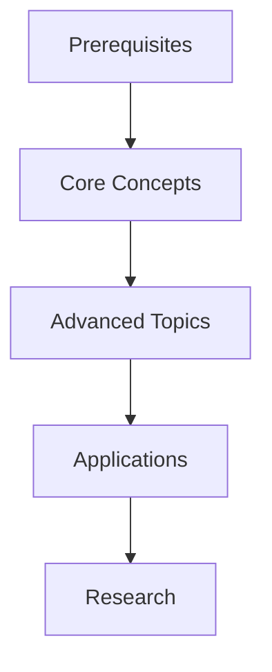
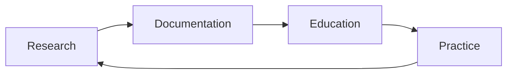

# Research and Educational Applications

> **Code on this page.** The Python snippets illustrate the ideas. Unless a snippet imports the
> `cognitive` package, it is not part of the package and is not run by its tests, so treat it as a
> sketch. The tested implementations are listed in [[docs/api/api_reference|the API reference]].

## Overview

Plain text documentation serves as a powerful foundation for research and education in cognitive modeling. This document explores how our text-based approach enhances scientific research, knowledge transfer, and educational outcomes.

## Research Applications

### 1. Literature Management

```yaml

---

paper:

  title: "Active Inference: A Process Theory"

  authors: ["Friston", "FitzGerald", "Rigoli"]

  year: 2017

  key_concepts:

    - [[free_energy_principle]]

    - [[active_inference]]

    - [[predictive_processing]]

  implementations:

    - [[basic_active_inference]]

    - [[advanced_models]]

---

```

### 2. Experiment Documentation

- **Structured Recording**

  - [[experiment_design]]

  - data collection

  - result analysis

  - replication protocols

### 3. Knowledge Synthesis

- **Integration Patterns**

  - literature review

  - concept mapping

  - theory development

## Educational Framework

### 1. Learning Pathways



### 2. Concept Dependencies

- **Structured Learning**

  - foundational concepts

  - intermediate topics

  - advanced applications

### 3. Interactive Learning

```python

# Interactive example with documentation

class ActiveInferenceAgent:

    """

    Learn about Active Inference:

    1. free_energy_principle

    2. belief_updating

    3. action_selection

    """

    def update_beliefs(self, observation):

        # Implementation details

        pass

```

## Knowledge Organization

### 1. Concept Mapping

- **Hierarchical Structure**

  - concept hierarchy

  - relationship mapping

  - [[knowledge_graphs]]

### 2. Learning Resources

```markdown

## Active Inference

- [[theoretical_foundation]]

  - Mathematical Framework

  - Key Principles

- [[practical_implementation]]

  - Code Examples

  - Case Studies

- [[exercises]]

  - Basic Problems

  - Advanced Challenges

```

### 3. Progress Tracking

- **Learning Assessment**

  - skill progression

  - knowledge gaps

  - mastery criteria

## Research Tools

### 1. Literature Analysis

```python

def analyze_literature():

    """

    Analyze research papers and extract key concepts.

    See literature_analysis for methodology.

    """

    papers = collect_papers()

    concepts = extract_concepts()

    relationships = map_relationships()

    return knowledge_graph

```

### 2. Experiment Tools

- **Research Support**

  - data collection tools

  - analysis scripts

  - [[visualization_tools]]

### 3. Collaboration Features

- **Team Science**

  - version control

  - peer review

  - knowledge sharing

## Educational Tools

### 1. Tutorial Generation

```python

def generate_tutorial():

    """

    Generate interactive tutorials from documentation.

    See tutorial_generation for details.

    """

    concepts = extract_concepts()

    examples = get_examples()

    exercises = create_exercises()

    return tutorial

```

### 2. Assessment Tools

- **Learning Evaluation**

  - quiz generation

  - progress tracking

  - [[feedback_systems]]

### 3. Interactive Examples

- **Hands-on Learning**

  - code playgrounds

  - interactive notebooks

  - simulation environments

## Integration Benefits

### 1. Research-Education Bridge



### 2. Knowledge Flow

- **Bidirectional Transfer**

  - research to education

  - education to research

  - practice to theory

### 3. Continuous Improvement

- **Iterative Development**

  - feedback incorporation

  - content refinement

  - system evolution

## Best Practices

### 1. Research Documentation

- **Scientific Rigor**

  - methodology documentation

  - result reproduction

  - peer review process

### 2. Educational Content

- **Pedagogical Design**

  - learning objectives

  - content structure

  - assessment design

### 3. Integration Methods

- **Unified Approach**

  - workflow integration

  - tool compatibility

  - system coherence

## Implementation Examples

### 1. Research Projects

```yaml

project:

  title: "Active Inference Study"

  components:

    - [[literature_review]]

    - [[experiment_design]]

    - [[data_analysis]]

    - [[publication]]

```

### 2. Educational Modules

```yaml

module:

  title: "Introduction to Active Inference"

  sections:

    - [[theoretical_background]]

    - [[practical_exercises]]

    - [[assessments]]

```

## Related Concepts

- knowledge management

- [[learning_systems]]

- research methods

- educational design

## References

- research methodology

- educational theory

- [[knowledge_organization]]

- learning science

