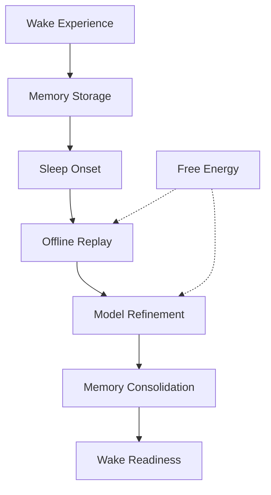

# Sleep and Memory Consolidation Through Active Inference

> **Code on this page.** The Python snippets illustrate the ideas. Unless a snippet imports the
> `cognitive` package, it is not part of the package and is not run by its tests, so treat it as a
> sketch. The tested implementations are listed in [[docs/api/api_reference|the API reference]].

This document explores sleep and memory consolidation as Active Inference processes, examining how offline learning optimizes generative models during sleep. It integrates sleep neuroscience with computational modeling to understand how the sleeping brain refines predictions and consolidates memories.

## 🧠 Sleep as Active Inference

### Offline Model Optimization

Sleep as a period of unconstrained model refinement:



### Core Sleep Active Inference Architecture

```python
import numpy as np

rng = np.random.default_rng(0)
cues = rng.normal(size=(5, 20))              # wake experiences (illustrative)
outcomes = rng.normal(size=(5, 3))
W = np.zeros((20, 3))                        # linear generative mapping

def prediction_error(W):
    return np.mean((cues @ W - outcomes) ** 2)

def learn(W, i, rate=0.02):
    x, y = cues[i], outcomes[i]
    return W + rate * np.outer(x, y - x @ W)  # delta rule on the prediction error

for i in range(5):                           # wake: one pass over each experience
    W = learn(W, i)
print("after wake:", prediction_error(W))

for _ in range(500):                         # sleep: offline replay, no new input
    W = learn(W, rng.integers(5))
print("after replay:", prediction_error(W))
```

## 🔬 Memory Replay and Consolidation

### Experience Replay During Sleep

Neural replay as Active Inference optimization:

```python
import numpy as np

rng = np.random.default_rng(1)
errors = np.array([0.1, 0.5, 2.0, 0.3])      # per-episode prediction error, illustrative
alpha = 1.0                                  # prioritisation strength

priority = errors**alpha
p = priority / priority.sum()
replayed = rng.choice(len(errors), size=1000, p=p)
print(np.bincount(replayed, minlength=len(errors)) / 1000, p)   # replay follows error
```

### Memory Consolidation Processes

Transforming labile memories into stable representations.

## 🧪 Sleep Stage-Specific Processing

### NREM Sleep Processing

Slow-wave sleep for memory consolidation.

### REM Sleep Processing

Dreaming and emotional processing.

## 🧬 Precision Optimization During Sleep

### Sleep-Dependent Precision Tuning

How sleep optimizes prediction precision:

```python
import numpy as np

rng = np.random.default_rng(2)
noise_sd = np.array([0.2, 1.0, 3.0])         # three sensory channels, illustrative
replayed_errors = noise_sd * rng.normal(size=(5000, 3))

precision = 1.0 / replayed_errors.var(axis=0)    # estimated inverse variance
print(precision.round(2), (1 / noise_sd**2).round(2))   # estimate vs true precision
```

## 🧪 Sleep and Learning Interactions

### Sleep-Dependent Learning

How sleep enhances different types of learning.

## 🧬 Clinical Sleep Research

### Sleep Disorders and Memory

Impact of sleep disorders on memory consolidation.

## 🔬 Research Directions

### Computational Sleep Neuroscience

#### Large-Scale Sleep Simulations
- **Brain-scale sleep models**: Simulating sleep processes across the entire brain
- **Individual differences**: Modeling how sleep varies between individuals
- **Developmental changes**: How sleep changes across the lifespan

#### Active Inference Sleep Models
- **Free energy during sleep**: How free energy drives sleep processes
- **Precision dynamics**: How precision changes during sleep stages
- **Model optimization**: Mathematical optimization during offline processing

### Sleep-Based Therapies

#### Memory Enhancement
- **Targeted memory reactivation**: Using cues to enhance specific memory consolidation
- **Sleep structure optimization**: Optimizing sleep architecture for learning
- **Transcranial stimulation**: Using brain stimulation to enhance sleep-dependent learning

#### Clinical Applications
- **Sleep disorder treatments**: New treatments based on Active Inference principles
- **Memory rehabilitation**: Using sleep to enhance memory recovery
- **Learning disorders**: Sleep-based interventions for learning difficulties

## 📚 Related Concepts

### Core Sleep Processes
- [[sleep]] - General sleep processes
- [[memory_consolidation]] - Memory consolidation mechanisms
- [[brain_rhythms]] - Neural oscillations during sleep

### Active Inference Integration
- [[active_inference]] - Core framework
- offline learning - Learning without new input
- [[precision_weighting]] - Precision changes during sleep

### Memory Systems
- [[memory_systems]] - Different memory types
- [[episodic_memory]] - Event memory consolidation
- [[procedural_memory]] - Skill memory consolidation

---

> **Sleep Active Inference**: Sleep represents a state of unconstrained Active Inference where the brain optimizes its generative model through memory replay, precision tuning, and consolidation in the absence of new sensory input.

---

> **Memory Replay**: Neural replay during sleep reactivates wake experiences to minimize prediction errors, strengthening important memories and weakening irrelevant ones through selective consolidation.

---

> **Precision Optimization**: Sleep dynamically adjusts prediction precision across sensory, motor, cognitive, and emotional domains, optimizing the balance between flexibility and stability in the generative model.

## References

- Hobson, J. A., & Friston, K. J. (2012). Waking and dreaming consciousness: Neurobiological and functional considerations. Progress in Neurobiology, 98(1), 82-98.
- Hobson, J. A., Hong, C. C.-H., & Friston, K. J. (2014). Virtual reality and consciousness inference in dreaming. Frontiers in Psychology, 5, 1133.
- Diekelmann, S., & Born, J. (2010). The memory function of sleep. Nature Reviews Neuroscience, 11(2), 114-126.
- Wilson, M. A., & McNaughton, B. L. (1994). Reactivation of hippocampal ensemble memories during sleep. Science, 265(5172), 676-679.
- Tononi, G., & Cirelli, C. (2014). Sleep and the price of plasticity: From synaptic and cellular homeostasis to memory consolidation and integration. Neuron, 81(1), 12-34.
