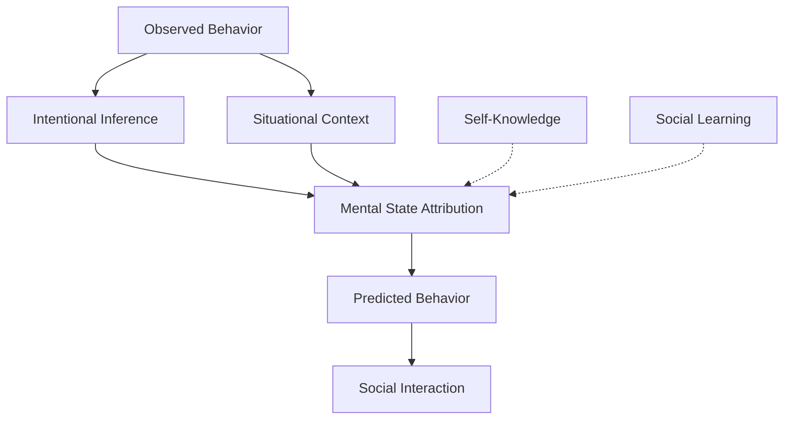

# Advanced Social Cognition and Theory of Mind

> **Code on this page.** The Python snippets illustrate the ideas. Unless a snippet imports the
> `cognitive` package, it is not part of the package and is not run by its tests, so treat it as a
> sketch. The tested implementations are listed in [[docs/api/api_reference|the API reference]].

This document explores advanced aspects of social cognition through Active Inference, focusing on theory of mind, mentalizing, social prediction, and the neural mechanisms supporting sophisticated social understanding and interaction.

## 🧠 Theory of Mind as Active Inference

### Mental State Attribution

Theory of mind involves inferring others' mental states from their behavior and context:



### Hierarchical Mentalizing

Social cognition operates across multiple levels of inference:

```python
import numpy as np

softmax = lambda x: np.exp(x - x.max()) / np.exp(x - x.max()).sum()

def level_k_policy(P_self, P_other, k, beta=3.0):
    """Level-0 acts uniformly; level-k softmax-best-responds to a level-(k-1) partner.

    P_self[a_self, a_other] and P_other[a_other, a_self] are the two players' payoffs."""
    if k == 0:
        return np.full(P_self.shape[0], 1.0 / P_self.shape[0])
    partner = level_k_policy(P_other, P_self, k - 1, beta)
    return softmax(beta * P_self @ partner)

# Illustrative coordination game with different preferred outcomes
P_row = np.array([[2.0, 0.0], [0.0, 1.0]])
P_col = np.array([[1.0, 0.0], [0.0, 2.0]])
for k in range(4):
    print(k, np.round(level_k_policy(P_row, P_col, k), 3))
```

## 🔬 Neural Mechanisms of Social Cognition

### Mirror Neuron System

Neural basis for understanding others' actions and intentions; the sketch below shows only the computational step, inferring goals from observed movement:

```python
# Inferring an observed agent's goal from its movement (inverse planning)
goals = np.array([[0.0, 5.0], [5.0, 0.0]])                    # two candidate goal locations
def action_likelihood(pos, step, goal, beta=2.0):
    """p(step | goal) is a softmax over how much each step reduces distance to the goal."""
    steps = np.array([[1, 0], [-1, 0], [0, 1], [0, -1]])
    gain = -np.linalg.norm(pos + steps - goal, axis=1)
    p = softmax(beta * gain)
    return p[np.where((steps == step).all(axis=1))[0][0]]

posterior = np.array([0.5, 0.5])
pos = np.zeros(2)
for step in ([0, 1], [0, 1], [1, 0], [0, 1]):                 # observed steps
    posterior *= [action_likelihood(pos, np.array(step), g) for g in goals]
    posterior /= posterior.sum()
    pos = pos + step
    print(pos, np.round(posterior, 3))
```

## 🧪 Social Prediction and Learning

### Social Generative Models

Predicting social behavior through learned social models:

```python
class OtherAgentModel:
    """Learn p(other's action | context) from observed behaviour using Dirichlet counts."""

    def __init__(self, n_contexts, n_actions):
        self.counts = np.ones((n_contexts, n_actions))

    def predict(self, context):
        return self.counts[context] / self.counts[context].sum()

    def observe(self, context, action):
        surprise = -np.log(self.predict(context)[action])      # prediction error in nats
        self.counts[context, action] += 1
        return surprise

rng = np.random.default_rng(0)
true_policy = np.array([[0.8, 0.2], [0.1, 0.9]])               # illustrative other agent
model = OtherAgentModel(2, 2)
surprises = []
for t in range(300):
    c = rng.integers(2)
    surprises.append(model.observe(c, rng.choice(2, p=true_policy[c])))
print("mean surprise, first 50 vs last 50:", np.mean(surprises[:50]), np.mean(surprises[-50:]))
print(np.round([model.predict(c) for c in range(2)], 2))
```

### Social Learning Mechanisms

Learning social norms and expectations:

```python
# Norm learning: pool observations of many individuals into an expectation, then score deviations
observed = rng.choice(3, size=200, p=[0.7, 0.2, 0.1])         # illustrative behaviours of others
norm = (np.bincount(observed, minlength=3) + 1) / (len(observed) + 3)
surprisal = -np.log(norm)                                     # how unexpected each behaviour is
print("norm:", np.round(norm, 2), "surprisal:", np.round(surprisal, 2))
```

## 🧬 Cultural and Developmental Aspects

### Cultural Learning

How social cognition adapts to cultural contexts:

```python
# Cultural context as a latent variable: infer the context, then predict with the mixture
conventions = np.array([[0.8, 0.15, 0.05],                    # p(behaviour | context 0)
                        [0.1, 0.30, 0.60]])                   # p(behaviour | context 1)
prior = np.array([0.5, 0.5])
posterior = prior.copy()
for b in (2, 2, 1, 2):                                        # behaviours seen in a new setting
    posterior = posterior * conventions[:, b]
    posterior /= posterior.sum()
print("p(context | behaviours):", np.round(posterior, 3))
print("predicted next behaviour:", np.round(posterior @ conventions, 3))
```

## 🔬 Research Directions

### Advanced Theory of Mind

#### Higher-Order Mentalizing
- **Third-order and beyond**: Modeling beliefs about beliefs about beliefs
- **Recursive mentalizing**: Infinite regress in social cognition
- **Meta-mentalizing**: Thinking about thinking about mental states

#### Cultural Cognition
- **Cross-cultural theory of mind**: Cultural variations in mentalizing
- **Cultural neuroscience**: Neural basis of cultural social cognition
- **Global-local social processing**: Cultural influences on social perception

### Computational Social Neuroscience

#### Neural Network Models
- **Deep mentalizing networks**: Neural networks for theory of mind
- **Social attention networks**: Neural mechanisms for social attention
- **Empathy networks**: Neural basis of emotional contagion

#### Active Inference Social Models
- **Social free energy**: Free energy in social contexts
- **Social precision**: Precision weighting in social cognition
- **Collective inference**: Multi-agent Active Inference

## 📚 Related Concepts

### Core Social Cognition
- [[social_cognition]] - Basic social cognition mechanisms
- [[communication]] - Social communication processes
- [[cooperation]] - Social cooperation and coordination

### Theory of Mind
- [[hierarchical_inference]] - Multi-level social inference
- [[working_memory]] - Social working memory
- [[attention_mechanisms]] - Social attention

### Neural Basis
- [[knowledge_base/biology/neuroscience]] - Neural mechanisms
- [[social_insect_cognition]] - Comparative social cognition
- [[neural_active_inference]] - Neural implementation

---

> **Advanced Social Cognition**: Social understanding involves hierarchical inference about others' mental states, cultural adaptation, and complex social prediction through Active Inference.

---

> **Theory of Mind Hierarchy**: Social cognition operates across multiple levels, from basic behavior observation to recursive modeling of others' beliefs about beliefs.

---

> **Neural Social Networks**: Specialized brain networks support social cognition, with mirror neurons for action understanding and mentalizing networks for theory of mind.

## References

- Premack, D., & Woodruff, G. (1978). Does the chimpanzee have a theory of mind? Behavioral and Brain Sciences, 1(4), 515-526.
- Frith, C. D., & Frith, U. (2006). The neural basis of mentalizing. Neuron, 50(4), 531-534.
- Kilner, J. M., Friston, K. J., & Frith, C. D. (2007). Predictive coding: An account of the mirror neuron system. Cognitive Processing, 8(3), 159-166.
- Friston, K., & Frith, C. (2015). Active inference, communication and hermeneutics. Cortex, 68, 129-143.
- Lawson, R. P., Rees, G., & Friston, K. J. (2014). An aberrant precision account of autism. Frontiers in Human Neuroscience, 8, 302.
