# Bayesian Generative Models

> **Code on this page.** The Python snippets illustrate the ideas. Unless a snippet imports the
> `cognitive` package, it is not part of the package and is not run by its tests, so treat it as a
> sketch. The tested implementations are listed in [[docs/api/api_reference|the API reference]].

## Overview

Bayesian generative models represent a powerful framework for modeling complex data generation processes while maintaining explicit uncertainty quantification. These models leverage [[bayesian_inference|Bayesian inference]] principles to describe how observations arise from underlying latent variables through probabilistic mechanisms.

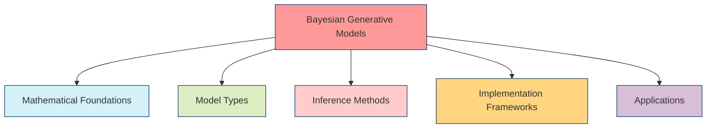

## Mathematical Foundations

### Generative Process

The core idea of a Bayesian generative model is to represent a data-generating process as:

```math

\begin{align}

\theta &\sim p(\theta) \quad \text{(Parameter Prior)}\\

z &\sim p(z|\theta) \quad \text{(Latent Variable)}\\

x &\sim p(x|z,\theta) \quad \text{(Observed Data)}

\end{align}

```

where:

- $\theta$ represents model parameters

- $z$ represents latent (unobserved) variables

- $x$ represents observed data

### Joint Distribution

The complete model specifies a joint distribution:

```math

p(x, z, \theta) = p(\theta)p(z|\theta)p(x|z,\theta)

```

Inference focuses on computing the posterior distribution:

```math

p(z, \theta|x) = \frac{p(x, z, \theta)}{p(x)} = \frac{p(\theta)p(z|\theta)p(x|z,\theta)}{\int\int p(\theta)p(z|\theta)p(x|z,\theta)d\theta dz}

```

### Hierarchical Structure

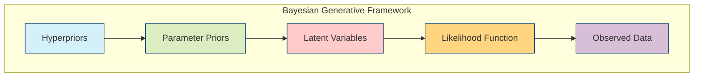

## Model Types

### Directed Graphical Models

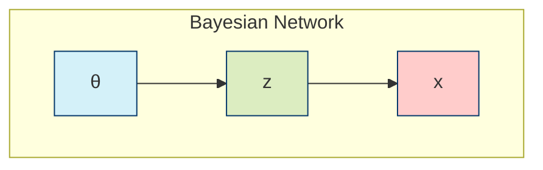

#### Latent Dirichlet Allocation (LDA)

```python
import numpy as np
rng = np.random.default_rng(0)

n_topics, vocab, n_docs, doc_len = 2, 5, 3, 20
alpha = np.full(n_topics, 0.5)                          # document-topic prior (illustrative)
beta = rng.dirichlet(np.full(vocab, 0.5), n_topics)     # topic-word distributions

docs = []
for _ in range(n_docs):
    theta = rng.dirichlet(alpha)                        # theta ~ p(theta)
    z = rng.choice(n_topics, size=doc_len, p=theta)     # z ~ p(z | theta)
    docs.append([rng.choice(vocab, p=beta[k]) for k in z])   # x ~ p(x | z)
print(docs[0])
```

### Hierarchical Models

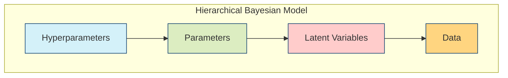

#### Hierarchical Linear Regression

```python
import numpy as np
rng = np.random.default_rng(1)

# Generative process: mu ~ N(0, tau^2), y_ij ~ N(mu_j, sigma^2)
tau, sigma, n_groups, n_per = 1.0, 0.5, 4, 10           # illustrative
mu = rng.normal(0, tau, n_groups)
y = mu[:, None] + rng.normal(0, sigma, (n_groups, n_per))

# Conjugate posterior mean of mu_j shrinks the group mean towards 0
w = (n_per / sigma**2) / (n_per / sigma**2 + 1 / tau**2)
posterior_mean = w * y.mean(axis=1)
print(np.round(mu, 2), np.round(posterior_mean, 2))
```

### Deep Generative Models

```mermaid

graph TB

    subgraph "Deep Generative Model"

        A[Prior p(z)] --> B[Encoder Network q(z|x)]

        A --> C[Decoder Network p(x|z)]

        B --> D[Latent Space]

        D --> C

        C --> E[Reconstructed Data]

    end

    style A fill:#d4f1f9,stroke:#05386b

    style B fill:#dcedc1,stroke:#05386b

    style C fill:#ffcccb,stroke:#05386b

    style D fill:#ffd580,stroke:#05386b

    style E fill:#d8bfd8,stroke:#05386b

```

#### Variational Autoencoder (VAE)

```python
import numpy as np
rng = np.random.default_rng(2)

def elbo_one_sample(x, mu, log_var, decode):
    """Single-sample ELBO with a Gaussian encoder q(z|x) = N(mu, exp(log_var)),
    prior N(0, I), and a unit-variance Gaussian decoder (up to a constant)."""
    z = mu + np.exp(0.5 * log_var) * rng.standard_normal(mu.shape)  # reparameterisation
    recon = -0.5 * np.sum((x - decode(z)) ** 2)
    kl = 0.5 * np.sum(np.exp(log_var) + mu**2 - 1.0 - log_var)      # KL(q || p) in closed form
    return recon - kl

W = np.array([[1.0, 0.0], [0.0, 1.0], [0.5, 0.5]])      # illustrative linear decoder
x = np.array([0.3, -0.2, 0.1])
print(elbo_one_sample(x, mu=np.zeros(2), log_var=np.zeros(2), decode=lambda z: W @ z))
```

## Inference Methods

### Markov Chain Monte Carlo

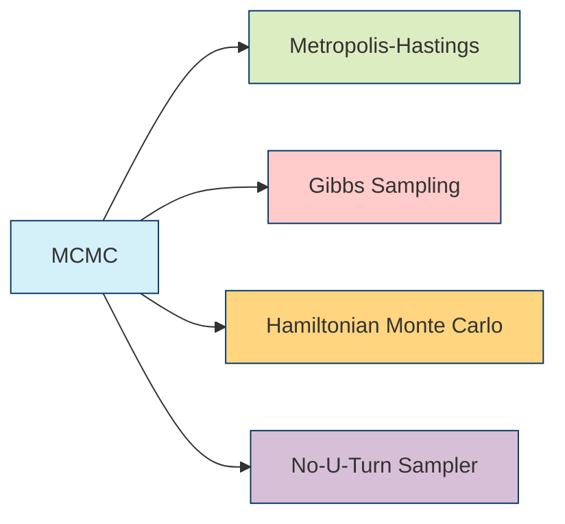

#### Hamiltonian Monte Carlo Implementation

```python
import numpy as np
rng = np.random.default_rng(3)

def hmc_step(q, log_p, grad_log_p, eps=0.2, n_leapfrog=10):
    p = rng.standard_normal(q.shape)
    q_new, p_new = q.copy(), p.copy()
    p_new += 0.5 * eps * grad_log_p(q_new)
    for i in range(n_leapfrog):
        q_new += eps * p_new
        if i < n_leapfrog - 1:
            p_new += eps * grad_log_p(q_new)
    p_new += 0.5 * eps * grad_log_p(q_new)
    h_old = -log_p(q) + 0.5 * p @ p
    h_new = -log_p(q_new) + 0.5 * p_new @ p_new
    return q_new if np.log(rng.uniform()) < h_old - h_new else q

log_p = lambda q: -0.5 * np.sum(q**2)         # standard normal target
grad = lambda q: -q
q, samples = np.zeros(2), []
for _ in range(2000):
    q = hmc_step(q, log_p, grad)
    samples.append(q)
samples = np.array(samples)
print(np.round(samples.mean(0), 2), np.round(samples.std(0), 2))
```

### Variational Inference

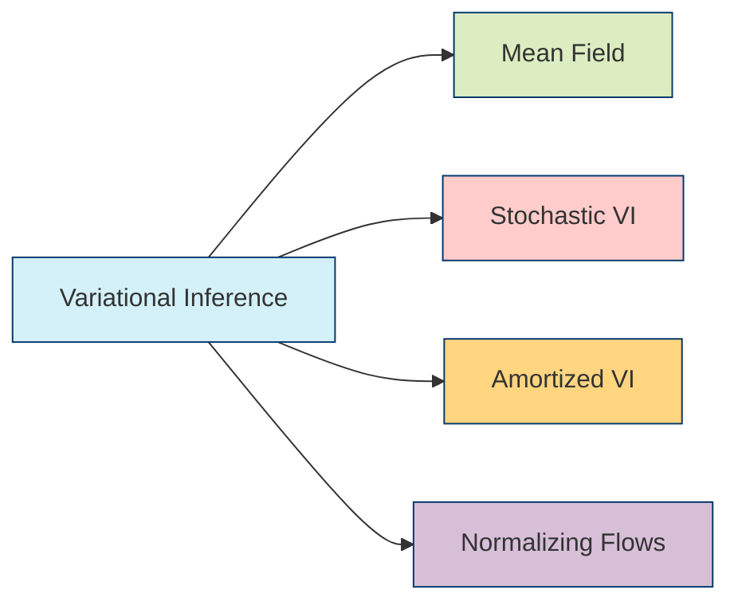

### Expectation-Maximization

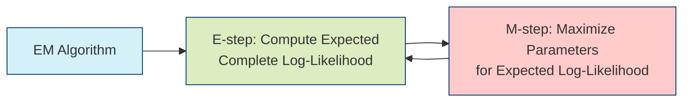

#### Gaussian Mixture Model with EM

```python
import numpy as np
rng = np.random.default_rng(4)

x = np.concatenate([rng.normal(-2, 1, 200), rng.normal(3, 1, 200)])   # illustrative data
mu, var, pi = np.array([-1.0, 1.0]), np.ones(2), np.array([0.5, 0.5])

for _ in range(50):
    # E-step: responsibilities r[n, k] = p(z_n = k | x_n)
    dens = pi * np.exp(-0.5 * (x[:, None] - mu) ** 2 / var) / np.sqrt(2 * np.pi * var)
    r = dens / dens.sum(axis=1, keepdims=True)
    # M-step: re-estimate parameters from the expected assignments
    nk = r.sum(axis=0)
    pi, mu = nk / len(x), (r * x[:, None]).sum(axis=0) / nk
    var = (r * (x[:, None] - mu) ** 2).sum(axis=0) / nk
print(np.round(mu, 1), np.round(pi, 2))
```

## Implementation Frameworks

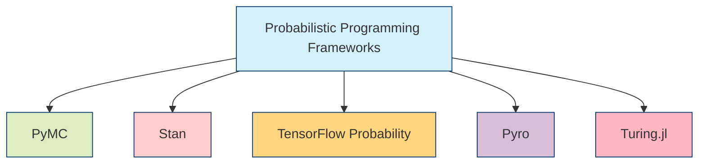

### Stan Example: Hierarchical Model

```stan

// Hierarchical Normal Model in Stan

data {

  int<lower=0> N;            // Number of observations

  int<lower=0> J;            // Number of groups

  array[N] int<lower=1, upper=J> group;  // Group indicators

  vector[N] y;               // Observations

}

parameters {

  real mu_overall;           // Global mean

  real<lower=0> sigma_overall;  // Between-group standard deviation

  vector[J] mu_group;        // Group-specific means

  real<lower=0> sigma_within;   // Within-group standard deviation

}

model {

  // Priors

  mu_overall ~ normal(0, 10);

  sigma_overall ~ cauchy(0, 5);

  sigma_within ~ cauchy(0, 5);

  // Hierarchical structure

  mu_group ~ normal(mu_overall, sigma_overall);

  // Likelihood

  y ~ normal(mu_group[group], sigma_within);

}

generated quantities {

  vector[N] y_rep;           // Posterior predictive samples

  for (n in 1:N)

    y_rep[n] = normal_rng(mu_group[group[n]], sigma_within);

}

```

### Turing.jl Example: Linear Mixed Effects Model

```julia

using Turing

using Random

using StatsPlots

using DataFrames

using Parameters

"""

Bayesian linear mixed effects model in Turing.jl

"""

@model function mixed_effects(X, groups, y; n_groups=length(unique(groups)))

    # Fixed effects priors

    n_predictors = size(X, 2)

    β ~ MvNormal(zeros(n_predictors), 10.0 * I)

    # Group-level effect priors

    σ_group ~ truncated(Cauchy(0, 5), 0, Inf)

    α ~ filldist(Normal(0, σ_group), n_groups)

    # Likelihood variance

    σ_y ~ truncated(Cauchy(0, 5), 0, Inf)

    # Likelihood

    μ = X * β + α[groups]

    y ~ MvNormal(μ, σ_y^2 * I)

    return nothing

end

"""

Fit mixed effects model and sample posterior

"""

function fit_mixed_effects(X, groups, y; n_chains=4)

    # Set up model

    model = mixed_effects(X, groups, y)

    # Run NUTS sampler

    chain = sample(model, NUTS(), MCMCThreads(), 1000, n_chains)

    return chain

end

"""

Generate predictions from posterior samples

"""

function predict_mixed_effects(chain, X_new, groups_new)

    # Extract posterior samples

    samples = Array(chain)

    n_samples = size(samples, 1)

    # Get parameters

    β_samples = samples[:, 1:size(X_new, 2)]

    α_samples = samples[:, (size(X_new, 2)+2):(size(X_new, 2)+1+length(unique(groups_new)))]

    σ_y_samples = samples[:, size(X_new, 2)+1]

    # Generate predictions

    predictions = zeros(n_samples, length(groups_new))

    for i in 1:n_samples

        μ = X_new * β_samples[i, :] + α_samples[i, groups_new]

        predictions[i, :] = μ

    end

    return predictions

end

```

## Applications

```mermaid

mindmap

  root((Bayesian<br>Generative<br>Models))

    Machine Learning

      Representation Learning

      Density Estimation

      Semi-supervised Learning

    Computer Vision

      Image Generation

      Scene Understanding

      3D Reconstruction

    Natural Language Processing

      Topic Modeling

      Language Generation

      Document Classification

    Science

      Physical Systems

      Computational Biology

      Causal Discovery

    Decision Making

      Reinforcement Learning

      Active Learning

      Experimental Design

```

## Theoretical Extensions

### Information-Theoretic Perspectives

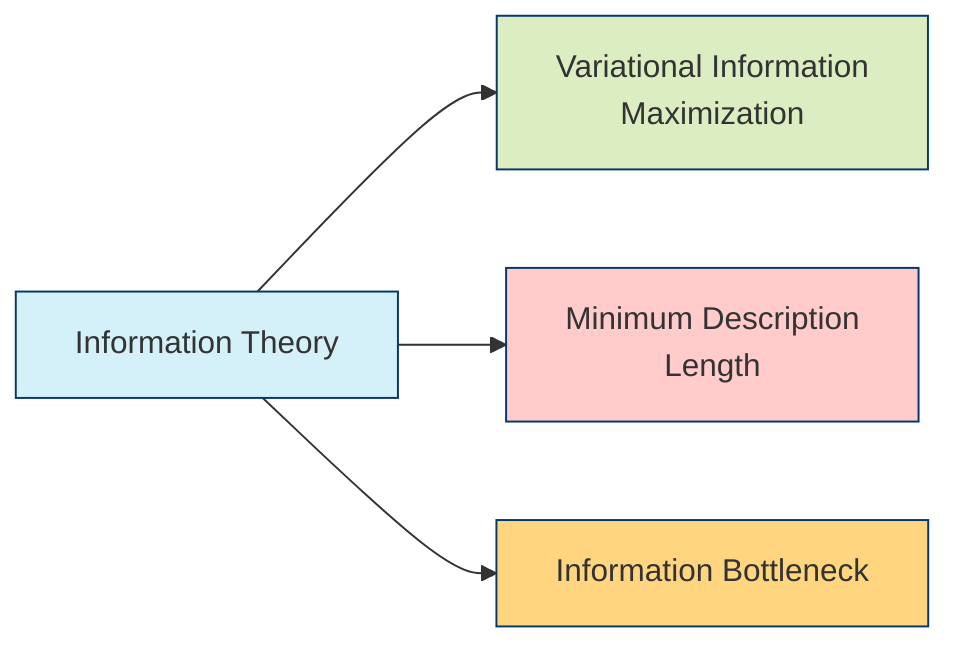

### Bayesian Decision Theory

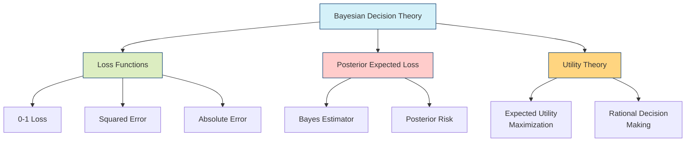

### Computational Complexity

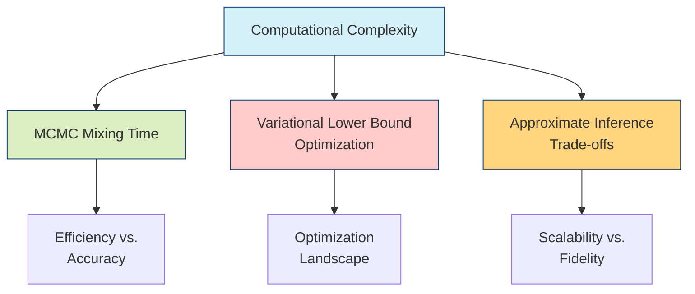

## References

1. Blei, D. M., Kucukelbir, A., & McAuliffe, J. D. (2017). Variational inference: A review for statisticians. Journal of the American statistical Association, 112(518), 859-877.

1. Gelman, A., Carlin, J. B., Stern, H. S., Dunson, D. B., Vehtari, A., & Rubin, D. B. (2013). Bayesian data analysis. CRC press.

1. Kingma, D. P., & Welling, M. (2013). Auto-encoding variational bayes. arXiv preprint arXiv:1312.6114.

1. Goodfellow, I., Pouget-Abadie, J., Mirza, M., Xu, B., Warde-Farley, D., Ozair, S., ... & Bengio, Y. (2014). Generative adversarial networks. Communications of the ACM, 63(11), 139-144.

1. Hoffman, M. D., & Gelman, A. (2014). The No-U-Turn sampler: adaptively setting path lengths in Hamiltonian Monte Carlo. Journal of Machine Learning Research, 15(1), 1593-1623.

1. Tran, D., Ranganath, R., & Blei, D. (2016). Hierarchical implicit models and likelihood-free variational inference. Advances in neural information processing systems, 29.

1. Salimans, T., Kingma, D., & Welling, M. (2015). Markov chain monte carlo and variational inference: Bridging the gap. International Conference on Machine Learning, 1218-1226.

