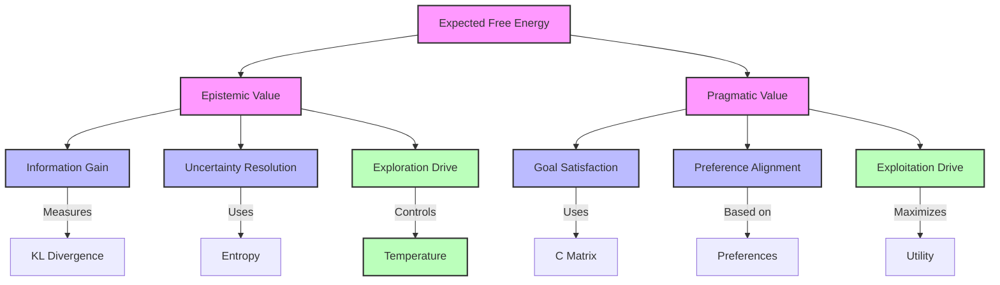
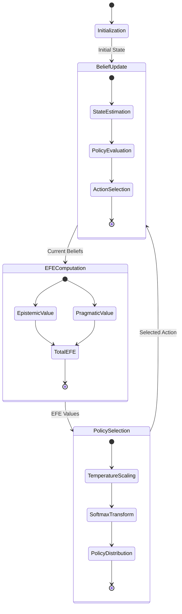
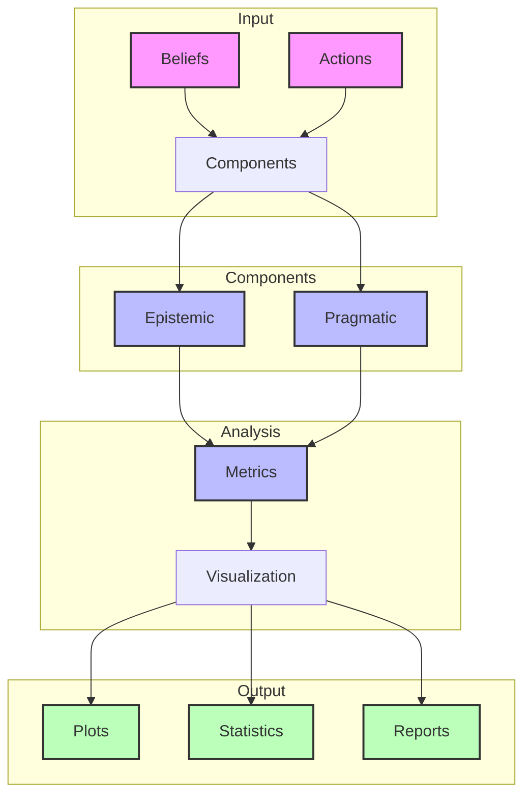

# Expected Free Energy Components

> **Code on this page.** The Python snippets illustrate the ideas. Unless a snippet imports the
> `cognitive` package, it is not part of the package and is not run by its tests, so treat it as a
> sketch. The tested implementations are listed in [[docs/api/api_reference|the API reference]].

## Component Structure



## Mathematical Flow

```mermaid

graph LR

    B[B Matrix] --> |State Transition| QS[Q(s|π)]

    QS --> |Observation Model| A[A Matrix]

    A --> |Predicted Obs| QO[Q(o|π)]

    QO --> |Compare| C[C Matrix]

    QS --> |Entropy| H[H(s|π)]

    H --> |Information| EP[Epistemic Value]

    C --> |Preference| PR[Pragmatic Value]

    EP --> |Sum| EFE[Expected Free Energy]

    PR --> |Sum| EFE

    EFE --> |Temperature γ| SM[Softmax]

    SM --> |Policy| P[P(π)]

    classDef matrix fill:#f9f,stroke:#333,stroke-width:2px

    classDef dist fill:#bbf,stroke:#333,stroke-width:2px

    classDef value fill:#bfb,stroke:#333,stroke-width:2px

    class B,A,C matrix

    class QS,QO,P dist

    class EP,PR,EFE value

```

## Overview

The Expected Free Energy (EFE) comprises two main components for each policy at each timestep:

1. Epistemic Value (Information Gain)

1. Pragmatic Value (Utility/Preference Satisfaction)

Links to:

- [[expected_free_energy]] - Full EFE formulation

- [[active_inference_pomdp]] - POMDP framework

- [[policy_selection]] - Action selection using EFE

## Mathematical Formulation

$G(\pi) = \underbrace{-\mathbb{E}_{Q(\tilde{x},\tilde{y}|\pi)}[D_{KL}[Q(\tilde{x}|\tilde{y},\pi)\|Q(\tilde{x}|\pi)]]}_{\text{Epistemic Value}} - \underbrace{\mathbb{E}_{Q(\tilde{y}|\pi)}[\ln P(\tilde{y}|C)]}_{\text{Pragmatic Value}}$

Links to:

- [[kl_divergence]] - Divergence measure

- [[information_theory]] - Information theoretic foundation

- [[statistical_foundations]] - Mathematical basis

## Component Analysis

### Epistemic Value

- Measures expected information gain

- Drives exploration and uncertainty reduction

- Computed using KL divergence

- Links to:

  - [[information_gain]] - Information theoretic perspective

  - [[exploration_exploitation]] - Balance in decision making

  - [[uncertainty_resolution]] - Uncertainty reduction

  - [[belief_updating]] - State estimation

### Pragmatic Value

- Measures expected goal achievement

- Drives exploitation of preferences

- Uses log preferences from [[C_matrix]]

- Links to:

  - [[utility_theory]] - Preference encoding

  - [[goal_specification]] - Goal definition

  - [[reward_function]] - Reward structure

  - [[preference_learning]] - Learning preferences

## Implementation

```python
import numpy as np

def entropy(p, eps=1e-16):
    return -np.sum(p * np.log(p + eps))

def efe_components(A, B, C, beliefs, action):
    """Return (G, epistemic, pragmatic) for one action.

    A[o, s] = P(o|s); B[s', s, a] = P(s'|s, a); C = ln P(o) (log preferences).
    Epistemic value is the expected information gain I(S; O) under the predictive
    state distribution; pragmatic value is E_Q(o)[ln P(o|C)]; G = -(epistemic + pragmatic).
    """
    Qs = B[:, :, action] @ beliefs            # predicted states
    Qo = A @ Qs                               # predicted observations
    ambiguity = Qs @ np.array([entropy(A[:, s]) for s in range(A.shape[1])])
    epistemic = entropy(Qo) - ambiguity       # H[Q(o)] - E_Q(s) H[P(o|s)]
    pragmatic = Qo @ C
    return -(epistemic + pragmatic), epistemic, pragmatic

# Illustrative two-state, two-observation, two-action model
A = np.array([[0.9, 0.1], [0.1, 0.9]])
B = np.stack([np.eye(2), np.array([[0.5, 0.5], [0.5, 0.5]])], axis=2)
C = np.log(np.array([0.8, 0.2]))
beliefs = np.array([0.9, 0.1])
for a in range(2):
    print(a, efe_components(A, B, C, beliefs, a))
```

Links to:

- [[compute_efe]] - Full EFE computation

- [[matrix_operations]] - Matrix computations

- [[numerical_methods]] - Numerical implementation

## Visualization

### Component Plots

```python
import matplotlib
matplotlib.use("Agg")
import matplotlib.pyplot as plt

parts = np.array([efe_components(A, B, C, beliefs, a) for a in range(B.shape[2])])
G, epistemic, pragmatic = parts.T
fig, ax = plt.subplots(figsize=(5, 3))
ax.bar(range(len(G)), -epistemic, label="-epistemic")
ax.bar(range(len(G)), -pragmatic, bottom=-epistemic, label="-pragmatic")
ax.set_xlabel("action")
ax.set_ylabel("contribution to G")
ax.legend()
fig.savefig("efe_components.png", dpi=100)
```

Links to:

- visualization guide - Visualization standards

- plotting utilities - Plotting tools

- [[matrix_plots]] - Matrix visualization

## Analysis Methods

### Component Balance

- Trade-off between exploration and exploitation

- Temperature parameter effects

- Learning dynamics

- Links to:

  - [[temperature_parameter]] - Control exploration

  - [[learning_dynamics]] - Learning behavior

  - [[optimization_theory]] - Optimization principles

### Temporal Evolution

- Component changes over time

- Policy adaptation

- Convergence properties

- Links to:

  - [[temporal_dynamics]] - Time evolution

  - [[convergence_analysis]] - Convergence study

  - [[policy_learning]] - Policy adaptation

## Related Concepts

- [[free_energy_principle]] - Theoretical foundation

- [[active_inference_theory]] - General framework

- [[variational_inference]] - Inference methods

- [[path_integral_free_energy]] - Path integral perspective

- [[action_selection]] - Selection mechanism

- [[belief_updating]] - State estimation

## References

- [[friston_2017]] - Active Inference

- [[da_costa_2020]] - Active Inference POMDP

- [[parr_2019]] - Generalizing Free Energy

- [[buckley_2017]] - Free Energy Tutorial

## Plot Descriptions

### 1. Total EFE Plot per Policy

- Shows overall Expected Free Energy for each policy over time

- Allows comparison of policy performance

- Highlights temporal dynamics of decision-making

### 2. Mean Components Plot

- Average epistemic and pragmatic values across policies

- Shows balance between exploration and exploitation

- Reveals general behavioral trends

### 3. Component Ratio Plot

- Epistemic/Pragmatic ratio for each policy

- Shows how policies balance information gain vs. goal achievement

- Reveals exploration/exploitation trade-offs

### 4. Policy Comparison Scatter

- Epistemic vs. Pragmatic values for each policy

- Color-coded by time to show temporal progression

- Reveals policy clustering and specialization

### 5. Policy Selection Probabilities

- Shows how likely each policy is to be selected

- Reveals decision-making dynamics

- Shows convergence to optimal policies

### 6. Component Heatmap

- Detailed view of components for all policies

- Useful for comparing policies at specific timesteps

- Shows relative contributions of epistemic and pragmatic values

## Analysis Methods

### Statistical Measures

1. **Global Statistics**

   - Mean EFE components per policy

   - Selection frequencies

   - Component ratios

   - Links to [[statistical_analysis]]

1. **Temporal Statistics**

   - Component autocorrelations

   - Local windowed statistics

   - Entropy evolution

   - Links to [[time_series_analysis]]

1. **Performance Metrics**

   - Selection probability

   - Component balance

   - Temporal stability

   - Links to optimization metrics

### Temporal Patterns

- Early exploration phase (high epistemic)

- Late exploitation phase (high pragmatic)

- Policy specialization over time

- Links to [[learning_dynamics]]

### Policy Comparison

- Relative performance analysis

- Component balance analysis

- Selection probability dynamics

- Links to [[policy_evaluation]]

### Performance Analysis

1. **Component Distribution**

   - Statistical moments

   - Temporal correlations

   - Distribution shape

   - Links to distribution analysis

1. **Selection Dynamics**

   - Entropy measures

   - Convergence rates

   - Stability metrics

   - Links to [[dynamical_systems]]

1. **Efficiency Metrics**

   - Information gain rate

   - Goal achievement rate

   - Resource utilization

   - Links to efficiency analysis

## Related Visualizations

- [[belief_evolution]]

- [[policy_evaluation]]

- [[free_energy_landscape]]

## References

- [[friston_2017]] - Active Inference

- [[parr_2019]] - Exploration vs Exploitation

- [[da_costa_2020]] - Behavioral Analysis

## Component Interactions



## Analysis Pipeline



## Advanced Theoretical Analysis

### Information-Theoretic Decomposition

**Theorem** (EFE Decomposition): The Expected Free Energy admits a complete information-theoretic decomposition:

$$G(\pi) = \underbrace{I[S_t; O_t | \pi]}_{\text{Epistemic}} + \underbrace{H[O_t | \pi] + \mathbb{E}[C(O_t) | \pi]}_{\text{Pragmatic}}$$

where $I[S_t; O_t | \pi]$ is the mutual information between states and observations under policy $\pi$.

**Proof**: By applying the mutual information decomposition and utilizing the relationship between entropy and expected utility.

```python
# Check I(S;O) = H[O] - H[O|S] = E_s KL[P(o|s) || Q(o)] on a random model
rng = np.random.default_rng(0)
A = rng.dirichlet(np.ones(4), size=3).T       # A[o, s], columns sum to 1
Qs = rng.dirichlet(np.ones(3))
Qo = A @ Qs
mi_entropy = entropy(Qo) - Qs @ np.array([entropy(A[:, s]) for s in range(3)])
mi_kl = sum(Qs[s] * np.sum(A[:, s] * np.log(A[:, s] / Qo)) for s in range(3))
print(mi_entropy, mi_kl)
assert np.isclose(mi_entropy, mi_kl)
```

### Geometric Perspective on EFE Components

**Definition** (EFE Manifold): The space of EFE component values forms a Riemannian manifold $(M, g)$ where:

- $M = \{(E, P) : E \geq 0, P \in \mathbb{R}\}$ (epistemic and pragmatic values)

- $g$ is the Fisher information metric on the space of policies

**Theorem** (Geodesic Policy Selection): Optimal policy transitions follow geodesics on the EFE manifold with respect to the Fisher information metric.

## Computational Complexity Analysis

**Theorem** (EFE Computation Complexity): Computing EFE components has complexity:

- Epistemic value: $O(|S|^2 |A| T)$ where $T$ is planning horizon

- Pragmatic value: $O(|S| |O| T)$

- Total complexity: $O(|S|^2 |A| T + |S| |O| T)$

This analysis provides computational bounds for practical implementation and guides optimization strategies.

