# Epistemic Value

> **Code on this page.** The Python snippets illustrate the ideas. Unless a snippet imports the
> `cognitive` package, it is not part of the package and is not run by its tests, so treat it as a
> sketch. The tested implementations are listed in [[docs/api/api_reference|the API reference]].

## Component Structure

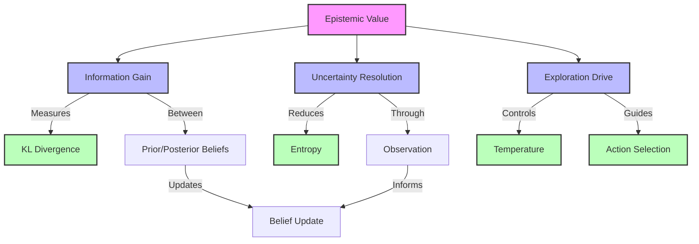

## Information Flow

```mermaid

graph LR

    B[Beliefs] --> |Prior| Q1[Q(s|π)]

    O[Observation] --> |Likelihood| L[P(o|s)]

    L --> |Posterior| Q2[Q(s|o,π)]

    Q1 --> |Compare| KL[KL Divergence]

    Q2 --> |Compare| KL

    KL --> |Information| IG[Information Gain]

    IG --> |Epistemic| EV[Epistemic Value]

    classDef state fill:#f9f,stroke:#333,stroke-width:2px

    classDef process fill:#bbf,stroke:#333,stroke-width:2px

    classDef measure fill:#bfb,stroke:#333,stroke-width:2px

    class B,O state

    class Q1,Q2,L process

    class KL,IG,EV measure

```

## Belief Dynamics

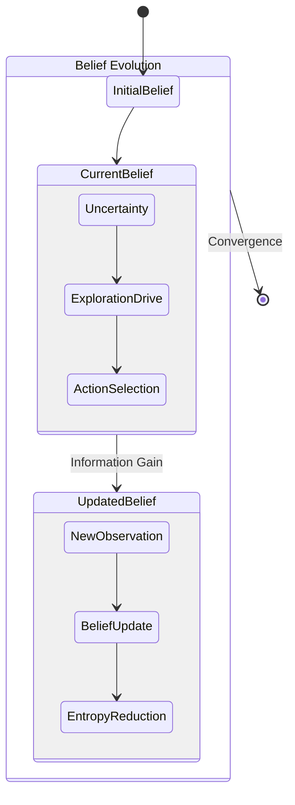

## Computation Process

```mermaid

graph TD

    subgraph Prior

        B[Beliefs] --> |Predict| QS[Q(s|π)]

        QS --> |Model| QO[Q(o|π)]

    end

    subgraph Posterior

        O[Observation] --> |Update| PS[P(s|o)]

        PS --> |KL| D[Divergence]

    end

    subgraph Value

        D --> |Expected| EV[Epistemic Value]

        EV --> |Guide| A[Action]

    end

    classDef input fill:#f9f,stroke:#333,stroke-width:2px

    classDef process fill:#bbf,stroke:#333,stroke-width:2px

    classDef output fill:#bfb,stroke:#333,stroke-width:2px

    class B,O input

    class QS,QO,PS,D process

    class EV,A output

```

## Analysis Framework

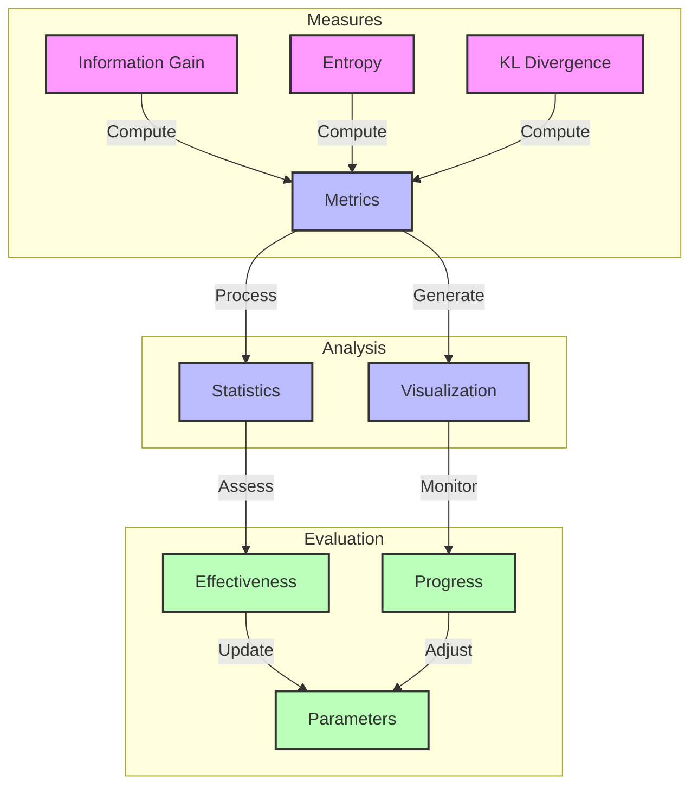

## Overview

Epistemic value quantifies the expected information gain or uncertainty reduction about hidden states through action. In active inference, it drives exploratory behavior by measuring how much an action or policy helps in learning about the environment.

Links to:

- [[information_gain]] - Information theoretic basis

- [[active_inference]] - Framework context

- [[exploration_exploitation]] - Decision making trade-off

## Extended Mathematical Formulation

The epistemic value can be decomposed into several interacting components that drive information-seeking behavior:

### 1. Information Gain Component

$IG(\pi) = \mathbb{E}_{Q(o,s|\pi)}[D_{KL}[Q(s|o,\pi)\|Q(s|\pi)]]$

where:

- $Q(s|\pi)$ is the predicted state distribution under policy $\pi$

- $Q(s|o,\pi)$ is the posterior state distribution after observation $o$

- $Q(o,s|\pi)$ is the joint distribution of states and observations

Links to:

- [[kl_divergence]] - Divergence measure

- [[belief_updating]] - State estimation

- [[information_theory]] - Theoretical foundation

### 2. Uncertainty Resolution Component

$\Delta H(\pi) = H[Q(s|\pi)] - \mathbb{E}_{Q(o|\pi)}[H[Q(s|o,\pi)]]$

where:

- $H[Q(s|\pi)]$ is the entropy of predicted state distribution

- $H[Q(s|o,\pi)]$ is the entropy of posterior state distribution

- $Q(o|\pi)$ is the predicted observation distribution

Links to:

- [[entropy]] - Uncertainty measure

- [[uncertainty_resolution]] - Resolution process

- [[information_metrics]] - Quantities measuring information content

### 3. Exploration Drive Component

$E(\pi) = -\gamma \cdot G(\pi)$

where:

- $\gamma$ is the [[temperature_parameter]]

- $G(\pi)$ is the [[expected_free_energy]]

Links to:

- [[exploration_exploitation]] - Trade-off control

- [[policy_selection]] - Action selection

- [[temperature_parameter]] - Parameter controlling randomness of choice

## Enhanced Implementation

The snippet below computes epistemic value as the mutual information between hidden states and observations for a small discrete likelihood matrix. The matrix and the state distribution are illustrative.

```python
import numpy as np
from cognitive.utils.matrix_utils import compute_entropy

# Illustrative likelihood P(o|s): rows are observations, columns are hidden states.
A = np.array([[0.9, 0.1, 0.5],
              [0.1, 0.9, 0.5]])
q_s = np.array([1 / 3, 1 / 3, 1 / 3])  # illustrative predicted states Q(s | pi)


def epistemic_value(A: np.ndarray, q_s: np.ndarray) -> tuple[float, float]:
    """Return (I(s; o), ambiguity) in nats, with I = H[Q(o)] - E_Q(s) H[P(o|s)]."""
    ambiguity = float(q_s @ compute_entropy(A, axis=0))
    return float(compute_entropy(A @ q_s)) - ambiguity, ambiguity


gain, ambiguity = epistemic_value(A, q_s)
print(f"epistemic value {gain:.4f} nats, ambiguity {ambiguity:.4f} nats")
```

## Properties

1. **Non-negativity**

   - Always ≥ 0 (after negation)

   - Maximum at highest information gain

   - Links to [[information_theory_axioms]]

1. **Uncertainty Dependence**

   - Higher for uncertain states

   - Zero for certain states

   - Links to uncertainty measures

1. **Policy Dependence**

   - Varies with action sequence

   - Path-dependent information gain

   - Links to [[policy_evaluation]]

## Applications

### Active Inference

1. **Exploration Drive**

   - Automatic information seeking

   - Uncertainty reduction

   - Links to:

     - [[information_seeking]] - Actively gathering information to reduce uncertainty

     - [[uncertainty_resolution]] - Reducing uncertainty about hidden states

     - [[active_learning]] - Choosing data to learn from most efficiently

1. **Policy Selection**

   - Balances with pragmatic value

   - Temperature-controlled weighting

   - Links to:

     - [[policy_selection]] - Choosing policies using expected free energy

     - [[temperature_parameter]] - Parameter controlling randomness of choice

     - [[efe_components]] - Balance between epistemic and pragmatic terms

### Other Frameworks

1. **Reinforcement Learning**

   - Intrinsic motivation

   - Curiosity-driven learning

   - Links to:

     - intrinsic motivation - Internal rewards

     - curiosity learning - Learning driven by novelty and information gain

     - [[exploration_strategies]] - Approaches for exploring unknown options

1. **Bayesian Optimization**

   - Acquisition functions

   - Exploration terms

   - Links to:

     - [[acquisition_functions]] - Functions scoring which point to sample next

     - [[bayesian_optimization]] - Sample-efficient optimization using a probabilistic model

     - [[gaussian_processes]] - Probabilistic models used as surrogates

## Analysis Methods

1. **Information Metrics**

   - Entropy reduction

   - Mutual information

   - Fisher information

   - Links to:

     - [[entropy]] - Uncertainty measure

     - [[mutual_information]] - Information shared between two variables

     - [[fisher_information]] - Curvature of the likelihood over parameters

1. **Visualization**

   - Information landscapes

   - Uncertainty maps

   - Exploration patterns

   - Links to:

     - information visualization - Information plots

     - uncertainty visualization - Uncertainty plots

     - [[exploration_visualization]] - Plots of exploration trajectories

## Related Concepts

- [[pragmatic_value]] - Goal-directed counterpart to epistemic value

- [[free_energy_principle]] - Theoretical basis

- [[information_geometry]] - Geometric perspective

- [[decision_theory]] - Decision framework

- [[optimal_control]] - Control theory

## References

- [[friston_2017]] - Active Inference

- [[lindley_1956]] - Information Measures

- [[mackay_2003]] - Information Theory

- schmidhuber 2010 - Artificial Curiosity

## Temporal Evolution

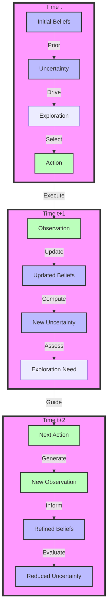

## Value Evolution

```mermaid

graph TD

    subgraph Epistemic

        EV[Epistemic Value] --> |Time t| EV1[Value(t)]

        EV --> |Time t+1| EV2[Value(t+1)]

        EV1 --> |High| EX1[Exploration]

        EV2 --> |Lower| EX2[Exploitation]

    end

    subgraph Learning

        EX1 --> |Gather| I1[Information]

        I1 --> |Update| B1[Beliefs]

        B1 --> |Reduce| U1[Uncertainty]

        EX2 --> |Use| I2[Knowledge]

        I2 --> |Apply| B2[Learned Model]

        B2 --> |Minimize| U2[Remaining Uncertainty]

    end

    subgraph Convergence

        U1 --> |Progress| C[Convergence]

        U2 --> |Approach| C

        C --> |Balance| F[Final State]

    end

    classDef value fill:#f9f,stroke:#333,stroke-width:2px

    classDef process fill:#bbf,stroke:#333,stroke-width:2px

    classDef state fill:#bfb,stroke:#333,stroke-width:2px

    class EV,EV1,EV2 value

    class EX1,EX2,I1,I2 process

    class B1,B2,U1,U2,C,F state

```

## Convergence Visualization

```mermaid

graph TD

    subgraph Initial Phase

        H1[High Uncertainty] --> |Drive| E1[Strong Exploration]

        E1 --> |Generate| A1[Diverse Actions]

        A1 --> |Collect| I1[New Information]

    end

    subgraph Middle Phase

        I1 --> |Reduce| H2[Medium Uncertainty]

        H2 --> |Balance| E2[Mixed Strategy]

        E2 --> |Select| A2[Focused Actions]

        A2 --> |Refine| I2[Targeted Information]

    end

    subgraph Final Phase

        I2 --> |Minimize| H3[Low Uncertainty]

        H3 --> |Enable| E3[Exploitation]

        E3 --> |Choose| A3[Optimal Actions]

        A3 --> |Maintain| I3[Model Confidence]

    end

    classDef phase fill:#f9f,stroke:#333,stroke-width:4px

    classDef state fill:#bbf,stroke:#333,stroke-width:2px

    classDef action fill:#bfb,stroke:#333,stroke-width:2px

    class Initial Phase,Middle Phase,Final Phase phase

    class H1,H2,H3,I1,I2,I3 state

    class E1,E2,E3,A1,A2,A3 action

```

## Learning Trajectory

```mermaid

graph LR

    subgraph Exploration

        E1[High Epistemic] --> |Seek| I1[Information]

        I1 --> |Update| B1[Beliefs]

        B1 --> |Assess| U1[Uncertainty]

    end

    subgraph Transition

        U1 --> |Guide| E2[Mixed Value]

        E2 --> |Balance| I2[Knowledge]

        I2 --> |Refine| B2[Model]

    end

    subgraph Exploitation

        B2 --> |Enable| E3[Low Epistemic]

        E3 --> |Apply| I3[Learned Policy]

        I3 --> |Achieve| G[Goals]

    end

    classDef phase fill:#f9f,stroke:#333,stroke-width:2px

    classDef process fill:#bbf,stroke:#333,stroke-width:2px

    classDef outcome fill:#bfb,stroke:#333,stroke-width:2px

    class E1,E2,E3 phase

    class I1,I2,I3,B1,B2 process

    class U1,G outcome

```

## Implementation Extensions

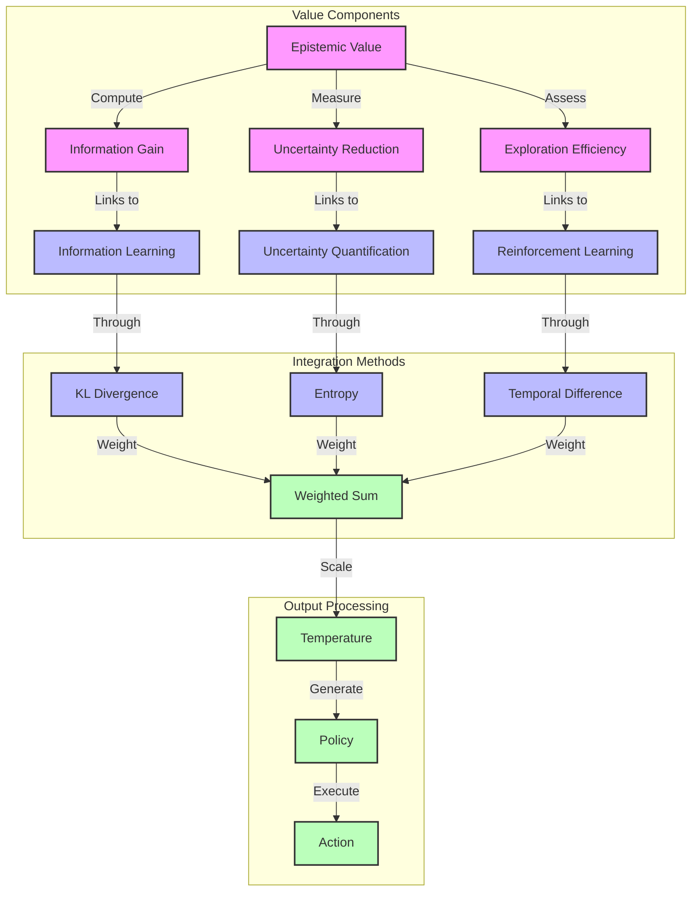

## Related Concepts

- [[information_gain]] - Quantifies knowledge acquisition

- [[uncertainty_resolution]] - Uncertainty reduction process

- [[active_learning]] - Strategic information gathering

- [[exploration_exploitation]] - Balance in decision making

- [[belief_updating]] - State estimation process

- [[free_energy_principle]] - Theoretical foundation

- [[information_geometry]] - Geometric perspective

- [[optimal_control]] - Control theory

- [[reinforcement_learning]] - Learning framework

- [[bayesian_inference]] - Statistical foundation

## Implementation Links

- [[matrix_operations]] - Core computations

- [[numerical_methods]] - Methods for stable numerical computation

- [[visualization_tools]] - Plotting utilities

- [[optimization_algorithms]] - Value optimization

- [[probability_distributions]] - Distribution handling

## Analysis Tools

- [[information_metrics]] - Information measures

- [[convergence_analysis]] - Learning dynamics

- [[visualization_suite]] - Visual analysis

- statistical tests - Validation methods

- [[performance_evaluation]] - Efficiency metrics

## References

- [[friston_2017]] - Active Inference

- [[lindley_1956]] - Information Measures

- [[mackay_2003]] - Information Theory

- schmidhuber 2010 - Artificial Curiosity

## Temporal Evolution


## Value Evolution

```mermaid

graph TD

    subgraph Epistemic

        EV[Epistemic Value] --> |Time t| EV1[Value(t)]

        EV --> |Time t+1| EV2[Value(t+1)]

        EV1 --> |High| EX1[Exploration]

        EV2 --> |Lower| EX2[Exploitation]

    end

    subgraph Learning

        EX1 --> |Gather| I1[Information]

        I1 --> |Update| B1[Beliefs]

        B1 --> |Reduce| U1[Uncertainty]

        EX2 --> |Use| I2[Knowledge]

        I2 --> |Apply| B2[Learned Model]

        B2 --> |Minimize| U2[Remaining Uncertainty]

    end

    subgraph Convergence

        U1 --> |Progress| C[Convergence]

        U2 --> |Approach| C

        C --> |Balance| F[Final State]

    end

    classDef value fill:#f9f,stroke:#333,stroke-width:2px

    classDef process fill:#bbf,stroke:#333,stroke-width:2px

    classDef state fill:#bfb,stroke:#333,stroke-width:2px

    class EV,EV1,EV2 value

    class EX1,EX2,I1,I2 process

    class B1,B2,U1,U2,C,F state

```

## System Integration

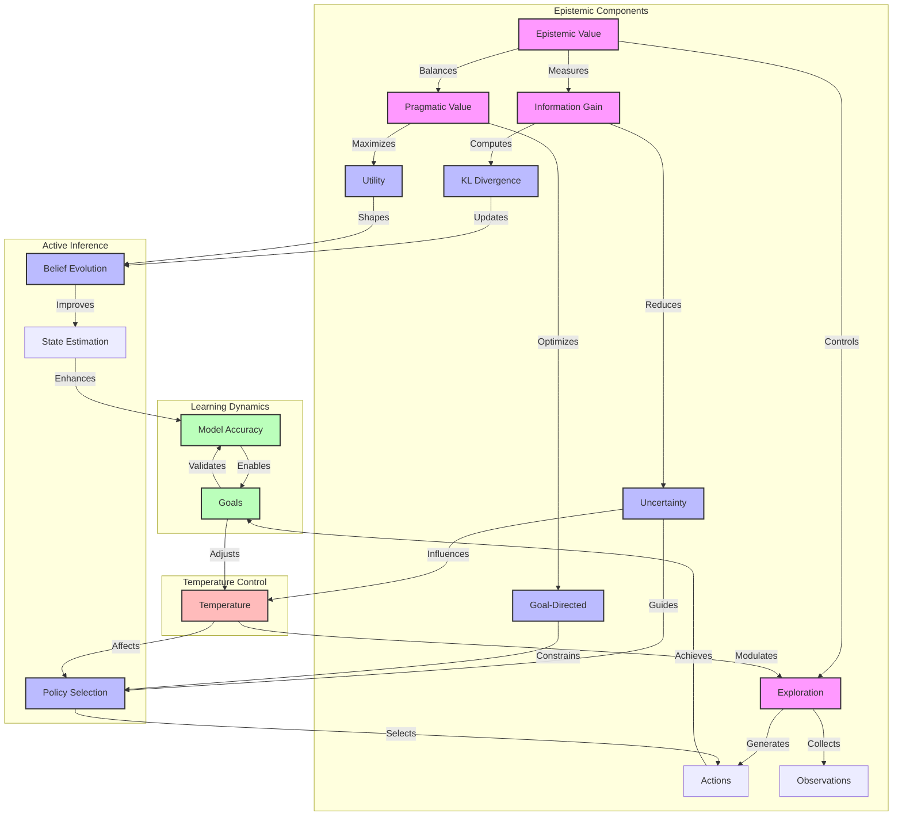

## Value Flow

```mermaid

graph LR

    subgraph Information Processing

        B[Beliefs] --> |Prior| Q1[Q(s|π)]

        O[Observation] --> |Evidence| L[P(o|s)]

        L --> |Update| Q2[Q(s|o,π)]

    end

    subgraph Value Computation

        Q1 --> |Compare| KL[KL Divergence]

        Q2 --> |Compare| KL

        KL --> |Information| IG[Information Gain]

        IG --> |Drive| EV[Epistemic Value]

        T[Temperature] --> |Control| EV

    end

    subgraph Decision Making

        EV --> |Guide| PS[Policy Selection]

        PS --> |Generate| A[Actions]

        A --> |Produce| O

    end

    classDef belief fill:#f9f,stroke:#333,stroke-width:2px

    classDef process fill:#bbf,stroke:#333,stroke-width:2px

    classDef decision fill:#bfb,stroke:#333,stroke-width:2px

    class B,Q1,Q2 belief

    class KL,IG,EV process

    class PS,A,O decision

```

## Learning Evolution

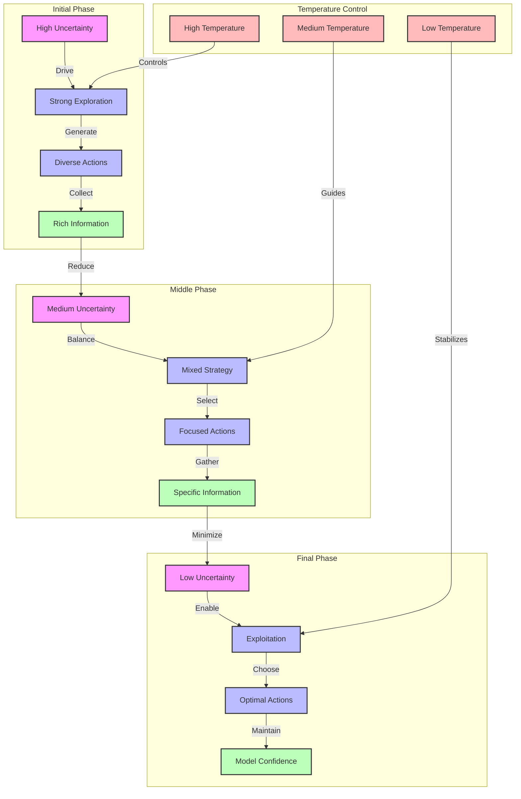

## Hierarchical Decomposition

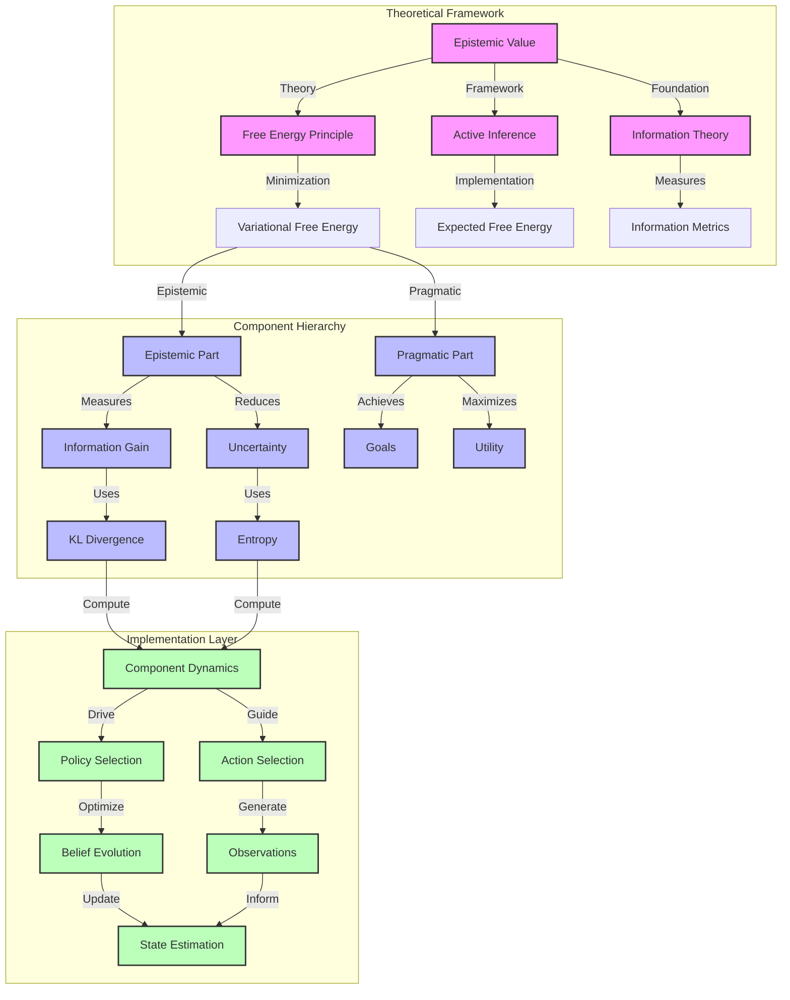

## Optimization Landscape

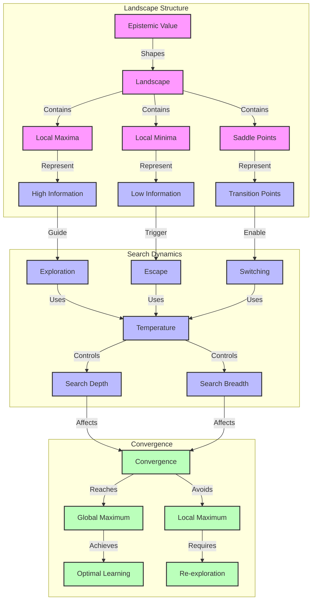

## Implementation Considerations

### Numerical Stability

```python
import numpy as np


def stabilized_computation(x: np.ndarray, epsilon: float = 1e-10) -> np.ndarray:
    """Floor values at epsilon so that logarithms stay finite."""
    return np.maximum(x, epsilon)
```

### Gradient Methods

```python
import numpy as np


def natural_gradient(fisher: np.ndarray, gradient: np.ndarray, learning_rate: float) -> np.ndarray:
    """Update using natural gradient."""
    return learning_rate * np.linalg.solve(fisher, gradient)
```

### Adaptive Temperature

```python
def adapt_temperature(uncertainty: float, min_temp: float = 0.1, max_temp: float = 10.0) -> float:
    """Adapt temperature based on uncertainty in [0, 1]."""
    return min_temp + (max_temp - min_temp) * uncertainty
```

## Future Directions

### Research Extensions

1. **Hierarchical Models**

   - Multi-scale epistemic value

   - Nested information structures

   - Links to [[hierarchical_inference]]

1. **Continuous Domains**

   - Differential entropy measures

   - Path integral formulations

   - Links to continuous state spaces

1. **Meta-Learning**

   - Learning to explore

   - Adaptive strategies

   - Links to [[meta_learning]]

### Implementation Improvements

1. **Parallelization**

   Each policy's epistemic value depends only on its own predicted state distribution, so policies can be evaluated independently.

1. **GPU Acceleration**

   The computation reduces to matrix products and elementwise logarithms.

1. **Vectorization**

   The function `compute_entropy` in `cognitive.utils.matrix_utils` computes the entropy of every row or column of a matrix of distributions in one call.

## Active Inference and Free Energy Connections

### Theoretical Framework Integration

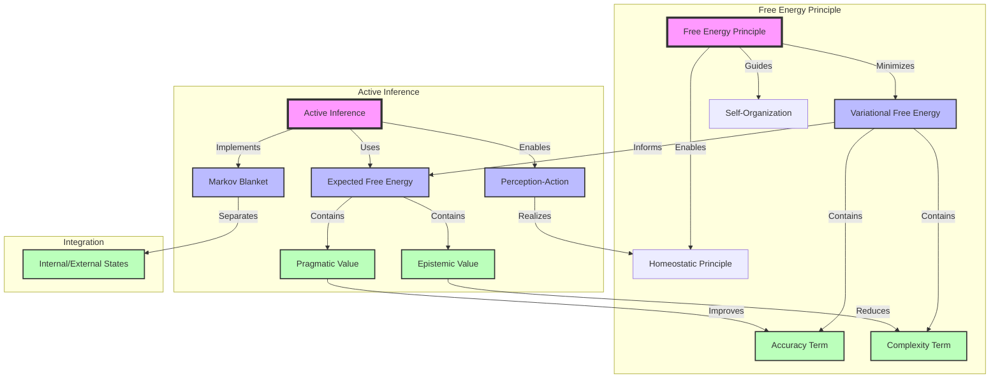

### Mathematical Unification

1. **Free Energy Decomposition**

   The variational free energy decomposes into:

   $F = \underbrace{\mathbb{E}_{Q(s)}[-\ln P(o|s)]}_{\text{accuracy}} + \underbrace{D_{KL}[Q(s)\|P(s)]}_{\text{complexity}}$

   while the expected free energy decomposes as:

   $G = \underbrace{D_{KL}[Q(s|\pi)\|P(s|\pi)]}_{\text{epistemic value}} - \underbrace{\mathbb{E}_{Q(o|\pi)}[\ln P(o)]}_{\text{pragmatic value}}$

   Numerically, the one-step expected free energy from the package equals the cross-entropy between predicted observations and preferences minus the epistemic value (illustrative values):

   ```python
   import numpy as np
   from cognitive.utils.matrix_utils import compute_entropy, expected_free_energy, softmax
   
   A = np.array([[0.9, 0.1, 0.5],
                 [0.1, 0.9, 0.5]])   # illustrative P(o|s)
   B = np.eye(3)[:, :, None]          # one action that leaves the state unchanged
   C = np.array([1.0, 0.0])           # illustrative preferences over observations
   q_s = np.array([0.5, 0.25, 0.25])  # illustrative beliefs
   
   q_o = A @ q_s
   gain = compute_entropy(q_o) - q_s @ compute_entropy(A, axis=0)  # epistemic value I(s; o)
   G = expected_free_energy(A, B, C, q_s, action=0)                # risk + ambiguity
   cross_entropy = -q_o @ np.log(softmax(C))                       # risk + H[Q(o)]
   assert np.isclose(G, cross_entropy - gain)
   ```

1. **Markov Blanket Structure**

   In a Markov blanket, internal and external states are conditionally independent given the blanket states.

1. **Perception-Action Coupling**

   Perception updates beliefs from observations, and action selects a policy from beliefs.

### Theoretical Implications

1. **Self-Organization Principle**

   The minimization of free energy leads to self-organization through:

   $\frac{d}{dt}\theta = -\Gamma \frac{\partial F}{\partial \theta}$

   where:

   - $\theta$ are the system parameters

   - $\Gamma$ is a positive definite matrix

   - $F$ is the free energy

1. **Homeostatic Regulation**

   Homeostasis keeps states within a tolerance of a target state.

1. **Information Geometry Connection**

   Epistemic value can be studied on a statistical manifold equipped with the Fisher information metric.

### Implementation Considerations

1. **Numerical Stability**

   Floor probabilities at a small epsilon before taking logarithms.

1. **Gradient Methods**

   Precondition the gradient with the inverse Fisher information matrix (natural gradient).

1. **Adaptive Temperature**

   Scale the temperature between a minimum and a maximum according to uncertainty.

### Related Concepts

- [[free_energy_principle]] - Core theoretical foundation

- [[active_inference]] - Implementation framework

- [[markov_blanket]] - System boundaries

- [[information_geometry]] - Geometric structure

- [[self_organization]] - Emergent behavior

- [[homeostasis]] - Regulatory principle

### References

- [[friston_2010]] - The free-energy principle

- [[parr_2019]] - The free energy of the mind

- [[buckley_2017]] - The active inference approach

- [[ramstead_2018]] - Variational physics of mind and life

### Enhanced Matrix Operations

Columns of the likelihood matrix are normalised with the package utility, and the column entropies give the ambiguity of each state.

```python
import numpy as np
from cognitive.utils.matrix_utils import compute_entropy, ensure_matrix_properties

A_raw = np.array([[9.0, 1.0, 5.0],
                  [1.0, 9.0, 5.0]])  # illustrative unnormalised counts
A = ensure_matrix_properties(A_raw, ["non_negative", "column_stochastic"])
print(A.sum(axis=0))               # each column is a distribution over observations
print(compute_entropy(A, axis=0))  # per-state entropy H[P(o|s)], the ambiguity of each state
```

### Improved Epistemic Value Computation

The information gain, the uncertainty resolution, and the mutual information between hidden states and observations coincide; the check below confirms this numerically for the illustrative matrix.

```python
import numpy as np
from cognitive.utils.matrix_utils import compute_entropy

A = np.array([[0.9, 0.1, 0.5],
              [0.1, 0.9, 0.5]])      # illustrative P(o|s)
q_s = np.array([1 / 3, 1 / 3, 1 / 3])  # illustrative Q(s | pi)

joint = A * q_s                       # Q(o, s) = P(o|s) Q(s)
q_o = joint.sum(axis=1)               # Q(o)
posterior = joint / q_o[:, None]      # Q(s|o), one row per observation

info_gain = q_o @ (posterior * np.log(posterior / q_s)).sum(axis=1)   # E_Q(o) KL[Q(s|o) || Q(s)]
delta_h = compute_entropy(q_s) - q_o @ compute_entropy(posterior, axis=1)  # H[Q(s)] - E H[Q(s|o)]
mutual_info = compute_entropy(q_o) - q_s @ compute_entropy(A, axis=0)      # H[Q(o)] - E H[P(o|s)]

assert np.allclose([info_gain, delta_h], mutual_info)
print(f"{mutual_info:.4f} nats")
```

### Enhanced Active Inference Integration

A policy that stays in a state whose observations are uninformative has maximal ambiguity and zero epistemic value, while a policy visiting informative states has positive epistemic value (illustrative values).

```python
import numpy as np
from cognitive.utils.matrix_utils import compute_entropy

A = np.array([[0.9, 0.1, 0.5],
              [0.1, 0.9, 0.5]])  # state 2 is uninformative: P(o|s) = [0.5, 0.5]
policies = {  # illustrative predicted state distributions Q(s | pi)
    "visit informative states": np.array([0.5, 0.5, 0.0]),
    "stay in ambiguous state": np.array([0.0, 0.0, 1.0]),
}
for name, q_s in policies.items():
    ambiguity = q_s @ compute_entropy(A, axis=0)
    gain = compute_entropy(A @ q_s) - ambiguity
    print(f"{name}: epistemic value {gain:.3f}, ambiguity {ambiguity:.3f}")
```

### Enhanced Information Geometric Components

See `docs/examples/README.md` for runnable examples.
