# Free Energy Principle

> **Code on this page.** The Python snippets illustrate the ideas. Unless a snippet imports the
> `cognitive` package, it is not part of the package and is not run by its tests, so treat it as a
> sketch. The tested implementations are listed in [[docs/api/api_reference|the API reference]].

## Overview

The Free Energy Principle (FEP) is a unifying theory that explains how biological systems maintain their organization in the face of environmental fluctuations. It proposes that all self-organizing adaptive systems minimize "variational free energy"—a statistical quantity that bounds the surprise (or self-information) associated with sensory signals. Through this minimization, organisms implicitly resist the natural tendency toward disorder described by the second law of thermodynamics.

Mathematically, the FEP states that biological systems minimize a functional $F[q]$ that represents the upper bound on surprise:

```math

F[q] = \mathbb{E}_q[\ln q(s) - \ln p(s,o)]

```

where:

- $q(s)$ is a recognition density over internal states $s$

- $p(s,o)$ is a generative model relating internal states $s$ to observations $o$

The principle has broad applications across cognitive neuroscience, artificial intelligence, and biological self-organization.

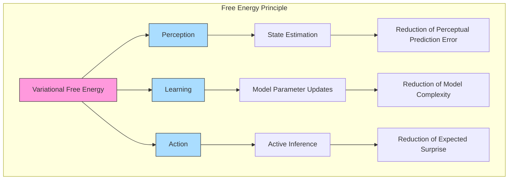

## Historical Context and Development

### Origins and Evolution

The Free Energy Principle emerged from the intersection of thermodynamics, information theory, and neuroscience, developed primarily by Karl Friston in the early 2000s:

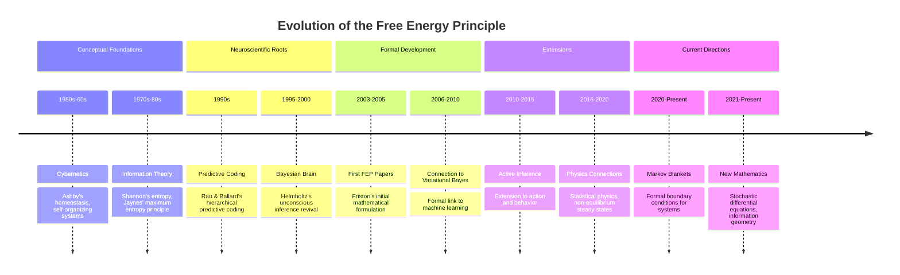

### Key Contributors

1. **Karl Friston**: Principal architect who formalized the Free Energy Principle

1. **Geoffrey Hinton**: Developed related concepts in Helmholtz Machines

1. **Anil Seth**: Extended FEP to interoceptive processing and consciousness

1. **Maxwell Ramstead**: Applied FEP to social systems and cultural dynamics

1. **Christopher Buckley**: Connected FEP to control theory

1. **Thomas Parr**: Developed hierarchical implementations

1. **Lancelot Da Costa**: Advanced mathematical formulations using stochastic calculus

### Intellectual Lineage

The Free Energy Principle integrates several intellectual traditions:

- **Helmholtz's Unconscious Inference**: The idea that perception is a form of unconscious statistical inference

- **Ashby's Cybernetics**: Concepts of homeostasis and self-organization

- **Jaynes' Maximum Entropy Principle**: Using entropy maximization subject to constraints

- **Feynman's Path Integrals**: Statistical mechanics approaches to understanding systems

- **Pearl's Causality**: Causal modeling through graphical models

## Mathematical Foundation

### Variational Free Energy

Variational free energy is formally defined as:

```math

F[q] = \mathbb{E}_q[\ln q(s) - \ln p(s,o)]

```

This can be decomposed in several ways:

```math

\begin{aligned}

F[q] &= \mathbb{E}_q[\ln q(s) - \ln p(s|o) - \ln p(o)] \\

&= D_{\mathrm{KL}}[q(s) \| p(s|o)] - \ln p(o) \\

&= \underbrace{\mathbb{E}_q[-\ln p(o|s)]}_{\text{accuracy}} + \underbrace{D_{\mathrm{KL}}[q(s) \| p(s)]}_{\text{complexity}}

\end{aligned}

```

where:

- $D_{\mathrm{KL}}$ is the Kullback-Leibler divergence

- $p(o)$ is the marginal likelihood or evidence

- $p(s|o)$ is the true posterior distribution

### Decomposition

The FEP can be decomposed into different components representing accuracy and complexity:

```math

\begin{aligned}

\text{Accuracy} &= \mathbb{E}_q[-\ln p(o|s)] \\

\text{Complexity} &= D_{\mathrm{KL}}[q(s) \| p(s)]

\end{aligned}

```

This decomposition reveals a fundamental trade-off: minimizing free energy requires balancing model fit (accuracy) against model complexity.

### Alternative Forms

Free energy can also be expressed in terms of energy and entropy:

```math

F[q] = \mathbb{E}_q[E(s,o)] - H[q(s)]

```

where:

- $E(s,o) = -\ln p(s,o)$ is the energy function

- $H[q(s)] = -\mathbb{E}_q[\ln q(s)]$ is the entropy of the recognition density

## Information Geometry Perspective

### Geometry of Free Energy

The Free Energy Principle can be understood through the lens of information geometry, where variational inference corresponds to optimization on a statistical manifold:

```math

\begin{aligned}

\delta F[q] &= \int \frac{\delta F}{\delta q(s)} \delta q(s) ds \\

&= \int \left(\ln q(s) - \ln p(s,o) + 1 \right) \delta q(s) ds

\end{aligned}

```

For parametric distributions $q_\theta(s)$ with parameters $\theta$, we can write:

```math

\frac{\partial F}{\partial \theta_i} = \mathbb{E}_q\left[\frac{\partial \ln q_\theta(s)}{\partial \theta_i}\left(\ln q_\theta(s) - \ln p(s,o)\right)\right]

```

### Fisher Information and Natural Gradients

Optimization in information geometry often uses the Fisher information matrix:

```math

\mathcal{G}_{ij} = \mathbb{E}_q\left[\frac{\partial \ln q_\theta(s)}{\partial \theta_i}\frac{\partial \ln q_\theta(s)}{\partial \theta_j}\right]

```

Leading to natural gradient descent:

```math

\Delta \theta = -\eta \mathcal{G}^{-1}\nabla_\theta F

```

where $\eta$ is a learning rate. This approach respects the Riemannian geometry of the probability simplex and can accelerate convergence.

### Connections to Optimal Transport

Recent work connects the FEP to optimal transport theory and Wasserstein gradients:

```math

\partial_t q_t = \nabla \cdot (q_t \nabla \delta F/\delta q)

```

This formulation reveals free energy minimization as a gradient flow on the space of probability measures.

## Connections to Statistical Physics

### Thermodynamic Interpretation

The Free Energy Principle has deep connections to statistical physics and thermodynamics:

```math

\begin{aligned}

F_{\text{thermo}} &= U - TS \\

F_{\text{variational}} &= \mathbb{E}_q[E] - H[q]

\end{aligned}

```

Where:

- $F_{\text{thermo}}$ is thermodynamic free energy

- $U$ is internal energy

- $T$ is temperature

- $S$ is entropy

- $F_{\text{variational}}$ is variational free energy

- $E$ is an energy function

- $H[q]$ is entropy of $q$

### Non-equilibrium Steady States

A more recent formulation connects the FEP to non-equilibrium steady states (NESS):

```math

\nabla \cdot (q(x) \nabla E(x)) = 0

```

Where $q(x)$ is a probability density function over states $x$ and $E(x)$ is a potential function. In the context of the FEP, biological systems are conceptualized as maintaining a characteristic probability distribution over their states.

### Principle of Least Action

The FEP can also be connected to the principle of least action via path integrals:

```math

q^*(x(t)) = \frac{1}{Z} \exp\left(-\int_0^T \mathcal{L}(x(t), \dot{x}(t)) dt\right)

```

Where $\mathcal{L}$ is a Lagrangian function and $Z$ is a normalizing constant. This formulation provides a bridge between the FEP and theoretical physics.

## Advanced Mathematical Formulations

### Stochastic Differential Equations

The FEP can be formulated using stochastic differential equations:

```math

\begin{aligned}

dx &= (f(x) + Q\partial_x\ln p(x))dt + \sqrt{2Q}dW \\

dp &= (-\partial_xH)dt + \sqrt{2R}dW

\end{aligned}

```

where:

- $f(x)$ is the drift function

- $Q$ and $R$ are diffusion matrices

- $dW$ is a Wiener process

- $H$ is the Hamiltonian

### Path Integral Formulation

The path integral perspective connects FEP to quantum mechanics:

```math

\begin{aligned}

p(x(T)|x(0)) &= \int \mathcal{D}[x]e^{-S[x]} \\

S[x] &= \int_0^T dt\left(\frac{1}{2}|\dot{x} - f(x)|^2 + V(x)\right)

\end{aligned}

```

where:

- $\mathcal{D}[x]$ is the path integral measure

- $S[x]$ is the action functional

- $V(x)$ is the potential function

### Information Geometric Extensions

Using the language of information geometry:

```math

\begin{aligned}

g_{ij}(\theta) &= \mathbb{E}_{p(x|\theta)}\left[\frac{\partial \ln p(x|\theta)}{\partial \theta^i}\frac{\partial \ln p(x|\theta)}{\partial \theta^j}\right] \\

\Gamma_{ijk}^{(α)} &= \mathbb{E}\left[\frac{\partial^2 \ln p}{\partial \theta^i\partial \theta^j}\frac{\partial \ln p}{\partial \theta^k}\right] \\

\nabla_\theta F &= g^{ij}(\theta)\frac{\partial F}{\partial \theta^j}

\end{aligned}

```

## Implementation Framework

### Variational Methods

```python
import numpy as np

prior = np.array([0.5, 0.5])             # p(s), illustrative
likelihood = np.array([[0.9, 0.2],       # p(o|s); column index is s
                       [0.1, 0.8]])
o = 0                                    # observed outcome
joint = likelihood[o] * prior            # p(o, s)

def free_energy(q):
    """F = E_q[ln q(s) - ln p(o, s)] for categorical q."""
    return np.sum(q * (np.log(q) - np.log(joint)))

posterior = joint / joint.sum()
print(free_energy(np.array([0.5, 0.5])))
print(free_energy(posterior), -np.log(joint.sum()))   # F = surprise at the posterior
```

### Markov Blanket Implementation

```python
import numpy as np

# Illustrative Gaussian over [external, blanket, internal]. A zero
# external-internal precision entry encodes conditional independence.
precision = np.array([[ 2.0, -0.8,  0.0],
                      [-0.8,  2.0, -0.8],
                      [ 0.0, -0.8,  2.0]])
cov = np.linalg.inv(precision)

def partial_corr(i, j, given):
    idx = [i, j] + given
    P = np.linalg.inv(cov[np.ix_(idx, idx)])
    return -P[0, 1] / np.sqrt(P[0, 0] * P[1, 1])

print("marginal corr(ext, int):", cov[0, 2] / np.sqrt(cov[0, 0] * cov[2, 2]))
print("corr(ext, int | blanket):", partial_corr(0, 2, [1]))
```

### MCMC Sampling

```python
import numpy as np

rng = np.random.default_rng(0)

def log_posterior(s, o=1.0):
    """Prior N(0, 1), likelihood N(o; s, 0.5^2) (illustrative), unnormalised."""
    return -0.5 * s**2 - 0.5 * ((o - s) / 0.5) ** 2

s, samples = 0.0, []
for _ in range(20000):
    proposal = s + 0.5 * rng.normal()
    if np.log(rng.uniform()) < log_posterior(proposal) - log_posterior(s):
        s = proposal
    samples.append(s)
samples = np.array(samples[2000:])
print(samples.mean(), samples.var())   # analytic posterior: mean 0.8, variance 0.2
```

## Advanced Applications

### 1. Biological Systems

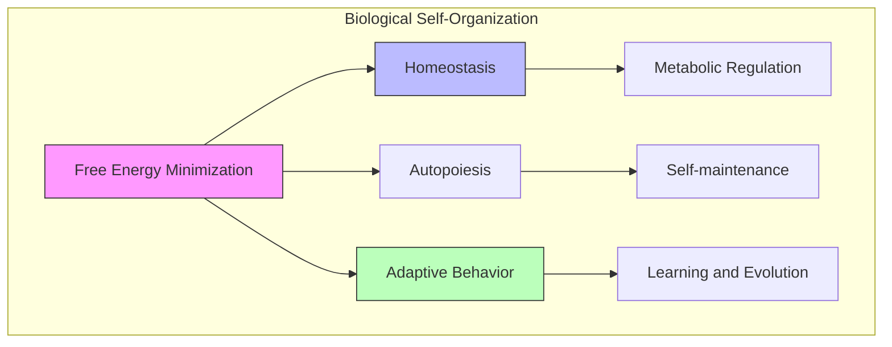

### 2. Cognitive Systems

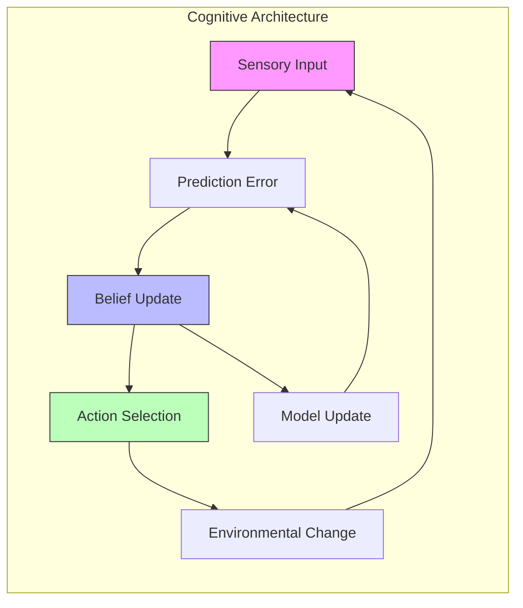

### 3. Artificial Systems

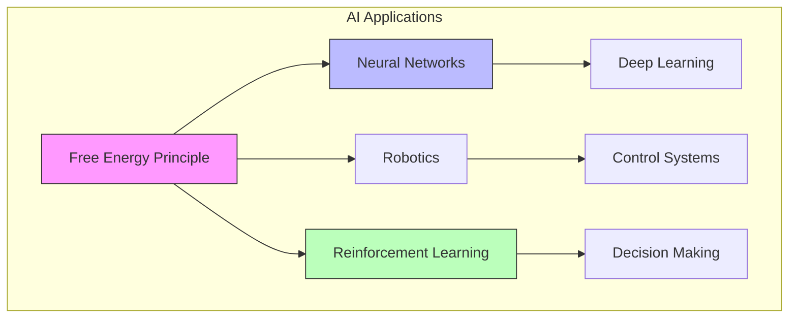

## Future Directions

### Emerging Research Areas

1. **Quantum Extensions**

   - Quantum Free Energy

   - Quantum Information Geometry

   - Quantum Active Inference

1. **Complex Systems**

   - Collective Behavior

   - Network Dynamics

   - Emergence and Criticality

1. **Machine Learning**

   - Deep Free Energy Models

   - Variational Autoencoders

   - Generative Models

### Open Problems

1. **Theoretical Challenges**

   - Exact vs. Approximate Inference

   - Non-equilibrium Dynamics

   - Scale Separation

1. **Practical Challenges**

   - Computational Tractability

   - Model Selection

   - Real-world Applications

## Criticisms and Limitations

### Technical Critiques

1. **Mathematical Tractability**: Exact free energy minimization is often intractable in complex models.

1. **Linearity Assumptions**: Many implementations rely on linear or weakly nonlinear approximations.

1. **Discrete vs. Continuous Time**: Reconciling discrete and continuous time formulations remains challenging.

1. **Identifiability Issues**: Different generative models can yield identical behavioral predictions.

### Conceptual Critiques

1. **Circularity Concerns**: Critics argue the theory risks being unfalsifiable by explaining everything.

1. **Missing Mechanistic Details**: The abstract nature can obscure specific neural mechanisms.

1. **Teleological Interpretations**: Confusion between "as if" optimization and goal-directed behavior.

1. **Scale Problems**: Applying the principle across vastly different scales (from cells to societies) raises questions.

### Empirical Challenges

1. **Experimental Design**: Testing FEP directly is challenging due to its mathematical abstraction.

1. **Parameter Identification**: Identifying model parameters from empirical data can be difficult.

1. **Competing Explanations**: Alternative theories sometimes provide simpler explanations for the same phenomena.

## Recent Extensions and Developments

### Non-equilibrium Steady States

Recent formulations cast the FEP in terms of non-equilibrium steady states using stochastic differential equations:

```math

dx = f(x)dt + \sigma(x)dW

```

where $x$ represents the system state, $f(x)$ is a drift function, $\sigma(x)$ is a diffusion coefficient, and $dW$ is a Wiener process.

### Particular Physics

The "particular physics" formulation grounds the FEP in specific physical principles:

```math

\begin{aligned}

\dot{p}(x,t) &= -\nabla \cdot (f(x)p(x,t)) + \frac{1}{2}\nabla^2 \cdot (D(x)p(x,t)) \\

&= -\nabla \cdot (f(x)p(x,t) - \nabla \cdot (D(x)p(x,t)))

\end{aligned}

```

where $p(x,t)$ is a probability density function, $f(x)$ is a flow field, and $D(x)$ is a diffusion tensor.

### Symmetry Breaking

Recent work connects the FEP to symmetry breaking in physics:

```math

\mathcal{L}(g \cdot x) = \mathcal{L}(x) \quad \forall g \in G

```

where $\mathcal{L}$ is a Lagrangian, $g$ is a group element, and $G$ is a group of transformations. The emergence of Markov blankets is viewed as a form of symmetry breaking.

### Dynamic Causal Modeling

Extensions to Dynamic Causal Modeling (DCM) allow empirical testing of FEP predictions:

```math

\dot{x} = f(x,u,\theta) + w

```

where $u$ are inputs, $\theta$ are parameters, and $w$ is noise. DCM enables system identification from time series data.

## Philosophical Implications

### Epistemology

The FEP has profound implications for epistemology:

1. **Knowledge as Model**: Suggests knowledge is embodied in probabilistic models.

1. **Bayesian Brain**: Positions the brain as a Bayesian inference machine.

1. **Umwelt**: Each organism constructs its own model-based reality.

### Metaphysics

Several metaphysical consequences follow from the FEP:

1. **Mind-Body Problem**: Offers a naturalistic account of mind as inference.

1. **Causality**: Reframes causation in terms of generative models.

1. **Emergence**: Provides a mathematical account of how higher-order properties emerge.

### Ethics and Aesthetics

The FEP has been extended to consider:

1. **Value**: Framing value in terms of expected free energy minimization.

1. **Aesthetics**: Suggesting beauty might relate to successful prediction.

1. **Social Dynamics**: Modeling social cohesion as shared free energy minimization.

## Theoretical Results

### Fisher Information and Cramér-Rao Bound

The FEP connects to fundamental results in information theory:

```math

\text{Var}(\hat{\theta}) \geq \frac{1}{\mathcal{I}(\theta)}

```

where $\mathcal{I}(\theta)$ is the Fisher information. This relates to the precision with which parameters can be estimated.

### Markov Blanket Conditions

For a system with states partitioned into internal states $\mu$ and external states $\eta$, the Markov blanket $b$ must satisfy:

```math

p(\mu | \eta, b) = p(\mu | b)

```

This condition ensures that internal states are conditionally independent of external states, given the blanket states.

### Path Integral Formulation

The path of least action in state space can be formulated as:

```math

q^*(x_{0:T}) = \frac{1}{Z}p(x_0)\exp\left(-\int_0^T \mathcal{L}(x, \dot{x})dt\right)

```

where $\mathcal{L}(x, \dot{x})$ is a Lagrangian and $Z$ is a normalizing constant.

### Marginal Stability

Systems at non-equilibrium steady states exhibit marginal stability:

```math

\lambda_{\max}(J) \approx 0

```

where $\lambda_{\max}(J)$ is the maximum eigenvalue of the Jacobian matrix of the dynamics. This relates to critical slowing near bifurcation points.

## Best Practices

### Model Design

1. Choose appropriate state space dimensionality

1. Structure hierarchical dependencies

1. Design informative priors

1. Balance model complexity

1. Test with simulated data

### Implementation

1. Handle numerical stability issues

1. Choose appropriate approximation methods

1. Validate with synthetic data

1. Benchmark against standard methods

1. Implement efficient matrix operations

```python
import numpy as np

rng = np.random.default_rng(0)
mu, sigma = 0.5, 2.0                     # illustrative Gaussian model
x = rng.normal(mu, sigma, 200_000)
scores = np.stack([(x - mu) / sigma**2,                      # d ln p / d mu
                   ((x - mu) ** 2 - sigma**2) / sigma**3],   # d ln p / d sigma
                  axis=1)
fisher = scores.T @ scores / len(x)      # E[score score^T]
print(fisher)                            # analytic: diag(1/sigma^2, 2/sigma^2)
```

### Validation

1. Check convergence of optimization

1. Analyze sensitivity to hyperparameters

1. Compare with alternative models

1. Test edge cases

1. Evaluate generalization performance

## Related Documentation

- [[active_inference]]

- [[variational_inference]]

- [[bayesian_brain_hypothesis]]

- [[markov_blanket]]

- [[predictive_coding]]

- [[information_theory]]

- [[statistical_physics]]

- [[self_organization]]

- [[autopoiesis]]

## Quantum Extensions

### Quantum Free Energy Principle

The quantum extension of FEP uses quantum probability theory:

```math

\begin{aligned}

\text{Quantum State:} \quad |\psi\rangle &= \sum_s \sqrt{q(s)}|s\rangle \\

\text{Density Matrix:} \quad \rho &= |\psi\rangle\langle\psi| \\

\text{Quantum Free Energy:} \quad F_Q &= \text{Tr}(\rho H) + \text{Tr}(\rho \ln \rho)

\end{aligned}

```

### Quantum Information Geometry

```math

\begin{aligned}

\text{Quantum Fisher Information:} \quad g_{ij}^Q &= \text{Re}(\text{Tr}(\rho L_i L_j)) \\

\text{SLD Operators:} \quad L_i &= 2\frac{\partial \rho}{\partial \theta^i} \\

\text{Quantum Relative Entropy:} \quad S(\rho\|\sigma) &= \text{Tr}(\rho(\ln \rho - \ln \sigma))

\end{aligned}

```

### Implementation Framework

```python
import numpy as np

H = np.array([[0.0, 1.0], [1.0, 0.0]])   # illustrative two-level Hamiltonian
T = 0.5                                  # temperature, k_B = 1

def von_neumann_entropy(rho):
    w = np.linalg.eigvalsh(rho)
    w = w[w > 1e-12]
    return -np.sum(w * np.log(w))

def quantum_free_energy(rho):
    return np.trace(rho @ H).real - T * von_neumann_entropy(rho)

E, V = np.linalg.eigh(H)
weights = np.exp(-E / T)
thermal = V @ np.diag(weights / weights.sum()) @ V.T
print(quantum_free_energy(thermal), -T * np.log(weights.sum()))  # equal at thermal state
print(quantum_free_energy(np.eye(2) / 2))                        # higher elsewhere
```

## Advanced Mathematical Structures

### Category Theory Framework

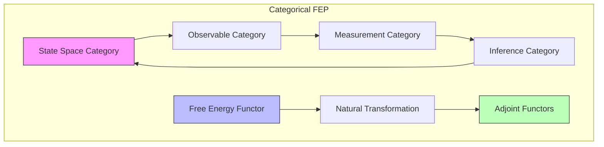

### Differential Forms and Symplectic Structure

```math

\begin{aligned}

\text{Symplectic Form:} \quad \omega &= \sum_i dp_i \wedge dq_i \\

\text{Hamiltonian Vector Field:} \quad X_H &= \omega^{-1}(dH) \\

\text{Liouville Form:} \quad \theta &= \sum_i p_i dq_i

\end{aligned}

```

### Lie Group Actions

```math

\begin{aligned}

\text{Group Action:} \quad \Phi: G \times M &\to M \\

\text{Momentum Map:} \quad J: T^*M &\to \mathfrak{g}^* \\

\text{Coadjoint Orbit:} \quad \mathcal{O}_\mu &= \{Ad^*_g\mu : g \in G\}

\end{aligned}

```

## Advanced Applications

### 1. Biological Systems

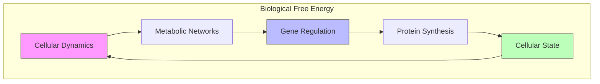

### 2. Neural Systems

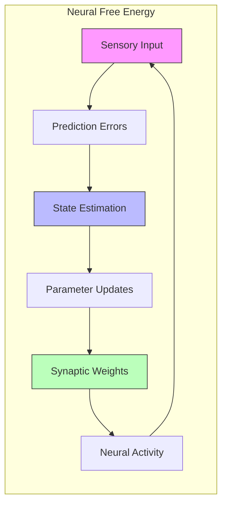

### 3. Social Systems


## Computational Complexity Analysis

### Time Complexity

1. **Belief Updates**: $O(d^3)$ for $d$-dimensional state space

1. **Free Energy Computation**: $O(d^2)$ for matrix operations

1. **Markov Blanket Identification**: $O(n^2)$ for $n$ variables

### Space Complexity

1. **State Representation**: $O(d)$ for state vectors

1. **Covariance Matrices**: $O(d^2)$ for precision matrices

1. **Model Parameters**: $O(d^2)$ for transition matrices

### Optimization Methods

1. **Gradient Descent**: $O(kd^2)$ for $k$ iterations

1. **Natural Gradient**: $O(kd^3)$ with Fisher information

1. **Variational EM**: $O(kd^3)$ for full covariance

## Best Practices

### Model Design

1. Choose appropriate state space dimensionality

1. Design informative priors

1. Structure hierarchical dependencies

1. Balance model complexity

1. Implement efficient numerics

### Implementation

1. Use stable matrix operations

1. Handle numerical precision

1. Implement parallel computation

1. Monitor convergence

1. Validate results

### Validation

1. Test with synthetic data

1. Compare with baselines

1. Cross-validate results

1. Analyze sensitivity

1. Benchmark performance

## Future Research Directions

### Theoretical Developments

1. **Quantum Extensions**: Quantum probability theory

1. **Category Theory**: Functorial relationships

1. **Information Geometry**: Wasserstein metrics

### Practical Advances

1. **Scalable Algorithms**: Large-scale systems

1. **Neural Implementation**: Brain-inspired architectures

1. **Real-world Applications**: Complex systems

### Open Problems

1. **Non-equilibrium Dynamics**: Far-from-equilibrium systems

1. **Scale Separation**: Multiple time scales

1. **Emergence**: Collective phenomena

## Markov Blanket Theory

### Formal Definition

```math

\begin{aligned}

& \text{Markov Blanket Partition:} \\

& \mathcal{S} = \{η, s, a, μ\} \\

& \text{where:} \\

& η: \text{external states} \\

& s: \text{sensory states} \\

& a: \text{active states} \\

& μ: \text{internal states}

\end{aligned}

```

### Conditional Independence

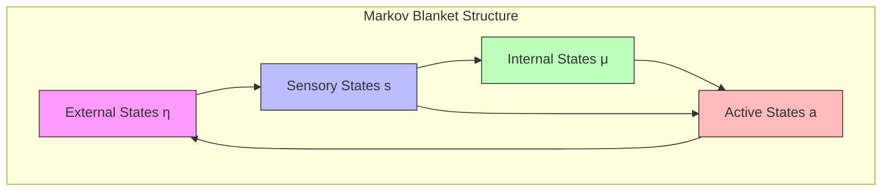

### Statistical Properties

```math

\begin{aligned}

& \text{Conditional Independence:} \\

& P(η|s,a,μ) = P(η|s,a) \\

& P(μ|s,a,η) = P(μ|s,a) \\

& \text{Flow:} \\

& \dot{x} = f(x) + ω \\

& \text{where } x = [η,s,a,μ]^T

\end{aligned}

```

## Technical Derivations

### Free Energy Decomposition

```math

\begin{aligned}

F &= \mathbb{E}_q[\log q(s) - \log p(o,s)] \\

&= \mathbb{E}_q[\log q(s) - \log p(s|o) - \log p(o)] \\

&= D_{KL}[q(s)||p(s|o)] - \log p(o) \\

&= \underbrace{D_{KL}[q(s)||p(s|o)]}_{\text{accuracy}} + \underbrace{\mathbb{E}_q[\log q(s)]}_{\text{complexity}}

\end{aligned}

```

### Variational Principle

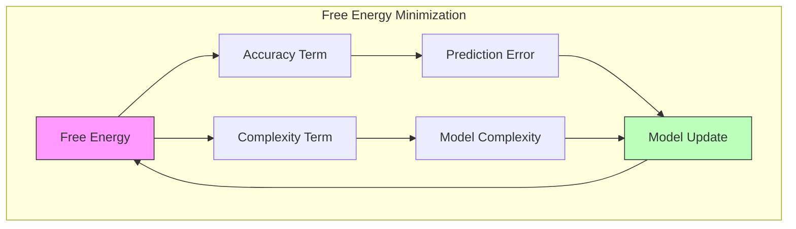

### Path Integral Formulation

```math

\begin{aligned}

& \text{Action:} \\

& S[q] = \int_0^T \mathcal{L}(q,\dot{q})dt \\

& \text{Lagrangian:} \\

& \mathcal{L}(q,\dot{q}) = F[q] + \frac{1}{2}\dot{q}^T\Gamma\dot{q} \\

& \text{Hamilton's Equations:} \\

& \dot{q} = \frac{\partial H}{\partial p}, \quad \dot{p} = -\frac{\partial H}{\partial q}

\end{aligned}

```

## Mathematical Foundations

### Information Geometry

```math

\begin{aligned}

& \text{Fisher Metric:} \\

& g_{ij}(θ) = \mathbb{E}_p\left[\frac{\partial \log p}{\partial θ^i}\frac{\partial \log p}{\partial θ^j}\right] \\

& \text{Natural Gradient:} \\

& \dot{θ} = -g^{ij}\frac{\partial F}{\partial θ^j} \\

& \text{Geodesic Flow:} \\

& \ddot{θ}^k + \Gamma^k_{ij}\dot{θ}^i\dot{θ}^j = 0

\end{aligned}

```

### Differential Geometry

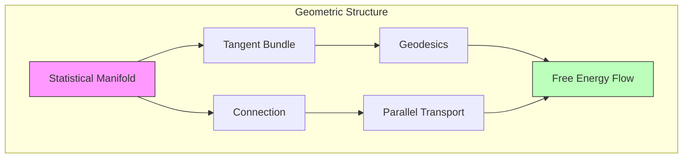

### Stochastic Processes

```math

\begin{aligned}

& \text{Langevin Dynamics:} \\

& dx = f(x)dt + σdW \\

& \text{Fokker-Planck Equation:} \\

& \frac{\partial p}{\partial t} = -\nabla \cdot (fp) + \frac{1}{2}\nabla^2(Dp) \\

& \text{Path Integral:} \\

& p(x_T|x_0) = \int \mathcal{D}[x]e^{-S[x]}

\end{aligned}

```


### Validation

1. Check convergence of optimization

1. Analyze sensitivity to hyperparameters

1. Compare with alternative models

1. Test edge cases

1. Evaluate generalization performance

## Non-Equilibrium Statistical Mechanics Extensions

### Theoretical Framework

**Definition** (Non-Equilibrium Steady State): A system state where currents flow but macroscopic properties remain constant:

$$\langle\dot{X}\rangle = 0, \quad \text{but} \quad \langle J_i \rangle \neq 0$$

where $J_i$ are probability currents and $X$ represents macroscopic observables.

**Theorem** (Fluctuation-Dissipation Relations): For systems near equilibrium, the response to perturbations is related to spontaneous fluctuations:

$$\chi(\omega) = \frac{1}{k_B T} \int_0^\infty \langle\delta X(t)\delta X(0)\rangle e^{-i\omega t} dt$$


### Quantum Generalizations

**Definition** (Quantum Free Energy): For quantum systems with density matrix $\rho$:

$$F_Q = \text{Tr}[\rho H] - T S_Q[\rho]$$

where $S_Q[\rho] = -\text{Tr}[\rho \ln \rho]$ is the von Neumann entropy.


## Related Documentation

- [[active_inference]]

- [[variational_inference]]

- [[bayesian_brain_hypothesis]]

- [[markov_blanket]]

- [[predictive_coding]]

- [[information_theory]]

- [[statistical_physics]]

- [[self_organization]]

- [[autopoiesis]]

## See also

- [[knowledge_base/cognitive/free_energy_principle|Free Energy Principle]]

## References

- Friston, K. (2010). The free-energy principle: a unified brain theory? Nature Reviews Neuroscience, 11(2), 127-138.
- Friston, K. (2019). A free energy principle for a particular physics. arXiv:1906.10184.
- Parr, T., Pezzulo, G., & Friston, K. J. (2022). Active Inference: The Free Energy Principle in Mind, Brain, and Behavior. MIT Press.
- Dayan, P., Hinton, G. E., Neal, R. M., & Zemel, R. S. (1995). The Helmholtz machine. Neural Computation, 7(5), 889-904.
- Rao, R. P. N., & Ballard, D. H. (1999). Predictive coding in the visual cortex: a functional interpretation of some extra-classical receptive-field effects. Nature Neuroscience, 2(1), 79-87.
- Buckley, C. L., Kim, C. S., McGregor, S., & Seth, A. K. (2017). The free energy principle for action and perception: A mathematical review. Journal of Mathematical Psychology, 81, 55-79.
