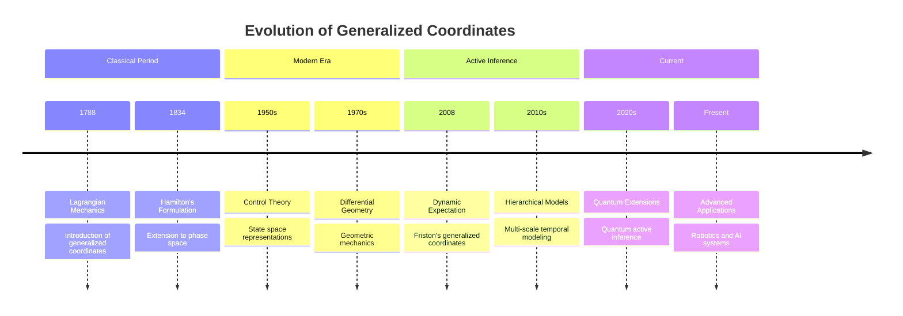
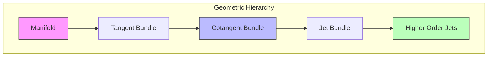
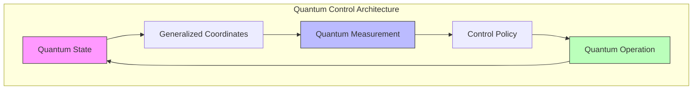

# Generalized Coordinates in Active Inference

> **Code on this page.** The Python snippets illustrate the ideas. Unless a snippet imports the
> `cognitive` package, it is not part of the package and is not run by its tests, so treat it as a
> sketch. The tested implementations are listed in [[docs/api/api_reference|the API reference]].

## Overview

Generalized coordinates provide a fundamental mathematical framework for representing continuous-time dynamics in active inference by explicitly incorporating higher-order temporal derivatives into the state space. This approach enables rich temporal modeling and prediction across multiple time scales.


## Historical Development



### Intellectual Lineage

1. **Classical Mechanics**

   - Lagrangian formulation

   - Hamiltonian dynamics

   - Phase space representations

1. **Control Theory**

   - State observers

   - Kalman filtering

   - Optimal control

1. **Active Inference**

   - Free energy principle

   - Predictive coding

   - Hierarchical models

## Mathematical Foundation

### Basic Definition

A state x in generalized coordinates is represented as a vector of temporal derivatives:

```math

\begin{aligned}

\tilde{x} &= [x, x', x'', ..., x^{(n)}]^T \\

\text{where:} \\

x &: \text{state value} \\

x' &: \text{velocity} \\

x'' &: \text{acceleration} \\

x^{(n)} &: \text{nth order derivative}

\end{aligned}

```

### Shift Operator

The shift operator D maps between orders of motion:

```math

\begin{aligned}

D\tilde{x} &= [x', x'', x''', ..., 0]^T \\

D &= \begin{bmatrix}

0 & 1 & 0 & \cdots \\

0 & 0 & 1 & \cdots \\

0 & 0 & 0 & \ddots \\

\vdots & \vdots & \vdots & \ddots

\end{bmatrix}

\end{aligned}

```

### Taylor Series Connection

The relationship to Taylor series expansion:

```math

\begin{aligned}

x(t + \Delta t) &= \sum_{n=0}^{\infty} \frac{x^{(n)}(t)}{n!}(\Delta t)^n \\

&\approx \sum_{n=0}^{N} \frac{x^{(n)}(t)}{n!}(\Delta t)^n

\end{aligned}

```

## Extended Mathematical Framework

### Lie Group Structure

```math

\begin{aligned}

& \text{Group Action:} \\

& \Phi: G \times T\mathcal{M} \to T\mathcal{M} \\

& \text{Infinitesimal Generator:} \\

& X_ξ(x) = \frac{d}{dt}\big|_{t=0} \exp(tξ) \cdot x \\

& \text{Momentum Map:} \\

& J: T^*\mathcal{M} \to \mathfrak{g}^*

\end{aligned}

```

### Variational Structure

```math

\begin{aligned}

& \text{Action Functional:} \\

& S[\gamma] = \int_0^T L(\gamma(t), \dot{\gamma}(t))dt \\

& \text{Euler-Lagrange:} \\

& \frac{d}{dt}\frac{\partial L}{\partial \dot{\gamma}} - \frac{\partial L}{\partial \gamma} = 0 \\

& \text{Hamilton's Principle:} \\

& δS = 0

\end{aligned}

```

### Riemannian Structure



### Advanced Differential Forms

```math

\begin{aligned}

& \text{Jet Bundle Forms:} \\

& \omega^k = \sum_{|α|≤k} a_α dx^α \\

& \text{Contact Forms:} \\

& θ^{(k)}_i = dx^{(k)}_i - x^{(k+1)}_i dt \\

& \text{Cartan Distribution:} \\

& \mathcal{C} = \ker(θ^{(0)}) \cap ... \cap \ker(θ^{(k)})

\end{aligned}

```

## Advanced Implementation Frameworks

### Hierarchical Prediction System

```python
import numpy as np
from math import factorial

n = 6                                          # highest order kept (illustrative)
D = np.diag(np.ones(n), k=1)                   # shift operator: D @ [x, x', x'', ...] = [x', x'', ..., 0]

def predict(x_tilde, dt):
    """Taylor prediction x(t + dt) = sum_k (D dt)^k / k! applied to the generalized state (D is nilpotent)."""
    E = sum(np.linalg.matrix_power(D * dt, k) / factorial(k) for k in range(n + 1))
    return E @ x_tilde

# Generalized coordinates of x(t) = sin(t) at t = 0.5: derivatives cycle through cos, -sin, -cos, sin
t, dt = 0.5, 0.3
x_tilde = np.array([np.sin(t), np.cos(t), -np.sin(t), -np.cos(t), np.sin(t), np.cos(t), -np.sin(t)])
print(predict(x_tilde, dt)[0], np.sin(t + dt))
```

### Adaptive Order Selection

```python
import numpy as np
from math import factorial

# Truncation error of an order-N generalized state for x(t) = sin(t), predicted dt ahead
t, dt, tol = 0.5, 0.5, 1e-6                    # illustrative values
derivs = lambda k: np.sin(t + k * np.pi / 2)   # k-th derivative of sin at t

for N in range(1, 12):
    pred = sum(derivs(k) * dt ** k / factorial(k) for k in range(N + 1))
    err = abs(pred - np.sin(t + dt))
    if err < tol:
        break
print("smallest order meeting the tolerance:", N, " error:", err)
```

## Advanced Applications

### 1. Quantum Control Systems



## Mathematical Extensions

### Category Theory Perspective

```math

\begin{aligned}

& \text{Functor:} \\

& F: \mathbf{Man} \to \mathbf{Vect} \\

& \text{Natural Transformation:} \\

& η: F \Rightarrow G \\

& \text{Adjunction:} \\

& F \dashv G

\end{aligned}

```

### Geometric Mechanics

```math

\begin{aligned}

& \text{Euler-Poincaré Equations:} \\

& \frac{d}{dt}\frac{δl}{δξ} = ad^*_ξ\frac{δl}{δξ} \\

& \text{Reduced Equations:} \\

& \dot{μ} = ad^*_{ξ}μ \\

& \text{Reconstruction:} \\

& \dot{g} = g ξ

\end{aligned}

```

### Information Geometry Extensions

```math

\begin{aligned}

& \text{α-Connection:} \\

& \Gamma^{(α)}_{ijk} = \mathbb{E}\left[\frac{∂^2l}{∂θ^i∂θ^j}\frac{∂l}{∂θ^k}\right] + \frac{1-α}{2}\mathbb{E}\left[\frac{∂l}{∂θ^i}\frac{∂l}{∂θ^j}\frac{∂l}{∂θ^k}\right] \\

& \text{Dual Structure:} \\

& g_{ij} = -\mathbb{E}\left[\frac{∂^2l}{∂θ^i∂θ^j}\right] = \mathbb{E}\left[\frac{∂l}{∂θ^i}\frac{∂l}{∂θ^j}\right]

\end{aligned}

```

## Best Practices

### 1. Model Design

1. Choose appropriate number of orders

1. Balance precision and computational cost

1. Consider temporal scale separation

1. Implement regularization

1. Monitor numerical stability

### 2. Implementation

1. Use stable numerical methods

1. Implement efficient matrix operations

1. Consider sparse representations

1. Parallelize when possible

1. Cache intermediate results

### 3. Validation

1. Check prediction accuracy

1. Monitor derivative stability

1. Validate across time scales

1. Test edge cases

1. Compare with ground truth

## Common Issues

### Technical Challenges

1. Numerical instability in higher orders

1. Computational complexity scaling

1. Memory requirements

1. Noise amplification

1. Temporal aliasing

### Solutions

1. Regularization techniques

1. Adaptive order selection

1. Sparse implementations

1. Noise filtering

1. Multi-scale approaches

## Future Directions

### Theoretical Developments

1. Quantum extensions

1. Field theory formulations

1. Information geometry connections

### Practical Advances

1. Hardware acceleration

1. Real-time implementations

1. Large-scale applications

### Open Problems

1. Optimal order selection

1. Stability guarantees

1. Scaling properties

## Stochastic Extensions and Formal Stability Analysis

### Stochastic Differential Equation Implementation

**Definition** (Stochastic Generalized Coordinates): For a system with noise, the generalized coordinates follow:

$$d\tilde{x}^{(n)} = f^{(n)}(\tilde{x}^{(0)}, \ldots, \tilde{x}^{(n)}) dt + \sigma^{(n)}(\tilde{x}) dW_t$$

where $W_t$ is a Wiener process and $\sigma^{(n)}$ is the noise amplitude matrix.

See `docs/examples/README.md` for runnable examples.


## Related Documentation

- [[active_inference]]

- [[differential_geometry]]

- [[information_geometry]]

- [[numerical_methods]]

- [[dynamical_systems]]

- [[stochastic_processes]]


## References

- Friston, K. (2008). Hierarchical models in the brain. PLoS Computational Biology, 4(11), e1000211.
- Friston, K. J., Trujillo-Barreto, N., & Daunizeau, J. (2008). DEM: A variational treatment of dynamic systems. NeuroImage, 41(3), 849-885.
- Friston, K., Stephan, K., Li, B., & Daunizeau, J. (2010). Generalised filtering. Mathematical Problems in Engineering, 2010, 621670.
- Buckley, C. L., Kim, C. S., McGregor, S., & Seth, A. K. (2017). The free energy principle for action and perception: A mathematical review. Journal of Mathematical Psychology, 81, 55-79.
- Arnold, V. I. (1989). Mathematical Methods of Classical Mechanics (2nd ed.). Springer.
