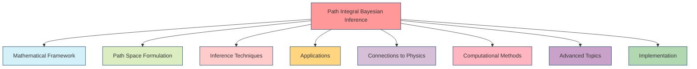
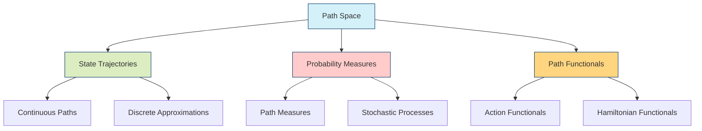
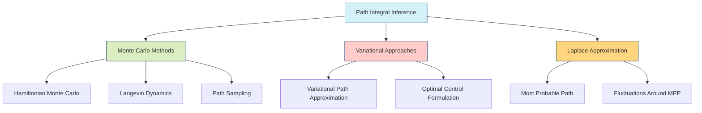
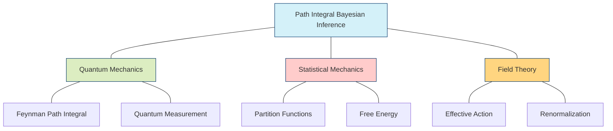
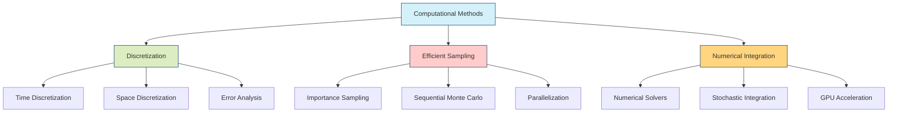
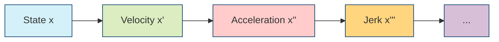
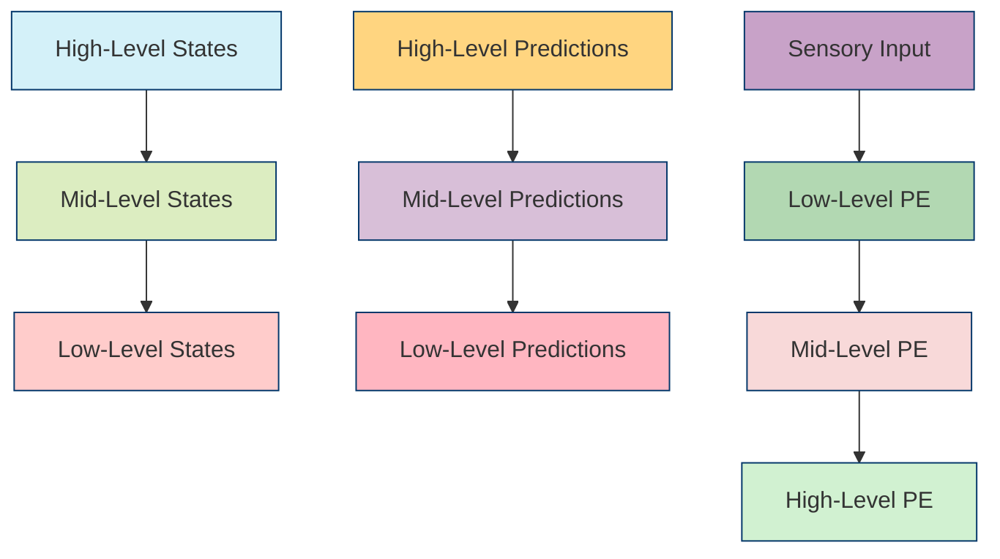

# Path Integral Bayesian Inference

> **Code on this page.** The Python snippets illustrate the ideas. Unless a snippet imports the
> `cognitive` package, it is not part of the package and is not run by its tests, so treat it as a
> sketch. The tested implementations are listed in [[docs/api/api_reference|the API reference]].

## Overview

Path Integral Bayesian Inference combines [[path_integral|path integration]] techniques from statistical physics with [[bayesian_inference|Bayesian inference]] methods to provide a powerful framework for solving complex inference problems. This approach allows for traversing probability distributions over continuous trajectories in state space, enabling more expressive and powerful inference in both deterministic and stochastic systems.



## Mathematical Framework

### Path Integral Formulation

The path integral formulation of Bayesian inference represents the posterior probability of a trajectory $x(t)$ given observations $y$ as:

```math

P(x(t)|y) = \frac{1}{Z} e^{-S[x(t)]}

```

where:

- $S[x(t)]$ is the action functional, incorporating both prior dynamics and observation likelihood

- $Z$ is the normalization constant (partition function)

### Extended Action Functionals

The action functional can be decomposed into multiple terms:

```math

S[x(t)] = S_{\text{prior}}[x(t)] + S_{\text{likelihood}}[x(t),y] + S_{\text{constraints}}[x(t)]

```

For dynamical systems with general noise structures:

```math

S_{\text{prior}}[x(t)] = \int_{t_0}^{t_1} \left[\frac{1}{2}(\dot{x}(t) - f(x(t),t))^T \Sigma^{-1} (\dot{x}(t) - f(x(t),t)) + \frac{1}{2}\log|\Sigma|\right] dt

```

where:

- $f(x(t),t)$ represents the deterministic dynamics

- $\Sigma$ is the noise covariance matrix

- Additional terms can represent constraints or regularization

### Information Geometry

The path integral formulation naturally connects to information geometry through:

```math

ds^2 = \int_{t_0}^{t_1} g_{\mu\nu}(x(t)) dx^\mu(t) dx^\nu(t)

```

where $g_{\mu\nu}$ is the Fisher-Rao metric tensor.

## Path Space Formulation



### 1. State-Space Trajectories

Path integrals operate on trajectories through state space, rather than just single points:

```math

x(t): [t_0, t_1] \rightarrow \mathcal{X}

```

where $\mathcal{X}$ is the state space.

### 2. Measure on Path Space

The path measure defines a probability distribution over all possible trajectories:

```math

\mathcal{D}[x(t)] = \prod_{t \in [t_0, t_1]} dx(t)

```

### 3. Path Probability

The probability of a specific path is:

```math

P[x(t)] = \frac{1}{Z} e^{-S[x(t)]}

```

where $Z = \int \mathcal{D}[x(t)] e^{-S[x(t)]}$ is the path integral normalization.

## Inference Techniques



### 1. Monte Carlo Path Sampling

```python
import numpy as np

rng = np.random.default_rng(0)

def action(path, y, f, dt, sigma, sigma_y):
    """S[x] = prior (SDE residual) term + observation term."""
    resid = path[1:] - path[:-1] - f(path[:-1]) * dt
    return np.sum(resid ** 2) / (2 * sigma ** 2 * dt) + np.sum((y - path) ** 2) / (2 * sigma_y ** 2)

def path_mcmc(y, f, dt, sigma, sigma_y, n_samples=4000, step=0.3):
    """Metropolis-Hastings over paths with single-time-point proposals; target P ~ exp(-S)."""
    path = y.copy()
    S = action(path, y, f, dt, sigma, sigma_y)
    samples = []
    for i in range(n_samples):
        t = rng.integers(len(path))
        proposal = path.copy()
        proposal[t] += step * rng.standard_normal()
        S_new = action(proposal, y, f, dt, sigma, sigma_y)
        if np.log(rng.random()) < S - S_new:            # accept with prob min(1, exp(-dS))
            path, S = proposal, S_new
        if i >= n_samples // 2 and i % 10 == 0:         # discard burn-in, thin
            samples.append(path.copy())
    return np.array(samples)

# Illustrative data: noisy observations of dx/dt = -x
dt, T = 0.1, 30
truth = np.exp(-dt * np.arange(T))
y = truth + 0.1 * rng.standard_normal(T)
post = path_mcmc(y, lambda x: -x, dt, sigma=0.2, sigma_y=0.1)
print("RMSE of raw observations:", np.sqrt(np.mean((y - truth) ** 2)))
print("RMSE of posterior mean:", np.sqrt(np.mean((post.mean(0) - truth) ** 2)))
```

### 2. Variational Path Approximation

The Variational Path Approximation minimizes the KL divergence between the true posterior and a simpler approximating path distribution:

```math

\text{KL}(q[x(t)] || p[x(t)|y]) = \int \mathcal{D}[x(t)] q[x(t)] \log \frac{q[x(t)]}{p[x(t)|y]}

```

### 3. Most Probable Path

The Most Probable Path (MPP) is the trajectory that maximizes the posterior probability:

```math

x_{MPP}(t) = \arg\max_{x(t)} P(x(t)|y) = \arg\min_{x(t)} S[x(t)]

```

This can be found through variational calculus, leading to the Euler-Lagrange equations.

## Applications

```mermaid

mindmap

  root((Path Integral<br>Bayesian<br>Inference))

    Stochastic Dynamical Systems

      State Estimation

      Parameter Inference

      System Identification

    Continuous-Time Bayesian Networks

      Continuous Time Processes

      Coupled Oscillator Networks

      Gene Regulatory Networks

    Bayesian Filtering

      Nonlinear Filtering

      Particle Filtering

      Continuous-Discrete Filtering

    Control Theory

      Optimal Control

      Stochastic Control

      Path Planning

    Statistical Physics

      Sampling Complex Systems

      Phase Transitions

      Critical Phenomena

```

### 1. Continuous-Time Dynamical Systems

Path integral methods are particularly suited for inferring hidden states and parameters in continuous-time stochastic dynamical systems:

```math

dx(t) = f(x(t), \theta, t)dt + g(x(t), \theta, t)dW(t)

```

where $W(t)$ is a Wiener process, and observations are typically made at discrete times.

### 2. Continuous-Time Bayesian Networks

Path integrals enable Bayesian inference in networks with continuous-time dynamics, where variables evolve according to coupled differential equations.

### 3. Bridging Discrete and Continuous Models

Path integrals provide a natural framework for connecting discrete-time observations with continuous-time generative models.

## Connections to Physics



### 1. Statistical Physics Analogy

The path integral formulation establishes direct connections to statistical physics:

- The action functional $S[x(t)]$ corresponds to the energy of a path

- The normalization $Z$ corresponds to the partition function

- The posterior sampling corresponds to Boltzmann sampling

### 2. Renormalization Connection

The [[bayesian_renormalization|renormalization group]] techniques from physics can be applied to Bayesian inference, allowing for effective coarse-graining of complex models and handling of multi-scale phenomena.

### 3. Field Theory Methods

Techniques from quantum field theory, such as perturbation theory and diagrammatic expansions, can be adapted for complex Bayesian inference problems.

## Computational Methods



### 1. Discretization Strategies

```julia

function discretize_path(time_points, path_function)

    """

    Convert a continuous path to a discrete representation

    """

    discretized_path = [path_function(t) for t in time_points]

    return discretized_path

end

function path_action_discrete(path, time_points, prior_dynamics, noise_variance)

    """

    Calculate the discretized action of a path

    """

    action = 0.0

    dt = time_points[2] - time_points[1]

    for i in 1:(length(path)-1)

        x_curr = path[i]

        x_next = path[i+1]

        t = time_points[i]

        # Numerical derivative

        dx_dt = (x_next - x_curr) / dt

        # Expected dynamics

        f_x = prior_dynamics(x_curr, t)

        # Contribution to action from this segment

        segment_action = (dt / (2 * noise_variance)) * norm(dx_dt - f_x)^2

        action += segment_action

    end

    return action

end

```

### 2. Advanced Sampling Methods

```python
def path_particle_filter(y, f, dt, sigma, sigma_y, n_particles=500):
    """Sequential importance sampling over paths with resampling."""
    x = np.zeros(n_particles) + y[0]
    estimates = []
    for obs in y:
        x = x + f(x) * dt + sigma * np.sqrt(dt) * rng.standard_normal(n_particles)
        logw = -0.5 * ((obs - x) / sigma_y) ** 2         # observation likelihood
        w = np.exp(logw - logw.max())
        w /= w.sum()
        estimates.append(w @ x)
        x = x[rng.choice(n_particles, n_particles, p=w)]  # multinomial resampling
    return np.array(estimates)

est = path_particle_filter(y, lambda x: -x, dt, sigma=0.2, sigma_y=0.1)
print("RMSE of filtered estimate:", np.sqrt(np.mean((est - truth) ** 2)))
```

### 3. GPU Acceleration

Modern implementations leverage GPUs for massive parallelization of path sampling and evaluation, enabling inference in high-dimensional systems.

## Advanced Topics

### Functional Derivatives

Key equations in path space involve functional derivatives:

```math

\frac{\delta S[x(t)]}{\delta x(t)} = 0

```

This leads to the Euler-Lagrange equations:

```math

\frac{d}{dt}\frac{\partial \mathcal{L}}{\partial \dot{x}} - \frac{\partial \mathcal{L}}{\partial x} = 0

```

### Stochastic Differential Equations

The connection to SDEs is made explicit through the Fokker-Planck equation:

```math

\frac{\partial P}{\partial t} = -\nabla \cdot (f P) + \frac{1}{2}\nabla \cdot (D \nabla P)

```

## Active Inference and Free Energy

### Free Energy Principle in Path Integrals

The Free Energy Principle (FEP) in continuous time can be formulated as a path integral:

```math

F = \int_{t_0}^{t_1} F(x(t), \mu(t), a(t)) dt

```

where:

- $x(t)$ represents hidden states

- $\mu(t)$ represents internal states (expectations)

- $a(t)$ represents actions

- $F$ is the variational free energy

The variational free energy decomposes into accuracy and complexity terms:

```math

F = \underbrace{E_q[\ln q(x) - \ln p(x,y)]}_{\text{Complexity}} - \underbrace{\ln p(y)}_{\text{Accuracy}}

```

### Generalized Coordinates and Active Inference

In continuous time, states are represented in generalized coordinates of motion:



The generative model in continuous time takes the form:

```math

dx = f(x,v,\theta)dt + \sigma_x dW_x

dy = g(x,\theta)dt + \sigma_y dW_y

```

### Implementation of Continuous-Time Active Inference

```python
n = 3                                            # orders of motion: x, x', x''
D = np.diag(np.ones(n - 1), k=1)                 # shift operator, (D mu)_i = mu_{i+1}
A = -np.eye(n)                                   # illustrative linear flow, f(mu) = -mu per order
C = np.zeros((1, n)); C[0, 0] = 1.0              # only the zeroth order is observed
Pi_x, Pi_y = np.eye(n), 10.0 * np.eye(1)

def filter_step(mu, y_t, dt):
    """One Euler step of d mu/dt = D mu - dF/dmu in generalised coordinates."""
    eps_y = y_t - C @ mu
    eps_x = D @ mu - A @ mu
    dF = -C.T @ Pi_y @ eps_y + (D - A).T @ Pi_x @ eps_x
    return mu + dt * (D @ mu - dF)

mu = np.zeros(n)
for y_t in y:
    for _ in range(10):                          # sub-steps keep the Euler scheme stable
        mu = filter_step(mu, y_t, dt / 10)
print("belief about x:", mu[0], "last observation:", y[-1], "truth:", truth[-1])
```

### Path Integral Policy for Active Inference

The optimal policy in active inference can be derived through path integral control:

```python
def path_integral_policy(x0, f, cost, horizon=10, n_samples=200, sigma=1.0, temperature=0.05, dt=0.1):
    """First action of the exp(-S/lambda)-weighted average of sampled action sequences."""
    actions = sigma * rng.standard_normal((n_samples, horizon))
    S = np.zeros(n_samples)
    for k in range(n_samples):
        x = x0
        for t in range(horizon):
            x = x + (f(x) + actions[k, t]) * dt
            S[k] += cost(x, actions[k, t]) * dt
    w = np.exp(-(S - S.min()) / temperature)
    w /= w.sum()
    return w @ actions[:, 0]

# Illustrative: preferred state 1, small penalty on action magnitude
cost = lambda x, a: (x - 1.0) ** 2 + 0.01 * a ** 2
print("first action from x = 0:", path_integral_policy(0.0, lambda x: -x, cost))
```

### Hierarchical Active Inference

Active inference naturally extends to hierarchical models through nested generative models:



### Free Energy and Path Integral Control

The connection between free energy minimization and path integral control becomes explicit through the relationship:

```math

P(\tau|a) \propto \exp(-S[\tau]/\lambda)

```

where:

- $\tau$ is a trajectory

- $S[\tau]$ is the path cost (action)

- $\lambda$ is the temperature parameter

This leads to an optimal control law:

```python
def compute_optimal_control(initial_state, target_state, n_samples=100):
    """Weights P(tau|a) ~ exp(-S[tau]/lambda) applied to a one-dimensional reach task."""
    cost = lambda x, a: (x - target_state) ** 2 + 0.01 * a ** 2
    return path_integral_policy(initial_state, lambda x: -x, cost, n_samples=n_samples)

print(compute_optimal_control(0.0, 1.0), compute_optimal_control(2.0, 1.0))
```

## References

1. Friston, K. J., et al. (2010). Action and behavior: a free-energy formulation

1. Buckley, C. L., et al. (2017). The free energy principle for action and perception

1. Da Costa, L., et al. (2020). Active inference on continuous time: a real-time implementation

1. Baltieri, M., & Buckley, C. L. (2019). PID control as a process of active inference

1. Isomura, T., & Friston, K. (2018). In vitro neural networks minimize variational free energy

1. Tschantz, A., et al. (2020). Learning action-oriented models through active inference

1. Millidge, B., et al. (2021). Neural active inference: Deep learning of prediction, action, and precision

1. Bogacz, R. (2017). A tutorial on the free-energy framework for modelling perception and learning

