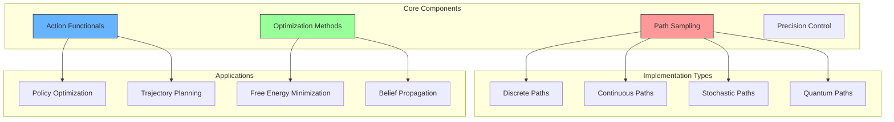

# Path Integral Implementations

> **Code on this page.** The Python snippets illustrate the ideas. Unless a snippet imports the
> `cognitive` package, it is not part of the package and is not run by its tests, so treat it as a
> sketch. The tested implementations are listed in [[docs/api/api_reference|the API reference]].

## Overview

This document provides comprehensive implementations of path integral methods for active inference and cognitive modeling. Path integrals offer powerful computational tools for trajectory optimization, policy evaluation, and uncertainty quantification in complex systems.



## Core Mathematical Framework

### Path Integral Definition

For a system with state $\mathbf{x}(t)$ and action functional $S[\mathbf{x}]$:

```math

Z = \int \mathcal{D}[\mathbf{x}(t)] \exp(-S[\mathbf{x}(t)]/\hbar)

```

where:

- $\mathcal{D}[\mathbf{x}(t)]$ is the path measure

- $S[\mathbf{x}(t)]$ encodes dynamics and constraints

- $\hbar$ is an effective temperature parameter

Related concepts: [[path_integral_theory]], [[variational_calculus]], [[statistical_physics]]

### Action Functional Forms

For active inference applications:

```math

S[\mathbf{x}, \mathbf{u}] = \int_{t_0}^{T} \left[ \frac{1}{2}|\dot{\mathbf{x}} - f(\mathbf{x}, \mathbf{u})|^2 + C(\mathbf{x}, \mathbf{u}) \right] dt

```

where:

- $f(\mathbf{x}, \mathbf{u})$ represents system dynamics

- $C(\mathbf{x}, \mathbf{u})$ is the cost function

- $\mathbf{u}(t)$ are control inputs

## Implementation Classes

### 1. Basic Path Sampler

```python
import numpy as np

rng = np.random.default_rng(0)

def sample_paths(x0, f, horizon, n_paths, sigma, dt=0.1):
    """Euler-Maruyama rollouts of dx = f(x) dt + sigma dW (uncontrolled)."""
    x = np.zeros((n_paths, horizon + 1, len(x0)))
    x[:, 0] = x0
    for t in range(horizon):
        noise = sigma * np.sqrt(dt) * rng.standard_normal((n_paths, len(x0)))
        x[:, t + 1] = x[:, t] + f(x[:, t]) * dt + noise
    return x

def path_weights(costs, temperature):
    """Boltzmann weights exp(-S / temperature), shifted for numerical stability."""
    w = np.exp(-(costs - costs.min()) / temperature)
    return w / w.sum()

f = lambda x: -x                                  # illustrative linear dynamics
path_cost = lambda p: 0.1 * np.sum((p - 1.0) ** 2)  # illustrative: stay near x = 1
paths = sample_paths(np.zeros(1), f, horizon=20, n_paths=500, sigma=1.0)
w = path_weights(np.array([path_cost(p) for p in paths]), temperature=1.0)
print("effective sample size:", 1.0 / np.sum(w ** 2))
print("weighted final state:", w @ paths[:, -1])
```

### 2. Advanced Path Optimizer

```python
def optimise_controls(x0, f, state_cost, horizon, n_paths=500, n_iters=30,
                      sigma=1.0, temperature=1.0, dt=0.1):
    """Path-integral control: reweight random control perturbations by exp(-S/lambda)."""
    u = np.zeros((horizon, len(x0)))
    for _ in range(n_iters):
        eps = sigma * rng.standard_normal((n_paths, horizon, len(x0)))
        S = np.zeros(n_paths)
        for k in range(n_paths):
            x = x0.copy()
            for t in range(horizon):
                x = x + (f(x) + u[t] + eps[k, t]) * dt
                S[k] += state_cost(x) * dt
        u = u + np.einsum("k,kth->th", path_weights(S, temperature), eps)
    return u

def rollout_cost(x0, f, u, state_cost, dt=0.1):
    x, S = x0.copy(), 0.0
    for ut in u:
        x = x + (f(x) + ut) * dt
        S += state_cost(x) * dt
    return S

state_cost = lambda x: float(np.sum((x - 1.0) ** 2))   # illustrative quadratic cost
x0 = np.zeros(1)
u = optimise_controls(x0, f, state_cost, horizon=20)
print("cost without control:", rollout_cost(x0, f, np.zeros_like(u), state_cost))
print("cost with optimised control:", rollout_cost(x0, f, u, state_cost))
```

### 3. Precision Parameter Optimization

```python
def temperature_for_ess(costs, target_fraction=0.5):
    """Bisect (in log space) for the temperature giving a target effective sample size."""
    lo, hi = 1e-6, 1e6
    for _ in range(60):
        mid = np.sqrt(lo * hi)
        ess = 1.0 / np.sum(path_weights(costs, mid) ** 2) / len(costs)
        lo, hi = (mid, hi) if ess < target_fraction else (lo, mid)
    return np.sqrt(lo * hi)

costs = np.array([path_cost(p) for p in paths])
lam = temperature_for_ess(costs, 0.5)
print("temperature:", lam, "ESS fraction:", 1.0 / np.sum(path_weights(costs, lam) ** 2) / len(costs))
```

## Application Examples

### 1. Free Energy Minimization

```python
# Preference-driven example: cost is the squared distance to a preferred state
# (the negative log of a Gaussian preference, up to constants).
preferred = np.array([2.0])
pref_cost = lambda x: float(np.sum((x - preferred) ** 2))
u = optimise_controls(np.zeros(1), f, pref_cost, horizon=20, temperature=2.0)
x = np.zeros(1)
for ut in u:
    x = x + (f(x) + ut) * 0.1
print("final state under optimised control:", x, "preferred:", preferred)
```

## Performance Considerations

### Computational Complexity

- **Path Sampling**: O(N × T × D) where N=samples, T=timesteps, D=dimensions

- **Weight Computation**: O(N × T) for simple cost functions

- **Optimization**: O(I × N × T × D) where I=iterations

### Memory Requirements

- **Storage**: Paths require O(N × T × D) memory

- **Gradients**: Additional O(T × D) for optimization

- **Metrics**: Fisher information matrices: O(T²D²)

### Optimization Strategies

1. **Adaptive Sampling**: Adjust sample size based on convergence

1. **Hierarchical Methods**: Coarse-to-fine refinement

1. **Parallel Computation**: Distribute path sampling across cores

1. **GPU Acceleration**: Use tensor operations for batch processing

## Integration with Active Inference

### Connection to Expected Free Energy

Path integral sampling can be used to approximate expected free energy minimization over trajectories; the expected free energy is written here schematically:

```math

G[\pi] = \mathbb{E}_{\pi}[F[q(s_{t+1}|o_{t+1})] + \mathbb{E}_{q(s_{t+1})}[H[p(o_{t+1}|s_{t+1})]]]

```

### Policy Optimization

Use path integral methods for:

- **Policy Gradient**: Natural gradients on policy manifolds

- **Value Function Approximation**: Path-based value estimates

- **Exploration**: Automatic exploration through sampling

### Hierarchical Planning

Extend to multi-scale planning:

- **Temporal Hierarchies**: Different time scales

- **Spatial Hierarchies**: Different abstraction levels

- **Goal Hierarchies**: Nested objective structures

## Related Documentation

### Mathematical Foundations

- [[path_integral_theory]] - Theoretical foundations

- [[variational_calculus]] - Calculus of variations

- [[stochastic_calculus]] - Stochastic differential equations

- [[information_geometry]] - Geometric structures

### Computational Methods

- [[monte_carlo_methods]] - Sampling techniques

- [[optimization_theory]] - Optimization algorithms

- [[numerical_methods]] - Numerical analysis

- [[automatic_differentiation]] - Gradient computation

### Applications

- [[active_inference_theory]] - Active inference framework

- [[policy_optimization]] - Optimal control

- [[belief_space_planning]] - Planning in belief space

- [[free_energy_minimization]] - Energy minimization

## Future Developments

### Research Directions

1. **Quantum Path Integrals**: Quantum mechanical extensions

1. **Non-Markovian Dynamics**: Memory effects in trajectories

1. **Infinite-Dimensional Paths**: Functional space methods

1. **Multi-Agent Path Integrals**: Collective behavior

### Implementation Improvements

1. **Adaptive Discretization**: Smart grid refinement

1. **Machine Learning Integration**: Neural path approximators

1. **Hardware Optimization**: Specialized computing architectures

1. **Real-Time Applications**: Online path optimization

---

**See Also**: [[README]] for overview, [[path_integral_theory]] for theory, [[monte_carlo_methods]] for sampling

## See also

- [[path_integral_implementation|Path Integral Implementation]] - companion page

## References

- Kappen, H. J. (2005). Linear theory for control of nonlinear stochastic systems. Physical Review Letters, 95(20), 200201.
- Kappen, H. J. (2005). Path integrals and symmetry breaking for optimal control theory. Journal of Statistical Mechanics: Theory and Experiment, 2005(11), P11011.
- Theodorou, E., Buchli, J., & Schaal, S. (2010). A generalized path integral control approach to reinforcement learning. Journal of Machine Learning Research, 11, 3137-3181.
- Todorov, E. (2009). Efficient computation of optimal actions. Proceedings of the National Academy of Sciences, 106(28), 11478-11483.
- Friston, K., Daunizeau, J., Kilner, J., & Kiebel, S. J. (2010). Action and behavior: A free-energy formulation. Biological Cybernetics, 102(3), 227-260.
- Parr, T., Pezzulo, G., & Friston, K. J. (2022). Active inference: The free energy principle in mind, brain, and behavior. MIT Press.
