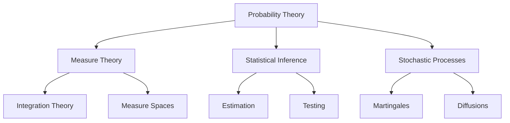
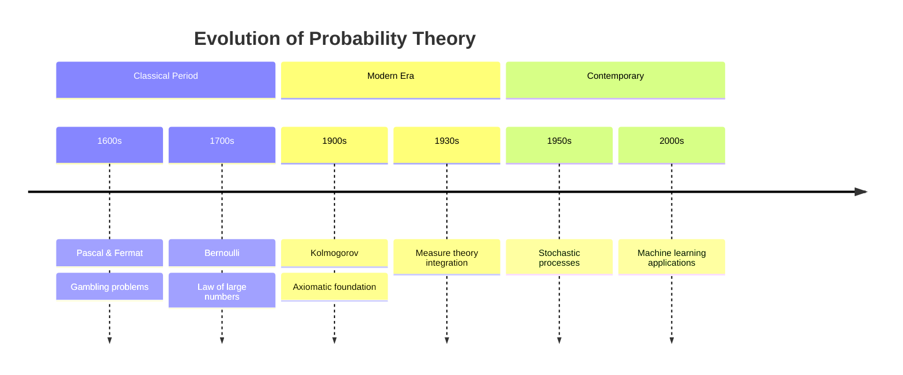
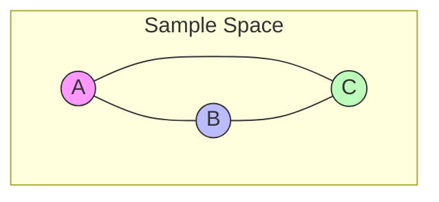
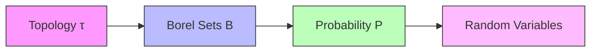
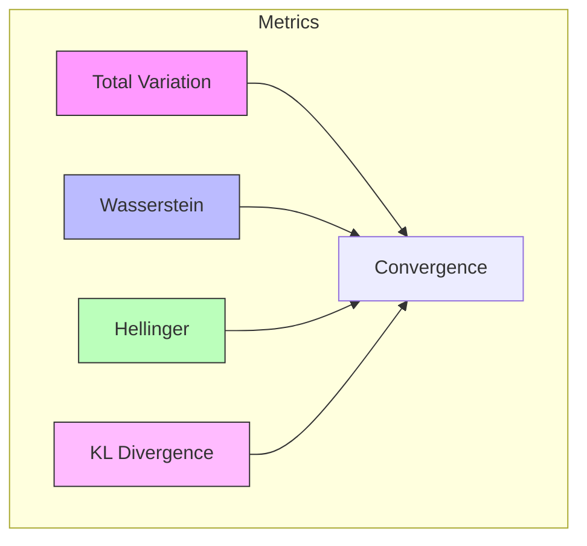
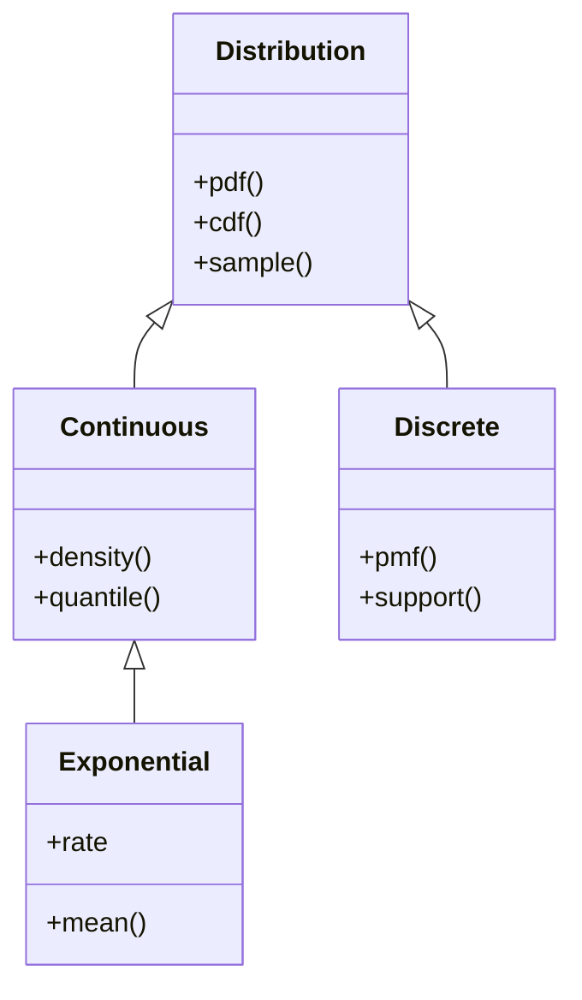
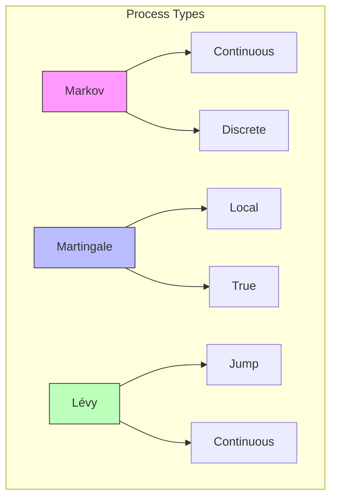
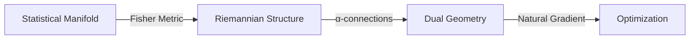
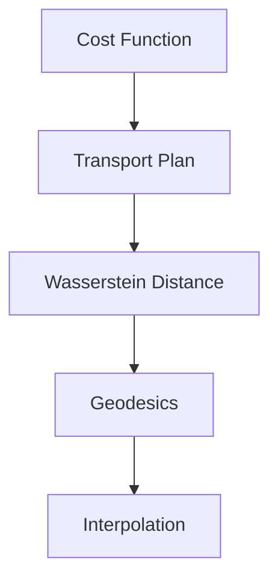
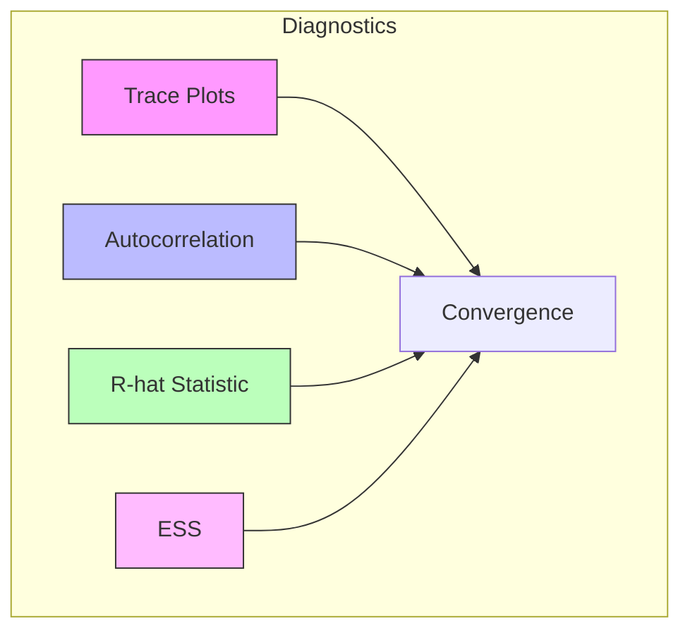

# Probability Theory

> **Code on this page.** The Python snippets illustrate the ideas. Unless a snippet imports the
> `cognitive` package, it is not part of the package and is not run by its tests, so treat it as a
> sketch. The tested implementations are listed in [[docs/api/api_reference|the API reference]].

## Overview

Probability theory provides the mathematical foundation for reasoning under uncertainty, forming the basis for modern approaches to cognitive modeling, machine learning, and statistical inference.



### Historical Development



## Fundamentals

### Probability Spaces

#### Measure Space

```math

(\Omega, \mathcal{F}, P)

```

where:

- $\Omega$ is sample space

- $\mathcal{F}$ is σ-algebra

- $P$ is probability measure

```mermaid

graph TD

    A[Sample Space Ω] --> B[Events F]

    B --> C[Probability Measure P]

    C --> D[P: F → [0,1]]

    D --> E[P(Ω) = 1]

    D --> F[P(∅) = 0]

    D --> G[Countable Additivity]

```

#### Axioms

1. Non-negativity: $P(A) \geq 0$

1. Normalization: $P(\Omega) = 1$

1. Additivity: $P(\cup_i A_i) = \sum_i P(A_i)$ for disjoint sets

### Random Variables

#### Definition

A measurable function $X: \Omega \rightarrow \mathbb{R}$

```mermaid

graph LR

    A[Sample Space Ω] -->|X| B[Real Line ℝ]

    B -->|F_X| C[Probability [0,1]]

    style A fill:#f9f,stroke:#333

    style B fill:#bbf,stroke:#333

    style C fill:#bfb,stroke:#333

```

#### Distribution Function

```math

F_X(x) = P(X \leq x)

```

#### Density Function

```math

f_X(x) = \frac{d}{dx}F_X(x)

```

### Probability Diagrams

#### Venn Diagrams



#### Distribution Plots

```python
import numpy as np

x = np.linspace(-12, 12, 6001)
dx = x[1] - x[0]

def normal_pdf(x, mu, sigma):
    return np.exp(-0.5 * ((x - mu) / sigma) ** 2) / (sigma * np.sqrt(2 * np.pi))

for mu, sigma in [(0.0, 1.0), (1.0, 0.5), (-1.0, 2.0)]:   # illustrative parameters
    pdf = normal_pdf(x, mu, sigma)
    mean = np.sum(x * pdf) * dx
    print(f"mu={mu}, sigma={sigma}: mass={pdf.sum() * dx:.4f}, mean={mean:.4f}")
```

## Probability Structures

### Topological Probability Spaces



#### Polish Spaces

```math

\begin{aligned}

& \text{Complete Metric Space:} \\

& (X,d) \text{ with Cauchy completion} \\

& \text{Second Countable:} \\

& \exists \text{ countable base for topology}

\end{aligned}

```

### Probability Metrics Space



### Distribution Hierarchies



## Advanced Concepts

### Measure-Theoretic Probability

#### Integration Theory

```math

\mathbb{E}[X] = \int_\Omega X dP = \int_\mathbb{R} x dF_X(x)

```

#### Integration Theory Visualization


#### Product Measures

```math

P(A \times B) = (P_1 \otimes P_2)(A \times B) = P_1(A)P_2(B)

```

### Stochastic Process Structures



### Characteristic Functions

#### Definition

```math

\phi_X(t) = \mathbb{E}[e^{itX}] = \int_{-\infty}^{\infty} e^{itx}dF_X(x)

```

#### Properties

1. $|\phi_X(t)| \leq 1$

1. $\phi_X(0) = 1$

1. $\phi_X(-t) = \overline{\phi_X(t)}$

### Martingale Theory

#### Definition

```math

\mathbb{E}[X_{n+1}|\mathcal{F}_n] = X_n

```

where $\mathcal{F}_n$ is filtration

#### Optional Stopping

```math

\mathbb{E}[X_\tau] = \mathbb{E}[X_0]

```

for bounded stopping time $\tau$

### Ergodic Theory

#### Ergodic Theorem

```math

\lim_{n \to \infty} \frac{1}{n}\sum_{k=1}^n f(T^k x) = \int_X f d\mu

```

for measure-preserving transformation T

#### Mixing Conditions

```math

\lim_{n \to \infty} \mu(A \cap T^{-n}B) = \mu(A)\mu(B)

```

### Large Deviations

#### Cramér's Theorem

```math

\begin{aligned}

& \text{Rate Function:} \\

& I(x) = \sup_{\theta \in \mathbb{R}}(\theta x - \log M(\theta)) \\

& \text{Large Deviation Principle:} \\

& \lim_{n \to \infty} \frac{1}{n}\log P(S_n/n \in A) = -\inf_{x \in A} I(x)

\end{aligned}

```

### Optimal Transport

#### Wasserstein Distance

```math

W_p(μ,ν) = \left(\inf_{\gamma \in \Gamma(μ,ν)} \int \|x-y\|^p d\gamma(x,y)\right)^{1/p}

```

#### Kantorovich Duality

```math

W_1(μ,ν) = \sup_{f: \text{Lip}(f) \leq 1} \int f d(μ-ν)

```

## Advanced Geometric Structures

### Information Geometry



#### Fisher Information Metric

```math

\begin{aligned}

& g_{ij}(θ) = \mathbb{E}_{p(x|θ)}\left[\frac{∂\log p(x|θ)}{∂θ^i}\frac{∂\log p(x|θ)}{∂θ^j}\right] \\

& \text{Geodesic Equation:} \\

& \ddot{θ}^k + \Gamma^k_{ij}\dot{θ}^i\dot{θ}^j = 0

\end{aligned}

```

### Optimal Transport Geometry



#### Kantorovich Problem

```math

\begin{aligned}

& \inf_{π \in \Pi(μ,ν)} \int_{X×Y} c(x,y)dπ(x,y) \\

& \text{Subject to:} \\

& π(A×Y) = μ(A), \quad π(X×B) = ν(B)

\end{aligned}

```

## Computational Methods

### MCMC Convergence Diagnostics



### Sampling Efficiency

```python
import numpy as np

rng = np.random.default_rng(0)
phi = 0.9                                    # AR(1) coefficient, illustrative
chain = np.zeros(20000)
for t in range(1, len(chain)):
    chain[t] = phi * chain[t - 1] + rng.normal()

def effective_sample_size(x, max_lag=200):
    x = x - x.mean()
    acf = np.correlate(x, x, mode="full")[len(x) - 1:][:max_lag] / (x @ x)
    return len(x) / (1 + 2 * acf[1:][acf[1:] > 0.05].sum())

print(effective_sample_size(chain))          # well below 20000 for a sticky chain
```


## Advanced Probability Models


### Diffusion Processes

See `docs/examples/README.md` for runnable examples.


### Markov Chain Monte Carlo

```python
import numpy as np

rng = np.random.default_rng(1)

def metropolis(log_p, x0, n, step=1.0):
    x, out = x0, []
    for _ in range(n):
        prop = x + step * rng.normal()
        if np.log(rng.uniform()) < log_p(prop) - log_p(x):
            x = prop
        out.append(x)
    return np.array(out)

# Target: mixture of two unit Gaussians at -2 and +2 (illustrative)
log_p = lambda x: np.logaddexp(-0.5 * (x + 2) ** 2, -0.5 * (x - 2) ** 2)
samples = metropolis(log_p, 0.0, 50000, step=2.0)[5000:]
print(samples.mean(), samples.std())        # about 0 and sqrt(1 + 4) ~ 2.24
```

### Sequential Monte Carlo

```python
import numpy as np

rng = np.random.default_rng(2)

def effective_sample_size(w):
    return 1.0 / np.sum(w ** 2)

def systematic_resample(w):
    positions = (rng.uniform() + np.arange(len(w))) / len(w)
    return np.searchsorted(np.cumsum(w), positions)

# Bootstrap filter for x_t = 0.9 x_{t-1} + N(0, 1), y_t = x_t + N(0, 0.5^2) (illustrative)
T, N = 50, 1000
x_true = np.zeros(T)
for t in range(1, T):
    x_true[t] = 0.9 * x_true[t - 1] + rng.normal()
y = x_true + 0.5 * rng.normal(size=T)

particles, estimates = rng.normal(size=N), []
for t in range(T):
    particles = 0.9 * particles + rng.normal(size=N)
    w = np.exp(-0.5 * ((y[t] - particles) / 0.5) ** 2)
    w /= w.sum()
    estimates.append(w @ particles)
    if effective_sample_size(w) < N / 2:
        particles = particles[systematic_resample(w)]
print(np.sqrt(np.mean((np.array(estimates) - x_true) ** 2)))   # below the 0.5 observation noise
```

### Advanced Probability Metrics

```python
import numpy as np

p = np.array([0.5, 0.3, 0.2])               # illustrative discrete distributions
q = np.array([0.4, 0.4, 0.2])

total_variation = 0.5 * np.abs(p - q).sum()
hellinger = np.sqrt(0.5 * np.sum((np.sqrt(p) - np.sqrt(q)) ** 2))
kl_pq = np.sum(p * np.log(p / q))

print(total_variation, hellinger, kl_pq)
print(total_variation <= np.sqrt(0.5 * kl_pq))   # Pinsker's inequality
```


## Advanced Topics

### Optimal Transport Theory

- Monge-Kantorovich problem

- Wasserstein geometry

- Displacement interpolation

- Brenier's theorem

### Stochastic Analysis

- Itô calculus

- Stratonovich integral

- Stochastic differential equations

- Malliavin calculus

### Information Geometry

- Statistical manifolds

- Fisher information

- α-connections

- Amari-Chentsov tensor

### Random Matrix Theory

- Wigner matrices

- Free probability

- Large deviation principles

- Tracy-Widom law

## Future Directions

### Quantum Probability

- Quantum measure theory

- Non-commutative probability

- Quantum stochastic processes

- Quantum information theory

### Machine Learning Applications

- Neural SDEs

- Normalizing flows

- Score-based generative models

- Probabilistic programming

### Theoretical Developments

- Rough paths theory

- Regularity structures

- Geometric measure theory

- Optimal transport methods

## Implementation Framework


### Statistical Inference

```python
import numpy as np

rng = np.random.default_rng(3)
x = rng.normal(2.0, 1.5, size=5000)         # data from an illustrative Gaussian

# Maximum likelihood for a Gaussian has a closed form
mu_hat = x.mean()
sigma_hat = np.sqrt(np.mean((x - mu_hat) ** 2))
log_lik = np.sum(-0.5 * np.log(2 * np.pi * sigma_hat**2)
                 - 0.5 * ((x - mu_hat) / sigma_hat) ** 2)
print(mu_hat, sigma_hat, log_lik)
```


## Advanced Applications

### Information Theory

See `docs/examples/README.md` for runnable examples.


### Stochastic Processes

```python
import numpy as np

rng = np.random.default_rng(4)
theta, sigma, dt = 1.0, 0.5, 0.01           # Ornstein-Uhlenbeck parameters, illustrative
x = np.zeros((2000, 1000))                  # 2000 paths, 1000 Euler-Maruyama steps
for t in range(1, x.shape[1]):
    x[:, t] = x[:, t - 1] - theta * x[:, t - 1] * dt + sigma * np.sqrt(dt) * rng.normal(size=x.shape[0])

print(x[:, -1].var(), sigma**2 / (2 * theta))   # stationary variance
```


## Best Practices

### Implementation

1. Use log-space computations

1. Implement numerical stability

1. Validate probability axioms

1. Handle edge cases

1. Use vectorized operations

1. Implement error checking

### Modeling

1. Choose appropriate distributions

1. Validate assumptions

1. Consider conjugate priors

1. Test inference methods

1. Use cross-validation

1. Monitor convergence

### Computation

1. Use stable algorithms

1. Implement vectorization

1. Handle numerical precision

1. Validate results

1. Use efficient data structures

1. Implement caching

## Common Issues

### Numerical Stability

1. Underflow/overflow

1. Division by zero

1. Log of zero

1. Precision loss

1. Floating-point errors

1. Catastrophic cancellation

### Solutions

1. Log-space arithmetic

1. Stable algorithms

1. Numerical safeguards

1. Error checking

1. Regularization

1. Robust implementations

## Related Topics

- [[measure_theory|Measure Theory]]

- [[information_theory|Information Theory]]

- [[statistics|Statistics]]

- [[bayesian_inference|Bayesian Inference]]

- [[stochastic_processes|Stochastic Processes]]

- [[statistical_learning|Statistical Learning]]

- [[random_variables|Random Variables]]

- [[probability_distributions|Probability Distributions]]

## References

1. kolmogorov 1933 - "Foundations of the Theory of Probability"

1. feller 1968 - "An Introduction to Probability Theory and Its Applications"

1. billingsley 1995 - "Probability and Measure"

1. durrett 2019 - "Probability: Theory and Examples"

1. williams 1991 - "Probability with Martingales"

1. kallenberg 2002 - "Foundations of Modern Probability"

