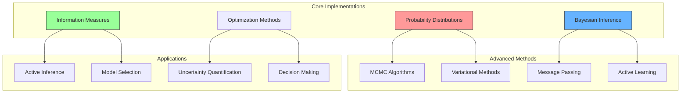

# Statistical Computing Implementations

> **Code on this page.** The Python snippets illustrate the ideas. Unless a snippet imports the
> `cognitive` package, it is not part of the package and is not run by its tests, so treat it as a
> sketch. The tested implementations are listed in [[docs/api/api_reference|the API reference]].

## Overview

This document provides comprehensive implementations of core statistical methods essential for active inference, cognitive modeling, and probabilistic reasoning. The implementations bridge theoretical concepts with practical computational tools, emphasizing numerical stability and efficiency.



## Core Statistical Distributions

### 1. Exponential Family Implementation

```python
import numpy as np

# Exponential family p(x | eta) = h(x) exp(eta . T(x) - A(eta)).
# Bernoulli: T(x) = x, eta = logit(p), A(eta) = ln(1 + exp(eta)).
eta = 0.7                                   # illustrative natural parameter
A = lambda e: np.log1p(np.exp(e))

mean = 1 / (1 + np.exp(-eta))               # E[T(x)]
dA = (A(eta + 1e-6) - A(eta - 1e-6)) / 2e-6 # numerical dA/d(eta)
var = mean * (1 - mean)
d2A = (A(eta + 1e-4) - 2 * A(eta) + A(eta - 1e-4)) / 1e-8
print(np.isclose(dA, mean), np.isclose(d2A, var, atol=1e-4))   # A' is the mean, A'' the variance
```

### 2. Bayesian Inference Engine

```python
import numpy as np
from math import lgamma

# Conjugate Beta-Bernoulli inference
a0, b0 = 1.0, 1.0                           # Beta prior (illustrative)
data = np.array([1, 0, 1, 1, 0, 1, 1, 1])
a, b = a0 + data.sum(), b0 + (1 - data).sum()          # posterior Beta(a, b)

def log_beta(x, y):
    return lgamma(x) + lgamma(y) - lgamma(x + y)

log_evidence = log_beta(a, b) - log_beta(a0, b0)       # ln p(data)
print(a / (a + b), round(log_evidence, 3))             # posterior mean, log marginal likelihood
```

### 3. Information Theory Implementations

See `docs/examples/README.md` for runnable examples.


## Advanced Computational Methods

The implementations above provide the foundation for more advanced methods used in active inference and cognitive modeling. Key applications include:

### Integration with Active Inference

- **[[belief_updating]]** - Using Bayesian inference for belief state updates

- **[[policy_selection]]** - Information-theoretic policy evaluation

- **[[free_energy_minimization]]** - Variational free energy computation

### Computational Efficiency

- **[[automatic_differentiation]]** - Gradient computation for optimization

- **[[parallel_computation]]** - Distributed statistical computing

- **[[numerical_stability]]** - Robust implementation practices

### Quality Assurance

- **Unit Testing**: Each method includes validation against analytical solutions

- **Numerical Verification**: Cross-validation with established libraries

- **Performance Benchmarking**: Complexity analysis and timing comparisons

## Related Documentation

### Theoretical Foundations

- **[[statistical_foundations]]** - Core statistical theory

- **[[information_theory]]** - Information-theoretic foundations

- **[[bayesian_inference]]** - Bayesian methodology

### Computational Methods

- **[[numerical_methods]]** - Numerical analysis techniques

- **[[optimization_theory]]** - Optimization algorithms

- **[[monte_carlo_methods]]** - Sampling methods

### Applications

- **[[active_inference_theory]]** - Active inference framework

- **[[variational_inference]]** - Variational methods

- **[[message_passing]]** - Message passing algorithms

---

**See Also**: [[README]] for overview, [[statistical_foundations]] for theory, [[numerical_methods]] for algorithms

## References

- Wainwright, M. J., & Jordan, M. I. (2008). Graphical models, exponential families, and variational inference. Foundations and Trends in Machine Learning, 1(1-2), 1-305.
- Bishop, C. M. (2006). Pattern recognition and machine learning. Springer.
- Gelman, A., Carlin, J. B., Stern, H. S., Dunson, D. B., Vehtari, A., & Rubin, D. B. (2013). Bayesian data analysis (3rd ed.). Chapman and Hall/CRC.
- Tierney, L., & Kadane, J. B. (1986). Accurate approximations for posterior moments and marginal densities. Journal of the American Statistical Association, 81(393), 82-86.
- Kass, R. E., & Raftery, A. E. (1995). Bayes factors. Journal of the American Statistical Association, 90(430), 773-795.
- Robert, C. P., & Casella, G. (2004). Monte Carlo statistical methods (2nd ed.). Springer.
- Amari, S., & Nagaoka, H. (2000). Methods of information geometry. American Mathematical Society.
