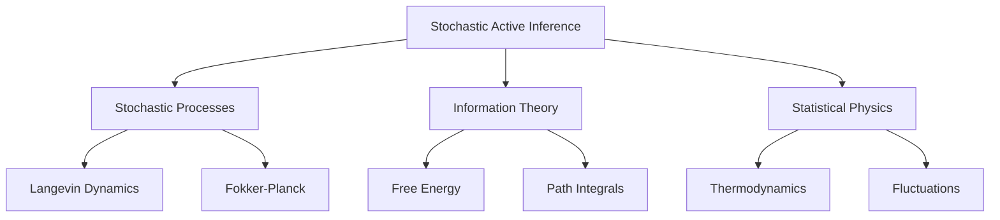
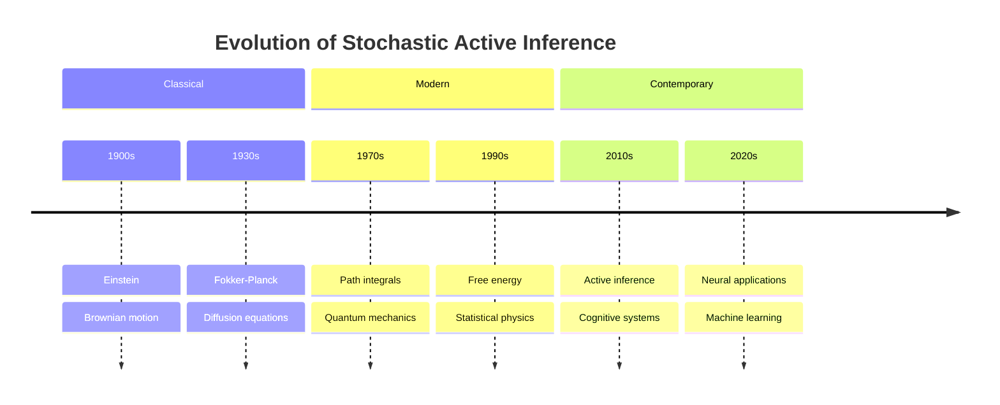
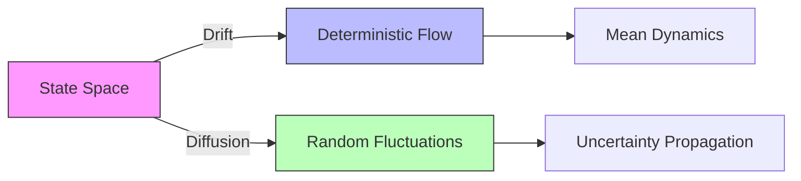
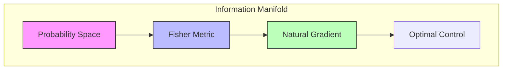
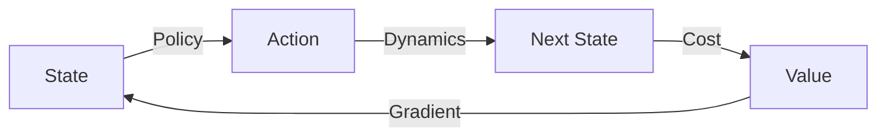

# Stochastic Active Inference

> **Code on this page.** The Python snippets illustrate the ideas. Unless a snippet imports the
> `cognitive` package, it is not part of the package and is not run by its tests, so treat it as a
> sketch. The tested implementations are listed in [[docs/api/api_reference|the API reference]].

## Overview



### Historical Development



Stochastic Active Inference extends the active inference framework to handle uncertainty and noise in both perception and action. This approach combines stochastic processes, statistical physics, and information theory to provide a comprehensive treatment of probabilistic inference and decision-making.

## Mathematical Foundation

### 1. Stochastic Processes

#### Langevin Dynamics

```math

dX_t = b(X_t)dt + \sigma(X_t)dW_t

```

where:

- $X_t$ is state process

- $b$ is drift term

- $\sigma$ is diffusion term

- $W_t$ is Wiener process

#### Fokker-Planck Equation

```math

\frac{\partial p}{\partial t} = -\nabla \cdot (bp) + \frac{1}{2}\nabla \cdot (\Sigma \nabla p)

```

where:

- $p$ is probability density

- $\Sigma = \sigma\sigma^T$ is diffusion matrix

### 2. Path Integrals

#### Path Probability

```math

P[x(t)] \propto \exp\left(-\frac{1}{2}\int_0^T |\sigma^{-1}(\dot{x} - b)|^2 dt\right)

```

#### Action Functional

```math

S[x] = \int_0^T \left(\frac{1}{2}|\sigma^{-1}(\dot{x} - b)|^2 + \nabla \cdot b\right) dt

```

### 3. Information Theory

#### Relative Entropy Rate

```math

\dot{D}_{KL}[p||q] = \lim_{t \to 0} \frac{1}{t}D_{KL}[p_t||q_t]

```

#### Fisher Information Flow

```math

\mathcal{I}(t) = \mathbb{E}_{p_t}\left[\left(\frac{\partial \log p_t}{\partial t}\right)^2\right]

```

## Stochastic Free Energy

### 1. Stochastic Variational Free Energy

#### Definition

```math

F_t[q] = \mathbb{E}_{q_t}[\log q_t - \log p_t] + \frac{1}{2}\mathbb{E}_{q_t}[|\sigma^{-1}(\dot{x} - b)|^2]

```

#### Flow Equation

```math

\frac{d}{dt}F_t = -\mathcal{I}(t) + \dot{D}_{KL}[q_t||p_t]

```

### 2. Stochastic Expected Free Energy

#### Definition

```math

G_t(\pi) = \mathbb{E}_{q_t}\left[\log q_t(s|\pi) - \log p_t(o,s)\right] + \frac{1}{2}\mathbb{E}_{q_t}[|\sigma^{-1}(\dot{s} - b_\pi)|^2]

```

#### Components

```math

G_t = \underbrace{\mathbb{E}_{q_t}[D_{KL}[q_t(s|\pi)||p_t(s|o,\pi)]]}_{\text{epistemic value}} + \underbrace{\mathbb{E}_{q_t}[\log q_t(o|\pi) - \log p_t(o)]}_{\text{pragmatic value}} + \underbrace{\frac{1}{2}\mathbb{E}_{q_t}[|\sigma^{-1}(\dot{s} - b_\pi)|^2]}_{\text{dynamic cost}}

```

## Implementation

### 1. Stochastic Integration

See `docs/examples/README.md` for runnable examples.


### 2. Path Integral Methods

```python
import numpy as np

rng = np.random.default_rng(0)
dt, T, n_paths = 0.01, 1.0, 20000
n_steps = int(T / dt)
sigma = 0.5                                  # diffusion coefficient, illustrative

# Euler-Maruyama paths of dX = -X dt + sigma dW, started at x = 1
x = np.ones(n_paths)
action = np.zeros(n_paths)                   # accumulated running cost along each path
for _ in range(n_steps):
    x += -x * dt + sigma * np.sqrt(dt) * rng.normal(size=n_paths)
    action += 0.5 * x**2 * dt

weights = np.exp(-action)                    # path weights exp(-S)
weights /= weights.sum()
print(x.mean(), np.exp(-1.0))                # unweighted mean vs analytic e^{-T}
print(weights @ x)                           # mean after weighting by exp(-S)
```

### 3. Stochastic Optimization

```python
import numpy as np

rng = np.random.default_rng(1)
temperature, step = 0.5, 0.01                # illustrative

grad_F = lambda x: x                         # F(x) = x^2 / 2
x, samples = 3.0, []
for t in range(200000):                      # Langevin dynamics targets exp(-F / T)
    x += -step * grad_F(x) + np.sqrt(2 * step * temperature) * rng.normal()
    if t > 20000:
        samples.append(x)
print(np.var(samples), temperature)          # stationary variance is the temperature
```

## Applications

### 1. Stochastic Control

- Optimal control

- Risk-sensitive control

- Robust control

- Adaptive control

### 2. Learning

- Stochastic gradient descent

- Langevin dynamics

- MCMC methods

- Particle filters

### 3. Decision Making

- Risk assessment

- Uncertainty quantification

- Exploration strategies

- Adaptive policies

## Best Practices

### 1. Numerical Methods

1. Use appropriate integrators

1. Control step size

1. Monitor stability

1. Handle boundary conditions

### 2. Sampling

1. Choose proper proposals

1. Monitor acceptance rates

1. Implement resampling

1. Check convergence

### 3. Implementation

1. Efficient computation

1. Parallel sampling

1. Adaptive methods

1. Error analysis

## Common Issues

### 1. Technical Challenges

1. Numerical instability

1. Sample degeneracy

1. Curse of dimensionality

1. Computational cost

### 2. Solutions

1. Adaptive step size

1. Importance sampling

1. Dimensionality reduction

1. Parallel computation

## Related Topics

- [[stochastic_processes]]

- [[probability_theory]]

- [[statistical_physics]]

- [[path_integral_free_energy]]

- [[optimal_control]]

- [[variational_methods]]

## Advanced Stochastic Framework

### Phase Space Structure



#### Stochastic Differential Geometry

```math

\begin{aligned}

& \text{Stratonovich Form:} \\

& dX_t = b(X_t)dt + \sigma(X_t) \circ dW_t \\

& \text{Itô-Stratonovich Correction:} \\

& b_{\text{Itô}} = b_{\text{Strat}} - \frac{1}{2}\sum_{j=1}^m \sigma^j \partial_x \sigma^j

\end{aligned}

```

### Information Geometry of Stochastic Systems



#### Fisher-Rao Metric

```math

\begin{aligned}

& \text{Metric Tensor:} \\

& g_{ij}(θ,t) = \mathbb{E}_{p(x,t|θ)}\left[\frac{∂\log p}{∂θ^i}\frac{∂\log p}{∂θ^j}\right] \\

& \text{Geodesic Flow:} \\

& \ddot{θ}^k + Γ^k_{ij}\dot{θ}^i\dot{θ}^j = -g^{kl}\frac{∂F}{∂θ^l}

\end{aligned}

```

## Stochastic Control Theory

### Optimal Control Framework



#### Hamilton-Jacobi-Bellman

```math

\begin{aligned}

& \text{Value Function:} \\

& -\frac{∂V}{∂t} = \min_u\left\{L(x,u) + \frac{∂V}{∂x}f(x,u) + \frac{1}{2}\text{tr}(σσ^T\frac{∂^2V}{∂x^2})\right\} \\

& \text{Optimal Control:} \\

& u^*(x,t) = \arg\min_u\left\{L(x,u) + \frac{∂V}{∂x}f(x,u)\right\}

\end{aligned}

```

### Risk-Sensitive Control

```python
import numpy as np

rng = np.random.default_rng(2)
cost = rng.normal(loc=1.0, scale=1.0, size=100000)   # cost samples, illustrative

def entropic_risk(cost, theta):
    """(1 / theta) ln E[exp(theta * cost)]; theta > 0 is risk-averse."""
    return np.log(np.mean(np.exp(theta * cost))) / theta

print(cost.mean())
for theta in (0.1, 1.0):
    print(theta, entropic_risk(cost, theta), 1.0 + theta / 2)   # Gaussian: mean + theta var / 2
```


## Advanced Topics

### Quantum Extensions

- Quantum stochastic differential equations

- Quantum filtering theory

- Open quantum systems

- Quantum control theory

### Machine Learning Applications

- Neural stochastic differential equations

- Stochastic normalizing flows

- Diffusion models

- Deep active inference

### Theoretical Developments

- Non-equilibrium thermodynamics

- Information geometry

- Optimal transport

- Rough path theory

## Future Research Directions

### Theoretical Challenges

- Non-Markovian processes

- Path-dependent dynamics

- Infinite-dimensional systems

- Quantum generalizations

### Computational Challenges

- High-dimensional sampling

- Long-time stability

- Adaptive algorithms

- Real-time implementation

### Applications

- Biological systems

- Robotics control

- Financial modeling

- Climate prediction

## References

- [[stochastic_processes]]

- [[probability_theory]]

- [[statistical_physics]]

- [[path_integral_free_energy]]

- [[optimal_control]]

- [[variational_methods]]

