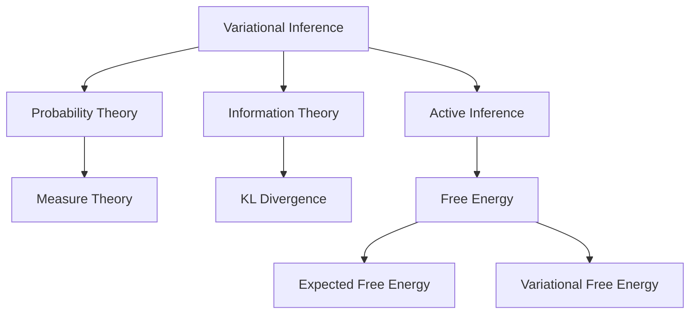

# Variational Inference

> **Code on this page.** The Python snippets illustrate the ideas. Unless a snippet imports the
> `cognitive` package, it is not part of the package and is not run by its tests, so treat it as a
> sketch. The tested implementations are listed in [[docs/api/api_reference|the API reference]].

## Overview

Variational Inference (VI) is a method for approximating complex probability distributions through optimization. It forms the mathematical foundation for many cognitive modeling approaches, including predictive coding and active inference.



## Core Concepts

### Evidence Lower Bound

```math

\mathcal{L} = \mathbb{E}_{q(z)}[\log p(x,z) - \log q(z)]

```

where:

- $\mathcal{L}$ is ELBO

- $q(z)$ is variational distribution

- $p(x,z)$ is joint distribution

### KL Divergence

```math

D_{KL}(q||p) = \mathbb{E}_{q(z)}[\log q(z) - \log p(z)]

```

where:

- $D_{KL}$ is KL divergence

- $q(z)$ is approximate posterior

- $p(z)$ is true posterior

## Active Inference Connection

### Free Energy Principle

```math

F = \mathbb{E}_{q(s)}[\log q(s) - \log p(o,s)]

```

where:

- $F$ is variational free energy

- $s$ are hidden states

- $o$ are observations

### Expected Free Energy

```math

G(\pi) = \mathbb{E}_{q(o,s|\pi)}[\log q(s|\pi) - \log p(o,s|\pi)]

```

where:

- $G$ is expected free energy

- $\pi$ is policy

- $q(o,s|\pi)$ is predicted distribution

### Hierarchical Inference

```math

\begin{aligned}

F_i &= \mathbb{E}_{q(s_i)}[\log q(s_i) - \log p(s_{i-1}|s_i) - \log p(s_i|s_{i+1})] \\

F_{total} &= \sum_i F_i

\end{aligned}

```

where:

- $F_i$ is level-specific free energy

- $s_i$ are states at level $i$

## Implementation Framework

### Variational Distribution

```python
import numpy as np

# Conjugate Gaussian model (illustrative): p(z) = N(0, 1), p(x | z) = N(z, sigma^2)
x, sigma = 1.5, 0.8

def elbo(m, s):
    """Analytic ELBO for q(z) = N(m, s^2)."""
    expected_loglik = -0.5 * np.log(2 * np.pi * sigma**2) - ((x - m) ** 2 + s**2) / (2 * sigma**2)
    kl = 0.5 * (m**2 + s**2 - 1 - 2 * np.log(s))
    return expected_loglik - kl

m, log_s = 0.0, 0.0
for _ in range(2000):                        # gradient ascent with finite differences
    g_m = (elbo(m + 1e-5, np.exp(log_s)) - elbo(m - 1e-5, np.exp(log_s))) / 2e-5
    g_s = (elbo(m, np.exp(log_s + 1e-5)) - elbo(m, np.exp(log_s - 1e-5))) / 2e-5
    m, log_s = m + 0.05 * g_m, log_s + 0.05 * g_s

print(m, np.exp(log_s) ** 2)                 # variational mean and variance
print(x / (1 + sigma**2), sigma**2 / (1 + sigma**2))   # exact posterior
```

### Active Inference Implementation

> [!note] Illustrative pseudocode
> The snippet below is a plain-numpy sketch; it is not the
> installed API. The real `cognitive.ActiveInferenceModel` is an abstract
> base whose constructor takes a `config_path`.

```python
import numpy as np

def softmax(x):
    e = np.exp(x - x.max())
    return e / e.sum()

D = np.array([0.5, 0.3, 0.2])                # prior over states, illustrative
A = np.array([[0.7, 0.2, 0.1],               # p(o | s)
              [0.2, 0.6, 0.3],
              [0.1, 0.2, 0.6]])
o = 1                                        # observed outcome

def free_energy(q):
    return np.sum(q * (np.log(q) - np.log(D) - np.log(A[o])))

logits = np.zeros(3)                         # q = softmax(logits)
for _ in range(500):                         # gradient descent on F
    q = softmax(logits)
    dF_dq = np.log(q) - np.log(D) - np.log(A[o]) + 1
    logits -= 0.5 * q * (dF_dq - q @ dF_dq)  # chain rule through the softmax

posterior = D * A[o] / (D @ A[o])
print(softmax(logits), posterior, free_energy(softmax(logits)))
```


## Advanced Topics

### Information Geometry

```math

\begin{aligned}

& \text{Fisher Metric:} \\

& g_{ij}(\theta) = \mathbb{E}_{p(x|\theta)}\left[\frac{\partial \log p(x|\theta)}{\partial \theta^i}\frac{\partial \log p(x|\theta)}{\partial \theta^j}\right] \\

& \text{Natural Gradient:} \\

& \dot{\theta} = -g^{ij}(\theta)\frac{\partial F}{\partial \theta^j} \\

& \text{α-Connection:} \\

& \Gamma_{ijk}^{(α)} = \mathbb{E}\left[\frac{\partial^2 \log p}{\partial \theta^i \partial \theta^j}\frac{\partial \log p}{\partial \theta^k} + \frac{1-α}{2}\frac{\partial \log p}{\partial \theta^i}\frac{\partial \log p}{\partial \theta^j}\frac{\partial \log p}{\partial \theta^k}\right]

\end{aligned}

```

### Geometric Structures

#### Statistical Manifold

```math

\begin{aligned}

& \text{Manifold:} \\

& \mathcal{M} = \{p_\theta : \theta \in \Theta\} \\

& \text{Tangent Space:} \\

& T_p\mathcal{M} = \text{span}\left\{\frac{\partial}{\partial \theta^i}\right\} \\

& \text{Cotangent Space:} \\

& T_p^*\mathcal{M} = \text{span}\{d\theta^i\}

\end{aligned}

```

#### Geodesic Flow

```math

\begin{aligned}

& \text{Geodesic Equation:} \\

& \ddot{\theta}^k + \Gamma_{ij}^k\dot{\theta}^i\dot{\theta}^j = 0 \\

& \text{Parallel Transport:} \\

& \nabla_{\dot{\gamma}}\dot{\gamma} = 0 \\

& \text{Curvature:} \\

& R(X,Y)Z = \nabla_X\nabla_YZ - \nabla_Y\nabla_XZ - \nabla_{[X,Y]}Z

\end{aligned}

```

### Advanced Variational Methods

#### Normalizing Flows

```math

\begin{aligned}

& \text{Change of Variables:} \\

& q_K(z_K) = q_0(z_0)\prod_{k=1}^K\left|\det\frac{\partial f_k}{\partial z_{k-1}}\right|^{-1} \\

& \text{Flow ELBO:} \\

& \mathcal{L} = \mathbb{E}_{q_0(z_0)}\left[\log p(x,z_K) - \log q_0(z_0) + \sum_{k=1}^K\log\left|\det\frac{\partial f_k}{\partial z_{k-1}}\right|\right]

\end{aligned}

```

#### Stochastic Variational Inference

```math

\begin{aligned}

& \text{Natural Parameters:} \\

& \eta = \mathbb{E}_{q(z)}[t(z)] \\

& \text{Stochastic Update:} \\

& \eta_{t+1} = (1-\rho_t)\eta_t + \rho_t\tilde{\eta}_t \\

& \text{where } \rho_t = (t + \tau)^{-\kappa}

\end{aligned}

```

### Implementation Framework

#### Advanced Normalizing Flows

```python
import numpy as np

rng = np.random.default_rng(0)
a, b = 0.5, 0.2                              # affine layer parameters, illustrative
z0 = rng.normal(size=100000)
z1 = a * z0 + b                              # layer 1: log|det| = log a
z2 = np.exp(z1)                              # layer 2: log|det| = z1

log_q0 = -0.5 * z0**2 - 0.5 * np.log(2 * np.pi)
log_q2 = log_q0 - np.log(a) - z1             # change of variables

# Exact log-normal density at the same points
exact = -0.5 * ((np.log(z2) - b) / a) ** 2 - np.log(z2 * a * np.sqrt(2 * np.pi))
print(np.max(np.abs(log_q2 - exact)))        # ~ 0
```


## Best Practices

### Model Design

1. Choose appropriate architectures

1. Design latent space

1. Initialize parameters

1. Consider hierarchical structure

1. Use normalizing flows

1. Implement geometric methods

### Implementation

1. Monitor convergence

1. Handle numerical stability

1. Validate inference

1. Test reconstruction

1. Use parallel transport

1. Implement geodesic updates

### Training

1. Tune learning rates

1. Balance loss components

1. Monitor KL divergence

1. Validate learning

1. Use natural gradients

1. Implement flow-based methods

## Common Issues

### Technical Challenges

1. Posterior collapse

1. Latent space issues

1. Gradient problems

1. Training instability

1. Metric degeneracy

1. Flow invertibility

### Solutions

1. KL annealing

1. Warm-up period

1. Gradient clipping

1. Careful initialization

1. Regularization

1. Stable flows

## Related Topics

- [[active_inference]]

- [[active_inference_agent]]

- [[probability_theory]]

- [[information_theory]]

- [[optimization_theory]]

- [[free_energy_principle]]

- [[differential_geometry]]

- [[information_geometry]]

- [[optimal_transport]]

## References

- Blei, D. M., Kucukelbir, A., & McAuliffe, J. D. (2017). Variational inference: a review for statisticians. Journal of the American Statistical Association, 112(518), 859-877.
- Hoffman, M. D., Blei, D. M., Wang, C., & Paisley, J. (2013). Stochastic variational inference. Journal of Machine Learning Research, 14, 1303-1347.
- Rezende, D., & Mohamed, S. (2015). Variational inference with normalizing flows. Proceedings of the 32nd International Conference on Machine Learning, PMLR 37, 1530-1538.
- Winn, J., & Bishop, C. M. (2005). Variational message passing. Journal of Machine Learning Research, 6, 661-694.
- Parr, T., Pezzulo, G., & Friston, K. J. (2022). Active Inference: The Free Energy Principle in Mind, Brain, and Behavior. MIT Press.
