# Philosophical Topics Index

## Overview

```mermaid

mindmap

    root((Philosophy))

        (Theoretical Philosophy)

            (Metaphysics)

            (Epistemology)

            (Logic)

        (Practical Philosophy)

            (Ethics)

            (Political Philosophy)

            (Aesthetics)

        (Applied Philosophy)

            (Philosophy of Science)

            (Philosophy of Mind)

            (Philosophy of Language)

```

## Core Domains

### 1. Theoretical Philosophy

#### Metaphysics

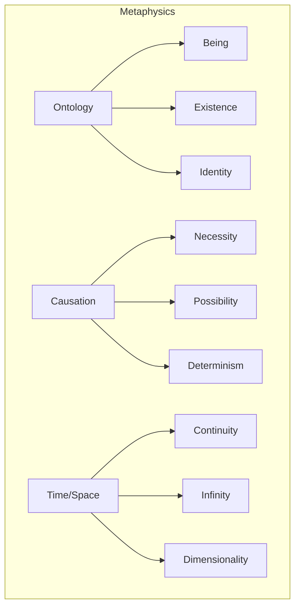

- ontology

  - [[being_and_nothingness]]

  - existence

  - identity and difference

- [[causation]]

  - necessity and contingency

  - possibility and actuality

  - determinism and free will

- time and space

  - continuity

  - infinity

  - dimensionality

#### Epistemology

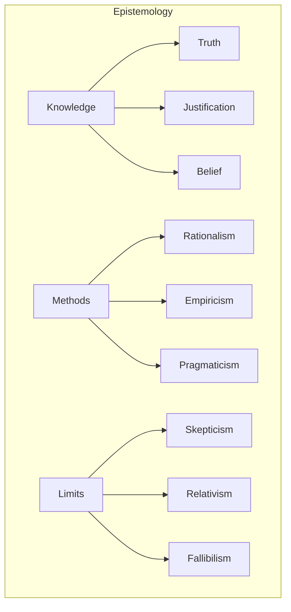

- knowledge theory

  - truth theories

  - [[justification]]

  - [[belief_systems]]

- epistemological methods

  - [[rationalism]]

  - [[empiricism]]

  - [[pragmaticism]]

- epistemic limits

  - [[skepticism]]

  - [[relativism]]

  - [[fallibilism]]

#### Logic

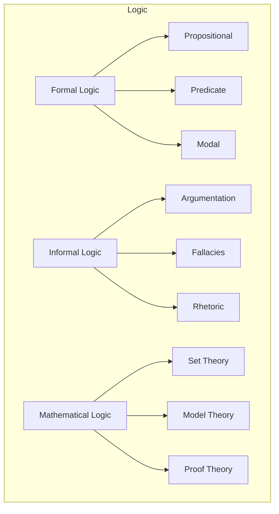

- [[formal_logic]]

  - [[propositional_logic]]

  - [[predicate_logic]]

  - [[modal_logic]]

- [[informal_logic]]

  - [[informal_logic|argumentation theory]]

  - [[fallacies]]

  - rhetoric

- [[mathematical_logic]]

  - [[set_theory]]

  - model theory

  - [[proof_theory]]

### 2. Practical Philosophy

#### Ethics

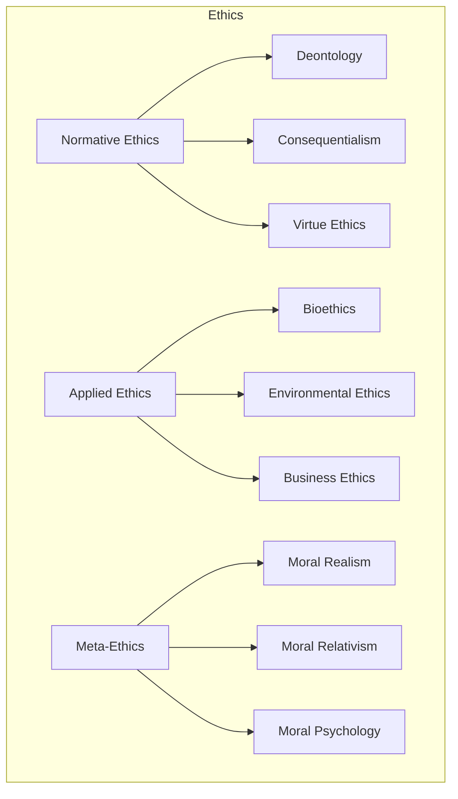

- [[normative_ethics]]

  - [[deontological_ethics]]

  - [[consequentialism]]

  - [[virtue_ethics]]

- [[applied_ethics]]

  - bioethics

  - [[environmental_ethics]]

  - [[business_ethics]]

- [[meta_ethics]]

  - [[moral_realism]]

  - [[moral_relativism]]

  - moral psychology

#### Political Philosophy

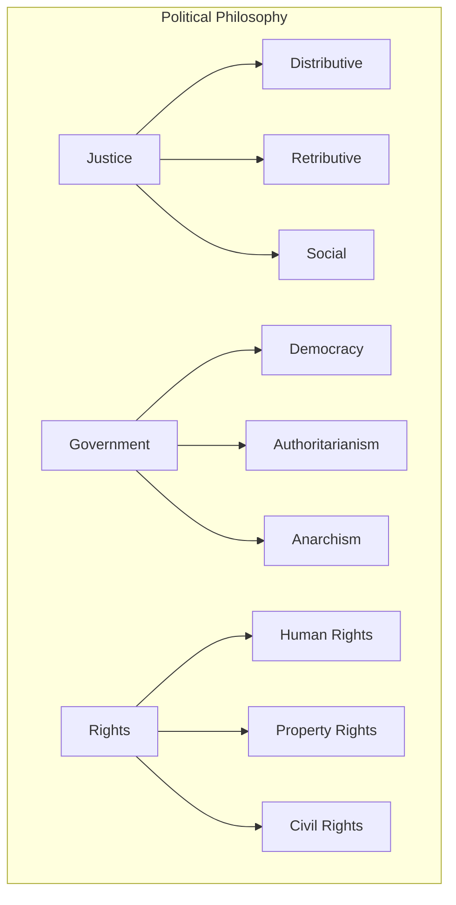

- [[justice]]

  - [[distributive_justice]]

  - [[retributive_justice]]

  - [[social_justice]]

- government

  - democracy

  - authoritarianism

  - [[anarchism]]

- rights

  - [[human_rights]]

  - [[property_rights]]

  - civil rights

#### Aesthetics

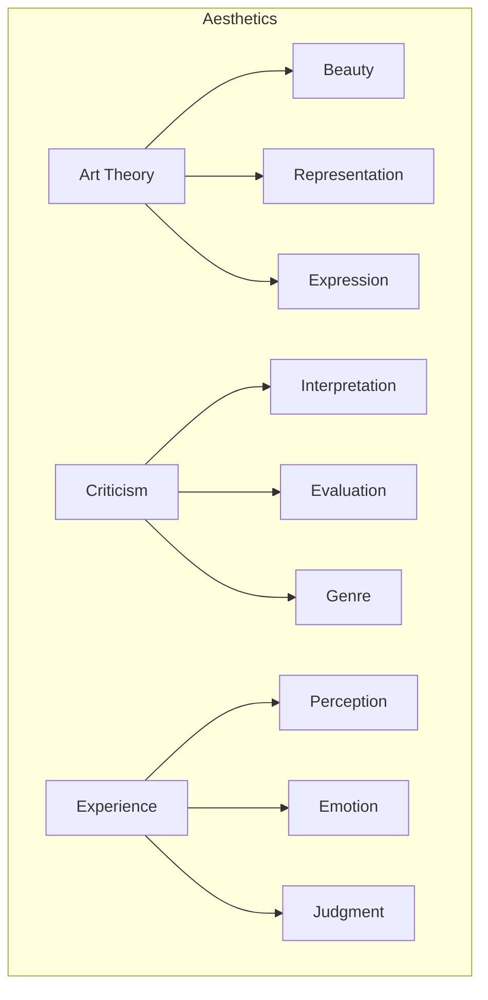

- art theory

  - beauty

  - representation

  - expression

- criticism

  - interpretation

  - evaluation

  - genre theory

- aesthetic experience

  - [[perception]]

  - [[emotion]]

  - judgment

### 3. Applied Philosophy

#### Philosophy of Science

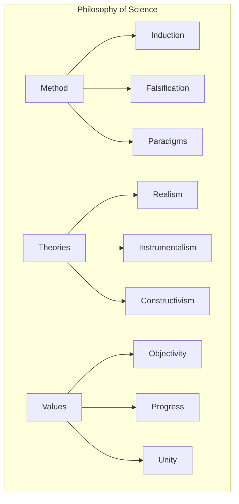

- [[scientific_method]]

  - [[induction]]

  - [[falsification]]

  - [[paradigm_shifts]]

- scientific theories

  - [[scientific_realism]]

  - [[instrumentalism]]

  - [[constructivism]]

- scientific values

  - [[objectivity]]

  - [[scientific_progress]]

  - [[unity_of_science]]

#### Philosophy of Mind

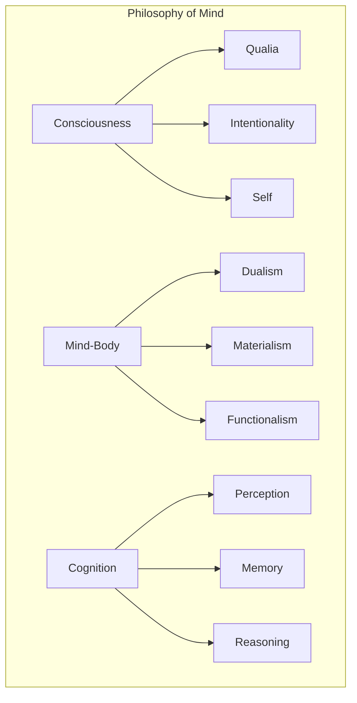

- [[consciousness]]

  - [[qualia]]

  - intentionality

  - [[self]]

- [[mind_body_problem]]

  - [[dualism]]

  - [[materialism]]

  - [[functionalism]]

- [[cognitive_processes]]

  - perception theory

  - memory theory

  - reasoning theory

#### Philosophy of Language

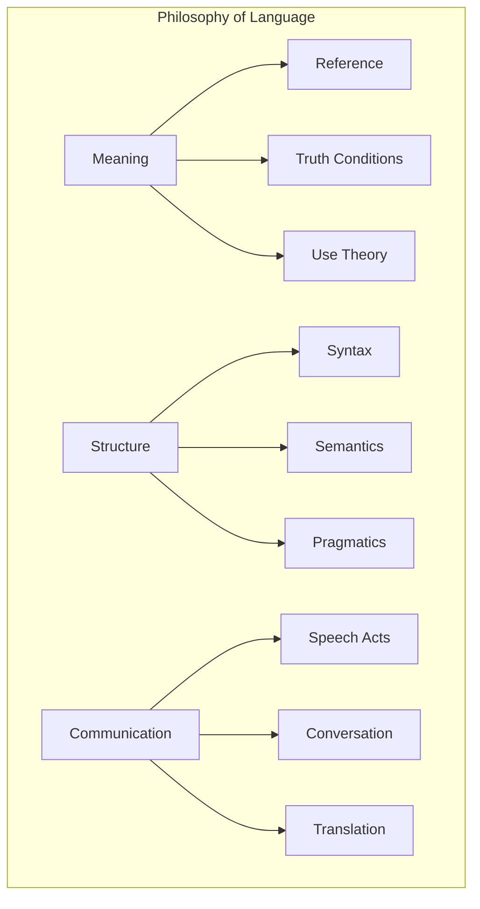

- meaning

  - reference

  - truth conditions

  - use theory

- linguistic structure

  - [[syntax]]

  - semantics

  - [[pragmatics]]

- [[communication]]

  - [[speech_acts]]

  - [[conversation_theory]]

  - translation theory

## Interdisciplinary Connections

### Philosophy and Science

- [[cognitive_science]]

- [[neurophilosophy]]

- [[philosophy_of_physics]]

- philosophy of biology

- [[philosophy_of_mathematics]]

### Philosophy and Society

- social philosophy

- [[philosophy_of_law]]

- [[philosophy_of_economics]]

- [[philosophy_of_education]]

### Philosophy and Technology

- [[philosophy_of_technology]]

- [[computer_ethics]]

- artificial intelligence ethics

- information ethics

## Historical Traditions

### Western Philosophy

- ancient philosophy

- medieval philosophy

- modern philosophy

- contemporary philosophy

### Eastern Philosophy

- [[buddhist_philosophy]]

- [[hindu_philosophy]]

- [[chinese_philosophy]]

- [[islamic_philosophy]]

### Contemporary Movements

- [[phenomenology]]

- [[existentialism]]

- [[critical_theory]]

- [[postmodernism]]

## Methodological Approaches

### Analysis

- [[conceptual_analysis]]

- logical analysis

- linguistic analysis

- phenomenological analysis

### Synthesis

- [[dialectical_method]]

- [[hermeneutics]]

- [[systems_theory]]

- [[complexity_theory]]

### Critical Methods

- [[deconstruction]]

- [[genealogy]]

- [[critical_theory]]

- feminist philosophy

## Advanced Philosophical Topics

### Philosophy of Action

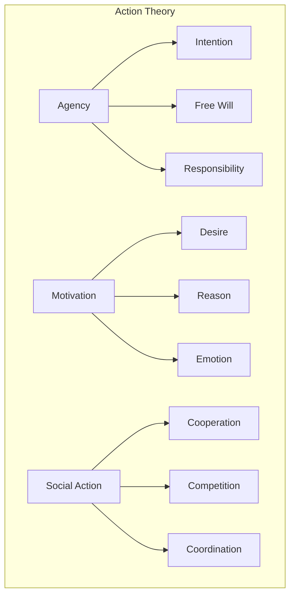

- [[action_theory]]

  - [[agency]]

  - intention

  - responsibility

- motivation theory

  - desire theory

  - [[practical_reason]]

  - emotion theory

- [[social_action]]

  - cooperation theory

  - [[game_theory]]

  - collective action

### Philosophy of Information

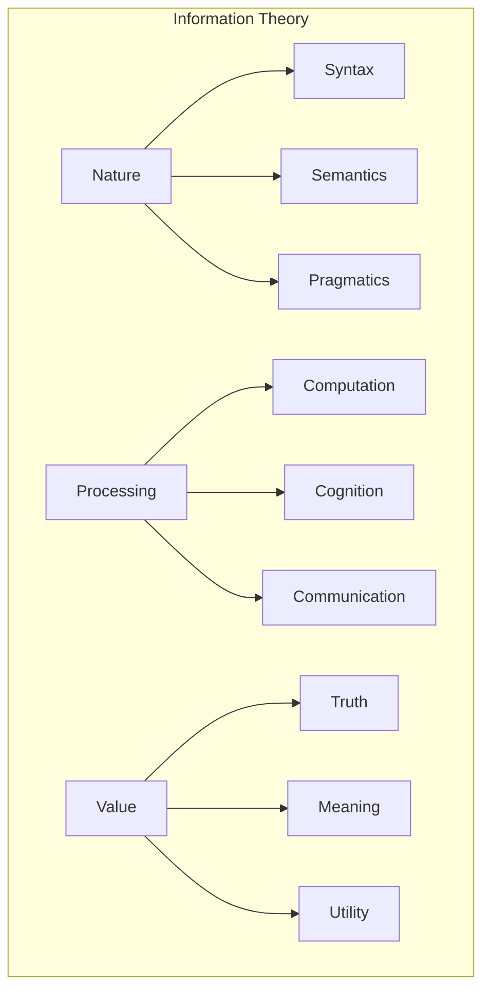

- information philosophy

  - information nature

  - [[information_dynamics]]

  - information ethics

- [[computational_theory]]

  - [[algorithmic_information]]

  - [[complexity_theory]]

  - [[quantum_information]]

- [[semantic_information]]

  - data semantics

  - information content

  - semantic value

### Environmental Philosophy

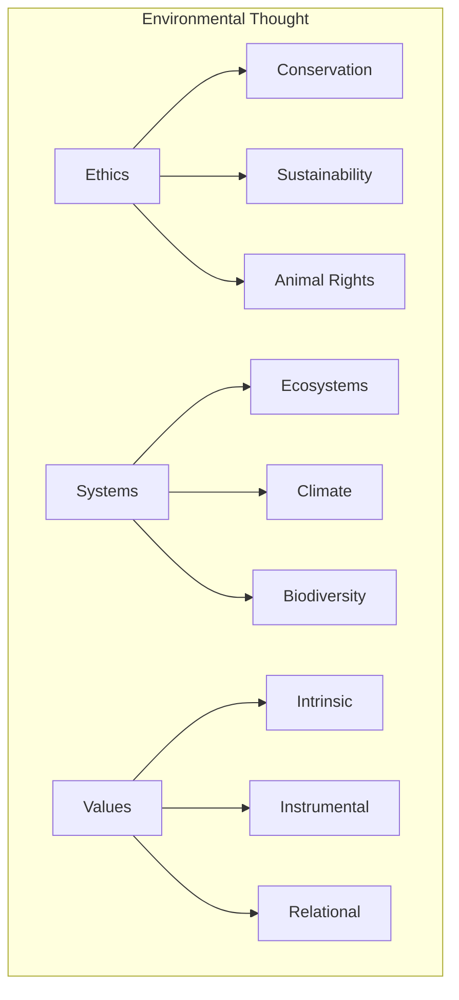

- [[environmental_ethics]]

  - [[environmental_ethics|deep ecology]]

  - [[ecofeminism]]

  - [[animal_ethics]]

- environmental systems

  - ecosystem theory

  - climate ethics

  - biodiversity value

- environmental values

  - nature value

  - future generations

  - [[environmental_justice]]

## Emerging Philosophical Fields

### Digital Philosophy

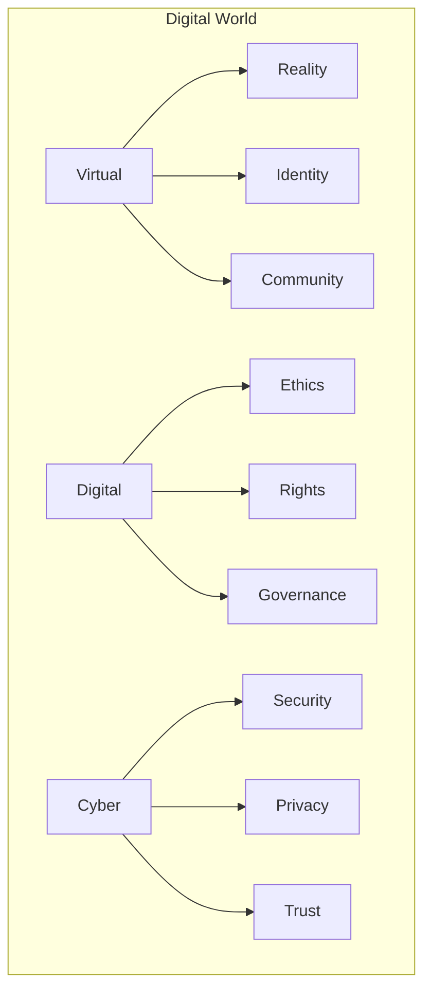

- digital metaphysics

  - [[virtual_reality]]

  - digital identity

  - cyberspace

- digital ethics

  - privacy theory

  - digital rights

  - algorithmic ethics

- digital society

  - virtual communities

  - [[digital_governance]]

  - cyber culture

### Cognitive Philosophy

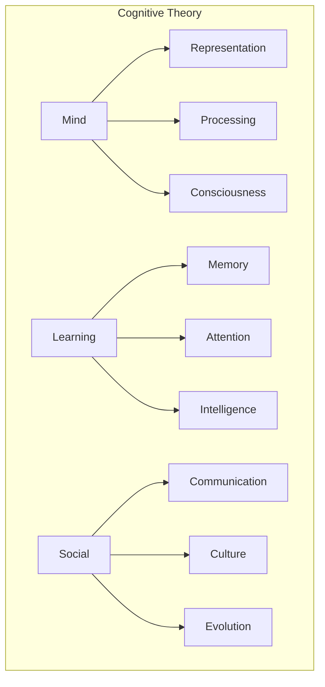

- cognitive theory

  - mental representation

  - [[information_processing]]

  - [[consciousness_studies]]

- [[learning_theory]]

  - [[memory_systems]]

  - [[attention_mechanisms]]

  - intelligence theory

- [[social_cognition]]

  - [[cultural_cognition]]

  - [[evolutionary_psychology]]

  - [[social_learning]]

### Quantum Philosophy

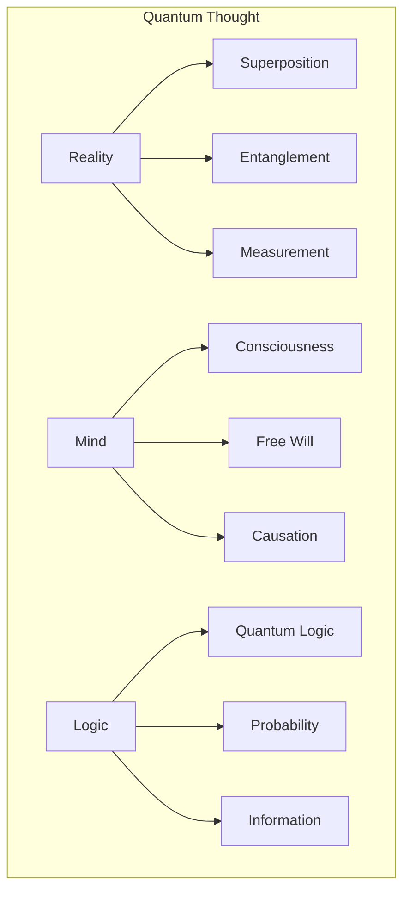

- quantum metaphysics

  - quantum reality

  - quantum causation

  - [[quantum_mind]]

- quantum epistemology

  - [[measurement_problem]]

  - [[quantum_logic|quantum probability]]

  - [[quantum_information]]

- [[quantum_logic]]

  - [[quantum_computation]]

  - [[philosophy_of_physics|quantum foundations]]

  - quantum semantics

## Philosophical Methods and Tools

### Formal Methods

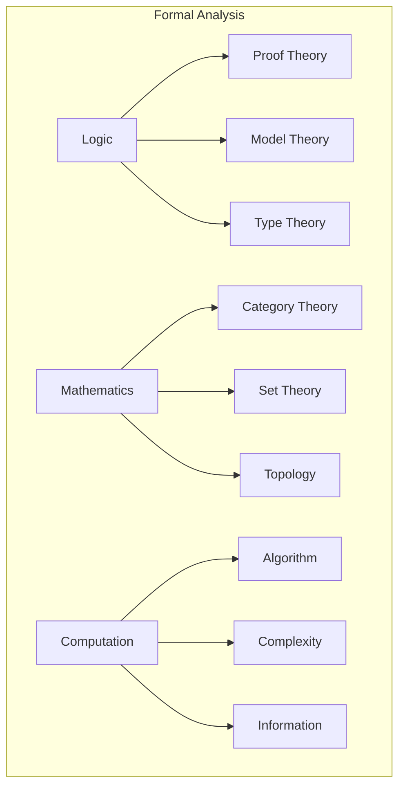

- formal methods

  - [[proof_theory]]

  - model theory

  - [[type_theory]]

- mathematical methods

  - [[category_theory]]

  - [[set_theory]]

  - [[topology]]

- [[computational_methods]]

  - algorithmic analysis

  - [[complexity_analysis]]

  - [[information_theory]]

### Experimental Philosophy

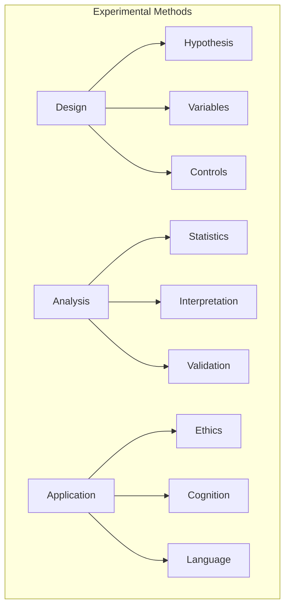

- [[experimental_philosophy]]

  - philosophical experiments

  - empirical methods

  - data analysis

- [[experimental_design]]

  - variable control

  - [[statistical_analysis]]

  - [[validation_methods]]

- experimental domains

  - moral psychology

  - [[cognitive_science]]

  - linguistic analysis

## Integrative Approaches

### Systems Philosophy

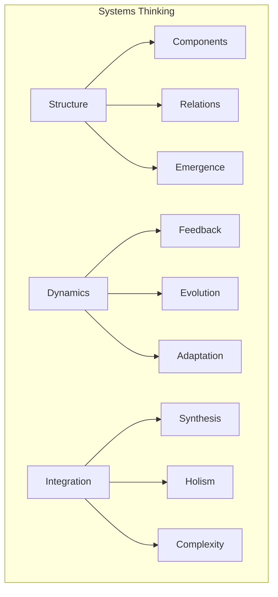

- systems philosophy

  - system structure

  - [[system_dynamics]]

  - [[emergence_theory]]

- [[cybernetics]]

  - [[feedback_systems]]

  - [[control_theory]]

  - [[information_flow]]

- complexity philosophy

  - [[complex_systems]]

  - [[self_organization]]

  - [[adaptive_systems]]

### Transdisciplinary Philosophy

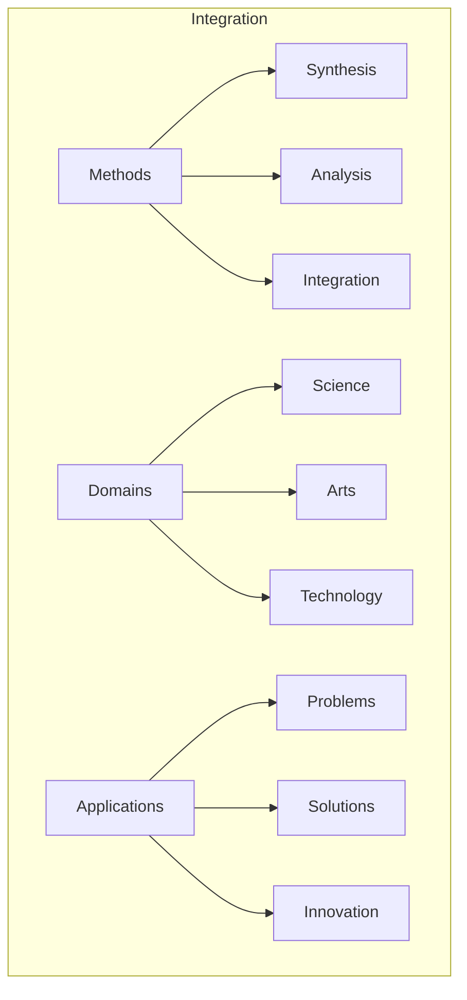

- transdisciplinary methods

  - integrative methods

  - boundary crossing

  - synthesis approaches

- knowledge integration

  - interdisciplinary synthesis

  - knowledge translation

  - [[boundary_objects]]

- practical applications

  - [[problem_solving]]

  - innovation theory

  - social transformation

## Cultural Philosophical Traditions

### Comparative Philosophy

```mermaid

graph TD

    subgraph Cross-Cultural 

        A[Methodologies] --> B[Comparison]

        A --> C[Translation]

        A --> D[Interpretation]

        E[Traditions] --> F[Western]

        E --> G[Eastern]

        E --> H[Indigenous]

        I[Dialogue] --> J[Engagement]

        I --> K[Integration]

        I --> L[Critique]

    end

```

- comparative methodology

  - cross cultural hermeneutics

  - philosophical translation

  - cultural interpretation

- tradition bridging

  - east west dialogue

  - african philosophy comparative

  - latin american thought

- global philosophy

  - world philosophies

  - intercultural philosophy

  - decolonial philosophy

### African Philosophy

```mermaid

graph TD

    subgraph African Thought

        A[Ubuntu] --> B[Community]

        A --> C[Personhood]

        A --> D[Ethics]

        E[Knowledge] --> F[Sage Philosophy]

        E --> G[Orality]

        E --> H[Liberation]

        I[Traditions] --> J[Ethnophilosophy]

        I --> K[Political]

        I --> L[Contemporary]

    end

```

- [[ubuntu_philosophy]]

  - [[african_communitarianism]]

  - personhood theory

  - [[ubuntu_philosophy|relational ethics]]

- african epistemology

  - sage philosophy

  - oral tradition

  - liberation epistemology

- african traditions

  - [[ethnophilosophy]]

  - political philosophy africa

  - contemporary african thought

### Latin American Philosophy

```mermaid

graph TD

    subgraph Latin American Thought

        A[Liberation] --> B[Theology]

        A --> C[Pedagogy]

        A --> D[Ethics]

        E[Identity] --> F[Mestizaje]

        E --> G[Coloniality]

        E --> H[Authenticity]

        I[Traditions] --> J[Indigenous]

        I --> K[Hispanic]

        I --> L[Contemporary]

    end

```

- [[liberation_philosophy]]

  - liberation theology

  - [[pedagogy_of_oppressed]]

  - [[ethics_of_liberation]]

- latin american identity

  - mestizaje

  - [[coloniality_of_power]]

  - philosophy of authenticity

- latin american traditions

  - indigenous philosophies

  - [[hispanic_scholasticism]]

  - positivism latin america

## Specialized Philosophical Fields

### Philosophy of Economics

```mermaid

graph TD

    subgraph Economic Philosophy

        A[Value] --> B[Labor]

        A --> C[Utility]

        A --> D[Exchange]

        E[Systems] --> F[Capitalism]

        E --> G[Socialism]

        E --> H[Markets]

        I[Methods] --> J[Models]

        I --> K[Prediction]

        I --> L[Explanation]

    end

```

- economic value

  - labor theory

  - [[utility_theory]]

  - [[exchange_value]]

- [[economic_systems]]

  - capitalism philosophy

  - socialist thought

  - market theory

- economic methodology

  - economic models

  - prediction theory

  - economic explanation

### Philosophy of History

```mermaid

graph TD

    subgraph Historical Thought

        A[Time] --> B[Linearity]

        A --> C[Cyclicality]

        A --> D[Progress]

        E[Causation] --> F[Determinism]

        E --> G[Contingency]

        E --> H[Agency]

        I[Interpretation] --> J[Hermeneutics]

        I --> K[Narrative]

        I --> L[Evidence]

    end

```

- [[philosophy_of_time]]

  - linear history

  - cyclical theory

  - progress theory

- historical causation

  - historical determinism

  - contingency theory

  - historical agency

- historical methodology

  - historical hermeneutics

  - narrative theory

  - historical evidence

### Philosophy of Religion

```mermaid

graph TD

    subgraph Religious Philosophy

        A[Existence] --> B[God]

        A --> C[Soul]

        A --> D[Afterlife]

        E[Knowledge] --> F[Revelation]

        E --> G[Faith]

        E --> H[Religious Experience]

        I[Diversity] --> J[Pluralism]

        I --> K[Exclusivism]

        I --> L[Inclusivism]

    end

```

- divine nature

  - arguments for god

  - arguments against god

  - divine attributes

- [[religious_epistemology]]

  - [[faith_and_reason|revelation]]

  - [[faith_and_reason]]

  - [[religious_experience]]

- religious diversity

  - [[religious_pluralism]]

  - [[religious_exclusivism]]

  - comparative theology

## Contemporary Philosophical Innovations

### Neuroethics

```mermaid

graph TD

    subgraph Neuroethics

        A[Science] --> B[Brain Intervention]

        A --> C[Enhancement]

        A --> D[Neuroimaging]

        E[Identity] --> F[Personality]

        E --> G[Memory]

        E --> H[Free Will]

        I[Society] --> J[Privacy]

        I --> K[Justice]

        I --> L[Policy]

    end

```

- [[neuroscientific_ethics]]

  - brain intervention

  - cognitive enhancement

  - neuroimaging ethics

- neuroidentity

  - personality modification

  - memory manipulation

  - neural free will

- neurosociety

  - neurotechnology privacy

  - neurojustice

  - [[neurolaw]]

### Philosophy of Embodiment

```mermaid

graph TD

    subgraph Embodiment

        A[Body] --> B[Phenomenology]

        A --> C[Corporeality]

        A --> D[Enactivism]

        E[Experience] --> F[Perception]

        E --> G[Emotion]

        E --> H[Action]

        I[Critiques] --> J[Gender]

        I --> K[Disability]

        I --> L[Technology]

    end

```

- [[embodied_cognition]]

  - body phenomenology

  - corporeal experience

  - [[enactivism]]

- embodied experience

  - embodied perception

  - somatic emotions

  - embodied action

- body politics

  - gendered embodiment

  - [[disability_theory]]

  - technological embodiment

### Speculative Realism

```mermaid

graph TD

    subgraph Speculation

        A[Ontology] --> B[Objects]

        A --> C[Relations]

        A --> D[Processes]

        E[Critique] --> F[Correlationism]

        E --> G[Anthropocentrism]

        E --> H[Idealism]

        I[Methods] --> J[Speculation]

        I --> K[Materialism]

        I --> L[Realism]

    end

```

- object oriented ontology

  - [[flat_ontology]]

  - withdrawn objects

  - [[hyperobjects]]

- ontological critique

  - anti correlationism

  - [[environmental_ethics|non-anthropocentrism]]

  - speculative materialism

- new realisms

  - [[transcendental_realism]]

  - speculative method

  - weird realism

## Cross-Disciplinary Philosophical Topics

### Philosophy of Mathematics

```mermaid

graph TD

    subgraph Mathematical Philosophy

        A[Foundations] --> B[Set Theory]

        A --> C[Logic]

        A --> D[Category Theory]

        E[Ontology] --> F[Platonism]

        E --> G[Formalism]

        E --> H[Constructivism]

        I[Practice] --> J[Proof]

        I --> K[Abstraction]

        I --> L[Application]

    end

```

- [[mathematical_foundations]]

  - set theoretical foundations

  - logical foundations

  - categorical foundations

- [[mathematical_ontology]]

  - [[mathematical_platonism]]

  - [[mathematical_formalism]]

  - [[mathematical_constructivism]]

- mathematical practice

  - [[proof_theory]]

  - mathematical abstraction

  - applied mathematics philosophy

### Philosophy of Art and Aesthetics

```mermaid

graph TD

    subgraph Aesthetics

        A[Experience] --> B[Beauty]

        A --> C[Sublime]

        A --> D[Taste]

        E[Creation] --> F[Expression]

        E --> G[Imagination]

        E --> H[Creativity]

        I[Critique] --> J[Interpretation]

        I --> K[Evaluation]

        I --> L[Standards]

    end

```

- aesthetic experience

  - theories of beauty

  - sublime theory

  - aesthetic taste

- artistic creation

  - artistic expression

  - [[imagination]]

  - creative process

- art critique

  - interpretation theory

  - [[aesthetic_value]]

  - aesthetic standards

### Philosophy of Education

```mermaid

graph TD

    subgraph Educational Philosophy

        A[Aims] --> B[Knowledge]

        A --> C[Virtue]

        A --> D[Growth]

        E[Methods] --> F[Pedagogy]

        E --> G[Dialogue]

        E --> H[Experience]

        I[Context] --> J[Society]

        I --> K[Politics]

        I --> L[Culture]

    end

```

- educational aims

  - knowledge acquisition

  - virtue development

  - personal growth

- pedagogical methods

  - [[critical_pedagogy]]

  - dialogical education

  - [[experiential_learning]]

- educational contexts

  - social reproduction

  - political education

  - [[cultural_transmission]]

## Meta-Philosophical Topics

### Philosophy of Philosophy

```mermaid

graph TD

    subgraph Meta-Philosophy

        A[Nature] --> B[Method]

        A --> C[Purpose]

        A --> D[Progress]

        E[Critique] --> F[Analytic]

        E --> G[Continental]

        E --> H[Cross-Cultural]

        I[Future] --> J[Integration]

        I --> K[Specialization]

        I --> L[Application]

    end

```

- philosophical methodology

  - metaphilosophical method

  - philosophical progress

  - philosophical purpose

- tradition critique

  - analytic critique

  - continental critique

  - cross cultural critique

- future philosophy

  - philosophical integration

  - philosophical specialization

  - applied philosophy

### Philosophical Anthropology

```mermaid

graph TD

    subgraph Human Nature

        A[Being] --> B[Identity]

        A --> C[Agency]

        A --> D[Finitude]

        E[Relation] --> F[Cultural]

        E --> G[Natural]

        E --> H[Technological]

        I[Development] --> J[Evolution]

        I --> K[History]

        I --> L[Potential]

    end

```

- [[human_nature]]

  - [[personal_identity]]

  - human agency

  - existential finitude

- human relations

  - cultural being

  - natural being

  - technological being

- human development

  - evolutionary anthropology

  - historical anthropology

  - future humanity

## Emerging Philosophical Topics

### Future Ethics

```mermaid

graph TD

    subgraph Future Ethics

        A[Generations] --> B[Responsibility]

        A --> C[Justice]

        A --> D[Rights]

        E[Existential] --> F[Risks]

        E --> G[Survival]

        E --> H[Flourishing]

        I[Technologies] --> J[Modification]

        I --> K[Enhancement]

        I --> L[Superintelligence]

    end

```

- future generations

  - intergenerational responsibility

  - [[intergenerational_justice]]

  - future rights

- [[existential_risk]]

  - existential ethics

  - human survival

  - collective flourishing

- emerging technologies ethics

  - genetic modification

  - human enhancement

  - [[artificial_superintelligence]]

### Philosophy of Complexity

```mermaid

graph TD

    subgraph Complexity

        A[Systems] --> B[Emergence]

        A --> C[Self-Organization]

        A --> D[Networks]

        E[Epistemology] --> F[Uncertainty]

        E --> G[Unpredictability]

        E --> H[Integration]

        I[Methods] --> J[Simulation]

        I --> K[Network Analysis]

        I --> L[Pattern Recognition]

    end

```

- [[complex_systems]]

  - [[emergence_theory]]

  - self organization principles

  - network ontology

- complexity epistemology

  - uncertainty principles

  - prediction limitations

  - knowledge integration

- complexity methods

  - [[computational_modeling]]

  - [[network_theory]]

  - [[pattern_recognition]]

## Asian Philosophical Traditions

### Chinese Philosophy

```mermaid

graph TD

    subgraph Chinese Thought

        A[Confucianism] --> B[Ritual]

        A --> C[Harmony]

        A --> D[Virtue]

        E[Daoism] --> F[Naturalness]

        E --> G[Non-action]

        E --> H[Balance]

        I[Buddhism] --> J[Emptiness]

        I --> K[Impermanence]

        I --> L[Compassion]

    end

```

- [[confucian_philosophy]]

  - [[ritual_li]]

  - harmony he

  - virtue de

  - [[confucian_philosophy|filial piety]]

- daoist thought

  - dao way

  - [[wuwei]]

  - [[ziran_naturalness]]

  - [[yin_yang_theory]]

- [[chinese_buddhism]]

  - [[chan_zen]]

  - [[huayan]]

  - [[tiantai]]

  - [[pure_land]]

### Indian Philosophy

```mermaid

graph TD

    subgraph Indian Thought

        A[Vedic] --> B[Rituals]

        A --> C[Cosmology]

        A --> D[Dharma]

        E[Orthodox] --> F[Nyaya]

        E --> G[Samkhya]

        E --> H[Vedanta]

        I[Heterodox] --> J[Buddhism]

        I --> K[Jainism]

        I --> L[Charvaka]

    end

```

- vedic philosophy

  - upanishadic thought

  - [[hindu_philosophy|Brahman and Atman]]

  - [[hindu_philosophy|karma theory]]

  - dharma ethics

- [[hindu_philosophy|orthodox darshanas]]

  - [[nyaya_logic]]

  - [[nyaya_logic|Vaisheshika ontology]]

  - [[samkhya_dualism]]

  - yoga discipline

  - mimamsa hermeneutics

  - [[vedanta_metaphysics]]

- heterodox schools

  - buddhist philosophy india

  - [[jain_philosophy]]

  - [[charvaka_materialism]]

  - [[ajivika_determinism]]

### Japanese Philosophy

```mermaid

graph TD

    subgraph Japanese Thought

        A[Buddhist] --> B[Zen]

        A --> C[Pure Land]

        A --> D[Nichiren]

        E[Native] --> F[Shinto]

        E --> G[Bushido]

        E --> H[Kokugaku]

        I[Modern] --> J[Kyoto School]

        I --> K[Modernism]

        I --> L[Aesthetics]

    end

```

- japanese buddhism

  - zen thought

  - pure land thought

  - nichiren buddhism

  - [[shingon_esoteric]]

- japanese traditions

  - [[shinto_philosophy]]

  - [[bushido_ethics]]

  - [[kokugaku_nativism]]

  - [[mono_no_aware]]

- modern japanese philosophy

  - [[kyoto_school]]

  - japanese phenomenology

  - philosophy of nothingness

  - comparative philosophy east west

## Indigenous Philosophical Traditions

### Native American Philosophy

```mermaid

graph TD

    subgraph Indigenous North American

        A[Cosmology] --> B[Sacred Space]

        A --> C[Time Cycles]

        A --> D[Origin Stories]

        E[Ethics] --> F[Relationality]

        E --> G[Reciprocity]

        E --> H[Harmony]

        I[Knowledge] --> J[Oral Tradition]

        I --> K[Experiential]

        I --> L[Ceremonial]

    end

```

- native american thought

  - indigenous cosmologies

  - [[traditional_ecological_knowledge|sacred ecology]]

  - cyclical time

  - creation stories

- indigenous ethics

  - relational ethics indigenous

  - reciprocity principle

  - harmony with nature

  - seven generations

- indigenous epistemology

  - oral knowledge systems

  - experiential knowledge

  - ceremonial knowledge

  - indigenous science

### Oceanic Philosophy

```mermaid

graph TD

    subgraph Pacific Thought

        A[Relationality] --> B[Kinship]

        A --> C[Sea Connections]

        A --> D[Ancestral Ties]

        E[Values] --> F[Community]

        E --> G[Reciprocity]

        E --> H[Land/Sea Rights]

        I[Knowledge] --> J[Navigation]

        I --> K[Ecological]

        I --> L[Genealogical]

    end

```

- oceanic philosophy

  - polynesian thought

  - melanesian philosophy

  - aboriginal philosophy

  - maori thought

- pacific relationality

  - va relationships

  - moana epistemology

  - ancestral knowledge

  - land sea connection

- indigenous pacific values

  - mana concept

  - tapu sacred

  - reciprocity systems

  - community ethics

## Process Philosophy

### Process Metaphysics

```mermaid

graph TD

    subgraph Process Thought

        A[Becoming] --> B[Flux]

        A --> C[Creativity]

        A --> D[Novelty]

        E[Relations] --> F[Internal]

        E --> G[Prehension]

        E --> H[Connection]

        I[Reality] --> J[Events]

        I --> K[Processes]

        I --> L[Occasions]

    end

```

- [[process_metaphysics]]

  - becoming ontology

  - flux theory

  - creativity principle

  - [[actual_occasions]]

- process relations

  - [[internal_relations]]

  - [[concrescence|prehension theory]]

  - causal efficacy

  - symbolic reference

- [[process_ontology]]

  - [[event_ontology]]

  - [[panexperientialism]]

  - [[concrescence]]

  - nexus theory

### Temporality Studies

```mermaid

graph TD

    subgraph Temporal Philosophy

        A[Time] --> B[Duration]

        A --> C[Succession]

        A --> D[Simultaneity]

        E[Experience] --> F[Memory]

        E --> G[Anticipation]

        E --> H[Present]

        I[Metaphysics] --> J[Becoming]

        I --> K[Eternalism]

        I --> L[Presentism]

    end

```

- philosophy of temporality

  - durational time

  - [[succession_theory]]

  - simultaneity concept

  - [[temporal_parts]]

- temporal experience

  - memory theory time

  - anticipation phenomenology

  - [[specious_present]]

  - [[time_consciousness]]

- temporal metaphysics

  - becoming theory

  - [[eternalism]]

  - [[presentism]]

  - [[growing_block_theory]]

## Phenomenological Traditions

### Existential Phenomenology

```mermaid

graph TD

    subgraph Existential Phenomenology

        A[Existence] --> B[Authenticity]

        A --> C[Facticity]

        A --> D[Transcendence]

        E[Being] --> F[Being-in-world]

        E --> G[Being-with]

        E --> H[Being-toward-death]

        I[Experience] --> J[Anxiety]

        I --> K[Freedom]

        I --> L[Nothingness]

    end

```

- [[existential_phenomenology]]

  - [[authenticity]]

  - [[facticity]]

  - transcendence

  - [[existentialism|existence precedes essence]]

- [[heideggerian_ontology]]

  - [[dasein]]

  - [[being_in_the_world]]

  - being with others

  - [[being_toward_death]]

- existential themes

  - [[being_toward_death|anxiety (angst)]]

  - [[being_and_nothingness|radical freedom]]

  - [[nothingness]]

  - [[absurdity]]

### Hermeneutic Phenomenology

```mermaid

graph TD

    subgraph Hermeneutic Phenomenology

        A[Interpretation] --> B[Pre-understanding]

        A --> C[Hermeneutic Circle]

        A --> D[Fusion of Horizons]

        E[Language] --> F[Dialogue]

        E --> G[Linguisticality]

        E --> H[Tradition]

        I[Truth] --> J[Disclosure]

        I --> K[Historicity]

        I --> L[Effective History]

    end

```

- [[hermeneutic_phenomenology]]

  - pre understanding

  - [[hermeneutic_circle]]

  - [[hermeneutic_phenomenology|fusion of horizons]]

  - [[effective_historical_consciousness]]

- linguistic hermeneutics

  - dialogical understanding

  - linguisticality of experience

  - tradition concept

  - language as medium

- hermeneutic truth

  - [[truth_as_disclosure]]

  - [[historicity_of_understanding]]

  - [[effective_history]]

  - application principle

### Feminist Phenomenology

```mermaid

graph TD

    subgraph Feminist Phenomenology

        A[Embodiment] --> B[Lived Body]

        A --> C[Sexual Difference]

        A --> D[Situated Knowledge]

        E[Experience] --> F[Oppression]

        E --> G[Agency]

        E --> H[Relationality]

        I[Method] --> J[Standpoint]

        I --> K[Intersectionality]

        I --> L[Critique]

    end

```

- [[feminist_phenomenology]]

  - [[lived_body]]

  - sexual difference

  - situated experience

  - embodied subjectivity

- feminist experience

  - oppression analysis

  - agency under oppression

  - [[relational_autonomy]]

  - gender experience

- feminist methodology

  - [[feminist_epistemology|standpoint theory]]

  - [[intersectionality]]

  - phenomenological critique

  - [[feminist_epistemology]]

## Critical Theories

### Postcolonial Philosophy

```mermaid

graph TD

    subgraph Postcolonial Thought

        A[Colonialism] --> B[Imperialism]

        A --> C[Hegemony]

        A --> D[Resistance]

        E[Identity] --> F[Hybridity]

        E --> G[Subaltern]

        E --> H[Authenticity]

        I[Knowledge] --> J[Epistemic Violence]

        I --> K[De-westernization]

        I --> L[Counter-discourse]

    end

```

- postcolonial theory

  - [[colonial_discourse]]

  - cultural imperialism

  - hegemony analysis

  - resistance theory

- postcolonial identity

  - [[cultural_hybridity]]

  - subaltern studies

  - authenticity critique

  - diaspora theory

- postcolonial epistemology

  - [[epistemic_violence]]

  - dewesternizing knowledge

  - counter discourse

  - border thinking

### Critical Race Philosophy

```mermaid

graph TD

    subgraph Critical Race Theory

        A[Race] --> B[Construction]

        A --> C[Intersectionality]

        A --> D[Racialization]

        E[Justice] --> F[Recognition]

        E --> G[Reparation]

        E --> H[Transformation]

        I[Method] --> J[Counterstory]

        I --> K[Critique]

        I --> L[Praxis]

    end

```

- [[critical_race_theory]]

  - race as construction

  - racial formation

  - racialization process

  - whiteness studies

- racial justice

  - [[recognition_theory]]

  - reparative justice

  - transformative justice

  - [[epistemic_justice]]

- critical race methodology

  - [[counterstorytelling]]

  - [[interest_convergence]]

  - racial realism

  - critical praxis

### Queer Philosophy

```mermaid

graph TD

    subgraph Queer Theory

        A[Sexuality] --> B[Heteronormativity]

        A --> C[Performativity]

        A --> D[Desire]

        E[Gender] --> F[Construction]

        E --> G[Fluidity]

        E --> H[Embodiment]

        I[Politics] --> J[Recognition]

        I --> K[Subversion]

        I --> L[Coalition]

    end

```

- queer theory

  - heteronormativity critique

  - performativity theory

  - desire theory

  - sexual subjectivity

- gender philosophy

  - gender construction

  - gender fluidity

  - embodiment gender

  - transgender studies

- queer politics

  - recognition politics

  - subversion strategies

  - coalition politics

  - queer futurity

## Contemporary Philosophical Methodologies

### Experimental Philosophy

```mermaid

graph TD

    subgraph X-Phi

        A[Methods] --> B[Surveys]

        A --> C[Experiments]

        A --> D[Statistical Analysis]

        E[Domains] --> F[Ethics]

        E --> G[Epistemology]

        E --> H[Mind]

        I[Critique] --> J[Intuitions]

        I --> K[Concepts]

        I --> L[Folk Psychology]

    end

```

- [[experimental_philosophy]]

  - survey methods

  - psychological experiments

  - statistical philosophy

  - empirical evidence

- x phi domains

  - experimental ethics

  - experimental epistemology

  - experimental metaphysics

  - folk intuitions

- philosophical psychology

  - intuition critique

  - concept empiricism

  - [[folk_psychology]]

  - conceptual analysis experimental

### Analytic-Continental Bridge

```mermaid

graph TD

    subgraph Bridge Philosophy

        A[Methods] --> B[Clarification]

        A --> C[Phenomenology]

        A --> D[Hermeneutics]

        E[Topics] --> F[Meaning]

        E --> G[Subjectivity]

        E --> H[Critical Theory]

        I[Figures] --> J[Late Wittgenstein]

        I --> K[Ricoeur]

        I --> L[Habermas]

    end

```

- analytic continental bridges

  - post analytic philosophy

  - [[phenomenology|naturalized phenomenology]]

  - hermeneutic analyticity

  - methodological pluralism

- bridging topics

  - meaning theory bridges

  - subjectivity analysis

  - critical theory analytics

  - [[consciousness_studies]]

- bridging figures

  - [[late_wittgenstein]]

  - [[hermeneutic_phenomenology|Ricoeur hermeneutics]]

  - habermas theory

  - davidson interpretation

### New Materialisms

```mermaid

graph TD

    subgraph New Materialism

        A[Matter] --> B[Agency]

        A --> C[Vitality]

        A --> D[Immanence]

        E[Critique] --> F[Anthropocentrism]

        E --> G[Dualism]

        E --> H[Representation]

        I[Method] --> J[Diffraction]

        I --> K[Entanglement]

        I --> L[Post-humanism]

    end

```

- new materialisms

  - material agency

  - vital materialism

  - immanent materialism

  - material feminism

- materialist critique

  - anthropocentrism critique

  - dualism critique

  - representationalism critique

  - matter discourse

- new materialist methods

  - [[diffractive_methodology]]

  - entanglement theory

  - posthumanist performativity

  - [[agential_realism]]

## Philosophy and Other Disciplines

### Philosophy of Cognitive Science

```mermaid

graph TD

    subgraph Cognitive Philosophy

        A[Mind] --> B[Representation]

        A --> C[Computation]

        A --> D[Embodiment]

        E[Methods] --> F[Naturalism]

        E --> G[Reduction]

        E --> H[Integration]

        I[Issues] --> J[Consciousness]

        I --> K[Intentionality]

        I --> L[Extended Mind]

    end

```

- philosophy cognitive science

  - mental representation

  - [[computational_theory_mind]]

  - [[embodied_cognition]]

  - [[enactivism]]

- cognitive methods

  - [[naturalized_epistemology]]

  - reductionism critique

  - disciplinary integration

  - [[levels_of_analysis]]

- cognitive issues

  - consciousness explanation

  - intentionality theories

  - [[extended_mind]]

  - [[predictive_processing]]

### Philosophy of Medicine

```mermaid

graph TD

    subgraph Medical Philosophy

        A[Health] --> B[Disease]

        A --> C[Normality]

        A --> D[Well-being]

        E[Practice] --> F[Evidence]

        E --> G[Care]

        E --> H[Decision-making]

        I[Ethics] --> J[Autonomy]

        I --> K[Justice]

        I --> L[Enhancement]

    end

```

- [[philosophy_of_medicine]]

  - health concepts

  - disease theory

  - normality abnormality

  - medical well being

- medical practice

  - [[evidence_based_medicine]]

  - care ethics medicine

  - clinical judgment

  - medical decision making

- [[biomedical_ethics]]

  - [[patient_autonomy]]

  - healthcare justice

  - human enhancement

  - medical paternalism

### Philosophy of Media

```mermaid

graph TD

    subgraph Media Philosophy

        A[Medium] --> B[Materiality]

        A --> C[Technology]

        A --> D[Mediation]

        E[Content] --> F[Representation]

        E --> G[Simulation]

        E --> H[Virtuality]

        I[Effects] --> J[Perception]

        I --> K[Society]

        I --> L[Subjectivity]

    end

```

- philosophy of media

  - media materiality

  - media technology

  - mediation theory

  - medium specificity

- media content

  - representation theory

  - [[simulation_theory]]

  - virtuality studies

  - [[hyperreality]]

- media effects

  - media perception

  - media society

  - technological subjectivity

  - [[attention_economy]]

## Frontier Philosophical Topics

### Biophilosophy

```mermaid

graph TD

    subgraph Biological Philosophy

        A[Life] --> B[Definition]

        A --> C[Organization]

        A --> D[Emergence]

        E[Evolution] --> F[Selection]

        E --> G[Function]

        E --> H[Teleology]

        I[Biosemiotics] --> J[Codes]

        I --> K[Interpretation]

        I --> L[Umwelt]

    end

```

- philosophy of biology

  - life definition

  - [[biological_organization]]

  - emergence in biology

  - organism concept

- evolutionary philosophy

  - selection theories

  - biological function

  - [[teleology_in_biology]]

  - evo devo philosophy

- [[biosemiotics]]

  - biological codes

  - interpretation in nature

  - [[umwelt_theory]]

  - organic meaning

### Philosophy of Artificial Intelligence

```mermaid

graph TD

    subgraph AI Philosophy

        A[Intelligence] --> B[Computation]

        A --> C[Embodiment]

        A --> D[Emergence]

        E[Ethics] --> F[Alignment]

        E --> G[Autonomy]

        E --> H[Rights]

        I[Futures] --> J[Singularity]

        I --> K[Coexistence]

        I --> L[Transformation]

    end

```

- [[philosophy_of_ai]]

  - computational intelligence

  - [[embodied_cognition|embodied AI]]

  - emergent intelligence

  - artificial minds

- [[ai_ethics]]

  - value alignment

  - ai autonomy

  - machine rights

  - [[responsibility_gaps]]

- ai futures

  - [[technological_singularity]]

  - human ai coexistence

  - [[intelligence_explosion]]

  - [[mind_uploading]]

### Interspecies Philosophy

```mermaid

graph TD

    subgraph Interspecies Thought

        A[Relations] --> B[Communication]

        A --> C[Ethics]

        A --> D[Cooperation]

        E[Minds] --> F[Animal Cognition]

        E --> G[Plant Intelligence]

        E --> H[Alien Minds]

        I[Politics] --> J[Multispecies]

        I --> K[Rights]

        I --> L[Justice]

    end

```

- interspecies philosophy

  - interspecies communication

  - interspecies ethics

  - multispecies cooperation

  - kinship beyond species

- nonhuman minds

  - [[animal_cognition]]

  - [[plant_intelligence]]

  - alien cognition

  - [[fungal_intelligence]]

- multispecies politics

  - multispecies communities

  - [[animal_rights]]

  - interspecies justice

  - ecological democracy

